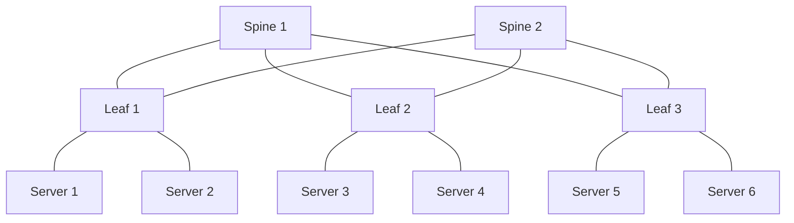
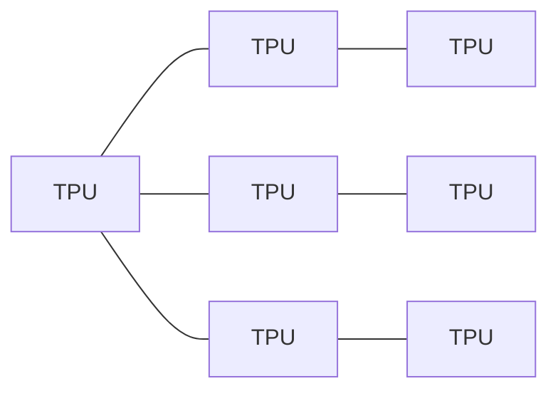
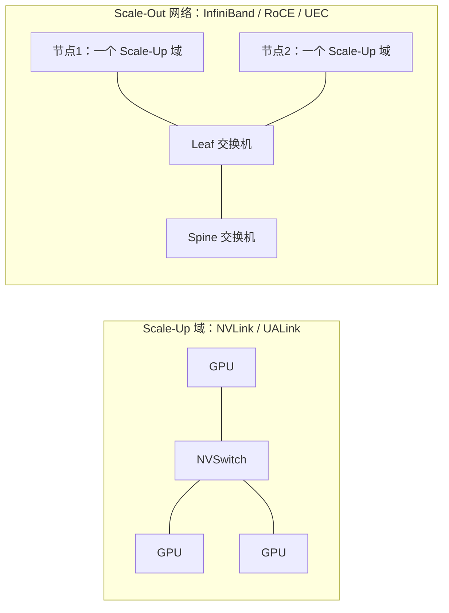

# 3. 架构设计：数据中心网络与 AI 集群拓扑

理解网络架构，能帮你回答：为什么 1000 张 GPU 训练一个大模型，网络不会变成瓶颈？为什么有的集群用 InfiniBand，有的用 RoCE，有的用 NVLink？

## 3.1 数据中心网络演进

早期数据中心网络是简单的三层架构：

```
核心层（Core）
   ↓
汇聚层（Aggregation）
   ↓
接入层（Access/ToR）
   ↓
服务器
```

这种架构扩展性差，汇聚层容易成为瓶颈。现代数据中心多用 **Spine-Leaf** 或 **Clos** 网络。

## 3.2 Spine-Leaf 架构



- **Leaf**：直接连接服务器的接入交换机（ToR）；
- **Spine**：连接所有 Leaf 的核心交换机；
- 任意两台服务器通信，最多经过 **3 跳**（src → leaf → spine → leaf → dst，实际取决于路径对称性）。

Spine-Leaf 的优点：

- 横向扩展：加 Leaf/Spine 就能扩展带宽；
- 低延迟、高带宽、无阻塞（如果上下行带宽对称）；
- 适合 east-west 流量（服务器之间通信）。

## 3.3 Clos 与 Fat-Tree

Clos 网络是一种多级无阻塞网络。Fat-Tree 是 Clos 网络的一种实现，每一层链路带宽逐级“变胖”，保证无阻塞。

现代 AI 集群常用 **fat-tree** 构建大规模网络。Meta 的 24k/129k GPU 集群、OpenAI 的 Azure AI 超级计算机都基于 fat-tree 或变体。

## 3.4 Google 的 3D-Torus + OCS

Google TPU 集群使用 **3D-torus** 拓扑：每个 TPU 直接连接到 6 个邻居，形成三维环面。



3D-torus 的优点：

- 高带宽、低延迟的近邻通信；
- 不需要大量交换机。

缺点：

- 任意两点之间路径不唯一，需要复杂路由；
- 故障时需要重配置。

Google 用 **OCS（Optical Circuit Switch，光路交换机）** 动态重配置 3D-torus 拓扑。当某条链路故障时，OCS 可以在毫秒级重新路由，保持高可用。Google 的 Apollo OCS（SIGCOMM 2022 论文披露）是最早的大规模部署案例；2025 年之后，OCS 也被更多厂商视为替代传统电交换机的节能方案（光交换功耗远低于电交换）。

## 3.5 Scale-Up 与 Scale-Out：先分清两种网络

讨论 AI 集群网络时，最先要分清两个概念：

- **Scale-Up（纵向扩展）网络**：把单机/单柜内的加速器连成一个“逻辑大 GPU”。典型是 NVIDIA NVLink + NVSwitch（一个域可达 72 卡），单 GPU 带宽达 TB/s 级、延迟亚微秒，承载张量并行（TP）等高带宽通信。
- **Scale-Out（横向扩展）网络**：把成千上万台服务器连成集群，跑 InfiniBand 或以太网/RoCE，承载数据并行（DP）的 all-reduce、流水线并行（PP）的激活值传输。



2025—2026 年的行业格局可以概括为：

| 层次 | 专有方案 | 开放 / 半开放方案 |
|---|---|---|
| Scale-Up | NVLink / NVSwitch（NVIDIA） | UALink（开放标准）、NVLink Fusion（半开放授权） |
| Scale-Out | InfiniBand（NVIDIA） | RoCE、UltraEthernet（UEC 超以太网） |

> 出处：[UALink Consortium 规范页](https://ualinkconsortium.org/specification)、[UltraEthernet Consortium 官网](https://ultraethernet.org/)。

## 3.6 InfiniBand vs RoCE vs TCP

AI 集群的节点间通信有三种常见网络技术：

| 技术 | 特点 | 适用场景 |
|---|---|---|
| TCP/IP over Ethernet | 通用、成熟、便宜 | 通用计算、推理服务、对象存储 |
| RoCE（RDMA over Converged Ethernet） | 在以太网上跑 RDMA，需要 PFC/ECN | 大规模分布式训练 |
| InfiniBand | 专用网络，高带宽、低延迟、内置 RDMA | 顶级超算、万卡训练集群 |
| NVLink/NVSwitch、UALink | GPU 域内互连，带宽最高 | 单机多卡、超节点（Scale-Up） |

**2025—2026 年的新变化**：InfiniBand 在 2023 年占据 AI 后端网络约 8 成份额，但 2025 年起新建 AI 集群中以太网/RoCE 的占比已反超（Dell'Oro、Broadcom 口径）。标志性事件是 Meta 在 SIGCOMM 2024 发表的论文《RDMA over Ethernet for Distributed Training at Meta Scale》：Meta 同时建设了两套各 24,576 GPU 的 400G 集群——一套 RoCEv2（Arista 7800，Tomahawk 4 芯片），一套 InfiniBand（NVIDIA Quantum-2）——并在 RoCE 集群上成功完成了 Llama 3.1 405B 的训练。结论是：**充分调优后，RoCE 与 InfiniBand 的训练性能相当**；但代价是 Meta 发现现成 DCQCN 在 400G 下行为不可预测，不得不自研与集合通信库联动的拥塞控制算法，并配合拓扑感知的 rank 分配、NIC PCIe 调优等大量工程。换言之，RoCE 的上限不输 IB，但把 RoCE 调到位本身就是一门手艺。

## 3.7 RDMA 基础架构

RDMA（Remote Direct Memory Access）让网卡直接读写远程内存，CPU 不参与数据搬运。


关键概念：

- **RNIC**：支持 RDMA 的网卡；
- **QP（Queue Pair）**：发送队列和接收队列；
- **CQ（Completion Queue）**：完成队列；
- **Verbs**：RDMA 编程接口；
- **MR（Memory Region）**：注册的内存区域。

RDMA 有两种传输模式：

- **RC（Reliable Connection）**：类似 TCP，可靠、按序；
- **UD（Unreliable Datagram）**：类似 UDP，低延迟但不保证可靠。

## 3.8 UltraEthernet（UEC）：以太网的“AI 化”改造

**UltraEthernet Consortium（超以太网联盟，UEC）** 2024 年 7 月成立，目标是改造以太网技术栈，使其在 AI/HPC 规模下匹敌 InfiniBand。成员上百家，除 AMD、Broadcom、Cisco、Intel、Meta、Microsoft、Oracle、Arista、HPE 等指导成员外，NVIDIA、Google Cloud、阿里云、腾讯等也在成员名单中——连 InfiniBand 的东家都加入了，本身就说明业界对“开放以太网做 AI 后端网络”的共识。截至 2026 年 10 月，UEC 官网已提供 **1.1 版规范**下载。

UEC 对传统以太网/RoCE 的改造思路，针对的正是 Meta 实践中暴露的痛点：

| RoCEv2 的痛点 | UEC 的改进方向 |
|---|---|
| 依赖 PFC 做无损，配置不当会死锁、Head-of-Line 阻塞 | 传输层支持**乱序交付**与**增强重传**，允许在有损网络上运行 |
| 单流绑定单路径，HASH 极化导致链路利用不均 | **包喷洒（Packet Spraying）**：同一条流的多路径分发 |
| DCQCN 在高带宽下收敛慢、不公平 | 全新的拥塞控制框架与更精细的遥测上报 |
| 缺乏标准化管理面 | 统一的管理、遥测与合规测试规范 |

> 出处：[UltraEthernet Consortium](https://ultraethernet.org/)。UEC 的意义在于把 Meta 这种“单厂手艺”变成多厂商可互操作的开放标准。

## 3.9 Scale-Up 互连：NVLink、NVLink Fusion、UALink 与 CXL

Scale-Up 层的竞争 2025—2026 年同样激烈，核心问题是：**除了 NVIDIA，别的厂商能不能造出“NVL72 那样的超节点？”**

### NVLink 演进

| 代际 | 搭载平台 | 单 GPU 双向带宽 | 域规模 |
|---|---|---|---|
| NVLink 3 | A100 | 600 GB/s | 8—16 卡 |
| NVLink 4 | H100/H200 | 900 GB/s | 8—18 卡（NVSwitch） |
| NVLink 5 | B200/GB300 | 1.8 TB/s | 72 卡（NVL72 机柜） |
| NVLink 6 | Rubin（2026） | 3.6 TB/s | 更大规模机柜级域 |

2025 年 5 月 Computex 上，NVIDIA 宣布 **NVLink Fusion**：把 NVLink IP 授权给 MediaTek、Marvell、Alchip、Astera Labs、Synopsys、Cadence 等合作伙伴，让第三方 CPU/ASIC 也能接入 NVLink 生态——一种“半开放”策略：既扩大生态，又不向直接竞争对手（Broadcom、AMD）开放。

### UALink：完全开放的 Scale-Up 标准

**UALink Consortium** 是 AMD、Intel、Google、Meta、Microsoft、AWS、阿里等 100 余家公司推动的开放标准，对标 NVLink。规范进展（出处：[UALink 规范页](https://ualinkconsortium.org/specification)）：

- **UALink 200G 1.0**（2025 年发布）：200G per lane，单 Pod 最多 **1,024 个加速器**；
- **Common 2.0**（2026 年 4 月）：引入**网络内计算（In-Network Compute）**，交换机直接参与集合通信；
- **200G DL/PL 2.0、128G DL/PL 1.0**：数据链路层与物理层规范；
- **Manageability 1.0**：基于 gNMI、YANG、SAI、Redfish 的管理面；
- **Chiplet 1.01**：与 UCIe 3.0 对齐的芯粒集成规范。

产业动向：AMD 的 MI400 / Helios 机柜架构即基于 UALink；2025 年 3 月 UALink 与中国 ODCC 联盟签署 MoU，2026 年 ODCC 已在国内启动 UALink 测试验证服务。分析机构（如 BofA）普遍认为 UALink 相比同期 NVLink 落后 1—2 代，但有望在 2027 年前后给非 NVIDIA 生态一个可用的超节点选项。

### CXL：CPU—内存侧的互连

**CXL 4.0** 于 2025 年 11 月在 SC25 发布（出处：[CXL Consortium](https://www.cxlconsortium.org/)）：基于 PCIe 7.0（128 GT/s）、支持 Bundled Ports 把多个物理端口聚合成单条逻辑链路（总带宽超 1.5 TB/s）、端口路由（PBR）与交换 fabric 支持跨机柜的**内存池化**。CXL 管的是 CPU—内存一致性与池化，和 NVLink/UALink（加速器互连）、UEC/InfiniBand（集群网络）三者互补，分别覆盖“内存墙”“超节点”“集群”三个层次。

## 3.10 带宽代际：400G → 800G → 1.6T

| 标准/产品 | 状态（截至 2026-10） |
|---|---|
| IEEE 802.3df-2024 | 2024 年 2 月批准，定义 400G/800G 以太网 |
| 800G 光模块 | 已在头部 AI 集群规模部署（DR8 / 2×FR4） |
| IEEE 802.3dj | 进行中，基于 200G/lane 电口与光口推进 1.6T 标准化 |
| 1.6T 光模块 | 2026 年起进入批量导入期 |
| 51.2T / 102.4T 交换芯片 | Broadcom Tomahawk 5/6 等已量产，单柜 800G×128 端口成为高端训练网络标配 |
| 硅光 / CPO | NVIDIA 2025 年发布 Spectrum-X Photonics / Quantum-X Photonics 硅光交换机，共封装光学（CPO）与线性驱动光模块（LPO/LRO）成为降低功耗的主要方向 |

## 3.11 Kubernetes 网络模型

Kubernetes 对网络有以下几个基本要求：

1. Pod 有独立 IP；
2. 所有 Pod 可以直接互相通信，不需要 NAT；
3. 节点上的 agent（kubelet）可以和所有 Pod 通信。

### CNI（Container Network Interface）

CNI 是 Kubernetes 调用容器网络插件的标准接口。常见 CNI 插件：

| CNI | 特点 |
|---|---|
| bridge/host-local | 简单桥接，适合测试 |
| Calico | BGP 路由，性能好，网络安全强 |
| Cilium | 基于 eBPF，高性能可观测，支持 Service Mesh |
| Flannel | 简单 overlay，UDP/VXLAN |
| Weave | 自动发现，适合小集群 |
| Multus | 多网卡，适合 RDMA/SR-IOV |

### Service 与 kube-proxy

Kubernetes Service 为一组 Pod 提供稳定的虚拟 IP。kube-proxy 负责把 Service IP 的流量转发到后端 Pod：

- **userspace**：早期方式，已淘汰；
- **iptables**：默认方式，规则多时有性能问题；
- **ipvs**：基于内核 IPVS，性能更好，适合大规模集群；
- **eBPF**（Cilium）：绕过 kube-proxy，直接 eBPF 转发。

## 3.12 负载均衡架构

### L4 负载均衡

工作在传输层，根据 IP + 端口分发流量。不关心 HTTP 内容。

常见实现：LVS、Nginx stream、Envoy TCP proxy、云厂商 SLB。

### L7 负载均衡

工作在应用层，可以根据 URL、Header、Cookie 分发流量。

常见实现：Nginx、HAProxy、Envoy、Ingress Controller、Gateway API。

### DNS 负载均衡

通过 DNS 返回不同 IP 实现流量分发。优点是简单，缺点是 TTL 缓存导致切换慢。

AI 推理服务常用多层负载均衡：

```
DNS / GeoDNS
  ↓
L4 LB（Anycast / ECMP）
  ↓
L7 Gateway（Envoy / Istio）
  ↓
K8s Service / Pod
```

## 3.13 本节小结

| 架构 | 特点 |
|---|---|
| Spine-Leaf | 现代数据中心主流，低延迟、易扩展 |
| Fat-Tree/Clos | 大规模无阻塞网络，适合 AI 集群 |
| 3D-Torus + OCS | Google TPU 集群，高近邻带宽、动态重配置 |
| InfiniBand | 专用 RDMA 网络，顶级训练集群，但生态封闭 |
| RoCE | 以太网上的 RDMA，调优到位后性能可对标 IB（Meta 24k GPU 实测） |
| UltraEthernet | 开放联盟改造以太网：包喷洒、乱序交付、新拥塞控制，2026-10 已发布 1.1 规范 |
| NVLink/NVSwitch | 专有 Scale-Up 互连，NVLink Fusion 半开放授权 |
| UALink | 开放 Scale-Up 标准，单 Pod 1,024 加速器，2026 年起进入部署期 |
| CXL 4.0 | CPU—内存一致性互连，跨机柜内存池化（2025-11 发布） |
| 800G/1.6T | 802.3df 已标准化 800G，802.3dj 推进 1.6T |
| TCP/IP | 通用，成本低，但延迟和 CPU 开销高 |
| CNI | K8s 容器网络插件标准 |
| kube-proxy | Service IP 到 Pod IP 的转发 |
| L4/L7 LB | 传输层/应用层流量分发 |

下一节，我们跟踪一个训练/推理数据包的完整旅程。
