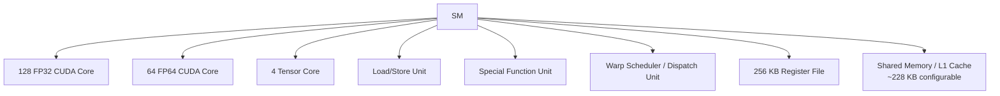
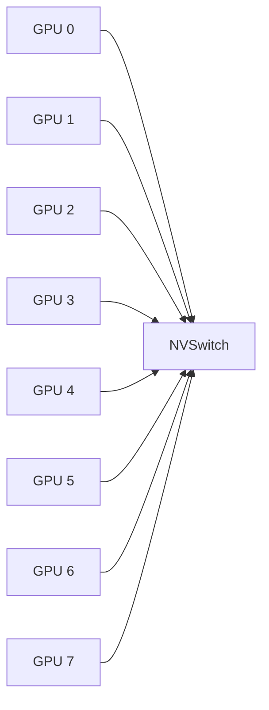

# 3. 架构设计：从 Fermi 到 Rubin

理解 GPU 架构演进，不是为了背年份，而是为了明白：**为什么 H100 比 A100 更适合大模型？为什么 B200 强调 FP4 和 Transformer Engine？为什么 Rubin 把 288 GB HBM4 当成最大卖点？为什么 NVLink 比 PCIe 重要得多？**

## 3.1 架构演进时间线

| 架构 | 年份 | 代表卡 | 关键创新 |
|---|---|---|---|
| Fermi | 2010 | GTX 480 | 第一代完整 CUDA Core 架构，引入 L1/L2 缓存 |
| Kepler | 2012 | GTX 680 / K20 | GK110，更多 SM，动态并行 |
| Maxwell | 2014 | GTX 980 / M40 | 能效提升，统一内存雏形 |
| Pascal | 2016 | P100 / GTX 1080 | NVLink 1，FP16，第一代针对 HPC/AI 的设计 |
| Volta | 2017 | V100 | 第一代 **Tensor Core**，NVLink 2 |
| Turing | 2018 | RTX 2080 / T4 | RT Core、第二代 Tensor Core、INT8 |
| Ampere | 2020 | A100 / RTX 3090 | 第三代 Tensor Core、TF32、稀疏加速、MIG |
| Hopper | 2022 | H100 / H200 | 第四代 Tensor Core、FP8、Transformer Engine、NVLink 4 |
| Blackwell | 2024-2025 | B200 / GB200 | 第五代 Tensor Core、FP4、第二代 Transformer Engine、NVLink 5、解耦架构 |
| Rubin | 2026 | Vera Rubin / NVL72 | HBM4（288 GB / 22 TB/s）、NVLink 6、第三代 Transformer Engine、NVFP4、双 die NV-HBI 封装 |

每一代架构的更新，几乎都围绕三个方向：

1. **算力**：更多 CUDA Core、更强 Tensor Core、更低精度支持；
2. **显存**：更大容量、更高带宽（HBM2e → HBM3 → HBM3e）；
3. **互联**：更快 NVLink、更多 GPU 直连。

## 3.2 SM 内部结构：一个“车间”里有什么

以 Hopper H100 的 SM 为例，简化后包含：



### CUDA Core

CUDA Core 是通用浮点/整数计算单元，负责标量和向量运算。它就像车间里的“万能钳工”。

### Tensor Core

Tensor Core 是专门做 **矩阵乘累加（Matrix Multiply Accumulate, MMA）** 的专用单元。

- Volta V100：每个 Tensor Core 每个周期可做 $4 \times 4 \times 4$ FP16 MMA。
- Ampere A100：支持 TF32、BF16、FP16、INT8。
- Hopper H100：支持 FP8，引入 **Transformer Engine**（动态在 FP16/BF16 和 FP8 之间切换精度）。
- Blackwell B200：支持 FP4，第二代 Transformer Engine，第五代 Tensor Core。
- Rubin：第三代 Transformer Engine，引入 **NVFP4**（带微缩放的 4-bit 浮点），并对 Attention 做结构化 2:4 稀疏化加速。

Tensor Core 是 AI 加速的“秘密武器”。它让矩阵乘法的有效吞吐，比单纯用 CUDA Core 高出数倍到数十倍。

## 3.3 Tensor Core 为什么快

传统 CUDA Core 做矩阵乘，是把大矩阵拆成很多标量乘加。Tensor Core 则直接一次吃掉一个小矩阵块：

```text
C = A × B + C
```

其中 A、B、C 可以是 $4 \times 4$、$8 \times 8$、$16 \times 8$ 等小矩阵，具体尺寸随架构和精度变化。

这意味着：

- **同样晶体管预算下，专用电路比通用电路效率高得多**；
- **数据在寄存器里复用，减少了从 shared memory / global memory 搬运**。

### 精度演进

| 精度 | 位宽 | 典型用途 |
|---|---|---|
| FP32 | 32 bit | 训练默认，数值稳定 |
| TF32 | 19 bit | Ampere 起训练加速，接近 FP32 稳定 |
| BF16 | 16 bit | 训练与推理，动态范围接近 FP32 |
| FP16 | 16 bit | 推理、混合精度训练 |
| FP8 | 8 bit | H100/H200 推理、部分训练（DeepSeek-V3） |
| MXFP8 / NVFP4 | 8 / 4 bit（微缩放） | Blackwell 起：权重/KV Cache 压缩；Rubin 推理主力 |
| FP4 | 4 bit | B200 推理量化 |

精度越低，同样功耗和面积下算力越高，但数值稳定性越差。Transformer Engine 的核心价值就是：**在需要稳定的地方用 FP16/BF16，在允许损失的地方自动切到 FP8/FP4。** Blackwell 引入的 **微缩放（Micro-tensor Scaling）** 把缩放因子细化到小矩阵块，让 NVFP4 这类超低精度也能保持可用精度，这正是 Rubin 把 4-bit 推向推理主力的前提。

## 3.4 HBM：GPU 的“主粮仓”

GPU 显存主要用 **HBM（High Bandwidth Memory）**，因为它能提供极高的带宽。

| GPU | 显存类型 | 容量 | 带宽 |
|---|---|---|---|
| A100 SXM | HBM2e | 80 GB | 2,039 GB/s |
| H100 SXM | HBM3 | 80 GB | 3,350 GB/s |
| H200 SXM | HBM3e | 141 GB | 4.8 TB/s |
| B200 | HBM3e | 180-192 GB | ~8 TB/s |
| Vera Rubin | HBM4 | 288 GB | 22 TB/s |

HBM 通过把多层 DRAM 芯片堆叠起来，用硅通孔（TSV）连接，实现高带宽、低功耗，但成本极高。进入 HBM4 时代后，竞争焦点进一步转向供给：美光已于 2026 年 3 月（GTC 2026 期间）官宣 HBM4 36GB 12 层高带宽内存进入大规模量产，单颗带宽超 2.8 TB/s、引脚速率超 11 Gbps，专为 Vera Rubin 设计；三星、SK 海力士也已通过 NVIDIA 认证——三供格局成形。SK 海力士拿下了 2026 年约 54% 的 HBM4 份额且产能售罄——**显存供给已经开始像先进制程一样成为战略资源**（来源：[Micron HBM4 量产官方公告](https://investors.micron.com/news/press-release/2026/Micron-in-High-Volume-Production-of-HBM4-Designed-for-NVIDIA-Vera-Rubin-PCIe-Gen6-SSD-and-SOCAMM2-03-16-2026/default.aspx)、[SemiAnalysis GTC 2026 纪要](https://newsletter.semianalysis.com/p/nvidia-the-inference-kingdom-expands)）。

## 3.5 NVLink 与 NVSwitch：GPU 之间的高速公路

单卡 GPU 不够用，需要多卡通信。PCIe 带宽太低（PCIe 4.0 x16 约 32 GB/s，PCIe 5.0 x16 约 64 GB/s），成为瓶颈。

**NVLink** 是 NVIDIA 的芯片间高速互联。下表为每 GPU 聚合带宽（双向）：

| 代际 | 每 GPU 带宽 | 典型配置 |
|---|---|---|
| NVLink 2 | 300 GB/s | V100 |
| NVLink 3 | 600 GB/s | A100 |
| NVLink 4 | 900 GB/s | H100 |
| NVLink 5 | 1.8 TB/s | B200/GB200 |
| NVLink 6 | 3.6 TB/s | Vera Rubin（NVL72 整柜聚合 260 TB/s） |

**NVSwitch** 是芯片级交换机，让一台机器里的所有 GPU 以全互联方式通信。DGX H100 有 8 块 GPU，通过 NVSwitch 实现任意两块 GPU 之间 900 GB/s 双向带宽。



在多机训练中，NVLink + NVSwitch 构成了 node 内部的高速网络；跨机则通常用 InfiniBand 或 RoCE。

## 3.6 2026 年的主流 GPU 对比

| GPU | 架构 | 低精度算力 | 显存 | 显存带宽 | 典型定位 |
|---|---|---|---|---|---|
| H100 SXM | Hopper | FP8 稠密 1,979 TFLOPS | 80 GB | 3.35 TB/s | 训练主力（存量最大） |
| H200 SXM | Hopper | FP8 稠密 1,979 TFLOPS | 141 GB | 4.8 TB/s | 长上下文推理 |
| B200 | Blackwell | FP8 稠密 ~4.5 PFLOPS，FP4 ~9 PFLOPS | 180-192 GB | ~8 TB/s | 训练/推理主力新装机 |
| GB200 NVL72 | Blackwell | 72 GPU 全互联，FP4 推理 ~1.4 EFLOPS | ~13.4 TB 总显存 | NVLink 5 全互联 | 万亿参数 MoE 训练/推理 |
| Vera Rubin | Rubin | NVFP4 推理 50 PFLOPS | 288 GB HBM4 | 22 TB/s | 2026 H2 起量，下一代主力 |
| Vera Rubin NVL72 | Rubin | 72 GPU 全互联 | ~20 TB 总显存 | NVLink 6 全互联 | 单机柜 Agentic AI 推理 |

## 3.7 Blackwell 的革新

2024 年 GTC 发布的 Blackwell 架构，不只是“H100 的升级版”。它有几个面向未来大模型的关键设计：

### 第二代 Transformer Engine

- 在 FP4 精度下提供更高吞吐；
- 引入 **微张量缩放（Micro-tensor Scaling）**，让小粒度矩阵块也能稳定低精度训练。

### 第五代 Tensor Core

- 支持更大的 MMA 操作尺寸；
- 原生支持 FP4、FP6、FP8、FP16、BF16、TF32 等精度。

### NVLink 5 与解耦设计

GB200 把两颗 B200 GPU 和一颗 Grace CPU 封装在一起（GB200 Grace Blackwell Superchip），并通过 NVLink 5 实现 CPU-GPU、GPU-GPU 之间的高速统一内存访问。

GB200 NVL72 机柜把 72 颗 GPU 用 NVLink 全互联，形成“一台超大 GPU”，特别适合万亿参数 MoE 模型。

## 3.8 下一站 Rubin：2026 年的架构格局

2026 年 GTC（3 月，圣何塞）上，NVIDIA 正式公开了 **Vera Rubin 平台**：Rubin GPU + Vera CPU + NVLink 6 + Kyber 机柜的组合（来源：[NVIDIA Rubin 架构博客](https://developer.nvidia.com/blog/inside-nvidia-rubin-gpu-architecture-powering-the-era-of-agentic-ai/)、[SemiAnalysis GTC 2026 纪要](https://newsletter.semianalysis.com/p/nvidia-the-inference-kingdom-expands)）。它的设计重点已经不是单纯堆峰值算力，而是**在机柜级系统里持续喂饱推理吞吐**：

### 双 die NV-HBI 封装

Rubin 把两颗“光罩极限”计算 die 用 NVIDIA 高带宽接口（NV-HBI）封装成一颗 GPU：3,360 亿晶体管、224 个 SM、896 个 Tensor Core，对外表现为单一 GPU。Blackwell 首创的双 die 思路在 Rubin 上成为标准形态。

### HBM4 与 NVLink 6：带宽再次翻倍

- 288 GB HBM4，峰值 22 TB/s，约为 Blackwell 的 2.8 倍；
- NVLink 6 每 GPU 3.6 TB/s，NVL72 整柜聚合 260 TB/s；
- NVLink-C2C 提供 1.8 TB/s 的 CPU-GPU 一致性互联（配 Vera CPU）。

推理（尤其是 Decode 阶段）是纯粹的带宽瓶颈，Rubin 用 22 TB/s 直接回应这个问题。

### 第三代 Transformer Engine

- NVFP4 推理算力 50 PFLOPS；
- 矩阵 B 支持 3-bit 查表格式：权重存储和搬运更少，精度接近 MXFP8；
- Attention 引入结构化 2:4 稀疏与压缩 MMA，Softmax 的 FP32 吞吐翻倍。

### 面向机柜级的细粒度同步

- **Tile-level triggering**：依赖 kernel 之间以更细的 tile 粒度触发，而不是整 kernel 级别的粗同步；
- **Counted writes**：通过 NVLink 的计数写替代传统的 barrier + 原子标志，降低 GPU 间同步开销；
- 机柜级供电平滑：平均功耗约降 10%，50 ms 峰值功耗降约 20%——在 600 kW 级机柜里，供电波动本身就是设计约束。

### 产品节奏与前瞻

- 2026 年 GTC 时，首个 Vera Rubin 机柜已在 Microsoft Azure 运行，2026 年下半年量产出货；
- **Rubin Ultra / NVL576（Kyber 机柜，2027）**：四 die 封装、单封装约 1 TB HBM4e、约 32 TB/s 带宽、NVFP4 约 100 PFLOPS，配合共封装光学（CPO）与 800V 直流供电；
- 再下一代 **Feynman** 已在路线图上（NVL1152 多机柜）。

### 2026 年的竞争格局简述

- **AMD**：MI355X（CDNA 4，288 GB HBM3E，8 TB/s）2025 年底起量，ROCm 7.x 持续收敛，主打“够用 + 可得性”；下一代 **MI400 系列（CDNA 5，含 432 GB HBM4 的 MI455X 与 72 GPU 的 Helios 机柜）** 已于 CES 2026 公布、计划 2026 年下半年出货（报道，来源：[ServeTheHome: AMD MI400 at Hot Chips 2026](https://www.servethehome.com/amd-mi400-gpu-at-hot-chips-2026/)）；
- **云厂商自研芯片**：AWS **Trainium 3** 于 2025 年底公布、2026 年初开始交付（144 GB HBM3e，Trn3 UltraServer 单机柜 144 芯片），并拿到 Anthropic 的百亿美元级采购承诺，自研芯片从“省钱备选”升级为“谈判筹码”（报道，来源：[Trainium News 2026](https://thebriefscript.com/trainium-news-2026/)）；Google TPU 继续保持年度迭代节奏，但公开细节远少于 NVIDIA；
- **国产**：华为昇腾 CloudMatrix 384 超节点对标 NVL72，走“以系统补单芯片”的路线（详见软件栈章节）；
- 据 SemiAnalysis 报道，NVIDIA 还与 Groq 达成了约 200 亿美元的授权与人才协议，把 LPU 推理芯片技术纳入 Vera Rubin 生态——推理市场的争夺已进入“架构 + 授权 + 生态”的综合战。

## 3.9 GPU 架构与 AI 工作负载的匹配

| AI 场景 | 对 GPU 的关键需求 | 推荐选择 |
|---|---|---|
| 大模型训练 | FP8/FP16 高算力、NVLink、大显存、高 MFU | H100/H200/B200/GB200/Vera Rubin |
| 长上下文推理 | 大显存、高带宽 | H200、B200、Vera Rubin |
| 低延迟推理 | 高频率、低精度 FP8/FP4/NVFP4 | B200、Vera Rubin |
| 多租户云 | MIG、MPS、显存隔离 | A100/H100 |
| 边缘/消费级 | 低功耗、低成本 | RTX 4090、Jetson |

## 3.10 本节小结

GPU 架构演进史，就是一部“让矩阵乘法更快、让显存更大、让 GPU 之间连得更紧”的历史：

- **Fermi → Pascal**：通用计算成熟，NVLink 诞生；
- **Volta → Ampere**：Tensor Core 出现并成熟，TF32/MIG 加入；
- **Hopper**：FP8 + Transformer Engine，面向大模型训练；
- **Blackwell**：FP4 + 第二代 Transformer Engine + GB200 全互联，面向万亿参数模型；
- **Rubin（2026）**：HBM4 22 TB/s + NVLink 6 + 第三代 Transformer Engine，竞争单位从单卡变成机柜，重心压向推理与 Agentic AI。

下一节，我们从硬件回到软件，看 CUDA 编程模型如何把这些硬件能力暴露给程序员。
