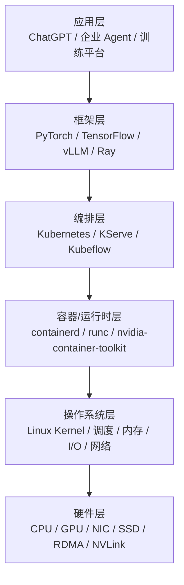

# 1. 背景：为什么 AI Infra 工程师必须懂 Linux

## 1.1 一个真实的场景

你负责的 Kubernetes 集群上，一个 8 卡 H100 训练任务跑着跑着，突然某个 worker 的 GPU 利用率从 95% 掉到 30%。

你检查了：

- NVIDIA 驱动：正常；
- NCCL：没有报错；
- 网络：IB 端口 up；
- 模型代码：没有改。

最后你发现：这个 worker 上的另一个高优先级进程抢占了 CPU，导致数据加载线程（DataLoader）无法及时给 GPU 喂数据。GPU 在等数据。

这个问题不在 Kubernetes，不在 GPU，不在网络——它在 **Linux 进程调度**。

## 1.2 Linux 是 AI 平台的“地面”

如果把 AI 基础设施画成一栋楼：

Linux 操作系统层承上启下。它决定：

- 进程什么时候跑、跑在哪个 CPU 上；
- 内存怎么分配、不够了怎么回收；
- 磁盘 I/O 怎么排队、网络包怎么处理；
- 容器里的资源限制怎么生效。

**AI Infra 工程师可以不写内核模块，但必须能读懂 Linux 的行为。**

## 1.3 为什么不只是“会用 Linux”

很多工程师的日常 Linux 能力包括：

- 会写 shell 脚本；
- 会用 `kubectl`、`docker`、`nvidia-smi`；
- 会装驱动、配网络、起服务。

但这不够。AI 场景下的 Linux 问题往往是**性能问题**和**边界问题**：

| 问题 | 表面现象 | 深层原因 |
|---|---|---|
| 训练慢 | GPU 利用率低 | DataLoader 被 CPU 调度饿死 / I/O 瓶颈 / NUMA 远程访问 |
| 推理延迟抖动 | P99 高 | CPU 抢占 / 内核态开销 / cgroup throttling |
| OOM | 容器被 kill | cgroup memory limit + 内核 OOM killer 策略 |
| NCCL 慢 | all-reduce 时间长 | IRQ 未绑定 / 网络中断在错误 CPU / RDMA 参数 |
|  checkpoint 慢 | 保存时间长 | page cache 回写策略 / I/O scheduler / 网络 fs |

这些问题的根因都在 Linux 内核层面。

## 1.4 AI 工作负载对 Linux 的特殊要求

AI 训练和推理不是普通的 Web 服务。它们对操作系统有独特需求：

### 高 CPU/GPU 协同

GPU 需要 CPU 准备数据、启动 kernel、处理通信。CPU 调度不畅会直接导致 GPU 空闲。

### 大内存 footprint

大模型训练需要几十 GB 到几百 GB 显存，CPU 内存也常被激活值、数据加载、检查点占满。

### 大 I/O 压力

数据加载、检查点保存、日志写入都会产生巨大的顺序/随机 I/O。

### 低延迟网络

分布式训练依赖 RDMA/InfiniBand，要求内核网络栈尽可能不成为瓶颈（DPDK、XDP、RDMA kernel bypass）。

### 稳定性

训练任务可能跑数周，期间不能出现内核 panic、soft lockup、内存泄漏。

## 1.5 2025-2026：Linux 内核正在发生的几件事

学习 Linux 不能只看经典教科书——2025 年下半年到 2026 年 10 月，内核版本从 6.12 一路演进到 7.3，有几条主线和 AI Infra 直接相关：

| 时间 | 事件 | 对 AI Infra 的意义 |
|---|---|---|
| 2024-11（6.12） | **sched_ext** 合入主线：用 eBPF 编写内核调度器 | 调度策略可以热加载、热替换，不用重启；延迟敏感负载的调度调优从“改内核”变成“写 BPF 程序” |
| 2025-09（6.17） | sched_ext 支持 cgroup 带宽控制接口；eBPF 加入标准字符串 kfuncs | 调度器可以感知 cgroup/容器配额；AI 平台可以按租户自定义 CPU 分配 |
| 2025-11（6.18） | **6.18 成为新的 LTS 内核**（维护至 2028-12）；eBPF 支持**签名的 BPF 程序**、`bpf_task_work` | 生产集群有了新的长期支持基线（2026-10 已更新到 6.18.57）；BPF 程序朝“可审计、可管控”方向演进 |
| 2026-02（6.19） | sched_ext 扩展性加固（bypass 模式、无锁 DSQ peek）；io_uring 支持 zcrx 零拷贝 socket、混合大小 SQE；device-private THP | 高性能网络（推理网关、存储网关）开始用 zcrx 做零拷贝收发；大页能力延伸到设备显存 |
| 2026-04（7.0） | **sched_ext deadline server 落地**；io_uring 支持 cBPF 过滤器；swap 子系统重构（swap table），redis 场景提速约 20% | sched_ext 调度器管理的任务也能获得 deadline 保证；swap 不再是“人人想关”的性能包袱 |
| 2026-06（7.1） | sched_ext 加入 **sub-scheduler 基础设施**（为按 cgroup 运行不同调度器铺路）；**io_uring struct_ops**：可用 BPF 定制 io_uring 事件循环 | “每个租户一个 BPF 调度器”从想法变成内核路线图上的正式功能 |
| 2026-08（7.2） | **CPU 调度器具备 LLC 缓存感知**；**DRM GPU 调度器公平化**（类 CFS，取代纯 FIFO）；MGLRU 回收改进约 30%；swap table 第四阶段再省 512MB/1TB 元数据 | GPU 不再被“先到先得”的 FIFO 饿死交互式负载；内存回收抖动下降，对训练混部场景友好 |
| 2026-10（7.3，发布中） | **sched_ext “终于完整”：每个 cgroup 可运行各自的 BPF sub-scheduler**，并支持基于 capability 的 CPU 委派；新增 dmem cgroup 管理 GPU 显存域；io_uring FUSE buffer pool 零拷贝、块设备支持 `RWF_DONTCACHE` | 多租户 AI 平台“按租户自定义 CPU 调度”正式可用；显存也纳入 cgroup 视野；数据库/存储引擎有了比 O_DIRECT 更灵活的缓存策略 |
| 2025-2026 | sched_ext 生态成熟：Google 的 BPF-CCX（面向 AMD Zen CCX 优化）、scx_rusty、scx_layered 等生产级调度器持续迭代 | 云厂商和开源社区都在把 BPF 调度器用于真实生产负载分层 |
| 2025-2026 | **GPUDirect Storage（GDS）** 成熟：存储直接读写 GPU 显存，2026-09 最新版为 v1.19.x；NVIDIA 2025 年 11 月提出 SCADA 倡议，把存储控制路径进一步卸载到 GPU | 大模型权重加载、KV-cache 下沉到 NVMe 时绕过 CPU bounce buffer，吞吐提升 1.5-7 倍 |
| 2025-2026 | **eBPF 可观测性成为主流**：Grafana Beyla 捐赠给 OpenTelemetry；Cilium/Tetragon/Pixie/Pyroscope 广泛部署 | 零侵入指标、 tracing、profiling 成为 Kubernetes 集群的默认配置 |
| 2025-2026 | **io_uring** 持续演进：multishot recv/accept、NVMe uring_cmd 透传、zcrx 零拷贝、struct_ops 可编程事件循环；liburing 2.15（2026-06） | 高并发推理网关、存储网关开始用它替代 epoll 事件循环 |

一句话总结这个趋势：**AI 负载正在从“应用层”向下倒逼 Linux 内核演进**——调度要可编程（sched_ext）、I/O 要绕过 CPU（GDS / io_uring / RDMA）、可观测要零侵入（eBPF）。

出处：[sched_ext 内核文档](https://docs.kernel.org/scheduler/sched-ext.html)、[KernelNewbies Linux 6.17](https://kernelnewbies.org/Linux_6.17)、[KernelNewbies Linux 6.18](https://kernelnewbies.org/Linux_6.18)、[The Register — 6.18 发布](https://www.theregister.com/software/2025/12/03/version-618-of-the-linux-kernel-is-here/2012921)、[KernelNewbies Linux 6.19](https://kernelnewbies.org/Linux_6.19)、[KernelNewbies Linux 7.0](https://kernelnewbies.org/Linux_7.0)、[KernelNewbies Linux 7.1](https://kernelnewbies.org/Linux_7.1)、[KernelNewbies Linux 7.2](https://kernelnewbies.org/Linux_7.2)、[KernelNewbies Linux 7.3](https://kernelnewbies.org/Linux_7.3)、[kernel.org 版本列表](https://www.kernel.org/category/releases.html)、[Oracle — GDS 验证实践](https://blogs.oracle.com/cloud-infrastructure/accelerate-ai-ml-workloads-oci-nvidia-ibm)、[Introl — AI 存储优化 2025](https://introl.com/blog/ai-optimized-storage-nvme-gpudirect-parallel-file-systems-2025)、[NVIDIA GDS 文档](https://docs.nvidia.com/gpudirect-storage/)、[Grafana Beyla eBPF 可观测](https://www.tekstream.com/blog/grafana-ebpf-observability/)、[liburing releases](https://github.com/axboe/liburing/releases)。

## 1.6 Linux 发行版选择

生产环境常用的服务器 Linux 发行版：

| 发行版 | 特点 | 适用场景 |
|---|---|---|
| Ubuntu Server LTS | 生态好、驱动新、社区活跃 | 云原生、AI 平台主流选择 |
| RHEL / Rocky Linux / AlmaLinux | 稳定、长支持、企业支持 | 金融、电信、传统企业 |
| Debian | 稳定、包管理严谨 | 长期运行的服务器 |
| Container-Optimized OS | 轻量、专为容器设计 | GKE 等托管 K8s |

AI 平台通常选择 **Ubuntu Server LTS** 或 **RHEL/Rocky**，因为 NVIDIA 驱动、CUDA、Docker 对它们的支持最好。2026 年 4 月发布的 **Ubuntu 26.04 LTS** 是目前新装 AI 节点的常见选择。内核版本方面，2025 年 11 月发布的 **6.18 是当前的 LTS 内核**（2026-10 已更新到 6.18.57，官方维护至 2028-12）；如果想用上 2026 年的新能力——sched_ext per-cgroup 调度（7.3）、LLC 缓存感知调度（7.2）、swap 重构（7.0+）——可以选择 7.x 主线或带 HWE 内核的发行版。老集群常见的 6.12 LTS（2026-10 已更新到 6.12.113）也仍在维护，但缺少上述新特性。

## 1.7 本章的学习路径

学习 Linux 系统与性能调优，建议按这个顺序建立直觉：

1. **先理解“内核 vs 用户空间”和“系统调用”**；
2. **再理解进程/线程/调度**；
3. **然后看内存管理**；
4. **接着看 I/O 和网络**；
5. **最后学 cgroup/namespace 和性能分析工具**。

不要着急记命令。先理解机制，命令只是机制的表面。

## 1.8 本节小结

- AI Infra 工程师必须懂 Linux，因为上层所有问题最终都可能落在操作系统层面；
- Linux 决定进程调度、内存管理、I/O、网络、容器隔离；
- AI 工作负载对 Linux 有高协同、大内存、大 I/O、低延迟、高稳定性的要求；
- 2025-2026 年的三条主线：**调度可编程化（sched_ext）、I/O 绕过 CPU（GDS / io_uring / RDMA）、可观测零侵入（eBPF）**；
- 学习 Linux 要从机制入手，而不是死记命令。

下一节，我们从最核心的概念开始：**Kernel/User Space、系统调用、进程模型**。
