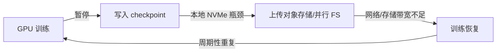
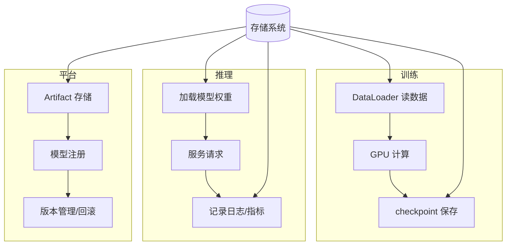

# 1. 背景：为什么 AI Infra 工程师必须懂存储

AI 系统的核心资产是数据与模型。无论训练还是推理，最终都绕不开一个问题：**数据在哪里、怎么读、怎么写、怎么保证不丢、怎么省钱。** 存储系统就是解决这些问题的底座。

## 1.1 几个真实的 AI 存储痛点

### 痛点 1：checkpoint 保存拖慢训练

训练一个大模型时，每隔一段时间就要保存一次 checkpoint。一次 checkpoint 可能包含数 TB 的权重和优化器状态。如果存储写入带宽不足，整个训练集群会停下来等保存完成。



### 痛点 2：模型服务冷启动慢

推理服务启动时需要从存储加载模型权重。如果权重文件在对象存储里，每次 Pod 启动都要下载几十 GB，冷启动时间会直接影响弹性扩缩速度。

### 痛点 3：推理服务的 KV Cache 把内存撑爆

长上下文、Agent 多轮调用让推理的 KV Cache 规模爆炸：一个长会话的 KV Cache 可达数十 GB，纯靠 GPU 显存放不下，放在远端对象存储上延迟又太高。2025 年兴起的**分离式推理架构（PD 分离）**把 KV Cache 当作一等公民在 GPU 之间搬来搬去，存储层级里因此多了一个新成员——**分布式 KV Cache 池**（如 Mooncake、LMCache），它架在显存与 NVMe 之间，是推理场景独有的存储问题。

### 痛点 4：Kubernetes 卷挂载失败

```text
MountVolume.SetUp failed for volume "pvc-xxx" : rpc error: code = DeadlineExceeded
```

这种错误在生产中很常见，可能的原因包括：CSI driver 未启动、StorageClass 配置错误、后端存储容量不足、网络分区导致 attach 超时等。

### 痛点 5：对象存储成本失控

AI 流水线会产生大量日志、指标、中间 artifact、旧版本模型。如果没有生命周期管理、分层存储和对象合并策略，对象存储账单会快速增长。随着数据湖规模向 PB 级演进，QLC 大容量 SSD（单盘 122TB 级）和低成本对象存储的组合成为新的成本优化焦点。

## 1.2 AI 工作负载的存储特征

| 特征 | 说明 | 对存储系统的要求 |
|---|---|---|
| 突发大写 | checkpoint 一次性写入数 TB | 高顺序写带宽、低延迟完成、不阻塞训练 |
| TB 级顺序文件 | 单个大文件包含权重/优化器状态 | 大文件优化、高效分块、快速恢复 |
| 海量小对象 | 数据集、日志、artifact 可能由大量小文件组成 | 元数据性能、合并策略、生命周期 |
| 共享命名空间 | 多节点需要同时读取训练数据/模型 | POSIX 语义或 S3 API、强一致性 |
| 强一致性需求 | checkpoint 必须可恢复、artifact 不可丢 | 数据校验、复制/纠删码、原子写入 |
| 热/温/冷分层 | 最新 checkpoint 最热，旧数据可转冷 | 自动分层、成本优化 |
| 单次读取 | 训练数据每个 epoch 只读一遍，传统读缓存收益低 | 优先裸随机读带宽（3FS 的设计哲学） |
| KV Cache 高并发读写 | 推理 PD 分离后 KV 块在节点间频繁搬运 | 高 IOPS 随机读写、RDMA/内存级延迟、跨节点共享 |

> 注：2025 年 DeepSeek 开源的 3FS 明确指出，AI 训练数据"只读一次"的特征让传统缓存失效，其设计几乎放弃读缓存，转而榨干 NVMe + RDMA 的裸随机读带宽（180 节点集群聚合读带宽达 6.6 TiB/s，来源：[DeepSeek 3FS](https://github.com/deepseek-ai/3fs)）。

## 1.3 存储问题在 AI 系统的位置



## 1.4 本章要回答的问题

- 块、文件、对象存储分别适合什么场景？
- 为什么 AI 训练 checkpoint 通常先写本地 NVMe，再异步上传到对象存储？
- 2025 年后异步 checkpoint 如何把训练阻塞从分钟级压到 1 秒以内？
- 3FS 为什么放弃读缓存？它和 Lustre/WEKA 的设计哲学有什么不同？
- 推理场景的 KV Cache 为什么催生了”GPU 显存与 NVMe 之间”的新存储层（Mooncake、CXL 内存池）？
- 对象存储的”最终一致性”会带来什么问题？
- 复制和纠删码怎么保证数据不丢？各自的代价是什么？
- Kubernetes 的 PV/PVC/StorageClass/CSI 是怎么把存储挂到 Pod 里的？
- 如何设计一个支持 AI 训练/推理/平台的存储架构？

下一章从核心思想开始，建立存储系统的概念框架。
