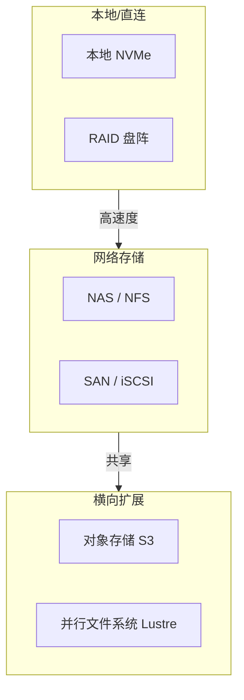
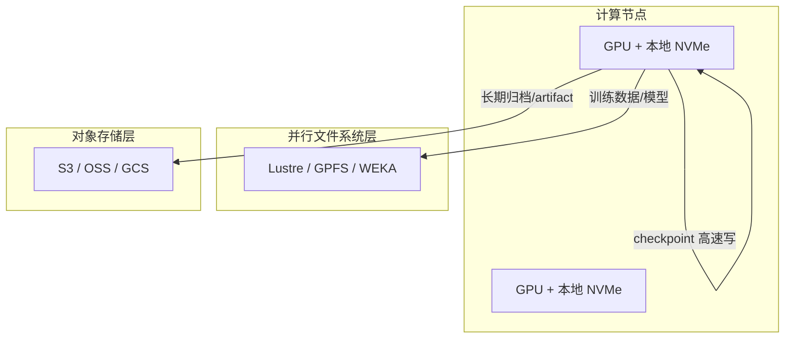
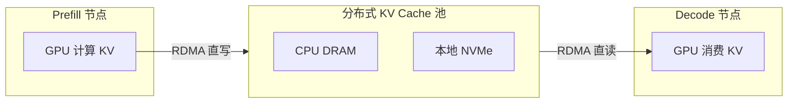
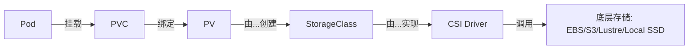

# 3. 架构设计

AI 集群的存储架构通常不是单一系统，而是**多种存储形态的组合**，分别服务于训练、推理、平台和归档等不同场景。

## 3.1 存储系统分类

| 类型 | 英文 | 特点 | 典型协议/产品 |
|---|---|---|---|---|
| 直连存储 | DAS | 直接挂在服务器上，延迟最低 | 本地 NVMe/SATA SSD |
| 网络附加存储 | NAS | 通过 NFS/SMB 共享文件 | NFS、SMB |
| 存储区域网络 | SAN | 通过专用网络提供块设备 | iSCSI、NVMe-oF、Fibre Channel |
| 对象存储 | Object Storage | 扁平命名空间，HTTP API，海量扩展 | S3、GCS、MinIO、Ceph |
| 并行文件系统 | Parallel FS | 高并发共享文件访问 | Lustre、GPFS、3FS、WEKA |

## 3.2 AI 集群典型存储架构

一个中等规模的 AI 训练集群通常采用三层存储：

| 层级 | 用途 | 典型产品 |
|---|---|---|
| 本地 NVMe | 临时 checkpoint、缓存、swap | Intel P5800X、Samsung PM1735、QLC 大容量盘（Solidigm D5-P5336 122TB） |
| 并行文件系统 | 共享训练数据集、模型仓库 | Lustre、Spectrum Scale、3FS、WEKA |
| 对象存储 | 长期保存 checkpoint、artifact、日志 | S3、GCS、MinIO、Ceph |

2025 年后一个明显趋势是**存算分离的彻底化**：像 3FS 这样的系统把"成百上千块 SSD + RDMA 网络"聚合成一个独立的存储资源池，计算节点无感知地访问其中任意一块盘，存储节点和计算节点可以独立扩容。这解决了传统"每机配本地盘"模式下容量和带宽被节点绑死的问题（来源：[DeepSeek 3FS](https://github.com/deepseek-ai/3fs)）。

## 3.3 云端存储服务

云厂商提供了丰富的托管存储选项：

| 服务 | 类型 | 特点 |
|---|---|---|
| AWS EBS | 块存储 | 挂载到单个 EC2，低延迟 |
| AWS EFS | 文件存储（NFS） | 多可用区共享，弹性容量 |
| AWS FSx for Lustre | 并行文件系统 | 与 S3 集成，适合 HPC/AI |
| AWS S3 | 对象存储 | 海量、便宜、生命周期管理 |
| S3 Express One Zone | 低延迟对象存储 | 单可用区目录桶，ms 级延迟，适合 checkpoint/热数据 |
| S3 Vectors | 向量检索 | 2025-12 GA，对象存储内原生向量索引（每索引 20 亿向量），面向 RAG 语义检索 |
| GCS / Azure Blob | 对象存储 | 类似 S3，各有定价和一致性模型 |
| Google Managed Lustre | 托管并行文件系统 | 2026-04 起单实例吞吐达 10 TB/s（一年提升 10 倍），checkpoint 读写较其他 GCP 存储快 2.6 倍 |

选型时要考虑：延迟、吞吐、IOPS、容量、成本、可用区、与计算资源的网络距离。

### 3.3.1 对象存储的 AI 化演进

2025-2026 年对象存储出现了三个明显的 AI 化方向：

1. **低延迟化**：S3 Express One Zone 用目录桶（directory bucket）把热数据放进单一可用区，延迟从数十 ms 降到个位数 ms，开始逼近并行文件系统的使用场景（大规模 checkpoint、训练热数据）。
2. **语义化**：S3 Vectors（2025-12 GA）在对象存储里内建向量索引，支持 metadata 过滤的近似最近邻查询，频繁查询延迟约 100ms 级，让 RAG 管线可以直接在"数据的存放处"做检索，省掉单独维护向量数据库的搬运成本（来源：[StorageNewsletter: S3 Vectors GA](https://www.storagenewsletter.com/2025/12/05/aws-reinvent-2025-amazon-s3-vectors-is-now-generally-available-with-40-times-the-scale-of-preview/)）。
3. **高吞吐化**：2026-04 Google Cloud 发布 Cloud Storage Rapid Bucket（构建在 Colossus 之上），单个可用区级桶提供 **>15 TB/s 带宽、2000 万请求/秒、亚毫秒延迟**，并给出原生 PyTorch/JAX 集成；官方数据是 checkpoint 写入快 3.2 倍、恢复快 5 倍，配套 Rapid Cache 支持写入即入缓存（ingest-on-write），checkpoint 恢复再快 2.2 倍。对象存储第一次在生产级 SLA 上逼近并行文件系统的 checkpoint 场景（来源：[Google Cloud Next '26 Storage Announcements](https://cloud.google.com/blog/products/storage-data-transfer/next26-storage-announcements)）。

## 3.4 推理侧的存储架构：KV Cache 池

训练侧的存储架构相对成熟，2025 年后真正的新架构出现在**推理侧**。PD（Prefill/Decode）分离把一次请求拆到不同 GPU 上执行，KV Cache 需要在节点间高速流转，于是形成了独立的 KV 存储层：

代表系统是月之暗面开源的 **Mooncake**：CPU DRAM + SSD + RDMA 组成的分布式 KV Cache 池，配合 Transfer Engine 在 GPU 之间搬运 KV 块。它在 Kimi K2 生产环境（128 张 H200）支撑了 224k tok/s 的 prefill 吞吐，并在 vLLM/SGLang/TensorRT-LLM 中成为标准 KV Connector（2025-12 起直接集成进 vLLM v1；2026-02 加入 PyTorch Ecosystem；2026-05 vLLM v0.31 内置 Mooncake Store connector，12 张 GB200 上实测吞吐提升 3.8 倍、P50 TTFT 降低 46 倍，命中率逼近 95%，并可近线性扩展到 60 张 GPU）。2026 年的新动向是"KV 存储池 + 大容量闪存"做成一体机：WEKA 2026-07 发布的 WEKApod 3（NeuralMesh 6 软件）单柜有效容量 1.1 EB、吞吐 10.2 TB/s、2.1 亿 IOPS，其 Augmented Memory Grid 把 KV Cache 卸载到 NVMe 闪存，宣称同等 GPU  footprint 下并发用户提升 10 倍；WEKA 与 OCI 的联合实测（72 张 H100、100K 上下文）显示长上下文推理吞吐提升 10 倍（来源：[Mooncake](https://github.com/kvcache-ai/Mooncake/)、[vLLM Blog: Mooncake Store](https://vllm-project.github.io/blog/2026-05-06-mooncake-store/)、[WEKApod 3 发布](https://www.weka.io/news/wekapod-3-densest-ai-storage-memory-system)、[WEKA × OCI 实测](https://www.weka.io/news/weka-and-oracle-cloud-infrastructure-validate-10x-throughput-gains)）。更进一步，CXL 内存池（如 XConn + MemVerge 在 OCP 2025 展示的 100 TiB 方案、阿里云 Beluga）正在把 KV Cache 的"温层"从 SSD 上移到可池化共享的内存总线上，TTFT 可再降一个数量级；2026 年生产部署仍以 CXL 2.0/3.x 扩展和早期池化为主，CXL 4.0 规范已于 2025-11 发布（128 GT/s），机架级池化预计 2027 年后进入主流（来源：[OCP 2025 CXL KV Cache 演示](https://www.storagenewsletter.com/2025/10/16/ocp-global-summit-2025-xconn-technologies-and-memverge-demonstrate-cxl-memory-pool-for-kv-cache/)、[Synopsys CXL 4.0 解读](https://www.synopsys.com/blogs/chip-design/cxl-4-ip-solution-ai-memory-connectivity.html)）。

## 3.5 Kubernetes 存储架构

Kubernetes 通过 PV/PVC/StorageClass/CSI 把存储抽象成可声明的资源：

### 关键概念

| 概念 | 作用 |
|---|---|
| PV（PersistentVolume） | 集群中的一块实际存储 |
| PVC（PersistentVolumeClaim） | 用户/应用对存储的请求 |
| StorageClass | 定义存储“模板”和 provisioner |
| CSI（Container Storage Interface） | 容器与存储系统之间的标准接口 |
| VolumeBindingMode | `Immediate` 或 `WaitForFirstConsumer`，影响调度 |
| AccessMode | `ReadWriteOnce`、`ReadOnlyMany`、`ReadWriteMany` |

## 3.6 控制面与数据面

存储系统通常分为控制面和数据面：

| 面 | 职责 | 例子 |
|---|---|---|
| 控制面 | 元数据管理、容量分配、策略执行 | S3 bucket 元数据、K8s PV controller、Lustre MDS |
| 数据面 | 实际数据传输 | S3 GET/PUT、NVMe 读写、Lustre OSS |

控制面决定了“数据在哪里、怎么访问”，数据面决定了“能跑多快”。AI 集群中，**数据面带宽往往是瓶颈**。

## 3.7 本地存储 vs 网络存储 vs 对象存储

| 维度 | 本地 NVMe | 并行文件系统 | 对象存储 |
|---|---|---|---|
| 延迟 | 最低（μs 级） | 较低（ms 级） | 较高（ms~百 ms） |
| 吞吐 | 高 | 高 | 高（并发时） |
| 共享 | 不共享 | 多机共享 | 多机共享 |
| 容量 | 小 | 中-大 | 极大 |
| 成本/GB | 高 | 中 | 低 |
| 适用 | checkpoint 缓存 | 训练数据集 | 长期归档/artifact |

## 3.8 AI 场景下的存储选型示例

| 场景 | 推荐存储 | 原因 |
|---|---|---|
| 分布式训练 checkpoint | 本地 NVMe + 异步上传对象存储/并行 FS | 高吞吐写入 + 可靠持久化 |
| 训练数据集 | 并行文件系统（Lustre/WEKA）或对象存储 + 本地缓存 | 多机共享、高吞吐顺序读 |
| 模型服务加载 | 对象存储 + 本地缓存/Init Container | 弹性扩缩、快速分发 |
| 训练日志/指标 | 对象存储 + 生命周期 | 海量小对象、低成本 |
| Artifact/模型注册 | 对象存储 + 版本控制 | 不可变、可追溯 |
| 推理 KV Cache | 分布式 KV Cache 池（Mooncake/LMCache）+ CXL/DRAM | 高并发共享、显存扩展、PD 分离 |

## 3.9 一句话总结

**AI 集群的存储架构是“本地高速 + 并行共享 + 对象归档”的分层组合；没有一种存储能满足所有需求，关键是让数据在正确的时间出现在正确的层级。**
