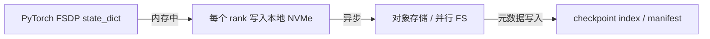
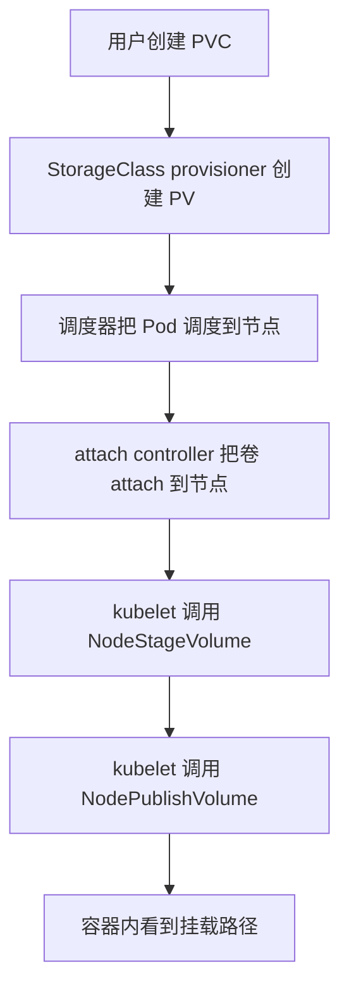
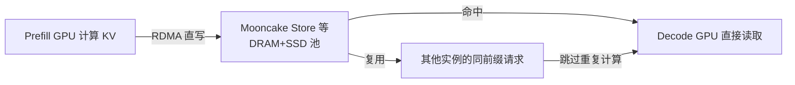

# 4. 存储数据流

理解存储系统最好的方式，是跟踪一个真实数据包的完整旅程。本章分析 AI 场景中最常见的四条链路：训练 checkpoint 保存、模型服务加载权重、Kubernetes CSI 卷挂载，以及 2025 年后兴起的推理 KV Cache 流转。

## 4.1 链路一：训练 checkpoint 保存

分布式训练中，所有 rank 需要协同保存 checkpoint。传统同步保存路径如下：

### 为什么先写本地 NVMe？

1. **高吞吐**：本地 NVMe 可提供数 GB/s 的顺序写带宽；
2. **低阻塞**：保存到本地后训练可以更快恢复；
3. **容错**：本地文件作为缓冲区，后续异步上传到持久存储。

### 异步 checkpoint：两阶段流水线

2025 年之后的主流做法是 PyTorch DCP 的**异步 checkpoint**，把保存拆成两个阶段，训练只在第一阶段被短暂阻塞：

实测数据非常可观：1856 张 H200 训练 Llama3-70B，GPU 阻塞时间仅约 0.78 秒，而后台写盘从约 436 秒优化到约 67 秒（缓存 save plan + 进程化异步写盘，合计约 6.5 倍提升；来源：[PyTorch Blog: 6x faster Async Checkpointing](https://pytorch.org/blog/6x-faster-async-checkpointing/)）。更早的测试中，7B 模型单次 checkpoint 从约 148.8 秒降到约 6.3 秒。

2026 年的研究方向是**多步重叠 checkpoint**：GoCkpt 把 GPU→CPU 的传输拆散到约 7 个训练步里，与梯度传输共用 PCIe 带宽，并把梯度一并传到 CPU 保证部分 checkpoint 的一致性，训练中断时间比已有最优传输方案再降约 86.7%、端到端吞吐最高提升约 38.4%（来源：[GoCkpt, arXiv:2511.07035](https://arxiv.org/html/2511.07035)）。工业界的另一条路线是**存储侧吸收写压力**：Alluxio 企业版从 3.5 起支持 CACHE_ONLY 写模式（checkpoint 只写缓存层、后台异步落盘，checkpoint 创建提速至 3 倍）、3.6 起支持 ASYNC 写模式；其分布式缓存在 MLPerf Storage v3.0 基准中跑出 147 GiB/s 的 Llama 3 405B checkpoint 写入带宽（来源：[Alluxio 3.5 发布](https://www.alluxio.io/blog/new-features-in-alluxio-enterprise-ai-3-5)、[MLPerf Storage v3.0 Alluxio 结果](https://www.alluxio.com.cn/mlperf-storage-v3-0%EF%BC%9Aalluxio%E5%88%86%E5%B8%83%E5%BC%8F%E7%BC%93%E5%AD%98%E5%AE%9E%E7%8E%B0147gib-s-llama-3%E5%A4%A7%E6%A8%A1%E5%9E%8Bcheckpoint%E5%86%99%E5%85%A5%E6%80%A7%E8%83%BD/)）。云上则可以反过来选择更快的桶：Google Cloud Storage Rapid Bucket 宣称 checkpoint 写入快 3.2 倍、恢复快 5 倍（来源：[Google Cloud Next '26](https://cloud.google.com/blog/products/storage-data-transfer/next26-storage-announcements)）。

### 异步上传的注意事项

- 需要保证上传完成前，不能删除本地 checkpoint；
- 需要记录 manifest，说明哪些文件属于同一个 checkpoint；
- 上传到对象存储时，通常使用 multipart 上传以提高大文件吞吐；
- 后台写盘线程与训练线程共享 CPU/GIL，2025 年后的解法是把写盘放到独立进程（消除 GIL 竞争）并缓存 save plan（消除重复 collective）。

## 4.2 链路二：模型服务加载权重

推理服务启动时，通常需要从存储加载模型权重：

### 优化点

| 优化 | 作用 |
|---|---|
| 本地缓存 | 同一节点上的 Pod 复用已下载权重 |
| 镜像预热 | 把常用模型打包进节点镜像或容器镜像层 |
| 并行下载 | 使用 multipart 或多线程提高带宽利用率 |
| 共享 PVC | 多副本 Pod 挂载同一个只读 PVC |
| 分层加载 | 先用 safetensors 元数据映射显存，再按需拉取权重分片，降低 TTFB |

## 4.3 链路三：Kubernetes CSI 卷挂载

Kubernetes 通过 CSI 把外部存储挂载到 Pod。完整流程包括：

### CSI 主要 RPC

| RPC | 阶段 | 作用 |
|---|---|---|
| CreateVolume | Provision | 在存储后端创建卷 |
| ControllerPublishVolume | Attach | 把卷 attach 到目标节点 |
| NodeStageVolume | Stage | 在节点上格式化/挂载到全局目录 |
| NodePublishVolume | Publish | 把全局目录 bind mount 到容器路径 |

任何一个阶段失败，Pod 都会卡在 `ContainerCreating`。

## 4.4 链路四：推理 KV Cache 的写入与复用

PD 分离架构下，KV Cache 成为一条独立的存储数据流：

关键机制：

- **按块寻址**：KV 块以 token 区间为单位编址，前缀相同即可复用，天然适合 Agent 多轮调用的 system prompt 共享；
- **分层驻留**：热点 KV 驻留 CPU DRAM，温数据下沉本地 SSD，远快于从远端存储重算 prefill；
- **传输引擎**：Mooncake Transfer Engine、NVIDIA NIXL 等用 RDMA/GPUDirect 把 GPU 显存直接对拷，绕开 CPU 和文件系统。

Mooncake 在 agentic 负载上把跨实例 KV Cache 命中率从约 1.7% 提升到约 92%，这是"用存储换计算"的典型胜利（来源：[Mooncake](https://github.com/kvcache-ai/Mooncake/)）。

## 4.5 四条链路的共性

| 链路 | 核心关注点 |
|---|---|
| checkpoint 保存 | 写入带宽、两阶段异步、save plan 缓存、manifest 管理 |
| 模型加载 | 读取带宽、本地缓存、冷启动时间、并发下载 |
| CSI 挂卷 | 控制面延迟、attach/stage/publish 成功率、多节点共享 |
| KV Cache 流转 | 传输延迟（RDMA）、块级寻址、分层驻留、跨实例复用 |

## 4.6 一句话总结

**存储数据流的关键不是“数据存在哪里”，而是“数据在什么时候以什么带宽、经过哪些控制面、到达哪里”。**
