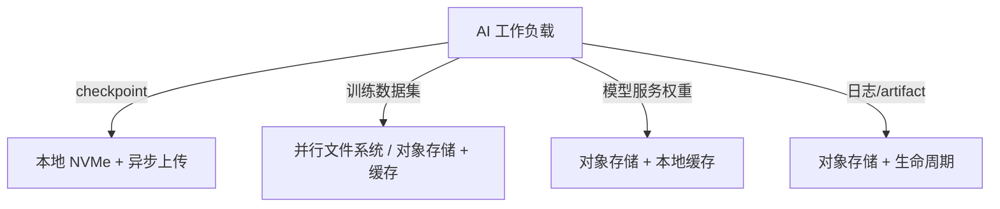

# 8. 企业生产实践

AI 集群的存储生产实践，核心是**在性能、成本、可靠性和运维复杂度之间找到可运营的平衡点**。本章从选型、checkpoint 策略、K8s 存储、模型服务加载和成本治理五个维度展开。

## 8.1 存储选型决策树



## 8.2 checkpoint 策略

### 8.2.1 同步 vs 异步 checkpoint

| 方式 | 优点 | 缺点 |
|---|---|---|
| 同步 | 简单、强一致 | 训练阻塞时间长 |
| 线程异步 | 训练几乎不阻塞 | 与训练线程争 GIL，checkpoint 后 TPS 仍下跌 |
| 进程异步（2025 后主流） | 几乎无 GIL 竞争、可缓存 save plan | 需要额外 CPU 内存缓冲 |
| 多步重叠（2026 研究方向） | GPU→CPU 传输拆进约 7 个训练步，中断再降约 86.7% | 实现复杂，需框架级支持（GoCkpt） |
| 缓存吸收（Alluxio 等企业方案） | checkpoint 只写缓存层、后台落盘，创建提速约 3 倍 | 依赖商业存储层，耐久性靠后端保障 |

（多步重叠与缓存吸收来源：[GoCkpt, arXiv:2511.07035](https://arxiv.org/html/2511.07035)、[Alluxio 3.5 发布](https://www.alluxio.io/blog/new-features-in-alluxio-enterprise-ai-3-5)。）

大规模训练的标准做法已是**两阶段异步 checkpoint + 独立写盘进程**：GPU→CPU 拷贝只阻塞约 1 秒，真正的写盘由后台进程完成。1856 张 H200 实测，后台处理从约 436s 优化到约 67s，因此可以把 checkpoint 频率提高数倍而不损失有效训练时间（来源：[PyTorch Blog: 6x faster Async Checkpointing](https://pytorch.org/blog/6x-faster-async-checkpointing/)）。

### 8.2.2 checkpoint 频率

| 频率 | 故障回滚损失 | 写入开销 | 适用 |
|---|---|---|---|
| 高（1-5 分钟） | 小 | 高 | 万卡集群、硬件故障率高 |
| 中（15-30 分钟） | 中 | 中 | 中小规模训练 |
| 低（数小时） | 大 | 低 | 稳定环境、可接受重跑 |

Meta/Google 的经验：在高故障率环境下，checkpoint 间隔越短，有效训练时间越高，前提是存储写入带宽足够。

### 8.2.3 checkpoint 清理

- 保留最近 N 个 checkpoint；
- 旧的自动转对象存储归档；
- 删除前确认新 checkpoint 可加载。

## 8.3 Kubernetes 存储生产实践

### 8.3.1 StorageClass 设计

```yaml
apiVersion: storage.k8s.io/v1
kind: StorageClass
metadata:
  name: fast-local-ssd
provisioner: kubernetes.io/no-provisioner
volumeBindingMode: WaitForFirstConsumer
reclaimPolicy: Retain
```

- `WaitForFirstConsumer` 让调度器先选节点再绑定卷，避免 Pod 调度到没有本地盘的节点；
- `Retain` 防止 PVC 删除时数据被误删。

### 8.3.2 CSI driver 选择

| 场景 | 推荐 CSI |
|---|---|
| 本地 NVMe checkpoint | local-static-provisioner / LVM CSI |
| 共享数据集 | NFS CSI / Lustre CSI |
| 块存储 | EBS CSI / RBD CSI |
| 对象存储 | COSI（未来标准）或 sidecar |

### 8.3.3 常见排障

| 现象 | 可能原因 | 排查 |
|---|---|---|
| Pod 卡在 ContainerCreating | CSI driver 未启动、attach 失败、网络分区 | `kubectl describe pod`、CSI pod 日志 |
| checkpoint 写入慢 | 本地盘带宽不足、对象存储并发低 | `iostat -x 1`、对象存储监控 |
| 模型加载超时 | 对象存储下载慢、缓存未命中 | 检查 storage-initializer 日志 |

## 8.4 模型服务权重加载优化

### 8.4.1 Init Container 下载

```yaml
initContainers:
- name: storage-initializer
  image: kserve/storage-initializer
  args: ["s3://models/llama-3", "/mnt/models"]
```

### 8.4.2 本地缓存策略

- 同一节点上的多个 Pod 共享一个 hostPath/PVC 缓存；
- 使用 JuiceFS/Alluxio 把对象存储挂载为带缓存的文件系统；
- 热门模型预加载到节点镜像中。

### 8.4.3 推理 KV Cache 的存储实践（2025 后）

PD 分离架构下，KV Cache 成为推理集群最大的"存储消费者"：

| 实践 | 说明 |
|---|---|
| 分布式 KV Cache 池 | 用 Mooncake Store / LMCache 把各实例的 KV 块池化，跨实例复用前缀 |
| DRAM 优先、SSD 兜底 | 热点 KV 驻留 CPU 内存，温数据下沉 NVMe，避免全部挤占显存 |
| RDMA 直传 | 用 Mooncake Transfer Engine / NIXL 做 GPU 显存间直拷，不走文件系统 |
| CXL 内存池（探索中） | 20-100 TiB 级共享内存池作为 KV 温层，比 SSD 方案 TTFT 低一个数量级 |

Kimi K2 生产环境（128 张 H200）用 Mooncake 支撑了 224k tok/s prefill 与 288k tok/s decode；agentic 负载下跨实例 KV 命中率从约 1.7% 提升到约 92%。2026 年这套实践开始标准化：vLLM v0.31（2026-05）内置 Mooncake Store connector，12 张 GB200 实测吞吐提升 3.8 倍、P50 TTFT 降低 46 倍，并可在 60 张 GPU 上近线性扩展；WEKApod 3 这类"闪存 + KV 卸载"一体机则把同一思路做成了存储产品（来源：[Mooncake](https://github.com/kvcache-ai/Mooncake/)、[vLLM Blog: Mooncake Store](https://vllm-project.github.io/blog/2026-05-06-mooncake-store/)）。

## 8.5 成本治理

### 8.5.1 对象存储成本优化

| 策略 | 效果 |
|---|---|
| 生命周期规则 | 自动转 IA/归档 |
| 合并小对象 | 减少 LIST/HEAD 开销 |
| 删除过期 artifact | 避免无限增长 |
| 跨区域复制按需开启 | 避免不必要流量 |
| 热数据用目录桶/低延迟桶 | checkpoint、热数据集放 S3 Express One Zone / GCS Rapid Bucket 类低延迟高吞吐层，避免买整集群并行 FS（Rapid Bucket 宣称 checkpoint 写快 3.2 倍、恢复快 5 倍） |
| 数据湖用 QLC 大容量盘 | 245TB 级 QLC SSD（Micron 6600 ION，2026-05 出货）单盘容量两年翻两倍、功耗远低于 HDD 阵列，适合"写一次读多次"的训练数据集 |

### 8.5.2 存储容量规划

- checkpoint 数量 × 单次大小 × 保留周期；
- 训练数据集原始大小 + 解压后大小；
- artifact 增长速度；
- 预留 20-30% 缓冲空间。

## 8.6 一句话总结

**生产环境的存储优化不能靠单点配置，而要靠“选型正确 + 异步写入 + 本地缓存 + 生命周期管理”的组合拳。**
