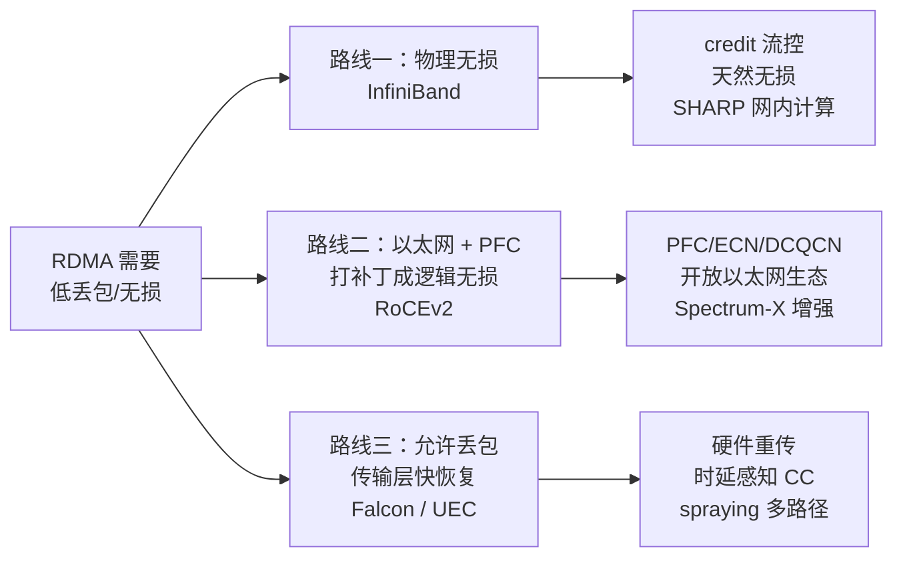

# 2. 核心思想

> 一句话理解：**AI 集群网络的全部设计可以归结为一次"二分"——把通信按带宽时延比切进 scale-up 域（机柜内、内存语义、微秒时延）和 scale-out 域（机柜间、消息语义、大象流），再分别为两个域选择拓扑、无损机制与故障域。**

## 2.1 第一性原理：scale-up / scale-out 二分

为什么 AI 集群的网络不能是一张网？因为**机柜内和机柜间的带宽时延比差了 1–2 个数量级，且成本结构完全不同**：

| | Scale-Up 域 | Scale-Out 域 |
|---|---|---|
| 覆盖范围 | 单机内 / 单机柜（NVL72 为 72 GPU） | 机柜间，数百到十万级节点 |
| 代表技术 | NVLink/NVSwitch、AMD xGMI、UALink（规划） | InfiniBand、RoCE/以太网（Spectrum-X/UEC） |
| 带宽（每 GPU） | NVLink4 900GB/s；NVLink5 1.8TB/s | 400–800Gbps（=50–100GB/s） |
| 时延 | 亚微秒到 1µs 量级 | 2–5µs（RDMA）到几十 µs（TCP） |
| 带宽时延积（BDP） | 约 1–2 MB | 约 100–500 KB |
| 语义 | 内存语义（load/store、地址空间统一） | 消息语义（send/recv、QP/VC） |
| 拓扑 | 交换阵列（NVSwitch 无阻塞 crossbar） | fat-tree / rail-optimized / Dragonfly+ |
| 成本 | 极贵（铜背板/专用 SerDes），按域计价 | 相对便宜（以太网生态），按端口计价 |

这个二分是**并行策略的第一约束**：张量并行（TP）每层做 2 次 all-reduce、每 microbatch 都发生，如果跨机柜走 scale-out 域，400Gbps 的带宽和 3µs 的时延会把 step 时间吃掉一大截；把 TP 限制在 NVLink 域内，同样的通信只需几十分之一的时间。所以工程上的铁律是：

```text
TP（张量并行）   → 必须在 scale-up 域（NVLink/UALink 内）
EP（专家并行）   → 只能走 scale-out 域，因此对 fabric 最挑剔
DP（数据并行）   → scale-out 上的周期性大象流，带宽敏感
PP（流水并行）   → 相邻 stage 点对点，量小但延迟敏感（气泡敏感）
```

大模型训练的并行维度越来越多（TP×EP×PP×DP×CP 组合），每一次"某个维度该放多大"的背后，都是一次对本章这张表的查表。

## 2.2 带宽时延比与 BDP：为什么"域"的边界是机柜

BDP（带宽时延积）= 带宽 × 往返时延，含义是"一条流水线在途最多装多少字节"。它对通信的影响有两个：

1. **流水线深度要求**：要跑满 1.8TB/s 的 NVLink5，发送端需要保持约 1–2MB 的在途数据；跑满 400G 的 RDMA 链路需要约 400KB。在途数据不够 = 带宽跑不满。RDMA 的优势正在于网卡硬件维护大量在途请求，而 TCP 软件栈在高 BDP 下很难填满管道。
2. **通信-计算重叠的边界**：梯度 all-reduce 要与反向计算 overlap，overlap 的粒度必须大于一次通信的 RTT，否则"等通信"反而打乱计算流水。NVLink 域内 RTT 亚微秒，重叠粒度可以细到每层；跨机柜 3–5µs，就需要更粗的粒度（桶化 bucketize）。

机柜是这两个世界的自然边界：NVLink 铜缆（SerDes over PCB/背板）在 1.8TB/s 速率下传输距离只有米级，超过机柜就要上光模块和重定时，成本曲线立刻变陡。这就是为什么 NVIDIA 把 72-GPU 域装进一个机柜（GB200 NVL72，9 个 NVSwitch tray、约 130TB/s 聚合带宽），而机柜之间交给 800G 光互联。

## 2.3 尾部延迟：同步屏障的数学

同步数据并行下，step 时间由最慢者决定：

```text
T_step = T_compute + T_comm_worst + ε
```

如果单 rank 通信时间服从某种分布，T_comm_worst 就是它的上尾。考虑 2048 个 rank、每个 rank 通信时间有 1% 的概率多 50%——一个 step 内"至少一个 rank 撞上"的概率是 `1 - 0.99^2048 ≈ 1`。也就是说**在千卡规模上，尾部事件每步都在发生**，平均带宽指标在数学上就不可用。工程含义：

- fabric 必须无收敛（否则某些模式必然排队 = 必然有人进尾部）；
- 拥塞控制必须快（µs 级反应，而不是 TCP 的 RTT 级反应）；
- 慢源要能被快速定位（遥测粒度到 per-flow/per-link，见第 5 章）；
- 集合通信算法要能绕开慢路径（NCCL 的拓扑感知 channel 划分）。

## 2.4 大象流与 incast：流量矩阵视角

把一次训练 step 的通信写成流量矩阵（谁向谁发多少字节），四种并行策略的"形状"完全不同（第 7 章 Mini Demo 会给出可运行的模型）：

| 策略 | 模式 | 矩阵形状 | 网络压力 |
|---|---|---|---|
| DP 梯度同步 | all-reduce（ring） | 每个 rank 只与 ring 邻居通信，每 rank 2(n-1)/n × M | 大消息、带宽敏感、周期突发 |
| TP | all-reduce | 同 ring，但 M 小、频率高 | 时延敏感，留在 scale-up |
| EP（MoE） | all-to-all × 2（dispatch/combine） | 近似全互联，扇出 n-1 | **incast + 哈希极化重灾区** |
| PP | 相邻 stage p2p | 链式，边界 rank 通信量翻倍 | 延迟敏感（气泡），量小 |

两个关键结构性问题：

**incast（扇入）。** EP 的 all-to-all 在时间上天然同步：所有 rank 同刻 dispatch token。32 个 sender 同时向一个 400G 端口各发 4MiB，出口要串行服务约 2.7ms，队列瞬时峰值 124MiB——任何缓冲不够或吸收不及时的 fabric 在这里现原形。incast 的解法不是"更大的缓冲"，而是：让流量不要同时到达（拥塞控制提前降速，ECN/DCQCN）、让流量走多条路（自适应路由/spraying）、让流量别那么大（EP 分组、拓扑感知 all-to-all）。

**大象流的哈希极化。** 少量大象流 + 多级 ECMP = 大概率出现"多条流同路"。HPN 论文量化了这个问题并把"路径选择"从哈希手里拿回来；Spectrum-X 与 Quantum-2 用自适应路由（per-packet/flowlet 级动态选路）解决同一个问题（见 5.3）。

## 2.5 无阻塞与收敛比：bisection bandwidth

**二分带宽（bisection bandwidth）**：把网络节点分成两半，跨半流量在最坏切分下能得到的带宽。full bisection（无阻塞）= 任意通信模式下都没有结构性排队。AI 训练要求 1:1，原因在 2.3 已经给出数学。

无阻塞很贵（交换端口数大约翻倍），于是出现了两个著名的"省法"：

**Rail-optimized（轨优化）。** 每 GPU 的 NIC 按序号组成"轨"（第 i 块 NIC 全部接进第 i 张独立的小 fabric）。LLM 训练的通信高度结构化——TP 在同机 NVLink 内，跨机通信几乎总是"第 i 块 NIC 对第 i 块 NIC"（同号 GPU 之间）。于是每张 rail fabric 只需要支持"轨内"通信，可以用更少的层数与端口实现等效无阻塞。Meta 的 IB 大集群与阿里 HPN（8 轨）都采用了这个思想。

**Rail-only（去 spine 化）。** MIT/Meta 的 Rail-only 论文（arXiv 2307.12169）更进一步：LLM 训练通信"稀疏且成组"，根本不需要通用 spine 层，直接把每组轨网连成非阻塞域，跨组通信经节点内部转发。论文报告可省 **38–77% 网络成本、37–75% 功耗**，代价是 MoE all-to-all 要经节点内部转发（有额外开销）。这是"用 workload 知识换成本"的极致案例。

## 2.6 有损、无损与"第三条路"

RDMA 要求"不丢包"，但实现路径有三条，对应三条生态路线：



- **InfiniBand**：从链路层就按无损设计（credit-based flow control），子网管理器集中算路由，交换机支持 SHARP 网内计算。优势是确定性、完整性（一家管到底）；代价是封闭生态与价格。
- **RoCEv2**：把 RDMA 跑在以太网上，用 PFC 实现无损 + ECN/DCQCN 做拥塞控制。优势是以太网生态（多厂商、便宜、运维人才多）；代价是 PFC 的风暴/死锁/队头阻塞风险，参数调优门槛高，以及"无损"打补丁的哲学问题。
- **第三条路（2025 后成气候）**：Google Falcon（硬件传输 + 快速重传 + 时延 CC，跑在有损以太网上，无需 PFC）；UEC 规范（多路径 spraying、乱序交付、新拥塞控制，2025-06 发布 1.0，2026-10 发布 1.1）；OpenAI 牵头的 MRC 协议（OCP 开源，多路径可靠连接）。共同点：**把"可靠与有序"从网络身上拿回到端侧，网络可以重新变回简单、有损、便宜的以太网**。

## 2.7 集合通信原语：把 all-reduce 拆开看

all-reduce（全员归约）不是原子操作，它是两个更基本原语的组合：

```text
all-reduce(X) = reduce-scatter(X) → all-gather(partial)

reduce-scatter：每个 rank 得到 1/N 的归约结果（每 rank 发送 (N-1)/N × M）
all-gather：   每个 rank 把 1/N 的结果广播给全员（每 rank 再发 (N-1)/N × M）
合计每 rank 发送 2(N-1)/N × M —— 与 ring all-reduce 总字节一致
```

为什么要拆？三个工程动机：

1. **与反向计算 overlap**：反向传播是按层产生梯度的，ZeRO/DDP 把梯度切成桶，每凑满一桶就发起一次 reduce-scatter，通信藏在计算后面；拆成两段后，all-gather 还能推迟到 optimizer step 之前。
2. **算法可以混合**：带宽优的段用 ring，时延优的段用 tree；NCCL 内部正是按消息大小和拓扑在算法间自动选择。
3. **网内计算友好**：SHARP 对 reduce-scatter 的加速比 all-gather 更直接（归约发生在交换路径上）。

**拓扑感知的算法选择**是另一个层次：在 2D/3D 网格（如 TPU 的 torus、NVL72 域）上，all-reduce 最优算法是先沿一个维度 reduce-scatter、再沿另一个维度 all-gather（2D-Torus 算法），步数和字节都优于直接把 ring 铺在网格上。Google TPU 的 ICI 通信（见 [Google 案例](/09-case-study/google/)）和 NCCL 的 `src/graph/` 拓扑搜索都在做这件事——**算法不再是与拓扑无关的抽象，而是拓扑的函数**。

最后用一个算例把 2.2 的 BDP 落成直觉：400Gbps × 3µs RTT ≈ 150KB 在途数据。一次 all-reduce 消息 128MB、128 rank 用 ring：每步发送 1MB，单步理论时间 = 时延 3µs + 1MB/400Gbps = 3 + 20 = 23µs，其中时延占 13%——这就是"大消息带宽主导、小消息时延主导"的定量来源，也是 Mini Demo 场景 6 的教学目标。

## 2.8 本章小结

| 思想 | 一句话 | 决定什么 |
|---|---|---|
| scale-up / scale-out 二分 | 机柜内外是两个世界 | 并行策略的维度上限、NVLink 域大小 |
| 带宽时延比 / BDP | 流水线要能装满 | 为什么 RDMA 优于 TCP、overlap 粒度 |
| 尾部延迟 | 同步屏障取最慢 | 无阻塞拓扑、µs 级 CC、遥测粒度 |
| 大象流 + incast | 少而大的流 + 同步扇入 | 哈希极化、ECN/DCQCN、自适应路由 |
| 无阻塞与 rail | 用 workload 结构换成本 | fat-tree vs rail-optimized vs rail-only |
| 有损/无损/第三条路 | 可靠放端侧还是放网络 | IB vs RoCE vs Falcon/UEC 的路线选择 |

下一章把这些思想拼成一张完整的架构图：一个 10 万卡级 AI 集群的网络到底长什么样。

**参考来源**

- [NVIDIA GB200 NVL72 架构（SemiAnalysis 拆解）](https://newsletter.semianalysis.com/p/gb200-hardware-architecture-and-component)（72 GPU 域、9 NVSwitch tray、约 130TB/s）
- [Rail-only: A Low-Cost High-Performance Network for Training LLMs（arXiv 2307.12169）](https://arxiv.org/abs/2307.12169)（38–77% 成本节省）
- [DCQCN: Congestion Control for Large-Scale RDMA Deployments（SIGCOMM'15）](https://www.microsoft.com/en-us/research/publication/dcqcn-congestion-control-for-large-scale-rdma-deployments/)
- [Falcon: A Reliable, Low Latency Hardware Transport（SIGCOMM'25）](https://dl.acm.org/doi/10.1145/3718958.3754353)（第三条路的代表作）
