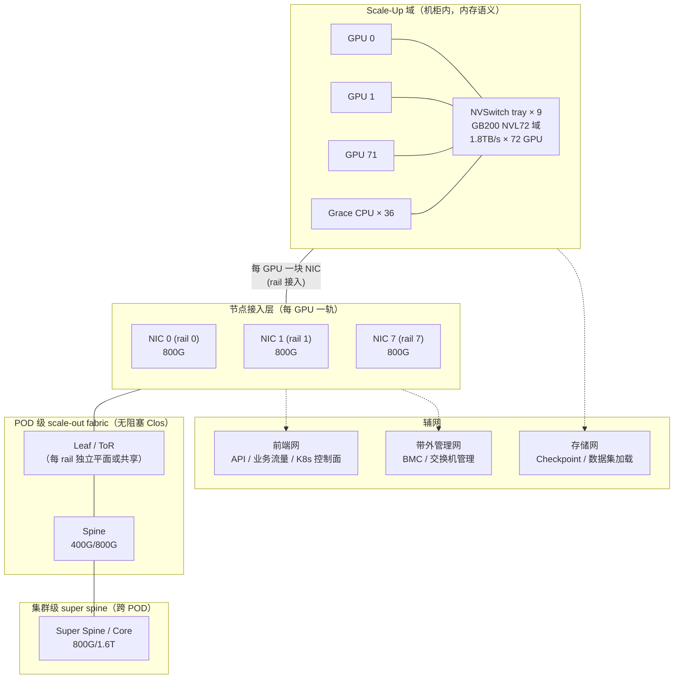
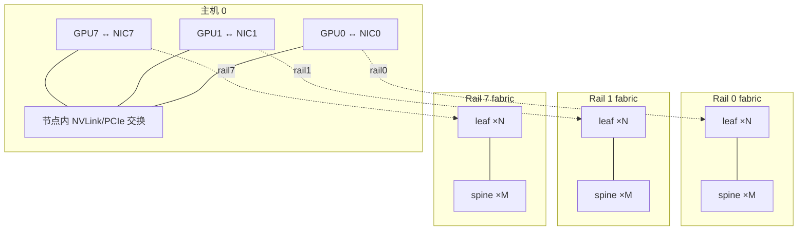
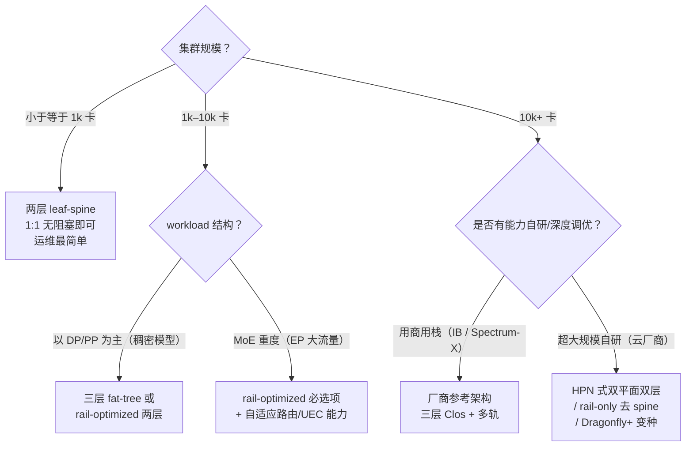

# 3. 架构设计

> 一句话理解：**一个生产级 AI 集群的网络是四层 fabric 的叠加——NVLink scale-up 域（机柜内）、节点级多轨接入、POD 级无阻塞 Clos、集群级 super spine，再叠加前端网、存储网、带外管理网三张"辅网"；架构设计就是把训练流量逐层对号放进这四层。**

## 3.1 全景图



读这张图的三个要点：

1. **主流量路径是"GPU → NVLink 域 → NIC → fabric"**：数据从 GPU 显存经 GPUDirect RDMA 直达 NIC 不落地（绕过 CPU 内存，省两次 PCIe 拷贝）。NIC 与 GPU 的 PCIe 拓扑要匹配（同 switch 下），否则 P2P 带宽打折。
2. **辅网与主网物理隔离**：checkpoint 打满存储网、K8s 控制面抖动，都不能碰训练流量。多网卡服务器上"哪块 NIC 走哪张网"必须在装机/交付阶段就固化并验收。
3. **每一层的带宽预算必须自洽**：节点 8×800G=6.4T 上行、POD 内 fabric 必须 ≥ 6.4T×节点数/2（二分），super spine 必须 ≥ POD 间并发流量；任何一层出现短板，上层带宽全部浪费。

## 3.2 分层详解

### Scale-up 域（机柜内）

以 GB200 NVL72 为例：72 颗 Blackwell GPU + 36 颗 Grace CPU，经 9 个 NVSwitch tray 组成一个无阻塞 NVLink 域，单 GPU 1.8TB/s（NVLink5，18 链路 × 100GB/s），整柜约 130TB/s 聚合带宽。域内是**内存语义**：GPU 之间可以 load/store 彼此的显存，NCCL 的 NVLink transport 直接 P2P 读写。

演进方向（2025–2026）：Rubin NVL144 把域扩到 144 颗（双 die 封装按 die 计数）、NVLink6 3.6TB/s；NVIDIA 同时开放 NVLink Fusion 授权给第三方 CPU（如 MediaTek、Marvell 等合作方）与加速器，UALink 联盟则试图提供开放替代方案（详见第 6 章）。对架构的含义：**scale-up 域正在从"单机 8 卡"长成"单柜 72–144 卡"**，机柜间带宽压力反而下降——更多通信被吸收进机柜。

### 节点接入层：一 GPU 一 NIC 的多轨形态

8 卡训练节点的标准形态是 8 块高速 NIC（每 GPU 一块、一一对应成"轨"），单机聚合 3.2T（8×400G，H100 代）或 6.4T（8×800G，GB200 代）。这个形态的理由：

- **轨对应**：第 i 块 NIC 只服务第 i 号 GPU，跨机 all-reduce 的流天然按轨隔离，fabric 可以按 rail 分平面设计（见 2.5）。
- **带宽匹配**：单 GPU 的集合通信峰值需求是 NVLink 域出口带宽的 1/8–1/4，一块 400/800G NIC 刚好匹配。
- **故障隔离**：一块 NIC/一条链路故障只影响一个"轨"，集合通信可以降级继续跑（配合 NCCL 的 channel 重排）。

代价是主机的 PCIe 拓扑必须精心设计：8 块 NIC + 8 块 GPU 挂在同一组 PCIe switch 下，才能保证 GPUDirect RDMA 的 P2P 带宽与 NUMA 亲和（这也是 [GPU 调度主题](/02-cloud-native/gpu-scheduling/)里拓扑感知调度的物理前提）。

### POD 级 fabric：fat-tree 与 rail-optimized 两种主流

**三层 fat-tree（Clos）**：k-ary fat-tree 支持 k³/4 台主机无阻塞（k=32 时 8192 台），跳数 2/4/6，是 IB 集群的经典结构（QM9700/Q3400 的胖树布线）。优点是通用、无阻塞、路由简单（up-down）；缺点是越往上层端口越贵。

**Rail-optimized 双层/单轨结构**：Meta 24k IB 集群与阿里 HPN（15k GPU/POD）都按轨分平面。以 8 轨为例，每张 rail fabric 只接 8k 台主机的同号 NIC，可以用更少的层数做到无阻塞；rail 之间不直连，跨轨流量一律经节点内部 NVLink 域转发。



HPN 的关键数字：两层双平面（dual-plane）结构单 POD 互联 **15,072 颗 GPU**（传统三层 Clos 的 5 倍规模），**双 ToR** 设计把 ToR 故障从"训练中断"降级为"带宽减半"，端到端训练性能提升 **14.9%** 以上，论文发表时已生产运行 8 个月以上。

### 容量计算的 worked example（1024 卡节点，8×400G 多轨）

假设 1024 台 8 卡主机（共 8192 卡），每 GPU 一块 400G NIC。用第 2 章的二分带宽定义验证 POD 内 fabric 是否够：

```text
主机侧总接入带宽   = 1024 × 8 × 400G = 3.28 Pb/s
要求二分带宽       ≥ 3.28 / 2 = 1.64 Pb/s（full bisection）

leaf 层：每台 leaf 48 个下行口（48×400G 接主机）、48 个上行口（1:1）
  → 需要 leaf = 1024×8 / 48 ≈ 171 台
spine 层：每台 spine 64 个 400G 端口，可接 64 个 leaf 的上行
  → 需要 spine ≥ 171×48/64 ≈ 129 台（取整后校验每 leaf 上行 48 口都打满不同 spine）

结论：两层即可无阻塞；若改用 rail-optimized（8 轨），每张 rail fabric 只接
1024 个 400G 口——用 128 端口大容量 leaf 时，1024/128 = 8 台 leaf、零 spine
就能做到轨内无阻塞；即使仍按两层设计，spine 规模也从 129 台缩到十几台。
这就是 2.5 节"rail 用更少层数实现等效无阻塞"的具体来源。
```

这个算例说明了 2.5 节"rail 用更少层数实现等效无阻塞"的具体来源：**rail 把每张子网的端点规模从 N×8 缩到 N，层数需求随端点规模下降**。HPN 的两层 15k POD 正是这个思路加上双平面容错。

### 集群级：super spine 与跨园区

单个 POD 到 1.5–3 万卡后，继续横向扩就要在 POD 之上再叠一层 super spine（或叫 core/dcgw）。设计问题从"无阻塞"变成"分区容错"：POD 之间的 job 通信（多切片训练）需要稳定带宽，但 super spine 层故障不能拖垮所有 POD——所以常见做法是**按 job 划 fabric 分区**（一个 job 的全部节点落在同一组 spine 下），与 K8s 的拓扑感知调度联动（[GPU 调度](/02-cloud-native/gpu-scheduling/)的 NodeResourceTopology 场景）。跨园区（Stargate 式多 DC 拓扑）则属于 [OpenAI 案例](/09-case-study/openai/)的范畴，本主题不展开 WAN 侧。

## 3.3 拓扑选型决策树



几个典型参照点：Meta 24k 卡选了**两种都做**（RoCE 胖树 + IB rail-optimized 各一个 24k 集群，用实践对比，见第 8 章）；阿里 15k/POD 双平面两层；腾讯星脉支持 10 万卡单集群组网；Google TPU 走的是 3D-torus + OCS 的另一条路线（见 [Google 案例](/09-case-study/google/)）；HPC 传统的 Dragonfly+（如 Slingshot、Tundra，组内全互联 + 组间长链路）在 AI 集群里多用于"万卡级且成本敏感"的场景——Dragonfly+ 的动机是"用更少的交换机端口换更大的规模"，与 rail-only 异曲同工，代价是路由与集合通信算法要专门设计。

### 机柜物理约束：网络规划的隐性边界

架构图之外，机柜层的物理约束经常反过来决定架构：

- **铜的极限**：NVLink 铜背板只在机柜内可行；机柜间 DAC（直连铜缆）在 400G 下大约 2–3 米、800G 下更短——**leaf 到 spine 的布线距离直接决定能否用电学线缆省钱**。
- **光模块功耗**：800G 可插拔光模块单端口功耗 13–18W，一台 64 端口交换机光模块功耗近 1kW，逼近芯片本体——这是 CPO（共封装光学）的核心动机（第 8 章）。
- **机柜功率**：NVL72 机柜 120kW+，一个 POD 的供电与制冷上限往往先于网络端口数到达瓶颈；腾讯星脉"支持 10 万卡"的官方口径也注明这接近单体数据中心的供电极限。

## 3.4 辅网设计

| 辅网 | 承载 | 设计要点 |
|---|---|---|
| 前端网（frontend） | API 网关、推理入口、K8s 控制面、镜像拉取 | 与训练 fabric 物理隔离；推理服务通常 25/100G 足够 |
| 存储网（storage/backend-for-storage） | Checkpoint 写读、数据集加载、参数分发 | 大流量周期性突发；常独立 100/200/400G；与并行文件系统/对象存储配合 |
| 带外管理网（BMC/OOB） | IPMI/Redfish、交换机管理口、固件升级 | 完全独立物理网络，是网络自身故障时的最后逃生通道 |

Checkpoint 流量值得单独预算：一次万卡训练 job 的 checkpoint（优化器状态+权重）可达数 TB 到数十 TB，按"分钟级完成"要求倒推，存储网需要数百 Gbps 到 Tbps 级，且它的突发模式（全集群同时写）和训练通信一样是同步的。

## 3.5 本章小结

| 层 | 关键技术 | 关键数字（2026） |
|---|---|---|
| Scale-up 域 | NVLink5/NVSwitch、（规划）UALink/NVLink6 | 72 GPU/域，1.8TB/s per GPU；Rubin NVL144 3.6TB/s [规划] |
| 节点接入 | 一 GPU 一 NIC、GPUDirect RDMA | 8×800G=6.4T/节点 |
| POD fabric | 三层 fat-tree / rail-optimized 两层 | 单 POD 15k–25k GPU 无阻塞 |
| 集群级 | super spine、按 job 分区 | 10 万卡级 = 多 POD + 分区 |
| 辅网 | 前端/存储/带外三网隔离 | checkpoint 数 TB 级突发 |

下一章沿时间轴走一遍：一个大规模训练 job 从提交到运行的每一步，网络里到底发生了什么。

**参考来源**

- [Alibaba HPN（SIGCOMM'24，免费 PDF）](https://ennanzhai.github.io/pub/sigcomm24-hpn.pdf)（15,072 GPU/POD、双 ToR、+14.9%）
- [Meta：Building Meta's GenAI Infrastructure](https://engineering.fb.com/2024/03/12/data-infrastructure/building-metas-genai-infrastructure/)（24k 双集群、RoCE 胖树 + IB）
- [NVIDIA GB200 NVL72 架构（Supermicro 参考手册 PDF）](https://www.supermicro.com/manuals/brochure/Brochure-AI-SuperCluster-NVIDIA-GB200-NVL72.pdf)
