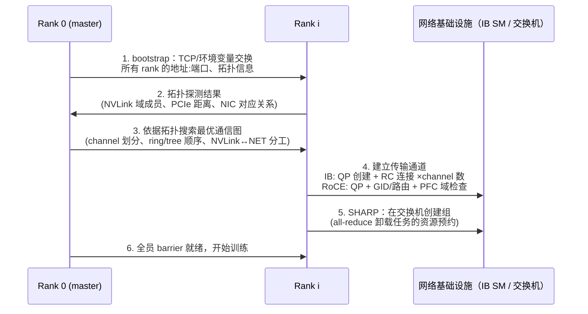
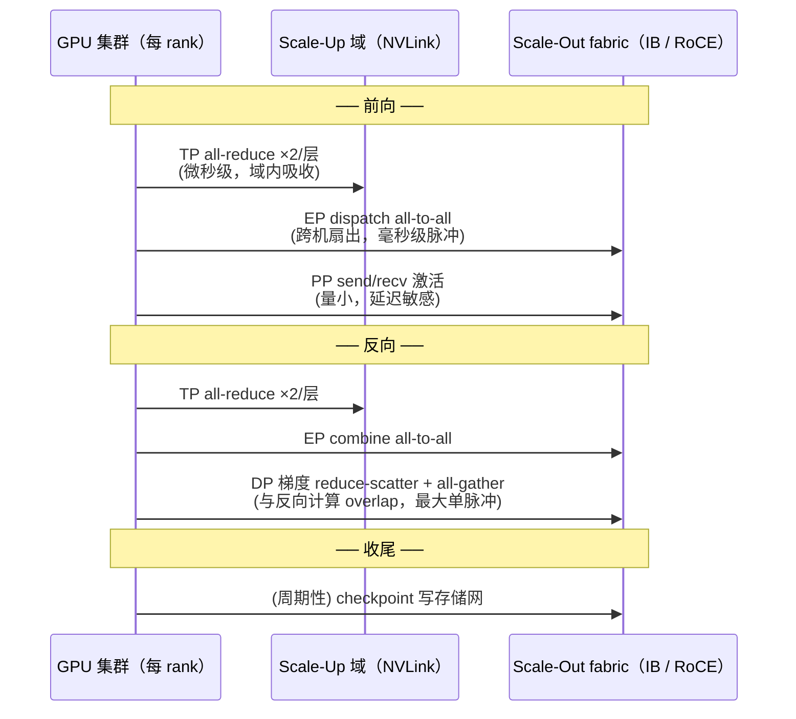

# 4. 工作流程：一次大规模训练的流量生命周期

> 一句话理解：**一次万卡训练的网络上旅程分三段——启动阶段的"建链风暴"（拓扑探测、QP 建立、SHARP 组创建，分钟级）、稳态阶段的"步内脉冲"（每 step 两次 all-to-all/all-reduce 洪峰，与计算交替重叠）、以及贯穿全程的"隐性流量"（checkpoint、遥测、故障重试）——每一段对网络的要求都不一样。**

## 4.1 阶段零：Job 启动（分钟级，但首次提交时最痛）

训练进程在第一个 step 之前要做大量网络准备，NCCL 初始化是核心：



这段旅程的几个工程现实：

- **初始化时长与规模正相关**：万卡级 NCCL init 通常要数秒到几十秒；PyTorch/NCCL 的启动优化（缓存拓扑、复用 communicator、torch.compile 与并行初始化重叠）能把"小时级"压到"分钟级"（Meta 报告把启动时间从数小时降到数分钟）。
- **SHARP 组创建是 IB 特有的隐藏成本**：网内计算需要交换机为每个通信组分配聚合资源，超大 communicator 的 SHARP 组建立可能成为秒级甚至分钟级操作，所以生产上常限制 SHARP 组数量或对超大组回退到 host 侧算法。
- **拓扑探测决定 channel 质量**：NCCL 会读取 NVLink 域结构（谁和谁在一个 NVSwitch 域内）、PCIe/NIC 对应关系，然后为每个 channel 指定"哪些 GPU 走 NVLink、哪些走 NET"。探测错了（比如老版本 NCCL 不认识新型 NVSwitch 拓扑），all-reduce 会退化成跨 NUMA 的慢路径——这是"驱动/固件/NCCL 版本必须配套升级"的原因之一。
- **gang 语义的网络体现**：初始化期间任何一个 rank 起不来，全员阻塞在 bootstrap。这就是 [GPU 调度主题](/02-cloud-native/gpu-scheduling/)里 Gang 调度存在的网络侧理由。

## 4.2 稳态阶段：一个训练 step 的通信时序

以 MoE 大模型（TP=8 机内、EP=64 跨机、PP=8、DP=其余）为例，一个 step 内网络流量呈"脉冲式"分布：



流量落点总结（与第 2 章的矩阵对应）：

| 通信 | 落在哪层 | 时序特征 | 对网络的要求 |
|---|---|---|---|
| TP all-reduce | scale-up（NVLink） | 每层 2 次，最高频 | 微秒时延、绝不抖动 |
| EP dispatch/combine | scale-out | 每层 2 次 all-to-all，同步扇出 | incast 吸收、多路径、哈希均匀 |
| PP p2p | scale-out | 每 microbatch 边界，双向 | 低时延（影响流水线气泡） |
| DP 梯度同步 | scale-out | 每 step 1 次（ZeRO 分两段） | 大带宽、与计算重叠、突发吸收 |
| Checkpoint | 存储网 | 每 N step 一次，全集群同时写 | Tbps 级突发、不干扰训练网 |

**通信-计算重叠**是稳态阶段的头号优化：ZeRO 把梯度同步拆成 reduce-scatter + all-gather 并与反向逐桶 overlap；EP 的 all-to-all 可以与 expert GEMM 做细粒度流水。重叠的效果直接取决于网络的**尾延迟稳定性**——P99 抖动一次，流水线里就插进一个气泡。

## 4.3 数据路径：一个梯度包从 GPU 到 wire

以 GPUDirect RDMA 的 write 操作为例（IB/RoCE 通用）：

```text
GPU 显存 ──DMA──▶ NIC 板载缓冲 ──线路上行──▶ 交换机 ──▶ 对端 NIC ──DMA──▶ 对端 GPU 显存
   │                │                                                            │
   │                ├─ PCIe (最好与同 GPU 同 PCIe switch)                        │
   │                ├─ 硬件生成 RDMA Write + ACK                                  │
   │                └─ 时延测量 / ECN 反应 / 速率控制                             │
   └─ CUDA kernel 的 ncclDevKernel 发出指令（doorbell）
```

关键节点：

1. **GPU→NIC**：理想路径是同 PCIe switch 下的 P2P DMA（GPUDirect）；如果 NIC 与 GPU 跨 NUMA，先要过 CPU socket 间互联，带宽与时延双输——所以交付验收时要核对 PCIe 拓扑（`nvidia-smi topo -m`）。
2. **NIC→wire**：网卡硬件按 QP（Queue Pair）维护在途请求，逐包做 congestion control（DCQCN 的速率闸门就在这）、必要时做 inline SHARP 聚合。
3. **交换机**：无阻塞转发 + ECN 标记 +（IB 上）SHARP 聚合 +（Spectrum-X/Quantum 上）自适应路由改道。
4. **对端**：按内存地址直接 DMA 进 GPU 显存，硬件回 ACK。整个过程中 CPU 只参与"发起"，不参与"搬运"。

## 4.4 故障与收尾路径

- **单 rank 网络故障**：NCCL 该 channel 超时（默认秒级到十分钟级，由 `NCCL_TIMEOUT`/`NCCL_BLOCKING_WAIT` 控制）→ 通信器 abort → job 报错退出 → 调度器重调度（从最近 checkpoint 恢复）。NSDI'24 的 Google 数据表明训练机每天 0.08% 的故障率意味着万卡集群几乎每天都有节点退出，**这条路径必须快**：checkpoint 频率、恢复时间（MTTR）决定了有效训练时间占比。
- **链路降速而非中断**：光模块误码导致 FEC 纠错、链路从 800G 协商到 400G——不触发故障检测，但 all-reduce 带宽悄悄减半。这类"灰度故障"只能靠遥测发现（第 5.4）。
- **checkpoint 突发**：每 N step（典型几十分钟）全集群同时向存储网写数 TB 数据。这个突发必须满足两个约束：一是带宽足够（否则 step 被拖长），二是**绝不能借道训练 fabric**（否则 PFC/ECN 域被瞬间打爆，集合通信全面降级）。实践中常见做法是给 checkpoint 独立的存储 NIC 与物理隔离的存储网络。
- **Job 结束**：进程退出 → QP/SHARP 组释放 → 交换机转发表老化。短生命周期的推理任务（Serverless）反复建链，QP 建立的 µs/ms 级开销和交换机表项压力成为另一个优化战场（[vLLM](/04-llmops/vllm/)/[SGLang](/04-llmops/sglang/) 的 PD 分离多机部署同样受此约束）。

## 4.5 本章小结

| 阶段 | 网络事件 | 时间量级 | 优化关键词 |
|---|---|---|---|
| 启动 | bootstrap、拓扑探测、QP/SHARP 组创建 | 秒–分钟 | 初始化重叠、版本配套、Gang 保证 |
| 稳态每 step | TP（域内）+ EP/PP/DP（域外）脉冲 | ms 级 | 重叠、尾延迟、incast 吸收 |
| 数据路径 | GPUDirect RDMA 全程硬件搬运 | µs 级 | PCIe 拓扑、QP 深度、CC 参数 |
| 故障路径 | 超时→abort→重调度→checkpoint 恢复 | 分钟级 | MTTR、灰度故障遥测 |

下一章深入稳态阶段依赖的四个核心模块：NVSwitch、IB 子网管理器、拥塞控制、遥测。

**参考来源**

- [NCCL Documentation — NVLink/NVSwitch 拓扑与 channel 划分](https://docs.nvidia.com/deeplearning/nccl/user-guide/docs/envs.html)
- [Meta：Training large language models at scale](https://engineering.fb.com/2024/06/12/data-infrastructure/training-large-language-models-at-scale-meta/)（启动时间从小时到分钟、并行-拓扑映射）
- [NVIDIA Quantum-X800 用户手册（SHARP v4）](https://networking-docs.nvidia.com/nvidia-quantum-x800-xdr-clusters)
