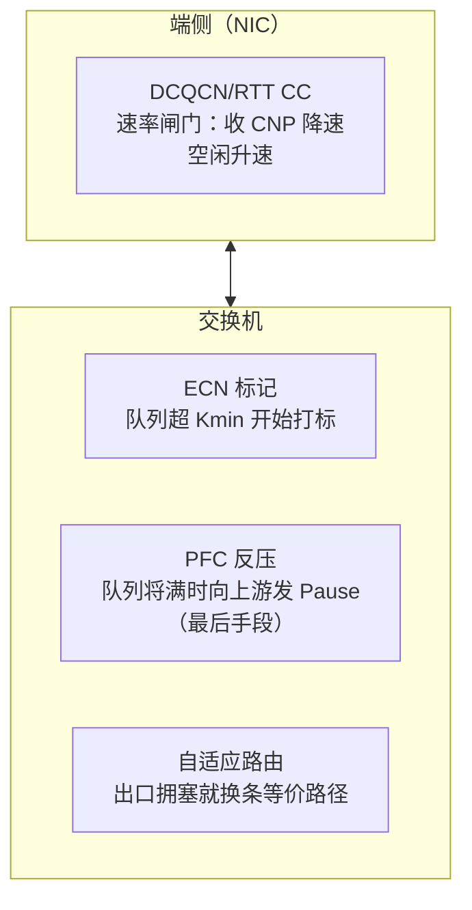

# 5. 核心模块

> 一句话理解：**AI 集群网络的四个核心模块各管一段——NVSwitch 把机柜变成一个"大 GPU"，IB 子网管理器把 fabric 的拓扑/路由/资源管成一台"逻辑交换机"，拥塞控制模块（PFC/ECN/DCQCN/自适应路由）决定大象流能不能共存，遥测模块决定你能不能在一个 step 之内找到那条捣乱的链路。**

## 5.1 Scale-Up 模块：NVSwitch 与 NVLink 域

NVSwitch 是 scale-up 域的心脏。以 GB200 NVL72 为例：9 个 NVSwitch tray 通过机柜背板（铜互连）把 72 颗 GPU 连成无阻塞交换阵列，每 GPU 18 条 NVLink5 链路（100GB/s/条，双向合计 1.8TB/s）。NVSwitch 的职责有三层：

1. **无阻塞交换**：任意两 GPU 之间专线带宽，all-to-all/ring 随意打满，没有哈希、没有收敛比。
2. **内存语义维护**：NVLink 是 load/store 协议，NVSwitch 负责地址路由、一致性/排序语义，让 72 颗 GPU 的显存像一台机器的共享地址空间。
3. **集合运算卸载**：NVSwitch 内置的 NVLink SHARP 能力可以在交换路径上直接做归约（reduce），all-reduce 的"加"发生在 switch 内部而不是端上——这与 IB 的 SHARP（见 5.5）是同一思想的两个实现。

AMD 阵营的对照实现是 Infinity Fabric/xGMI：MI300X 每 GPU 7 条 xGMI 链路（128GB/s/条，合计 896GB/s），8 卡平台是**全互联 mesh（无 switch 芯片）**——带宽参数接近 NVLink4，但 all-to-all 有效带宽和扩展性（没有 NVL72 这样的 72 卡域）是结构性差距。UALink 联盟（2025-04 发布 1.0 规范）试图定义开放的 scale-up 标准，截至 2026-10 尚无量产芯片（第 6 章展开）。

## 5.2 Scale-Out 控制面：IB 子网管理器（Subnet Manager）

InfiniBand 的 fabric 不是即插即用的：每一代链路速率、每增加一台交换机，都要由**子网管理器（SM）**统一计算和下发三张表：

| SM 职责 | 内容 | 生产实现 |
|---|---|---|
| LID/GID 分配 | 给每个端口分配本地标识 | OpenSM（开源）、NVIDIA UFM（商用） |
| 路由计算 | 为每个 src-dst 对算端口级路径 | fat-tree 用 up-down 算法；Dragonfly+ 用特定路由；可插件化 |
| 资源管理 | SHARP 组、VL（虚通道）、QoS 的分配 | UFM 集中管控 |

SM 的设计要点：

- **高可用**：SM 是控制面单点（数据面不受影响），生产必须跑主备（常用 UFM HA 或双 OpenSM 心跳）。SM 重启期间新链路不能入网，但存量转发不中断。
- **路由算法的"AI 化"**：传统 up-down 对 all-to-all 流量并不友好（第 2 章的 incast），所以 NVIDIA 在 Quantum-2/X800 上提供**自适应路由（Adaptive Routing）**——转发不再严格查静态表，而是按出口队列拥塞状态动态选路，与集合通信感知（collective-aware）配合打散大象流。
- **与调度系统的联动**：UFM 提供 API，把 fabric 状态（链路降速、端口错误计数）暴露给调度器，实现"带病节点不调度"（对应 [AI SRE](/07-ai-sre/) 的闭环）。

SM 的日常操作对运维是黑盒与显式并存，几个典型动作：

```bash
ibstat / iblinkinfo          # 查看链路速率与状态（发现"协商降速"的第一现场）
perfquery / ibqueryerrors    # 端口计数器：CRC、丢包、错误符号
opensm -c /etc/opensm.conf   # SM 启动：路由引擎选择（fat-tree / updn / torus-2QoS）
saquery -r                   # 查询 SA（子网代理）路由表
```

生产环境的经验：**数据面故障 80% 能在端口计数器里看到先兆**（误码率缓慢爬升），SM/UFM 把这些计数器变成 fabric 级健康画像，是"灰度故障"防线的一部分。

RoCE/以太网没有 SM 这个实体——它的"控制面"分散在：PFC/ECN 的域配置（逐交换机下发）、BGP/EVPN 路由（underlay）、以及（Spectrum-X 上）SONiC/Cumulus 加 NVIDIA 专用 agent。**这是 IB 与以太网在运维模型上的根本差异：前者集中式、声明式；后者分布式、需要更多工程纪律。**

## 5.3 拥塞控制模块：从 PFC 到自适应路由

拥塞控制是 AI fabric 上最"细节决定成败"的模块。四层机制由内到外：



**ECN（显式拥塞通知）**：交换机监测出口队列，超过 Kmin 开始对报文打 CE 标记，接收端 NIC 回送 CNP（拥塞通知包），发送端 NIC 据此降速。DCQCN（SIGCOMM'15，微软为 Bing 的 RoCE 部署提出）是它的标准化实现：alpha 平滑的乘性降速 + 字节计数器/定时器的加性升速 + 快速恢复。参数（Kmin/Kmax、降速因子、AI/HI 定时器）必须按 RTT 与缓冲区大小整网调优，调不好就是"不降速（丢包）或降太狠（带宽跑不满）"。

**PFC（优先级流控）**：队列真要溢出时的最后手段——向上游发 Pause 帧。PFC 的问题在 [计算机网络](/01-foundation/computer-networks/) 主题有原理介绍，本主题强调工程后果：

- **死锁**：多条流在 up-down 路由下形成缓冲区依赖环（Mini Demo 场景 5 给出可运行的检测模型），全员永久 Pause。
- **风暴/队头阻塞**：Pause 逐级上溯可能扩散到无损域入口，把整个域"冻住"数毫秒——在同步屏障下就是全员 step 停顿。
- **缓解手段**：死锁检测与 watchdog、缓冲区分段（shared/dynamic 水位）、让大象流别触发 PFC（靠 ECN 提前降速 + 足够 headroom）、或用自适应路由把热点流引开。

**自适应路由（AR）**：Quantum-2（NDR）起 IB 支持、Spectrum-X 以太网原生支持。思想是"与其排队等一条最优路径，不如立刻换条空闲的等价路径"。对 incast 与哈希极化都是釜底抽薪——但要求传输层能容忍**乱序到达**（IB 的按序交付需要交换机做报文排序，Spectrum-X 与 UEC 则把它交给端侧）。这正是 UEC 规范的立足点（见 6.3）。

## 5.4 遥测与故障域模块

AI fabric 的遥测要求远高于传统 DCN，因为故障模式多是"灰度"的：

| 遥测对象 | 关键指标 | 能发现什么 |
|---|---|---|
| 端口物理层 | FEC 纠错计数、CRC 错误、链路协商速率 | 光模块老化/污染导致的"悄悄降速" |
| 队列/缓冲 | ECN 标记率、PFC Pause 时长与次数 | 隐型热点、PFC 风暴前兆 |
| 流级 | per-flow 吞吐、重传、乱序 | 哈希极化（多条流挤一条路径） |
| 集合通信级 | nccl-tests 带宽、step 时间分解 | 端到端"网络是否拖后腿" |
| 拓扑/配置 | 实际布线与设计图偏差、CRC 域配置 | 施工错误（错线、错 VLAN） |

工程实践的两个参照：腾讯星脉 2.0 的"灵境"仿真平台宣称能在万卡规模**分钟级定位**网络或慢卡故障；NVIDIA UFM 的遥测 + telemetry 流能把交换机每端口每队列的计数器秒级送入监控。这些系统的共同价值：**把一个 step 之内出现的网络抖动，归因到具体链路，时间控制在下一次重试发生之前**——这就是 [AI SRE](/07-ai-sre/) 主题里"网络 SLI"的落地形态。

一条可落地的采集管线长这样：

```text
交换机端口计数器（每 5–10s）
  ├─ IB: UFM telemetry / perfquery → Prometheus exporter
  └─ 以太网: SNMP/gNMI（SONiC 原生） → Prometheus
主机侧（每 5–15s）
  ├─ ibstat / ethtool -S → node-exporter 扩展
  ├─ NVIDIA: DCGM（GPU 侧） + NCCL 内建计时（per-comm 时延）
  └─ dmesg / 链路事件 → 事件流
集合通信级（每 step / 每 job）
  └─ nccl-tests 定时巡检 + 训练框架的通信耗时分解
        │
        ▼
  统一监控：P99 通信时延、busbw 达标率、PFC pause 占比、FEC 误码趋势
        │
        ▼
  告警规则：单链路误码斜率、单 rail 带宽偏离、step 时延突增且无变更记录
```

关键设计决策是**把"集合通信级"指标与"物理层"指标放进同一个时间轴**：step 抖动告警一跳链路到端口计数器，就是一次完整的归因。

故障域设计上，模块化冗余是标准答案：双 ToR（HPN）、双 plane（HPN/星脉）、多 rail + channel 降级（NCCL）、链路聚合+快速收敛。设计原则一句话：**任何单点失效都只准造成"带宽降级"，不准造成"训练中断"**。

## 5.5 网内计算模块：SHARP 与 NVLink SHARP

集合通信的归约（reduce）可以由交换机代劳：

- **IB SHARP**：Quantum 系列交换机内置聚合引擎。SHARP v4（Quantum-X800 代）提供约 14.4 TFLOPS 聚合算力（官方口径，约为 NDR 代的 9 倍），all-reduce 变成"每个节点把数据发进树、交换机边收边加、结果广播回去"，通信量从 O(N) 降到近 O(1) 接收。
- **NVLink SHARP**：NVSwitch 内对 NVLink 域的通信做同样的事，TP 的 all-reduce 直接由 switch 完成归约。

价值与代价：对超大消息 all-reduce，SHARP 能显著提升有效带宽（尤其 reduce 阶段）；代价是组资源有限（5.2 节 SM 管理）、组建立有延迟、且把更多"正确性"押在交换机固件上——所以生产上常见策略是"消息大于阈值才走 SHARP"。

## 5.6 本章小结

| 模块 | 代表实现 | 核心职责 | 典型故障 |
|---|---|---|---|
| Scale-up | NVSwitch tray、AMD xGMI mesh | 域内无阻塞 + 内存语义 + 归约卸载 | 拓扑识别错误、背板误码 |
| 控制面 | IB SM/UFM；以太网 BGP+配置管理 | 拓扑发现、路由、资源分配 | SM 单点、路由算法与流量不匹配 |
| 拥塞控制 | ECN/DCQCN、PFC、自适应路由 | 大象流共存、incast 吸收 | PFC 死锁/风暴、ECN 参数不当 |
| 遥测 | UFM telemetry、灵境、自研采集 | 灰度故障定位、SLI | 采集粒度不够、告警无拓扑上下文 |
| 网内计算 | SHARP v4、NVLink SHARP | 归约卸载、降通信量 | 组资源耗尽、固件 bug |

下一章换个视角：把 IB、RoCE、UEC 三条路线放到一张对比表里，并读一读 NCCL 与 UEC/Falcon 的源码级设计。

**参考来源**

- [NVIDIA Quantum-X800 XDR 集群文档（SHARP v4、自适应路由）](https://networking-docs.nvidia.com/nvidia-quantum-x800-xdr-clusters)
- [DCQCN（SIGCOMM'15）](https://www.microsoft.com/en-us/research/publication/dcqcn-congestion-control-for-large-scale-rdma-deployments/)
- [腾讯星脉 2.0 发布报道（C114）](https://www.c114.com.cn/ai/5339/a1267376.html)（灵境分钟级定位）
- [AMD Instinct MI300X 平台（8×896GB/s xGMI 全互联）](https://flopper.io/system/amd-instinct-mi300x-platform)
