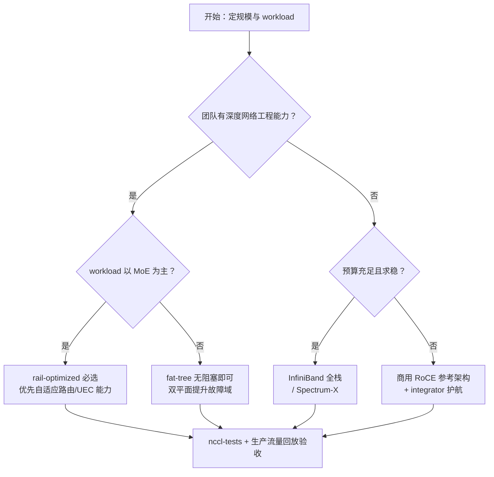

# 8. 企业生产实践

> 一句话理解：**生产实践的决策顺序是——先用流量矩阵和规模定 fabric 形态，再用"确定性 vs 开放性"定协议路线，然后用量化案例校准预期（95% 利用率是调出来的，不是买出来的），最后把排障 playbook 和验收标准写进运营手册。**

## 8.1 选型决策

### 协议路线对比（2026 年视角）

| 方案 | 适合谁 | 优势 | 代价 |
|---|---|---|---|
| InfiniBand（Quantum-2/X800） | 追求确定性的大厂/超算 | 无损原生、SHARP、UFM 一体化、案例最成熟（Oracle 131k、Stargate 部分、顶级超算） | 封闭、贵、单一供应商 |
| Spectrum-X（以太网 AI 化） | 想用以太网但要"IB 级"体验 | 自适应路由 + 增强 CC + 与 NVIDIA 栈协同；xAI Colossus 验证了 95% 吞吐 | 仍深度绑定 NVIDIA |
| 自建 RoCE（商用交换机 + 调优） | 有网络工程团队的云/大厂 | 开放生态、成本可控、可定制（阿里 HPN、腾讯星脉路线） | PFC/ECN 调优门槛高，一切自己兜底 |
| UEC-ready 以太网 | 面向 2027+ 的建设 | 规范开放、原生 spraying/乱序 | 生态刚起步，需陪跑 |
| 混合 | 现实的大多数 | 不同代际/不同供应商风险对冲（Meta 双织物） | 两套运维体系 |

### 决策树

### 被验证过的量化参照点

- **Meta 双 24k 集群（2024）**：一个 RoCE（Arista 7800 + Wedge400/Minipack2）、一个 Quantum-2 IB；不优化时大集群性能只有理想值 10–90%，拓扑感知调度 + 路由优化 + NCCL 调参后回到 90%+。教训：**大规模本身就是变量，验收必须在大集群上做**。
- **xAI Colossus（2024–2025）**：100k H100（后翻倍）用 Spectrum-X + SN5600 + BlueField-3，NVIDIA 官方口径 95% 持续吞吐、零丢包；对照口径"传统以太网约 60%"。教训：**以太网不是不行，是"增强型"以太网才行**（见 [xAI 案例](/09-case-study/xai/)）。
- **阿里 HPN（SIGCOMM'24）**：15,072 GPU/POD 双平面两层、双 ToR、每 GPU 400G 后端带宽；端到端 LLM 训练性能提升 14.9%+；发表时已生产 8 个月+。
- **腾讯星脉 2.0（2024-07）**：自研 51.2T 交换机（TCS9500）、400G 硅光、自研 CNIC 算力网卡（单机 3.2T）、TiTa 2.0 主动拥塞控制、TCCL 通信库；官方口径训练效率 +20%、MoE 通信性能 +30%、支持 10 万卡组网、分钟级故障定位。
- **OpenAI Stargate（2025–2026，公开报道口径）**：Abilene 等园区采用"自有协议 + 多厂商"路线——在 OCP 开源 MRC（Multipath Reliable Connection，与 AMD/Broadcom/Intel/微软/NVIDIA 共同开发，多路径喷洒 + 可靠连接），同时大量采购 InfiniBand（NVIDIA 口径 Stargate 含 64,000 台 GB200 系统的 IB 网络）。[未经独立验证的细节以 OCP 仓库与官方披露为准]
- **Google（对照组）**：TPU 走 3D-torus + OCS + ICI 自研路线；GPU 侧则以 Falcon 硬件传输 + Jupiter SDN/OCS 体系服务全网 RDMA——两条路线都验证过"为 AI 定制 fabric"比"通用 fabric 调优"走得更远（见 [Google 案例](/09-case-study/google/)）。

## 8.2 排障 Playbook

症状 → 定位 → 处置（按出现频率排序）：

| 症状 | 最可能根因 | 定位手段 | 处置 |
|---|---|---|---|
| all-reduce 带宽只有标称 60–80% | 哈希极化 / PFC 降速 / 光模块误码 | 对比 per-flow 吞吐分布；PFC pause 计数；FEC/CRC 计数 | 开自适应路由；换模块；调 ECN |
| 随机 NCCL timeout | 链路 flapping / 单端口错误风暴 | 交换机端口 up/down 日志；NIC 链路日志 | 隔离端口；重调度 job |
| 周期性 step 抖动 | PFC 风暴前兆 / 某 rail 热点 | PFC pause 时长曲线；per-queue ECN 标记率 | 降 CNP 阈值；调整无损域边界 |
| MoE 一开就劣化 | all-to-all incast + 极化叠加 | 流量矩阵仿真（Mini Demo 场景 3/4 的思路） | EP 分组、自适应路由、拓扑感知 all-to-all |
| 扩容后性能不升反降 | 拓扑感知调度缺失 / NCCL 旧版不认识新拓扑 | 对比新旧集群 nccl-tests；NCCL 拓扑 debug 日志 | 升级 NCCL/固件；开启拓扑感知调度 |
| 慢节点拖累全集群 | 单卡/单网卡 PCIe 拓扑错误 | `nvidia-smi topo -m` 巡检；NVLink 误码计数 | 修正布线/BIOS；节点隔离 |

三条纪律：

1. **先测 fabric 再测训练**：nccl-tests 不达标（见 8.4）不上真实 workload，避免"网络问题表现成模型问题"。
2. **每次变更只做一件事**：固件、驱动、NCCL、拓扑、ECN 参数，一次只改一个并留对照。
3. **保留"逃生通道"**：任一 job 能一键切回非 SHARP / 单 plane / 降级拓扑运行——新特性必须先灰度。

## 8.3 扩展与升级路径

- **带宽代际**：400G（NDR/QSFP112）→ 800G（XDR/OSFP）→ 1.6T（802.3dj 时代）。2025–2026 的现实是 800G 端口放量、1.6T 开始部署；交换机芯片进入 102.4T 时代（Tomahawk 6 已出货，NVIDIA Spectrum-6 对应 Spectrum-X Photonics 系列）。
- **光与电的边界**：单通道 112G SerDes 已到极限，224G/lane 靠 CPO（共封装光学）降功耗。NVIDIA 在 GTC 2025（3 月 18 日）发布 Spectrum-X Photonics（SN6810 102.4T/128×800G、SN6800 409.6T/512×800G，基于 TSMC COUPE 硅光平台）与 Quantum-X Photonics（Q3450-LD，144×800G），官方口径较可插拔光模块省电约 3.5–5 倍、网络韧性提升 10 倍；2025 底–2026 陆续交付。CPO 的运维含义：**光引擎不可现场更换**，备件策略与故障域设计要跟着改。
- **供电与散热的耦合**：800G/1.6T 端口功耗与机柜功率（NVL72 已达 120kW+）把"网络规划"变成"电力规划"的前置输入（参见 [xAI 案例](/09-case-study/xai/) 的电力账）。
- **协议升级窗口**：IB XDR、Spectrum-X、UEC 1.x 的共存期会持续到 2027 前后；新集群若计划 5 年生命周期，应把 UEC-ready 作为加分项而非决定项。

## 8.4 验收标准（交付 checklist 摘要）

| 项 | 标准（参考） |
|---|---|
| nccl-tests all_reduce busbw | 单轨 ≥ 标称 90%；整机 8 轨 ≥ 85% |
| 全集群 sweep | 随机抽 10% 主机对，busbw 不低于单轨 80% |
| 故障注入 | 随机断 1 链路/1 ToR，训练降级不中断（或按设计自动重调度） |
| 灰度故障 | 人工把某端口限速 50%，遥测 5 分钟内告警并定位到端口 |
| 长时间稳定性 | 72 小时真实 workload，PFC pause 总时长占比小于万分之一，无 NCCL timeout |

## 8.5 成本结构与采购策略

网络 bill of materials 的内部结构决定了采购谈判的优先级：

| 部件 | 占网络成本比例（经验值） | 降本杠杆 |
|---|---|---|
| 光模块/AOC/DAC | 30–50% | 速率代际选择、DAC 替代光模块（距离允许时）、多供应商认证 |
| 交换机（含芯片） | 25–40% | 收敛比取舍（仅限辅网）、rail 结构减层数、白盒 + 自研 NOS |
| NIC/DPU | 15–25% | 与 GPU 捆绑采购、功能取舍（是否需要 DPU 卸载） |
| 线缆/配线架/施工 | 10–15% | 布线设计复用、即插即用预端接 |

两条被反复验证的采购纪律：① **光模块多供应商认证**——单一供应商的光模块在 800G 代际就是交付瓶颈；② **交换机与光模块解耦采购**——绑定销售的光模块溢价通常显著高于第三方认证件，但要付出互操作测试成本。

## 8.6 推理集群的网络差异清单

推理集群复用训练 fabric 的大部分设计，但 checklist 有三处不同：

- **南北向带宽**：推理入口（API 网关→实例）需要独立容量规划，长上下文请求的输入/输出不对称（输入大、输出小）。
- **KV Cache 传输**：PD 分离架构下，prefill 与 decode 节点间是持续的大块数据流，需要低尾延迟的 RDMA 路径与独立的传输层（NIXL/Mooncake 类），这部分流量要与训练集合通信区别对待。
- **多实例共享 fabric**：推理实例密度高、生命周期短，QP  churn 与交换机表项压力大于训练；灰度发布时的"新旧版本混跑"要求 fabric 支持无损滚动升级。

## 8.7 本章小结

生产实践的精髓是**"用量化案例定预期、用流量矩阵定容量、用 playbook 定响应"**：Meta 告诉我们大集群必须现场调优，xAI 告诉我们增强以太网可以到 95%，HPN/星脉告诉我们自研路线的收益与代价，Google/OpenAI 告诉我们第三条路的门槛在运维体系。选型没有标准答案，但"先算账（流量矩阵）、再验收（nccl-tests）、后灰度（逃生通道）"的顺序对所有路线成立。

**参考来源**

- [Meta：Building Meta's GenAI Infrastructure](https://engineering.fb.com/2024/03/12/data-infrastructure/building-metas-genai-infrastructure/)
- [NVIDIA Newsroom：xAI Colossus × Spectrum-X](https://nvidianews.nvidia.com/news/spectrum-x-ethernet-networking-xai-colossus)
- [Alibaba HPN（SIGCOMM'24）](https://ennanzhai.github.io/pub/sigcomm24-hpn.pdf)；[腾讯星脉 2.0（C114）](https://www.c114.com.cn/ai/5339/a1267376.html)
- [NVIDIA Quantum-X800 平台](https://www.nvidia.com/en-us/networking/products/infiniband/quantum-x800/)；[Spectrum-X Photonics 发布（CIO Taiwan 转述）](https://www.cio.com.tw/87441/)
- [OCP Falcon 传输仓库](https://github.com/opencomputeproject/OCP-NET-Falcon)
