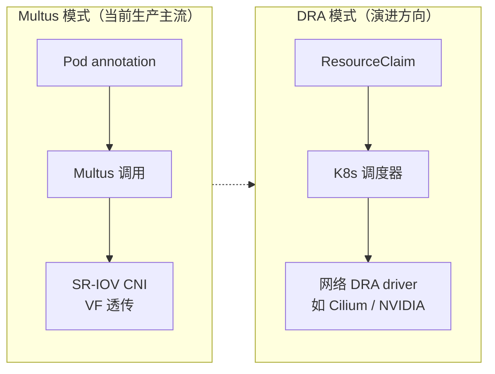

# 3. 架构设计

> 一句话理解：**CNI 是"每个节点上一组二进制插件 + 一份链式配置文件"，CSI 是"Controller 侧车控制逻辑 + Node 侧车执行挂载"的双面结构**——二者都通过 kubelet 的触发点与 K8s 主控制平面衔接，但 CNI 更贴近容器运行时，CSI 更贴近存储控制器。

## 3.1 CNI 部署模型

### 节点上的文件布局

```text
每个 K8s 节点
├── /opt/cni/bin/
│   ├── bridge          <-- 创建 Linux bridge + veth pair
│   ├── host-local      <-- 本地 IPAM
│   ├── static          <-- 静态 IPAM
│   ├── loopback        <-- 配置 lo 接口
│   ├── route           <-- 路由管理
│   ├── firewall        <-- iptables/nftables 防火墙
│   ├── bandwidth       <-- 限速
│   ├── portmap         <-- 端口映射
│   └── flannel / calico / cilium-cni 等厂商插件
└── /etc/cni/net.d/
    ├── 10-flannel.conflist
    ├── 10-calico.conflist
    └── 10-mynet.conf
```

kubelet / CRI 按字典序读取 `/etc/cni/net.d/` 下的第一个有效配置。`.conflist` 文件可以链式调用多个插件，每个插件接收上一个插件的 `prevResult`。

### CNI 配置列表与插件链

```json
{
  "cniVersion": "1.0.0",
  "name": "k8s-pod-network",
  "plugins": [
    {
      "type": "calico",
      "log_level": "info",
      "datastore_type": "kubernetes",
      "nodename": "node-1",
      "ipam": { "type": "calico-ipam" },
      "policy": { "type": "k8s" },
      "kubernetes": { "kubeconfig": "/etc/cni/net.d/calico-kubeconfig" }
    },
    {
      "type": "bandwidth",
      "capabilities": { "bandwidth": true }
    }
  ]
}
```

执行顺序：

```text
ADD chain
  ├─ plugin A (calico)  创建 veth、分配 IP、设置路由
  │      prevResult = { ips, routes, dns, interfaces }
  ├─ plugin B (bandwidth) 读取 prevResult，应用 tc 限速
  │      prevResult' = prevResult
  └─ final result 返回给调用方
```

插件之间通过 `prevResult` 传递上下文；`capabilities` 机制允许运行时（如 kubelet）传入额外参数（如 bandwidth 限制）。

### kubelet / CRI → CNI 调用路径

```text
Pod 创建
   │
   ▼
kubelet 通过 CRI 调用 runtime（containerd/CRI-O）创建 sandbox
   │
   ▼
runtime 创建 network namespace
   │
   ▼
runtime 执行 CNI ADD
   │     CNI_COMMAND=ADD
   │     CNI_NETNS=/proc/xxx/ns/net
   │     CNI_CONTAINERID=<sandbox-id>
   │     CNI_IFNAME=eth0
   ▼
/opt/cni/bin/... 按 conflist 链式执行
   │
   ▼
返回 result { ips, routes, dns, interfaces }
```

### 多节点模型

CNI 必须解决**跨节点 Pod 通信**。常见三种模型：

| 模型 | 代表 CNI | 原理 | 优缺点 |
|---|---|---|---|
| **Overlay（VXLAN）** | Flannel VXLAN、Calico VXLAN、Cilium VXLAN | Pod 包封装进 VXLAN UDP，走节点 IP 网络 | 通用、不要求底层网络配合；有封装开销、MTU 需减小 |
| **路由（BGP/直连）** | Calico BGP、Cilium 原生路由 | 每个 Pod IP 通过节点路由可达 | 性能好、无封装；要求底层网络能播路由 |
| **Underlay（二层）** | Flannel host-gw、Macvlan、SR-IOV | Pod 直接使用节点网络或 VF | 性能最高；IP 管理复杂、需要硬件配合 |

AI 训练场景通常 prefer **路由或 Underlay**：VXLAN 的封装 / 解封装会消耗 CPU、增加 latency，对 NCCL all-reduce 不友好。

## 3.2 CSI 部署模型

### Controller 侧：Deployment + sidecars

```text
CSI controller pod（通常 1~2 副本）
├── csi-driver        <-- 你的 CSI 驱动 controller service
├── external-provisioner
│       监听 PVC → CreateVolume / DeleteVolume
├── external-attacher
│       监听 VolumeAttachment → ControllerPublish / Unpublish
├── external-resizer
│       监听 PVC .status.allocatedResources → ControllerExpandVolume
├── external-snapshotter
│       监听 VolumeSnapshot → CreateSnapshot / DeleteSnapshot
└── livenessprobe / csi-attacher-health-monitor
```

Controller 需要访问后端存储 API（如云厂商 API、Ceph MON、NFS server），因此通常只跑在有权限的节点或独立 Deployment 上。

### Node 侧：DaemonSet + node-driver-registrar

```text
每个 K8s 节点上的 CSI node pod
├── csi-driver        <-- 你的 CSI 驱动 node service
└── node-driver-registrar
        把 /csi/csi.sock 注册到 kubelet 的插件注册机制
        kubelet 通过 /var/lib/kubelet/plugins/<driver-name>/csi.sock 调用 Node 接口
```

### kubelet 插件注册机制

```text
1. node-driver-registrar 启动后，把 CSI driver 信息写入
   /var/lib/kubelet/plugins_registry/<driver-name>-reg.sock

2. kubelet 的 plugin watcher 发现该 socket，调用 GetPluginInfo 获取
   { name, endpoint, supportedVolumeMode, ... }

3. kubelet 记住 driver name → socket path 的映射

4. 当 Pod 需要挂载该 driver 的卷时，kubelet 通过
   /var/lib/kubelet/plugins/<driver-name>/csi.sock
   直接调用 NodeStageVolume / NodePublishVolume
```

### VolumeAttachment 对象

CSI 的 ControllerPublish/Unpublish 由 `VolumeAttachment` 对象触发：

```yaml
apiVersion: storage.k8s.io/v1
kind: VolumeAttachment
metadata:
  name: csi-xxx
spec:
  attacher: ebs.csi.aws.com
  nodeName: worker-1
  source:
    persistentVolumeName: pv-xxx
status:
  attached: true
```

`external-attacher` watch 到 `VolumeAttachment` 后，调用 CSI Controller 的 `ControllerPublishVolume`；卸载时调用 `ControllerUnpublishVolume`，成功后删除该对象。

## 3.3 K8s 触发路径

### 网络：Pod 创建触发 CNI

```text
用户：kubectl apply -f pod.yaml
   │
   ▼
apiserver 写入 Pod 对象
   │
   ▼
kubelet watch 到本节点 Pod，开始 syncPod
   │
   ▼
CRI 创建 pause / sandbox 容器 & netns
   │
   ▼
kubelet 调用 CRI CNI ADD（底层执行 /opt/cni/bin/...）
   │
   ▼
CNI 返回 IP，kubelet 把 Pod IP 写回 status
```

### 存储：PVC + Pod 触发 CSI

```text
用户：kubectl apply -f pvc.yaml
   │
   ▼
apiserver 创建 PVC
   │
   ▼
external-provisioner watch 到未绑定 PVC
   │
   ▼
调用 CSI CreateVolume → 创建后端卷
   │
   ▼
创建 PV 并绑定到 PVC

用户：kubectl apply -f pod.yaml（使用该 PVC）
   │
   ▼
scheduler 把 Pod 调度到某节点
   │
   ▼
external-attacher 创建 VolumeAttachment
   │
   ▼
调用 CSI ControllerPublishVolume（云厂商把盘挂到节点）
   │
   ▼
kubelet 调用 CSI NodeStageVolume（格式化 / 全局挂载）
   │
   ▼
kubelet 调用 CSI NodePublishVolume（bind-mount 到 Pod 目录）
   │
   ▼
容器启动，看到 /data
```

### NetworkPolicy 的实现

NetworkPolicy 不是由 kubelet 直接触发，而是由 CNI 数据面持续同步：

```text
用户创建 NetworkPolicy
   │
   ▼
CNI 控制平面（Calico Typha/Felix、Cilium Operator/Agent）watch 策略
   │
   ▼
下发到节点数据面（iptables / eBPF / OVS）
   │
   ▼
Pod 之间的流量被允许 / 拒绝
```

## 3.4 网络拓扑：单 CNI、Multus 多网卡、SR-IOV、RDMA

### 单 CNI 模型

```text
Pod
 └── eth0 ── CNI（Cilium/Calico/Flannel）── 集群默认网络
```

最简单，适合大多数微服务和推理服务。

### Multus 多网卡模型

```text
Pod
 ├── eth0 ── 默认 CNI（管理面 / Service 网络）
 ├── net1 ── macvlan（存储网络）
 └── net2 ── SR-IOV CNI（RDMA 训练网络）
```

Multus 是一个 "meta CNI"，本身不做数据面，只负责按 `NetworkAttachmentDefinition` 依次调用多个 CNI。AI 训练常用 Multus 把管理、存储、RDMA 三网分离。

### SR-IOV + RDMA 模型

```text
物理节点
 ├── PF（Physical Function）：mlx5_0，100Gbps RoCE/IB
 └── VFs（Virtual Functions）：mlx5_1, mlx5_2, ..., mlx5_N

Pod A
 └── eth1 ── VF mlx5_1 直通到 netns ── 可直接做 RDMA
```

SR-IOV CNI 把一个 VF 放进 Pod netns；配合 `rdma-cni` 或 `ib-sriov-cni`，Pod 内的 NCCL 就能做 GPU Direct RDMA。

### 拓扑对比

| 拓扑 | 典型 CNI | 适用场景 | 复杂度 |
|---|---|---|---|
| 单网卡单 CNI | Cilium / Calico / Flannel | 通用 K8s 工作负载 | 低 |
| 多网卡（Multus） | Multus + 多个 CNI | 管理/存储/RDMA 隔离 | 中 |
| SR-IOV 直通 | SR-IOV CNI | 高性能 RDMA | 高 |
| Macvlan/IPvlan | macvlan / ipvlan CNI | 需要 Pod IP 在物理网络可见 | 中 |

### 2025-2026 新动向：从 Multus 注解到 DRA 资源声明

原生多网络（KEP-3698）至今没有进入 K8s 核心，Multus + NetworkAttachmentDefinition 仍是生产事实标准。但资源分配的方式正在变化：

- **DRA（Dynamic Resource Allocation，KEP-4381，K8s 1.34 GA）** 把"网卡 VF"这类稀缺硬件抽象成 `resource.k8s.io` 里的 DeviceClaim，由调度器统一分配——这与 SR-IOV 场景天然契合，避免了 annotation + admission webhook 的黑盒分配。
- **Multus 4.x** 社区在探索基于 DRA 的多网络分配，把"哪张 VF 给哪个 Pod"交给调度器决策。
- **Cilium 在 CiliumCon Europe 2026 展示了作为 DRA 网络驱动**（network attachment definition → CNI config）接管 SR-IOV 多网络的能力，即"默认网络 + RDMA 网络都由 Cilium 一体化管理"，不再必须 Multus 中介。
- **多宿主节点（multihoming）** 进入 Cilium 主线：一个节点多块网卡时，eBPF 数据面可以直接利用多平面出口。



### DPU/IPU 卸载架构（前沿）

高吞吐 AI 集群里，封装/解封装、conntrack、存储协议栈开始**从主机 CPU 卸载到 DPU**（如 NVIDIA BlueField-4，800Gb/s，2025-10 发布，2026 年起随 Vera Rubin NVL72 出货）：

```text
主机 CPU                     DPU（Arm 核 + 硬件加速）
├── K8s 控制面组件            ├── OVS / eBPF 数据面 fast path
├── CNI 控制面（策略下发）     ├── VXLAN/Geneve 封装卸载
└── 应用 / 训练进程           ├── conntrack / 安全策略执行
                              └── NVMe-oF / 存储协议卸载（如 WEKA NeuralMesh）
```

成熟落地模式是 **OVN-Kubernetes 的 DPU offload**：主机跑 OVN 控制面，DPU 上跑 OVS 数据面，主机 CPU 完全不做包处理；OPI（Open Programmable Infrastructure）项目在 2025 年从 PoC 走向多厂商生态（Intel E2100 IPU、AMD Pensando 等）。对 AI 平台的意义：训练节点的每个 CPU 核都很贵，把网络/存储基础设施开销挪到 DPU 上是直接的 TCO 收益。

## 3.5 本章小结

| 组件 | CNI | CSI |
|---|---|---|
| 节点文件 | `/opt/cni/bin` + `/etc/cni/net.d` | `/var/lib/kubelet/plugins/.../csi.sock` |
| 主控制平面 | 无（由 kubelet/CRI 直接调用） | Controller Deployment + sidecars |
| K8s 触发对象 | Pod | PVC / VolumeAttachment |
| 扩展拓扑 | Multus、SR-IOV、RDMA、（演进中）DRA 网络驱动 | 任意后端存储驱动；v1.36 起支持多卷组快照 |

架构上，CNI 更像"运行时扩展"，CSI 更像"控制器扩展"。下一章我们把架构落地成完整的工作流程。
