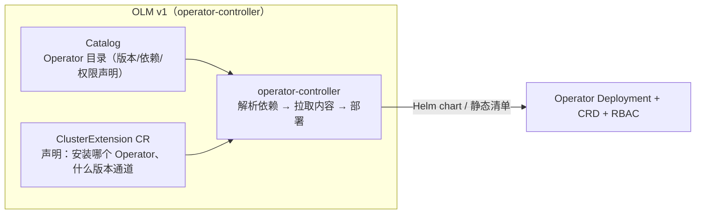

# 8. 生产实践：把 Operator 部署到真实集群

> 一句话理解：写对 Reconcile 只是开始——生产 Operator 要解决"怎么部署高可用、怎么管 CRD 版本演进、怎么和 Helm/GitOps/可观测体系集成、多租户怎么隔离、AI 场景（GPU/模型/金丝雀）怎么落地"等一整层工程问题。本章按"部署 → 版本演进 → 集成 → AI 落地 → 运维"五段讲透，最后给一张生产 Checklist。

## 8.1 部署形态：Operator 本身也是个 K8s 应用

Operator 通常是一个 Deployment（多副本 + Leader Election）+ 一组 CRD + RBAC + webhook Service/Secret。最常见的是**用 Helm 装 Operator**（呼应 [Helm 第 1 章](../helm/01-background)：Helm 装 Operator，Operator 管业务实例）。

```yaml
# Operator Deployment（KubeRay 风格）
apiVersion: apps/v1
kind: Deployment
metadata:
  name: kuberay-operator
spec:
  replicas: 2                         # 高可用：2 副本
  template:
    spec:
      affinity:
        podAntiAffinity:              # 反亲和：两副本调度到不同节点
          required: [podAntiAffinity...]
      containers:
        - name: operator
          image: kuberay/operator:v1.2.0
          args:
            - --leader-elect           # 开 Leader Election（多副本单干活）
          env:
            - {name: WATCH_NAMESPACE, value: ""}   # 空 = watch 全集群；或多租户限定 ns
          livenessProbe:
            httpGet: {path: /healthz, port: 8081}
          readinessProbe:
            httpGet: {path: /readyz,  port: 8081}
```

**部署要点**：

- **多副本 + Leader Election**：生产至少 2 副本，开 `--leader-elect`。单副本是 SPOF——Pod 重启间隙无调和。
- **反亲和**：两副本不调度到同一节点，避免节点故障同时挂两个。
- **healthz/readyz**：readiness 探针指向 `/readyz`（Cache 同步完才 ready），liveness 指向 `/healthz`（进程活着）。区别：Cache 没同步完时 readiness 失败（摘流），但进程活着 liveness 不杀。
- **metrics 端点要鉴权**：`/metrics` 暴露 reconcile 错误、队列深度等敏感运行信息。注意 **kube-rbac-proxy 镜像 2025-03 起已停止提供**——老部署里的 sidecar 会在镜像拉取时直接失败。新做法（Kubebuilder v4.1+ 默认）是 controller-runtime 内置的 `WithAuthenticationAndAuthorization` FilterProvider，用 Bearer Token + SubjectAccessReview 做认证授权，无需 sidecar。
- **WATCH_NAMESPACE**：多租户场景限定 Operator 只 watch 某些 namespace，减少权限爆炸面。
- **资源限额**：Operator 自己也要设 requests/limits——一个失控的 Operator（如无限 reconcile）会吃光节点内存。

## 8.2 CRD 版本演进：从 v1alpha1 到 v1

CRD 会长期存在（用户已创建大量 CR），版本演进是绕不开的工程问题。K8s 的方案是**多版本同时 served + conversion webhook**：

```
CRD 声明：v1alpha1 (served) ──conversion webhook── v1 (served, storage)
                                              │
                            只有 storage 版本真正写进 etcd
```

- **storage 版本唯一**：只有一个版本 `storage: true`，它是 etcd 里真正存储的形态。
- **conversion webhook**：用户用 `v1alpha1` 读写时，apiserver 调 webhook 把它和 storage 版本（`v1`）互转。用户无感知。
- **演进流程**：
  1. 新增 `v1beta1`（served, 不 storage），写 v1alpha1↔v1beta1 转换。
  2. 等所有客户端改用 v1beta1。
  3. 把 storage 切到 v1beta1，下线 v1alpha1。
  4. 最终收敛到 `v1`。

> **坑**：conversion webhook 也是控制平面关键路径，挂了相关 CR 的读写全卡。且转换必须是**无损往返**（v1→v1beta1→v1 要等价），否则数据会腐化。生产用 cert-manager 管证书 + 充分测试。

**字段废弃**：删/改字段时，旧字段先标记 `deprecated: true`（webhook 发警告），保留一两个版本让用户迁移，再删。不要直接删字段——存量 CR 会校验失败。

## 8.3 与 Helm / GitOps 集成

生产里 Operator 几乎总是和 Helm + GitOps（Argo CD/Flux）组合：

- **Helm**：负责装 Operator 本身 + 装初始 CR（`helm install kuberay`）。
- **Argo CD/Flux**：把"期望的 CR 清单"放 Git，GitOps 控制器持续 `apply`，Operator 响应 CR 变化。

```
Git (CR 清单) ──Argo CD apply──► apiserver (CR) ──watch──► Operator ──reconcile──► 真实工作负载
```

> **配合要点**：GitOps 和 Operator 都"声明式"，天然互补——GitOps 管"声明什么"，Operator 管"如何让声明成真"。但要注意**所有权边界**：GitOps 管的 CR，人不要手改（会被 GitOps 冲回）；Operator 创建的子资源（Deployment/Service），GitOps 不要管（会被 Operator 冲回）。两边各管一层，用 label/annotation 标注归属。

## 8.4 可观测：metrics + events + status 三件套

生产 Operator 必须暴露三层数据：

**① Metrics**（`:8080/metrics`，controller-runtime 自动）——盯这几个：

| 指标 | 告警阈值 |
|---|---|
| `controller_runtime_reconcile_errors_total` | 持续 > 0 → 立即告警（Controller 反复失败） |
| `workqueue_depth` | 持续高 → 处理不过来 |
| `controller_runtime_reconcile_time_seconds` (p99) | > 1s → 有阻塞 |
| `leader_election_master_status` | 持续 0 → 没有 leader |

**② Events**（Reconciler 主动写）——让 `kubectl describe raycluster` 看到 Operator 在干什么：

```go
r.Recorder.Eventf(&rc, "Normal", "ScaledWorker", "workers %d→%d", old, new)
r.Recorder.Eventf(&rc, "Warning", "ImagePullFailed", "retrying: %v", err)
```

**③ Status**（CR 的 status 字段）——上层编排和监控的真相源：`conditions`（Ready/Progressing/Degraded）+ `observedGeneration` + 业务字段（readyReplicas/endpoint）。

**告警铁律**：`reconcile_errors_total` 持续 > 0 是 Operator 健康第一指标，必须告警——它往往预示真实故障（CR 配置错、依赖不可达、代码 bug）。

## 8.5 多租户与权限隔离

AI 平台常一个集群多团队共用，Operator 要支持多租户：

- **namespace 级 Operator**：每个团队一个 namespace + 一个 Operator 实例（WATCH_NAMESPACE 限定），互不影响。简单但运维成本高（N 个 Operator）。
- **集群级 Operator + RBAC**：一个 Operator watch 全集群，靠 RBAC + namespace 隔离 CR 的写权限。省资源但权限要严格设计。
- **quota webhook**：validating webhook 拦截超配额的 CR（如某团队 `replicas` 超其 GPU 配额）——把平台的资源策略编码进准入控制。
- **节点池/优先级**：CR spec 支持指定 `nodeSelector`/`priorityClass`，把高优推理调度到专属 GPU 节点池。

## 8.6 AI 场景落地：GPU、模型、金丝雀

**GPU Operator 集成**：AI Operator 创建的工作负载要能用到 GPU——依赖 [NVIDIA GPU Operator](https://github.com/NVIDIA/gpu-operator) 装好的驱动/toolkit/device-plugin。CR spec 里写 `resources.limits: {nvidia.com/gpu: 4}`，调度器配合 GPU Operator 把 Pod 调到 GPU 节点。

**模型加载**：推理 Pod 启动后要拉/加载模型（几分钟）。生产实践：

- 模型放 PVC 或对象存储，Pod 用 initContainer 或 sidecar 挂载，避免每个 Pod 重复下载。
- readiness probe 探 `/health`（模型加载完才 ready），别用 TCP probe（进程起来了不代表模型加载完）。
- Operator 的 status.condition `Ready` 必须**等模型加载完**才 True——这是"领域就绪 ≠ K8s 就绪"的典型（见第 6.10 节）。

**金丝雀/版本切换**：推理服务升级要无感切流量。两种模式：

- **RollingUpdate**：`maxSurge` 控制新建比例，配合 readiness gate 逐步切。简单但有重叠期。
- **Canary CR**：Operator 支持主版本 + canary 版本（如 KServe 的 `canaryTrafficPercent`），按流量比例金丝雀，验证后全量。复杂但可控。

**缩到零**：闲时推理缩到 0 省 GPU。Operator watch 一个"激活信号"（如 KServe 的 Knative 激活），从 0 扩到 1 服务请求，空闲后再缩回 0。注意冷启动延迟（模型加载），SLA 要算进去。

**GPU 分配的下一站：DRA**：传统 `nvidia.com/gpu: N` 整数分配粒度粗、无法表达共享/切分。K8s 1.36 对 **DRA（Dynamic Resource Allocation）** 做了面向 AI/GPU 的升级，允许 Operator 在 CR spec 里声明结构化的设备请求（型号、显存、切分方式等），由 DRA driver + 调度器分配。新一代推理/训练 Operator 开始从 Device Plugin 整数配额转向 DRA 结构化请求——这是 GPU 调度主题的重点（见本手册 GPU 调度相关章节），写 CRD 时值得为 DRA 预留字段。

**大规模 CR 的调和优先级**：一个推理平台 Operator 常管数千个 `InferenceService`。controller-runtime v0.23 起默认开启的**优先级队列**（`Result.Priority`）让故障恢复中的服务插队、闲时同步任务让路，是 AI Operator 的实用能力（见第 3.8 节）。

## 8.7 运维：升级、故障恢复、容量

**Operator 升级**：

- Operator 镜像升级：滚动更新 Deployment（leader 切换间隙约 leaseDuration 不调和，业务容忍）。
- CRD 升级：走 8.2 的版本演进流程，先升 CRD（加新版本/字段），再升 Operator（用新版本），最后清旧版本。
- **向后兼容**：新版 Operator 必须能处理旧版 CR（conversion webhook 保证）；旧 Operator 不应遇到新字段（被 prune）。

**故障恢复**：

- Operator Pod 崩溃：K8s 重启，Cache 重新同步，level-triggered 保证状态最终一致——这是 Operator 相对脚本的核心优势。
- apiserver/etcd 故障：Operator 的 watch 断开，Informer 自动重连重 List；写操作失败退避重试。业务工作负载（已创建的 Pod）不受影响继续跑。
- 脑裂（多副本都以为自己是 leader）：Lease 机制保证不会，但要监控 `leader_election_master_status`，异常立即告警。

**容量规划**：

- 单 Operator 能管多少 CR？取决于 reconcile 复杂度和频率。监控 `workqueue_depth` 和 reconcile 时长，超载就拆（按 namespace 拆多实例，或拆 CRD）。
- watch 的资源越多，Cache 内存越大。大集群限制 watch 范围（WATCH_NAMESPACE）或用字段 selector 减少缓存。

## 8.8 Operator 的分发与生命周期管理：OLM v1

Helm 适合"装 Operator + 配置参数"，但平台团队常需要更强的能力：**像应用商店一样安装/升级/降级 Operator、校验其 RBAC 权限、管理依赖与版本通道**。这就是 OLM（Operator Lifecycle Manager）的定位。2025–2026 的最大变化是 **OLM v1（operator-controller）进入稳定 v1.x 线**（截至 2026-10 最新 v1.12），全面取代设计于五年前的 OLM v0：



与 v0 的核心差异：

| 维度 | OLM v0（legacy） | OLM v1（operator-controller） |
|---|---|---|
| 声明入口 | `Subscription` + `InstallPlan`（namespace 级） | **`ClusterExtension`**（集群级 CR，语义更简单） |
| 打包格式 | bundle + CSV（OperatorHub 生态） | Catalog + **Helm chart / 静态清单**（原生支持 Helm 打包的 Operator） |
| 权限模型 | 自动生成的 RBAC 与 Operator 分离安装 | 权限声明随扩展内容解析，最小化安装 |
| 依赖/通道 | 复杂的依赖求解器 | 内容解析 + 版本通道，模型大幅简化 |

> **实务判断**：OpenShift 用户仍大量使用 v0（随发行版提供），社区新项目优先看 v1。注意 **v0 → v1 没有自动迁移路径**（概念模型差异太大），迁移前对照 v1 的 limitations 文档评估。如果你的 Operator 本来就随 Helm Chart 分发，OLM v1 可以原样消费——这是 v1 相对 v0 最实际的吸引力。

## 8.9 生产 Checklist

| 维度 | 检查项 |
|---|---|
| 高可用 | ≥2 副本 + 反亲和 + Leader Election |
| 健康 | readiness=/readyz（Cache 同步完）、liveness=/healthz |
| 资源 | Operator 自身设 requests/limits |
| 安全 | metrics 端点鉴权（kube-rbac-proxy 已停用，用内置 FilterProvider）、RBAC 最小化、无 cluster-admin |
| CRD | schema 严格、多版本+conversion、printer columns、preserveUnknownFields=false |
| Webhook | ≥2 副本、<1s 响应、failurePolicy 明确、namespaceSelector 限范围、证书自动轮换；简单默认值优先用 CRD default 或 Mutating Admission Policy（K8s 1.36+） |
| Finalizer | 清理可重试、有超时、文档写明"卡 Terminating 怎么救" |
| Status | observedGeneration 更新、conditions 标准化、无敏感信息、体积可控 |
| 可观测 | reconcile_errors 告警、关键节点写 Event、metrics 暴露 |
| 版本 | CRD 演进流程、Operator 向后兼容、Helm/GitOps 各管一层 |
| 分发 | 需要商店化安装/升级/权限声明时评估 OLM v1（ClusterExtension + Catalog） |
| 多租户 | WATCH_NAMESPACE 或 RBAC 隔离、配额 webhook |
| 测试 | Reconcile 单元测试（envtest）、CRD schema 测试、升级 e2e |

## 本章小结

- **部署**：Operator 是多副本 Deployment + Leader Election + RBAC + CRD；常由 Helm 安装，Helm 管 Operator、Operator 管业务实例；metrics 端点必须鉴权（kube-rbac-proxy 已停用，改用 controller-runtime 内置 FilterProvider）。
- **版本演进**：多版本 served + conversion webhook，storage 版本唯一；字段废弃要先标 deprecated 再删。
- **集成**：与 Helm/GitOps 互补（各管一层所有权），可观测靠 metrics+events+status 三件套，`reconcile_errors` 是第一告警指标。
- **分发**：需要商店化安装/升级/权限声明时评估 OLM v1（ClusterExtension + Catalog，稳定 v1.x 线）；简单准入变更优先 Mutating Admission Policy（1.36 GA），减少 webhook 部署面。
- **多租户**：namespace 级 Operator 或集群级 + RBAC，配额用 validating webhook 编码。
- **AI 落地**：依赖 GPU Operator；模型加载要探"领域就绪"；金丝雀用 Canary CR；缩到零要算冷启动 SLA；关注 DRA 结构化 GPU 分配与优先级队列（v0.23+）两个新能力。
- **运维**：升级走版本演进 + 向后兼容；故障靠 level-triggered 自愈；容量看 workqueue_depth 和 reconcile 时长，超载拆分。

**参考来源**

- [Kubebuilder — Production (multi-replica, leader election)](https://book.kubebuilder.io/multiversion-tutorial)
- [Kubernetes — CRD versioning](https://kubernetes.io/zh-cn/docs/tasks/extend-kubernetes/custom-resources/custom-resource-definition-versioning/)
- [kube-rbac-proxy 停用公告](https://github.com/kubernetes-sigs/kubebuilder/discussions/3907)
- [OLM v1（operator-controller）文档](https://operator-framework.github.io/operator-controller/) —— ClusterExtension / Catalog / 升级通道，以及 v0 → v1 无自动迁移路径的说明。
- [KubeRay 部署文档](https://ray-project.github.io/kuberay/)
- [NVIDIA GPU Operator](https://github.com/NVIDIA/gpu-operator)
- [Kubernetes v1.36 "Haru" 发布报道 — DRA 面向 AI/GPU 升级](https://www.fullstackevolved.com/blog/kubernetes-v1-36-haru-user-namespaces-dra-2026-05-15/) —— DRA 在 1.36 的变化入口。
- [cert-manager — webhook 证书轮换](https://cert-manager.io/docs/concepts/ca-injector/)
- 本手册 [Helm 第 8 章](../helm/08-production-practice)（Helm+GitOps 集成）、[Kubernetes 第 9 章](../kubernetes/09-best-practices)（生产实践对照）。
