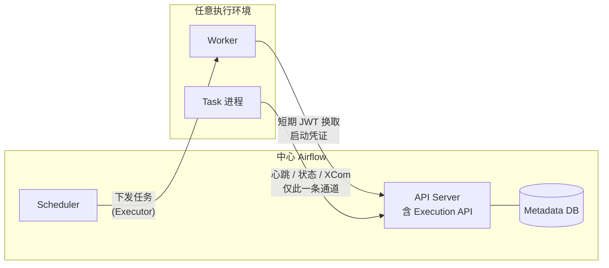

# 3. 架构设计：从“Flask 单体”到“Airflow 3 服务化架构”

> 一句话理解：Airflow 3（2025-04-22 GA，截至 2026-10 最新为 3.3.2）把架构彻底服务化——**DAG Processor 成为必需组件、Flask Webserver 被 FastAPI API Server + React UI 取代、Task 通过 Task Execution API + JWT 与平台通信、Executor 插件化（新增 Edge Executor）**。理解 Airflow 3 的组件边界，就理解了现代编排平台的演进方向。

## 3.0 版本现状（2026-10）

| 版本 | 发布日期 | 状态 | 要点 |
|---|---|---|---|
| Airflow 2.10/2.11 | 2024-08 / 2025-05 | **2.x 已于 2026-04-22 EOL** | 2.11 是最后一个 2.x 大版本（2.11.2 为最后补丁，2026-03-14），内置大量 3.0 迁移辅助 |
| Airflow 3.0 | 2025-04-22 | EOL（2025-09） | 服务化架构：Task SDK + Execution API（AIP-72）、Edge Executor（AIP-69）、Asset 调度（AIP-74/75）、React UI、REST API v2 |
| Airflow 3.1 | 2025-09-25 | 维护中 | Human-in-the-Loop（AIP-82）、Deadline Alerts（AIP-86，SLA 替代）、React 插件系统（AIP-68） |
| Airflow 3.2 | 2026-04-07 | 维护中 | Asset 分区调度（AIP-76）、多团队部署（AIP-67 首个里程碑）、PythonOperator 异步可调用、SQLAlchemy 2.0、Python 3.14 |
| **Airflow 3.3** | **2026-07-06** | **当前稳定版（3.3.2，2026-09-17）** | Task/Asset 状态存储（AIP-103）、可插拔重试策略（AIP-105）、Java/Go 语言 Task SDK（AIP-108，实验性） |
| Airflow 3.4 | beta 2026-10-13（GA 预计 2026-11 初） | 预览中 | Task Loops（AIP-111，运行期循环的任务组）、Dag Importer（AIP-85，实验性非 Python DAG：YAML 格式 + TypeScript/Go/Java SDK）、xcom_v2 表、psycopg3 默认驱动、Asset 默认单事件单 Run |

**结论**：Airflow 2 已经 EOL，生产新部署应直接选 Airflow 3.1+（官方建议跳过 3.0，直接升 3.1 或更高）。

## 3.1 总体架构（Airflow 3）

```
┌──────────────────────────────────────────────────────────────────────┐
│              用户 / CLI / REST API v2 (OpenAPI 3.1) / React UI        │
└───────────────────────────────┬──────────────────────────────────────┘
                                │
                                ▼
                ┌───────────────────────────────┐
                │   API Server (FastAPI, 必需)   │
                │  核心 REST API + UI 后端        │
                │  内嵌/独立 Task Execution API   │
                │  (AIP-72, JWT 认证)            │
                └───────────────┬───────────────┘
                                │
                                ▼
                ┌───────────────────────────────┐
                │     Metadata Database          │
                │  PostgreSQL / MySQL            │
                │  （生产禁用 SQLite）            │
                └───────┬───────────────┬───────┘
                        │               │
        ┌───────────────┼───────────────┼────────────────┐
        ▼               ▼               ▼                ▼
┌──────────────┐ ┌──────────────┐ ┌───────────┐ ┌────────────────┐
│ DAG Processor│ │  Scheduler   │ │ Triggerer │ │ Edge Executor  │
│ (必需,独立)   │ │ 创建 Run/TI  │ │ asyncio   │ │ 中心端         │
│ 解析 DAG 文件 │ │ 状态机推进    │ │ 监听事件  │ │ (可选)         │
└──────┬───────┘ └──────┬───────┘ └───────────┘ └───────┬────────┘
       │                │                                 │
       │     ┌──────────┴──────────┐              Edge Worker
       │     ▼                     ▼              (任意网络位置,
       │  Executor            Worker              只需装 Task SDK
       │  (配置属性,          (Local/Celery/       + edge3 provider,
       │   随 scheduler       Kubernetes)          出站 HTTPS 轮询)
       │   进程运行)
       ▼                     │
  DAG Bundle              Task 进程
  (本地目录/Git,          仅通过 Execution API
   带版本)                 上报状态, 持有短期 JWT
```

与 Airflow 2 的关键差异：

| 维度 | Airflow 2.x | Airflow 3.x |
|---|---|---|
| Web 层 | Flask Webserver + Flask-Admin UI | FastAPI API Server + 全新 React UI |
| DAG 解析 | DAG Processor 独立（2.3+，可选） | **必需组件**，必须单独运行 `airflow dag-processor` |
| Task 与 DB 的关系 | Task 直连 Metadata DB 读写状态/XCom | Task 只通过 **Task Execution API** 通信，禁止直连 DB |
| 认证 | Session/JWT 混合，Flask AppBuilder | API Server 统一认证；Execution API 使用短期 **JWT**；默认 Simple Auth Manager（生产可换 FAB 等） |
| Executor | 核心包内置 Celery/K8s | Celery/Kubernetes Executor 移入 **provider 包**；新增 **EdgeExecutor** |
| REST API | v1（Flask） | **v2（OpenAPI 3.1）**，v1 移除 |
| DAG 分发 | 共享 dags/ 目录（NFS/Git-sync） | **DAG Bundle** 抽象（本地目录/Git 等，支持版本固定） |

## 3.2 各组件职责

| 组件 | 职责 | Airflow 3 部署特性 |
|---|---|---|
| **Metadata Database** | 存储 DAG、DAG Run、TaskInstance、XCom、Variable、Connection、状态存储（3.3） | 生产必须 PostgreSQL/MySQL |
| **DAG Processor** | 扫描 DAG Bundle，解析并序列化 DAG，写入数据库 | **独立必需进程**，与 Scheduler 生命周期解耦 |
| **Scheduler** | 创建 DAG Run、推进 TaskInstance 状态机、调用 Executor | 可 HA 多副本 |
| **Executor** | Scheduler 的“配置属性”，决定 TaskInstance 分发到哪里执行 | Local（核心）/Celery、Kubernetes（provider）/Edge（provider） |
| **Worker** | 实际执行 TaskInstance；任务进程只通过 Execution API 通信 | Celery Worker / K8s Pod / Edge Worker |
| **Triggerer** | 处理 Deferrable Operator 的异步触发器（asyncio） | 可选；HITL 任务由 Scheduler 管理，不经过 Triggerer |
| **API Server** | FastAPI 服务：REST API v2 + React UI 后端 + Execution API | 必需；UI/API/任务回传统一入口 |

## 3.3 Metadata Database

Metadata Database 是 Airflow 的“大脑”，所有状态都集中在这里。

### 核心表

| 表 | 作用 |
|---|---|
| `dag` | DAG 元数据、序列化后的 DAG、是否暂停 |
| `dag_run` | 每次 DAG Run 的记录 |
| `task_instance` | 每个 Task 每次运行的状态 |
| `task_fail` | Task 失败记录 |
| `xcom` | 任务间交换的数据 |
| `variable` | 全局变量 |
| `connection` | 外部系统连接信息 |
| `log` | 操作日志 |
| `job` | Scheduler/Triggerer 等 job 心跳 |
| `slot_pool` | 资源池限制 |

### 生产数据库选型

| 数据库 | 推荐度 | 说明 |
|---|---|---|
| PostgreSQL | ⭐⭐⭐⭐⭐ | 生产首选，性能与稳定性好 |
| MySQL | ⭐⭐⭐ | 可用，注意字符集与连接池 |
| SQLite | ❌ | 仅本地开发 |

## 3.4 DAG Processor

DAG Processor 负责把磁盘上的 DAG 文件变成数据库里的序列化 DAG。

### 工作流程

```
DAG Bundle (本地目录 / Git, 带版本)
        │
        ▼
DAG Processor 扫描文件变化
        │
        ▼
导入 Python 模块，实例化 DAG
        │
        ▼
序列化 DAG (JSON)
        │
        ▼
写入 dag 表 (serialized_dag 字段)
        │
        ▼
Scheduler 读取序列化 DAG 做调度决策
```

### 关键点

- Airflow 2.3+ 把 DAG Processor 从 Scheduler 中拆出，避免 DAG 解析阻塞调度；**Airflow 3 起它是独立必需进程**。
- 解析失败会记录到 `dag_processing.processing_stats` 和 UI 的 DAG import errors。
- 大型 DAG 文件会增加解析时间，影响调度延迟。

## 3.5 Scheduler

Scheduler 是 Airflow 的心脏，主要做两件事：

1. **创建 DAG Run**：根据 `schedule` 创建新的 DAG Run。
2. **推进 TaskInstance**：检查依赖和状态，把可运行的 TaskInstance 发给 Executor。

### Scheduler 主循环

```
循环（每隔 min_file_process_interval / scheduler_idle_sleep_time）
    │
    ├─ 1. 从 Metadata DB 读取 active DAGs
    │
    ├─ 2. 对需要调度的 DAG 创建 DAG Run
    │
    ├─ 3. 对每个 DAG Run，找出依赖已满足的 TaskInstance
    │
    ├─ 4. 检查资源池、并发限制、Deadline（3.1 起，2.x 为 SLA）
    │
    ├─ 5. 把 TaskInstance 状态改为 scheduled → queued
    │
    └─ 6. 调用 Executor 的 queue_command
```

### Scheduler 高可用

- Airflow 2.0+ Scheduler 支持 HA，多个 Scheduler 实例通过数据库行锁协作。
- 用 `max_threads` 和 `processor_poll_interval` 等参数调优。

## 3.6 Executor 详解

### LocalExecutor

```
Scheduler
    │
    ▼
LocalExecutor 的进程池
    │
    ├─ Worker 进程 1
    ├─ Worker 进程 2
    └─ Worker 进程 N
```

- 单机多进程并行。
- 适合中小规模，部署简单。

### CeleryExecutor

```
Scheduler
    │
    ▼
Celery + Redis/RabbitMQ 消息队列
    │
    ├─ Celery Worker 1
    ├─ Celery Worker 2
    └─ Celery Worker N
```

- 传统多机扩展方案，成熟稳定。
- 需要额外维护 Redis/RabbitMQ 和 Celery Worker。

### KubernetesExecutor

```
Scheduler
    │
    ▼
Kubernetes API Server
    │
    ▼
为每个 TaskInstance 创建一个 Pod
```

- 每个任务一个 Pod，资源隔离好，弹性强。
- 启动 Pod 有 overhead，不适合超短任务。
- 需要 K8s 集群和镜像管理。

### Executor 对比

| 维度 | LocalExecutor | CeleryExecutor | KubernetesExecutor | EdgeExecutor（3.x） |
|---|---|---|---|---|
| 代码位置 | 核心包 | `providers/celery` | `providers/cncf/kubernetes` | `providers/edge3` |
| 扩展性 | 单机 | 多机 | 多机 + 弹性 | 跨网络/跨云/边缘节点 |
| 运维复杂度 | 低 | 中 | 高 | 低（worker 免维护 inbound） |
| 任务隔离 | 进程级 | 进程级 | Pod 级 | 进程级（远端机器） |
| 启动延迟 | 低 | 低 | 中（Pod 创建） | 低 |
| 适用任务 | 通用 | 通用 | 容器化、异构 | 数据主权、混合云、IoT、受限网络 |

### Edge Executor：把 Worker 推到任何网络位置（AIP-69）

传统 Executor 要求 Worker 能被中心调度方访问（消息队列或 K8s API）。Edge Executor 反其道而行：

```
Edge Worker (任意位置)                中心 Airflow
┌────────────────────┐         ┌────────────────────────┐
│ airflow task-sdk    │  出站   │ API Server / Execution │
│ + edge3 provider    │ ──────▶ │ API (HTTPS 轮询)       │
│ 只需出站 HTTPS      │ ◀────── │ 下发任务 / 接收上报     │
└────────────────────┘  JWT    └────────────────────────┘
```

- Worker 只需安装 `apache-airflow-providers-edge3`（依赖自带 `apache-airflow-sdk`），**无需数据库连接串、无需开入站端口**，`airflow edge worker` 一条命令启动。
- 适合：on-prem 机房、客户环境、数据主权受限区域、异构云。
- Airflow 3.0 GA 时随核心发布，后拆分为独立 `edge3` provider 持续演进（2026-10 已发布 5.0.0）。

## 3.7 Triggerer

Triggerer 是 Airflow 2.2+ 新增的组件，专门处理 Deferrable Operator。

```
TaskInstance (deferred)
        │
        ▼
Scheduler 把 Trigger 注册到 Triggerer
        │
        ▼
Triggerer 异步监听事件
        │
        ▼
事件触发 → Scheduler 唤醒 TaskInstance
        │
        ▼
TaskInstance 重新进入 queued → running
```

### 为什么需要 Triggerer

- 传统 `S3KeySensor` 占一个 worker 进程一直轮询。
- Deferrable 模式下，worker 只执行一次就进入 deferred，释放资源。
- Triggerer 用 asyncio 同时监听大量事件，单进程可处理很多 trigger。

## 3.8 Airflow 3 架构演进（已完成，非进行中）

Airflow 3.0（2025-04-22 GA）完成了酝酿多年的架构重构，核心变化：

### Task Execution API + Task SDK（AIP-72）——最大的架构更新



- **Task 不再直连 Metadata DB**：所有状态上报、XCom 读写、心跳都通过 Task Execution API（内嵌在 API Server 中，也可独立部署）。
- **Worker 持有短期 JWT**：由 API Server 签发、按任务发放，任务结束后即失效——数据库凭据不再下发到执行环境，攻击面大幅缩小。
- **Task SDK 独立发版**：`apache-airflow-sdk` 是与核心解耦的轻量包，DAG 编写接口（`from airflow.sdk import dag, task, DAG`）成为稳定的公开契约，任务可以在 K8s Pod、CI Runner、笔记本、边缘节点里以同样方式运行。

### 其他架构级变化

- **API Server 统一入口**：Flask Webserver 退役，FastAPI 同时承载 REST API v2（OpenAPI 3.1）、React UI 后端、Execution API。
- **React UI 重写（AIP-38）**：3.1 起支持插件式 UI 扩展（AIP-68）。
- **Scheduler 托管回刷（AIP-78）**：backfill 不再是 CLI 一次性作业，而是 Scheduler 内的持久实体，可在 UI/API 中创建、暂停、监控。
- **DAG Versioning（AIP-66）**：同一 DAG 的结构变更被记录版本，运行实例绑定具体版本，重跑/清除可指定版本。
- **DAG Bundle**：DAG 代码来源抽象为 bundle（本地目录、Git 仓库等），支持按版本拉取，取代脆弱的共享 NFS dags 目录。
- **移除历史包袱**：SubDAG、SLA（由 Deadline Alerts 替代）、DAG/XCom pickling、`DaskExecutor`（移出核心）等在 3.0 移除。

### Airflow 3.1–3.3 的后续演进

| 版本 | 架构/平台级新能力 |
|---|---|
| 3.1（2025-09） | Human-in-the-Loop（审批任务，`awaiting_input` 由 Scheduler 直接管理）；Deadline Alerts（AIP-86）替代 SLA；React 插件系统（AIP-68）；Python 3.13 支持、放弃 3.9 |
| 3.2（2026-04） | Asset 分区调度（AIP-76）；多团队部署首个里程碑（AIP-67，团队级配置/命名空间隔离）；SQLAlchemy 2.0；Python 3.14 |
| 3.3（2026-07） | Task/Asset 状态存储（AIP-103）；可插拔重试策略（AIP-105）；Java/Go 语言 Task SDK（AIP-108，实验性）——同一 Execution API，多语言执行；Go 版 Edge Worker 已进入 beta |
| 3.4（beta 2026-10） | Task Loops（AIP-111）：装饰器任务组 `.loop()` 按运行期次数迭代，支持 `until` 条件（do-while 语义）与 `max_iterations` 上限；Dag Importer（AIP-85，实验性）：Task SDK 内的可插拔 DAG 导入框架，原生 YAML DAG 格式与 TypeScript/Go/Java SDK 写的 DAG 可像 Python DAG 一样被 DAG Processor 识别；executor 工作负载队列统一为 `BaseExecutor.executor_queues`（旧的 per-type 入口转为兼容 shim，4.0 移除）；psycopg3 取代 psycopg2/asyncpg 成为元数据库默认驱动（事务模式 PgBouncer 开箱可用）；新的 XCom 行写入 `xcom_v2` 表 |

## 本章小结

- Airflow 3 架构 = Metadata DB + 必需 DAG Processor + Scheduler + API Server（FastAPI）+ 插件化 Executor + Triggerer。
- **Task Execution API + Task SDK（AIP-72）** 是 Airflow 3 最大的架构更新：任务零 DB 直连、JWT 短期凭证、SDK 独立发版。
- Celery/Kubernetes Executor 移入 provider 包，新增 **Edge Executor**（AIP-69）把 Worker 推到任意网络位置。
- DAG Bundle、DAG Versioning、Scheduler 托管回刷让 DAG 代码分发与历史可追溯。
- Airflow 2 已于 2026-04-22 EOL，新部署应选 Airflow 3.1+；3.4（beta 2026-10-13）预览 Task Loops 与非 Python DAG，GA 后再评估升级。

**参考来源**

- [Apache Airflow 3.0 GA 公告](https://airflow.apache.org/blog/airflow-three-point-oh-is-here/)
- [Apache Airflow — Architecture Overview (3.3)](https://airflow.apache.org/docs/apache-airflow/stable/core-concepts/overview.html)
- [Apache Airflow — Release Notes (3.3.2 / 3.4.0b1)](https://airflow.apache.org/docs/apache-airflow/stable/release_notes.html)
- [Apache Airflow — Upgrading to Airflow 3](https://airflow.apache.org/docs/apache-airflow/stable/installation/upgrading_to_airflow3.html)
- [apache-airflow-providers-edge3 文档](https://airflow.apache.org/docs/apache-airflow-providers-edge3/stable/index.html)
- [Astronomer — Airflow 3.2 发布解读](https://www.astronomer.io/blog/apache-airflow-3-2-release/)
- [Astronomer — Airflow Components](https://www.astronomer.io/docs/learn/airflow-components)
