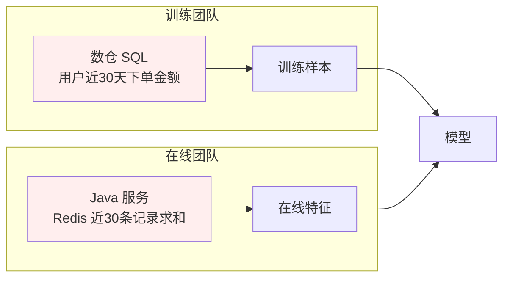

# 1. 背景：特征工程为什么需要“平台”

> 一句话理解：在典型的 ML 项目里，**数据科学家 80% 的时间花在特征准备上，而大多数“训练效果不达标”的根因不是模型，而是特征数据出了问题**——用了未来信息（泄漏）、训练与服务用了两套计算逻辑（偏斜）、或者每个团队重复造了同一批轮子。

## 1.1 从一道经典的面试题说起

> “线上 AUC 0.92，上线后一周跌到 0.71，可能是什么原因？”

高频答案之一就是**训练/服务偏斜（training-serving skew）**：离线训练时特征 A 是按“最近 30 天”窗口从数仓聚合的；在线服务时特征 A 是由另一段代码按“最近 30 条事件”从 Redis 里算的。两条链路语义看似一样，实则处处不同——窗口定义、空值处理、时区、去重规则、更新延迟。模型离线学到了一条规律，上线后输入分布全变了，效果必然崩。

另一个高频答案是**数据泄漏（leakage）**：构建训练集时没有按标签发生时刻截取特征，而是直接 join 了特征表的“当前值”。模型在训练集上效果惊人，上线即失效——它学到的是“未来”。

这两个问题有一个共同的解法：**把特征的定义、计算、存储、服务收敛到一个平台里，保证同一份逻辑、同一份数据服务训练和服务**。这就是特征平台。

## 1.2 传统特征工程的三大痛点

### 痛点一：特征逻辑的重复实现与漂移

同一个业务概念（“用户近 30 天消费金额”），离线由数据团队写 SQL，在线由工程团队写服务代码。两套代码独立演进：数仓口径改了，在线没改；在线修了 bug，训练没修。半年后没人说得清模型到底吃的是哪个口径。

### 痛点二：数据泄漏与“幸存者”样本

没有统一的时间语义，训练集 join 特征表时极容易把**标签时刻之后**的特征值取进来。典型场景：反欺诈模型用“用户是否被人工审核标记为欺诈”作为特征来源，而这个标记本身发生在交易之后。

### 痛点三：特征无法复用与治理缺位

每个模型项目各自抽数、各自存表，同一特征有 N 个版本躺在 N 个项目目录里。新同学不知道某个字段能不能用、口径是什么、谁在维护；模型出了问题无法回溯“当时训练用了哪个版本的特征”。

Google 在 2015 年的论文 *Hidden Technical Debt in ML Systems*（Sculley et al., NIPS 2015）把这类问题归因为：**ML 系统中“数据依赖”的治理成本远高于代码依赖**，论文提出的“pipeline jungle（管道丛林）”正是痛点一的学术表述。

## 1.3 历史脉络：从 Michelangelo 到 Context Engine

| 时间 | 事件 | 意义 |
|---|---|---|
| 2015 | Google 发表 *Hidden Technical Debt in ML Systems* | 提出数据依赖/管道丛林问题，奠定领域共识 |
| 2017 | Uber 公开 **Michelangelo** ML 平台（Hermann & Del Balso） | 首个广为人知的生产级特征平台：离线 Cassandra + 在线 Redis/ Cassandra 双存储，统一训练与服务特征 |
| 2019-2020 | **Feast** 由 Gojek 开源，随后进入 LF AI & Data 基金会 | 开源社区的事实标准，定义了 Feature View / Entity / Registry 等通用概念 |
| 2020 | **Tecton** 成立（创始团队来自 Uber Michelangelo） | 商业特征平台，主打实时特征与 RIFT 流式计算引擎 |
| 2020-2022 | 云厂商跟进：SageMaker Feature Store（2020）、Vertex AI Feature Store、Databricks Workspace Feature Store | 特征平台成为云 MLOps 标配组件 |
| 2023-2024 | Lakehouse 化：Databricks 将特征工程并入 Unity Catalog；Feast 支持 Delta/Iceberg 生态 | 离线底座统一到湖格式，治理线统一 |
| 2024-09 | Tecton 1.0 发布：托管 embedding 生成、Feature Retrieval API、版本化 Prompt 管理 | 特征平台正式向 LLM 应用的“上下文供给”扩展 |
| 2025-08 | **Databricks 宣布收购 Tecton**，并入 Agent Bricks 为 AI Agent 提供实时数据 | 标志性事件：特征平台 = 实时上下文引擎，赛道进入整合期 |
| 2025-2026 | 实时上下文工程（real-time context engineering）成为独立话题；RisingWave 等流式 SQL 引擎提出以物化视图替代专用特征平台 | 架构路线分化：专用系统 vs 通用流式基础设施 |

## 1.4 与相邻系统的边界

特征平台常被与数仓、数据湖、流平台混淆，边界如下：

| 系统 | 管什么 | 不管什么 | 关系 |
|---|---|---|---|
| 数仓/湖仓（Snowflake/BigQuery/Delta） | 通用数据的存储与 SQL 分析 | 训练时序语义、在线服务、特征版本治理 | 特征平台的**离线底座** |
| 流平台（Kafka/Flink） | 事件传输与流式计算 | 特征定义、训练集构建 | 实时特征的**生产通道** |
| 实验/模型平台（MLflow 等） | 实验、模型版本、部署 | 特征数据本身 | 模型消费特征，特征平台上游 |
| **特征平台** | **特征定义、PIT 训练集、在线/离线双存储、物化同步、特征治理** | 通用 ETL、模型训练与部署 | MLOps 链路中“数据 → 模型”的咬合层 |

## 1.5 本章小结

- 特征工程的痛不是“算得慢”，而是**不一致**：训练一套、服务一套、泄漏未来、无法复用。
- 2015 年 Google 论文提出数据依赖债务，2017 年 Uber Michelangelo 给出第一个工业级答案。
- 2020 年后开源（Feast）与商业（Tecton/Hopsworks）双轨发展；2025 年 Databricks 收购 Tecton，标志特征平台演进为 **AI Agent 的实时上下文引擎**。

**参考来源**

- [Hidden Technical Debt in Machine Learning Systems (Sculley et al., NIPS 2015)](https://papers.nips.cc/paper/5656-hidden-technical-debt-in-machine-learning-systems.pdf)
- [Michelangelo: Uber's Machine Learning Platform (Uber Engineering, 2017)](https://www.uber.com/blog/michelangelo-machine-learning-platform/)
- [Databricks 收购 Tecton 公告报道（PYMNTS, 2025-08）](https://www.pymnts.com/acquisitions/2025/databricks-to-purchase-tecton-to-boost-ai-agent-offerings/)
- [Tecton 1.0 发布](https://www.tecton.ai/whats-new/introducing-tecton-1-0/)
- [Feast 官方文档](https://docs.feast.dev/)
