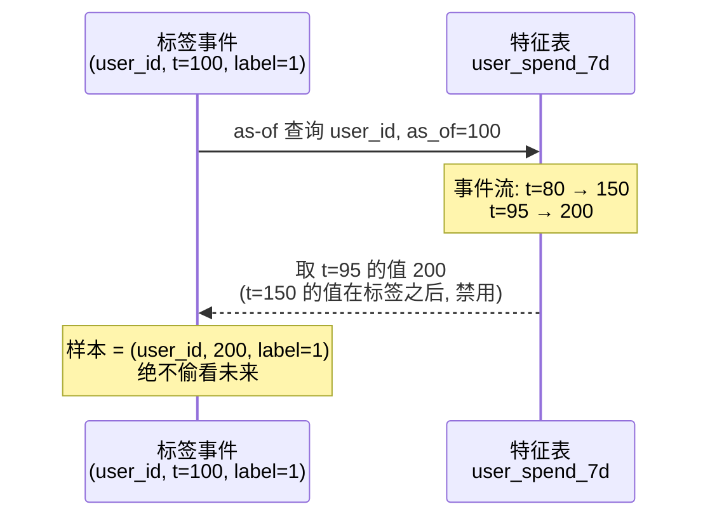
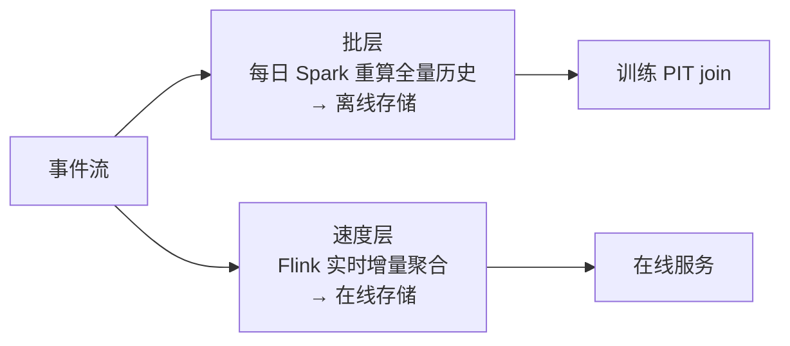

# 2. 核心思想：一份逻辑，两条通路，一个时间轴

> 一句话理解：特征平台的所有设计可以归纳为三句话——**特征是唯一资产（写一次）；训练与服务共用同一份定义（两条通路同源）；一切取值都以 event_timestamp 为准绳（一根时间轴）**。

## 2.1 思想一：特征即资产（Feature as an Asset）

传统模式里，特征是“某个脚本里的中间变量”；平台模式里，特征是**有名字、有 owner、有口径文档、有版本、可检索、可复用的数据资产**。

| 维度 | 脚本模式 | 资产模式 |
|---|---|---|
| 定义位置 | 散落各项目 | 中央注册中心（Registry） |
| 复用 | 复制粘贴 | 按名字引用 |
| 口径文档 | 口头传承 | 定义即文档（代码即声明） |
| 血缘 | 无 | 从数据源到模型可追踪 |
| 生命周期 | 无人下线 | owner 负责下线与迁移 |

把特征资产化的直接收益是**跨团队复用**：风控团队的“用户近 7 天交易次数”可以直接被推荐团队引用，而不必重新抽数。Uber Michelangelo 论文里强调，特征平台让 Uber 的模型开发者从“找数据写 SQL”变成“浏览特征目录选特征”。

## 2.2 思想二：单逻辑双通路（One Definition, Two Paths）

同一份特征逻辑，在训练时和在线服务时走不同的物理通路，但必须**语义等价**：

```mermaid
flowchart TB
    DEF[特征定义<br/>近7天消费金额 = SUM(amount)<br/>window=7d, entity=user_id]
    DEF --> OFF[离线通路<br/>批/流计算引擎<br/>写全量历史 + event_timestamp]
    DEF --> ON[在线通路<br/>增量状态/物化<br/>写最新快照]
    OFF --> OT[离线存储<br/>列式: 湖仓/数仓<br/>管训练与回填]
    ON --> ONT[在线存储<br/>KV: Redis/DynamoDB/RonDB<br/>管低延迟服务]
    OT --> PIT[Point-in-Time Join<br/>按标签时刻取历史值]
    ONT --> SRV[在线服务 API<br/>按主键取最新值]
    PIT --> TRAIN[训练]
    SRV --> INFER[推理]
```

三条硬性约束：

1. **定义唯一**：窗口、过滤、空值处理只有一份代码（或一份声明式配置）。
2. **数据同源**：离线/在线数据来自同一个特征管道（批产出或流产出 + 物化），而非两套独立管道。
3. **可验证**：平台提供偏斜检测能力，周期性对比两条通路在同一实体上的取值（见 Mini Demo 的 skew 模块与第 8 章监控）。

训练/服务偏斜（training-serving skew）正是“三约束”被破坏后的症状。Google 的 ML 测试规则（Breck et al., 2017）把它列为上线前必须检查的第一类问题。

## 2.3 思想三：Point-in-Time Correctness（时间轴准绳）

这是特征平台区别于普通数据平台的核心能力。

**问题**：训练集由“实体 + 标签时刻 + 特征值”构成。特征值必须回答的问题是——“在标签发生的那一时刻，这个特征看上去是什么样？”而不是“这个特征现在是什么样”。

**解法**：as-of join（又称 point-in-time join）。对每条训练样本，取特征表中满足 `event_timestamp <= 标签时刻` 的**最新一条**记录：



工程细节：

- **event_timestamp 是业务时间**，不等于写入时间（ingestion time）。迟到数据以 event_timestamp 归位。
- **max_age / TTL**：太老的特征宁可置空（模型用默认值兜底）也不服务陈旧值。
- **删除也是事件**：SageMaker Feature Store 的 `DeleteRecord` 会把删除作为一条记录写入离线库，保证 PIT join 能复原任意历史时刻的状态。

## 2.4 批流架构：Lambda vs Kappa 在特征上的映射

特征生产有两种主流架构，对应大数据领域的 Lambda 与 Kappa：

### Lambda 架构（离线批 + 在线流双轨）



- 优点：离线管道简单可靠、可重算、易回填。
- 缺点：**批流两套代码**，是偏斜的头号来源；在线状态与离线历史的一致性需要额外校验。

### Kappa 架构（流式单轨）

只有流式一条管道：Kafka + Flink 持续计算特征，全量历史从流的 replay/物化中重建，在线最新值是流状态的投影。

- 优点：**一套语义**，天然避免双实现偏斜。
- 缺点：流作业运维复杂、重放成本高、长时间窗口聚合的状态管理困难。

### 演进方向：批流一体引擎

商业系统普遍走向“一份声明式定义 + 引擎自动选择批/流执行”：Tecton 的 **RIFT 引擎**用 Rust 实现内存流式计算，声明同一个 time-windowed aggregation，引擎同时产出历史回填与在线增量；Databricks Feature View（Unity Catalog 模式）由平台托管特征管道，流式特征可直接写在线存储实现亚秒新鲜度；以 RisingWave 为代表的流式 SQL 引擎则主张用**物化视图替代专用特征平台**。Feast 以 push source 支持流式写入，但更纯粹的流式计算仍需外部 Flink/Kafka Streams。

## 2.5 2025-2026：从 Feature Store 到 Context Engine

LLM/Agent 时代给特征平台注入了新内涵，Tecton 1.0（2024-09）与 Databricks 收购 Tecton（2025-08）是两大节点：

1. **embedding 成为一等特征**：特征的 value 可以是向量，在线存储支持 ANN 检索（Hopsworks 内置向量索引；Tecton 支持向量特征并对接 Pinecone/Weaviate）。
2. **实时上下文工程（real-time context engineering）**：Agent/LLM 应用需要在毫秒级延迟预算内把“用户刚做了什么、账户状态、最近对话”注入 prompt。特征平台的在线服务 + 新鲜度保障恰好是这个问题的成熟答案。
3. **Lakehouse 化离线底座**：离线特征默认落在 Delta/Iceberg/BigQuery 上，与数仓共用存储与治理（Databricks Unity Catalog、Vertex AI Feature Store 与 BigQuery 打通）。
4. **平台整合**：Databricks 收购 Tecton 后，未被云厂商绑定的团队更多转向 Feast 等开源方案或流式 SQL 自建路线。

## 2.6 本章小结

- 三大核心思想：**特征即资产、单逻辑双通路、一根 event_timestamp 时间轴**。
- 偏斜的本质是“双实现”，泄漏的本质是“无视时间轴”；平台用定义中心化与 PIT join 分别从根上解决。
- Lambda/Kappa 是特征生产的两条路线，产业正在收敛到“一份定义、批流一体执行”。
- LLM/Agent 时代，特征平台演进的下一站是**实时上下文引擎**。

**参考来源**

- [Feast 官方文档（Point-in-time correctness）](https://docs.feast.dev/)
- [SageMaker Feature Store 文档（PutRecord/DeleteRecord）](https://docs.aws.amazon.com/sagemaker/latest/dg/feature-store.html)
- [Tecton 1.0：面向 LLM 应用的平台扩展](https://www.tecton.ai/whats-new/introducing-tecton-1-0/)
- [Databricks Feature Engineering in Unity Catalog](https://docs.databricks.com/en/machine-learning/feature-store/index.html)
- [RisingWave：2026 实时特征平台观察（含 Databricks 收购 Tecton 记录）](https://risingwave.com/blog/real-time-feature-store-2026/)
- [The ML Test Score (Breck et al., 2017)](https://research.google/pubs/the-ml-test-score-a-rubric-for-ml-production-readiness-and-technical-debt-reduction/)
