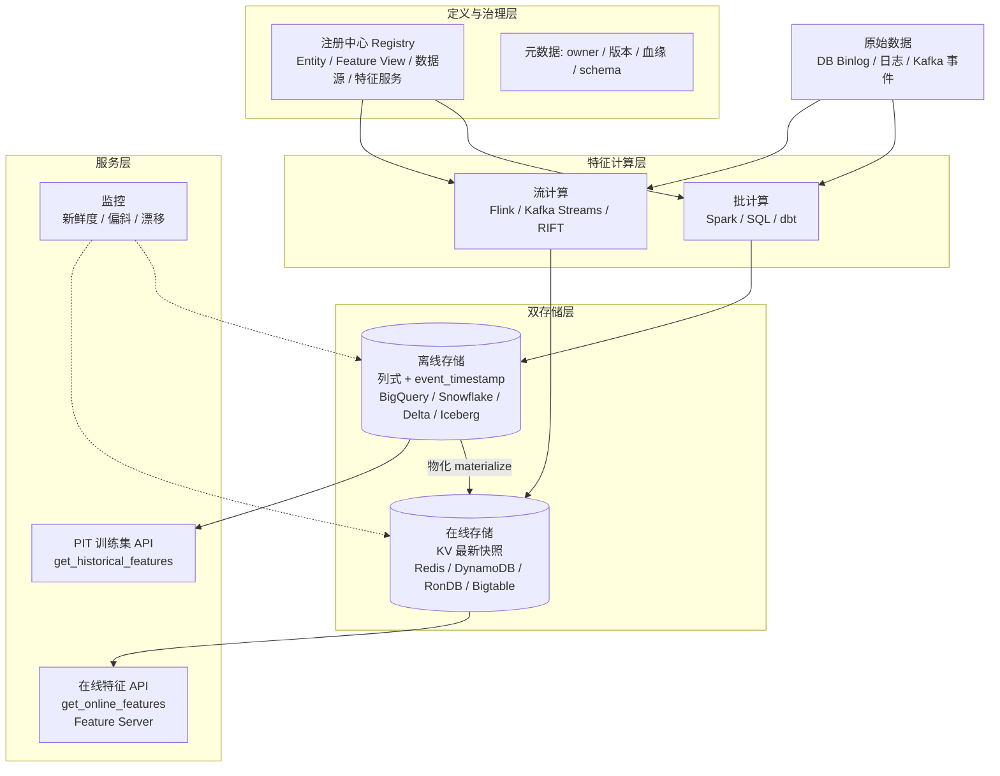
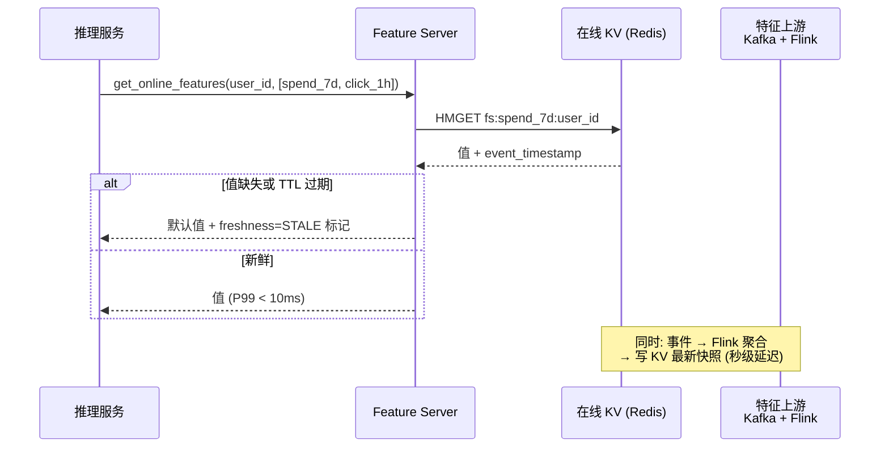
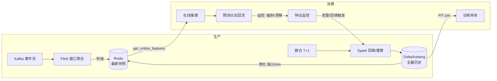

# 3. 架构设计：特征平台的四层结构

> 一句话理解：一个生产级特征平台可以自上而下拆成四层——**定义与治理层（Registry）、特征计算层（批/流管道）、双存储层（离线列式 + 在线 KV）、服务层（PIT 训练集 API + 在线特征 API）**，层与层之间通过明确的物化（materialization）动作衔接。

## 3.1 总体架构

## 3.2 各层职责与关键设计

### 3.2.1 定义与治理层（Registry）

注册中心是特征平台的“配置数据库”，回答“平台里有哪些实体、哪些特征、每个特征从哪来、由谁负责”。

- **Entity**：主键模型（user_id、item_id、device_id），是特征表之间 join 的公共键。
- **Feature View**：一组特征的逻辑视图，绑定实体、数据源、转换逻辑和时间戳字段。
- **数据源（Data Source）**：离线侧指向表/文件，流式侧指向 Kafka topic / push source。
- **血缘与版本**：特征定义变更必须版本化，训练数据集生成时记录所用定义版本，保证可复现。

### 3.2.2 特征计算层

| 模式 | 引擎 | 写入目标 | 新鲜度 | 典型场景 |
|---|---|---|---|---|
| 批计算 | Spark SQL / dbt / 数仓调度 | 离线存储 | T+1 小时 ~ T+1 天 | 长窗口聚合、画像类特征 |
| 流计算 | Flink / Kafka Streams / 商业引擎 | 在线存储（+可选离线） | 亚秒 ~ 秒级 | 实时行为特征、会话特征 |
| 物化 | 平台调度器 | 离线 → 在线 | 取决于调度周期 | 批产特征同步到在线供服务 |

设计要点：**批产特征必须周期性物化到在线存储**，否则在线服务取不到历史画像；**流产特征通常直接写在线存储**，同时以 change log 形式落到离线以支撑 PIT join。

### 3.2.3 离线存储：列式 + 时间轴

离线存储的要求与数仓高度重合（列式、分区、谓词下推），但额外要求：

1. **每条记录携带 event_timestamp**，按时间分区（如 SageMaker 离线库按事件时间前缀组织 S3 路径，存 Parquet）。
2. **append-only**：历史不可变，修正靠新记录 + 重新发布（见第 4 章回填）。
3. **支持高效的 as-of join**：Spark/Flink 侧实现 PIT join 语义，或用 DuckDB/Arrow 这类嵌入式引擎支撑 Python 端的低延迟取数（Hopsworks 用 ArrowFlight 宣称比 JDBC/ODBC 快 10-45 倍）。

### 3.2.4 在线存储：KV 最新快照

在线存储要求恰恰相反——行存、点查 O(1)、毫秒级延迟、高吞吐写入：

| 选型 | 特点 | 使用者 |
|---|---|---|
| Redis / KeyDB | 内存 KV，延迟最低，需自行做持久化与 TTL | Feast（社区常用）、自建 |
| DynamoDB | Serverless，托管多 AZ，与 SageMaker 原生集成 | AWS |
| RonDB（MySQL NDB 分支） | 分布式内存 + 磁盘 KV，带 SQL 接口 | Hopsworks 内置 |
| Bigtable | 单毫秒点查，托管 | Vertex AI |
| Lakebase / 托管 Postgres | 与数据平台统一治理的新路线 | Databricks（在线特征存储） |

两条通用约束：

- **只存最新快照**：同一实体只保留最新值（实现上 last-write-wins，但必须带 event_timestamp 防乱序覆盖）。
- **TTL**：过期特征必须失效而非静默服务陈旧值（与离线侧 max_age 对应）。

### 3.2.5 服务层

| API | 输入 | 输出 | 消费方 |
|---|---|---|---|
| `get_historical_features` | 实体 ID 列表 + query_timestamp（标签时刻） | PIT 正确的训练集 DataFrame | 训练管道（Spark / notebook） |
| `get_online_features` | 实体 ID 列表 + 特征名 | 最新特征值（毫秒级） | 在线推理服务 / Agent |
| Feature Server | HTTP/gRPC | 对非 Python 客户端暴露在线 API | 推理网关、Java 服务 |

## 3.3 一次在线请求的端到端时序

以“推荐系统首页请求用户实时特征”为例：

在线推理的端到端延迟预算通常是几十毫秒（如 Coinbase 风控在 100ms 内完成决策），特征获取一般只能占 5-15ms——这正是“在线存储选型 = 内存 KV”的原因，也是为什么在 LLM/Agent 场景下这套能力被重新命名为实时上下文供给。

## 3.4 数据流全景：从原始事件到训练与服务

## 3.5 本章小结

- 四层架构：Registry（定义）→ 计算（批/流）→ 双存储（离线列式全量 / 在线 KV 快照）→ 服务（PIT API / 在线 API / 监控）。
- 离线重“全量 + 时间轴 + 不可变”，在线重“最新 + 快 + 会过期”。
- 物化是衔接批与服务的桥；监控与预测日志回流构成闭环。

**参考来源**

- [Feast 架构与组件](https://docs.feast.dev/)
- [SageMaker Feature Store 在线/离线存储模型](https://docs.aws.amazon.com/sagemaker/latest/dg/feature-store.html)
- [Hopsworks Feature Store（RonDB 在线库 / ArrowFlight 取数）](https://www.hopsworks.ai/feature-store)
- [Databricks Feature Engineering（Feature View / 在线特征存储）](https://docs.databricks.com/en/machine-learning/feature-store/index.html)
