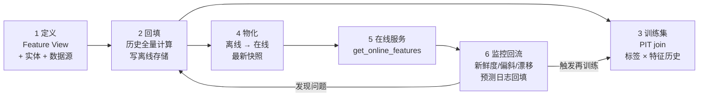
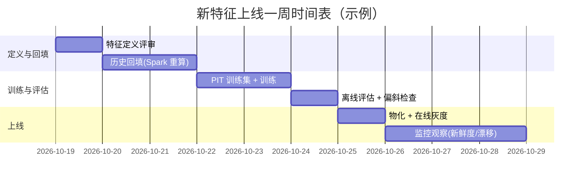

# 4. 工作流程：特征生产与消费全链路

> 一句话理解：一条特征从想法到稳定服务要走过**定义 → 回填（backfill）→ 训练集构建 → 物化上线 → 在线服务 → 监控回流**六个阶段，每个阶段都有明确的输入输出与失败模式；理解这条链路是排查一切特征事故的基本功。

## 4.1 全链路总览



## 4.2 阶段一：特征定义

新特征的起点是声明，而不是脚本。以 Feast 风格为例：

```python
from feast import Entity, FeatureView, Field, FileSource
from feast.types import Float64, Int64

user = Entity(name="user", join_keys=["user_id"])

user_spend_src = FileSource(
    path="s3://bucket/user_spend_events/",
    timestamp_field="event_timestamp",
)

user_spend_fv = FeatureView(
    name="user_spend_7d",
    entities=[user],
    schema=[
        Field(name="spend_sum_7d", dtype=Float64),
        Field(name="order_cnt_7d", dtype=Int64),
    ],
    source=user_spend_src,
    ttl=None,
)
```

关键审查点：

1. **timestamp_field 必须指向业务时间**（事件发生时刻），而不是 ETL 写入时刻。
2. **TTL / max_age 显式声明**：这个特征过多久就不可信？（用户实时位置 5 分钟，画像年龄永久）。
3. **owner 与描述**：写清楚口径，特别是窗口边界（含不含当天）、去重规则、空值语义。

## 4.3 阶段二：历史回填（Backfill）

新特征定义好之后，离线存储里是空的，必须回填历史才能训练。

- **批特征**：Spark/dbt 作业按分区重算全部历史，写入离线表（幂等：按分区覆盖）。
- **流特征**：要么从 Kafka replay 一段历史到流作业做回放计算，要么用批引擎按同一语义算一遍——**两边语义必须一致**，这是偏斜防控的第一道关口。
- **回填触发再训练**：新特征上线通常意味着模型要重新训练并离线评估，A/B 通过后才切换服务。

## 4.4 阶段三：训练集构建（PIT Join）

训练集 = 标签表 ×（按标签时刻取值的）特征表：

```mermaid
sequenceDiagram
    participant D as 数据科学家
    participant FS as 特征平台
    participant OFF as 离线存储
    D->>FS: get_historical_features<br/>(entity_df: user_id + query_timestamp + label)
    FS->>OFF: 每个实体按 query_timestamp 做 as-of 扫描
    OFF-->>FS: 各特征在标签时刻的值(缺失→null)
    FS-->>D: 训练 DataFrame<br/>含特征版本快照信息
    Note over D,FS: 输出必须可复现:<br/>记录 registry 版本 + 数据快照 ID
```

验收清单：

- 抽样核对若干 entity 在若干 query_timestamp 的特征值与人工 SQL 计算一致。
- 确认无泄漏：特征 event_timestamp 全部 ≤ query_timestamp（Mini Demo 的 `test_no_future_leakage` 就是这个检查）。
- 确认标签表的时间定义（下单时刻 vs 支付时刻）与业务口径一致。

## 4.5 阶段四：物化（Materialization）

把离线最新状态同步到在线存储，供服务读取。

- **调度**：批特征通常每 5 分钟 ~ 数小时一次增量物化；`materialize(start, end)` 只搬运时间窗内的新记录（Feast 的物化原语）。
- **乱序保护**：在线存储按 event_timestamp 做 last-write-wins 判断，迟到事件不覆盖更新值（Mini Demo 的 `test_out_of_order_write_ignored`）。
- **首启冷启动**：新特征首次物化需要把全部实体当前值灌入在线存储（full materialize）。

## 4.6 阶段五：在线服务

推理服务的特征获取路径必须短：

```python
features = fs.get_online_features(
    features=["user_spend_7d:spend_sum_7d", "user_click:click_cnt_1h"],
    entity_rows=[{"user_id": "u123"}],
).to_dict()
```

工程约束：

- **延迟预算**：特征获取 P99 通常 ≤ 10ms（批量多 key 一次 fetch，禁用 N+1 查询）。
- **降级策略**：在线缺失/TTL 过期 → 返回默认值并打 `STALE` 标记，推理侧决定放行或降级为兜底模型。
- **与推理框架集成**：KServe/SageMaker 推理可将特征获取封装为 transformer 前置步骤（见本手册 KServe 主题的 Transformer 模式）。

## 4.7 阶段六：监控与回流

特征平台的生命周期以监控闭环收尾：

| 监控项 | 信号 | 典型阈值 | 处置 |
|---|---|---|---|
| 新鲜度 | event_timestamp 与 wall clock 的差 | 批特征超过调度周期 2 倍 | 告警、查调度 |
| 在线缺失率 | get_online_features 返回 null 比例 | 突增 > 5% | 查物化管道 |
| 训练/服务偏斜 | 同实体两路取值差异 | 逐样本比对 + PSI > 0.25 | 阻断上线/回滚 |
| 分布漂移 | 在线特征分布 vs 训练分布 PSI | PSI > 0.25 | 触发再训练评估 |
| 预测日志回流 | 线上预测输入输出落离线 | 常态进行 | 支撑偏斜与效果归因 |

## 4.8 一次完整迭代的时序示例



## 4.9 本章小结

- 六阶段链路：定义 → 回填 → PIT 训练集 → 物化 → 在线服务 → 监控回流，回流发现问题反向触发回填或再训练。
- 每个阶段的“验收点”：定义审口径与时间字段、回填验语义一致、训练集验无泄漏、物化验乱序保护、服务验延迟与降级、监控设新鲜度/偏斜/漂移阈值。

**参考来源**

- [Feast 文档：物化与在线检索](https://docs.feast.dev/)
- [Feast 教程：欺诈检测三段式工作流（回填 → PIT 训练集 → 在线预测）](https://docs.feast.dev/tutorials/tutorials-overview/fraud-detection)
- [SageMaker Feature Store：流式 PutRecord 与 DeleteRecord 语义](https://docs.aws.amazon.com/sagemaker/latest/dg/feature-store.html)
