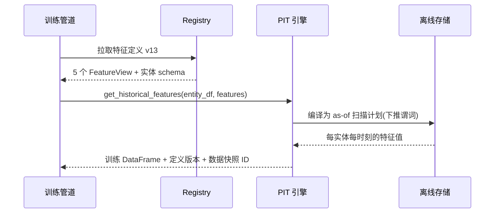

# 5. 核心模块：从 Registry 到 PIT Join 引擎

> 一句话理解：特征平台由六个可独立替换的模块构成——**实体/特征模型、注册中心、离线存储、在线存储、PIT join 引擎、监控与治理**，模块间的接口（物化、as-of 查询、特征获取）是整个行业的通用词汇。

## 5.1 模块总览

| 模块 | 职责 | 关键接口 | 代表实现 |
|---|---|---|---|
| 实体与特征模型 | 定义主键、特征 schema、时间语义 | FeatureView / FeatureGroup | Feast FeatureView、Hopsworks Feature Group |
| 注册中心 Registry | 定义存储、版本、发现、血缘 | apply / get / list | Feast Registry（文件/SQL）、Unity Catalog |
| 离线存储 | 全量历史 + 高效 PIT 扫描 | get_historical_features | BigQuery、Snowflake、Spark、DuckDB、Delta |
| 在线存储 | 最新快照 + 毫秒点查 | get_online_features | Redis、DynamoDB、RonDB、Bigtable |
| PIT join 引擎 | as-of 语义、泄漏防护 | entity_df × feature view | Spark 原生 / DuckDB / Feast 驱动 |
| 监控治理 | 新鲜度、偏斜、漂移、血缘 | metrics / alerts | Tecton Monitoring、Databricks Lakehouse Monitoring |

## 5.2 实体与特征模型

```python
# Mini Demo 的实体模型（docs/03-ai-platform/feature-store/mini-demo/feature_store_mini/entity.py）
@dataclass(frozen=True)
class Entity:
    name: str        # "user"
    join_key: str    # "user_id" —— 所有特征表共用的主键列
    description: str = ""
```

设计决策：

- **join_key 全局唯一语义**：`user_id` 在不同特征表里必须指同一个东西，否则 PIT join 会静默错配。
- **多实体特征**：会话特征可由 (user_id, session_id) 复合键承载；在线点查退化为一次多键查询。
- **特征命名规范**：建议 `entity_agg_window`（如 `user_spend_sum_7d`），命名即文档。

## 5.3 注册中心（Registry）

Registry 回答三个问题：**有什么特征？怎么算的？谁在负责？**

- **Feast**：registry 默认是文件/SQL 库，存所有 FeatureView/Entity/DataSource 定义；`feast apply` 把本地定义发布上去；训练时 SDK 从 registry 拉定义构造查询计划。
- **云厂商路线**：Databricks 用 Unity Catalog 直接托管特征定义（与表/模型统一权限与血缘）；SageMaker/Vertex 用 API 形式的 Feature Group 注册。
- **版本化**：定义变更应可 diff、可回滚；训练数据集生成时冻结所用定义版本。

## 5.4 离线存储模块

接口抽象：`ingest(rows)` / `point_in_time_join(entity_df)` / `as_of(entity, ts)`。

实现谱系：

| 实现 | 引擎 | 适用规模 | 备注 |
|---|---|---|---|
| DuckDB / 文件 | 本地嵌入式 | Demo/小团队 | Feast 默认 local 模式 |
| BigQuery / Snowflake / Redshift | 云数仓 | 中小规模、SQL 团队 | Feast 原生支持 |
| Spark | 分布式批 | 超大规模回填 | 与现有数据平台复用 |
| Delta / Iceberg | 湖格式 | Lakehouse 架构 | Databricks 生态默认 |

PIT join 在该模块内实现，核心语义（与 Mini Demo 的 `OfflineFeatureTable.as_of` 一致）：

```
对每个 entity、每个 query_timestamp:
    取 event_timestamp <= query_timestamp 的最新记录
    若 max_age 超限 → null
    同时间戳多条 → 以最新版本为准
```

生产实现还会处理：多个特征视图的一次扫描合并（projection pushdown）、数据倾斜（热点实体分区）、迟到数据重发布。

## 5.5 在线存储模块

接口抽象：`set(entity_id, values, event_timestamp)` / `get(entity_id, feature_names)`。

实现谱系：

| 实现 | 延迟 | 一致性 | 备注 |
|---|---|---|---|
| Redis | 亚毫秒 | 最终一致 + 主从 | 自建主流，需自管持久化 |
| DynamoDB | 毫秒级 | 可配强一致 | SageMaker 托管模式首选 |
| RonDB | 毫秒级 | 同步复制 | Hopsworks 内置，带 SQL 接口 |
| Bigtable | 单毫秒 | 最终一致 | Vertex AI 托管模式 |

两条实现纪律：

1. **last-write-wins 带时间戳守卫**：旧事件不得覆盖新快照（Mini Demo `test_out_of_order_write_ignored`）。
2. **TTL 即语义**：过期返回 null 让上层降级，而不是返回陈旧值制造静默错误。

## 5.6 PIT join 引擎

这是特征平台技术含量最高的模块。一个高效实现要做三件事：

1. **谓词下推**：把 `event_timestamp <= ts` 下推到存储层，避免全表扫描。
2. **一次扫描多视图**：训练集往往需要几十个特征视图，引擎把它们按实体分区合并扫描（Hopsworks 宣称其 ArrowFlight/DuckDB 路径比传统 JDBC/ODBC 快 10-45 倍）。
3. **泄漏防护的默认正确**：entity_df 必须携带 query_timestamp，缺失即报错——“默认安全”是平台相对手写 SQL 的核心价值。

## 5.7 监控与治理模块

- **新鲜度监控**：在线存储每条记录保留 event_timestamp，服务端周期采样计算 lag 分布。
- **偏斜监控**：对相同实体同时走离线 PIT 重算与在线点查，逐样本比对（`detect_skew`）+ 分布 PSI。
- **漂移监控**：在线分布 vs 训练分布（PSI < 0.1 正常，0.1-0.25 关注，> 0.25 告警）。
- **血缘**：特征 → 数据源 → 使用该特征的模型/服务，Databricks 的 Unity Catalog 模式将这条链与表血缘统一展示。

## 5.8 模块交互：一次训练集请求的完整路径



## 5.9 本章小结

- 六模块：模型、Registry、离线、在线、PIT 引擎、监控；各模块都有清晰的行业通用接口。
- 离线/在线存储是“同一数据的两种物理形态”，物化与 TTL 是连接它们的语义纽带。
- PIT 引擎的核心竞争力：默认防泄漏、单扫描多视图、谓词下推。

**参考来源**

- [Feast 组件文档（离线/在线 store 矩阵、registry、feature server）](https://docs.feast.dev/)
- [Hopsworks Feature Store（RonDB、ArrowFlight 取数路径）](https://www.hopsworks.ai/feature-store)
- [Databricks Feature Engineering（托管特征管道、按需特征、血缘）](https://docs.databricks.com/en/machine-learning/feature-store/index.html)
- 本主题 [Mini Demo](07-mini-demo) 对应模块的最小实现
