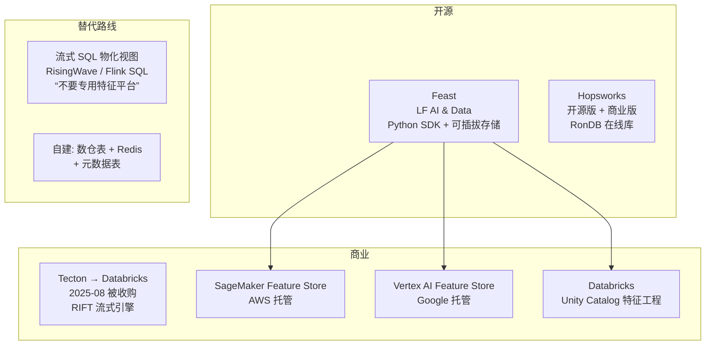

# 6. 生态与源码分析：Feast 走读与五大路线对比

> 一句话理解：开源侧 **Feast 是事实标准**（Python SDK + 可插拔存储，截至 2026-10 最新 0.67.x）；商业侧经过 2025 年的整合，形成 **Databricks（收购 Tecton）、AWS、Google、Hopsworks** 等主要路线——它们的差异本质是“特征计算由谁管、存储落在谁家”的分工差异。

## 6.1 生态版图



## 6.2 Feast 架构与源码走读

Feast 的定位（官方原话）：“不是一个数据库”，而是管理存储在其他系统里的特征数据的**定义层与服务层**。仓库 `github.com/feast-dev/feast`，SDK 主体在 `sdk/python/feast/`。

### 6.2.1 源码目录骨架

```
sdk/python/feast/
├── feature_store.py        # FeatureStore: 门面类, 所有用户 API 的入口
├── entity.py               # Entity 实体定义
├── feature_view.py         # FeatureView: 特征视图 + TTL/时间戳字段
├── data_source.py          # DataSource 抽象(批源) / PushSource(流源)
├── repo_operations.py      # feast apply: 定义编译 + 发布到 registry
├── registry/               # Registry: 定义的存储与版本(SQL/file)
├── infra/
│   ├── offline_stores/     # 离线存储插件: bigquery.py / snowflake.py /
│   │                       #   redshift.py / spark.py / duckdb.py / file.py
│   ├── online_stores/      # 在线存储插件: redis.py / dynamodb.py /
│   │                       #   sqlite.py / datastore.py / cassandra.py ...
│   └── materialization/    # 物化引擎: 把离线窗口数据搬进在线库
└── feature_server.py       # Feature Server: HTTP 在线特征服务
```

### 6.2.2 关键调用链

**feast apply（定义发布）**

```
feast apply
  → repo_operations.apply_total_repo_plan()
    → 解析 feature_repo/ 下 *.py 中的 Entity/FeatureView/DataSource
    → registry.apply_objects()  写入 registry(默认 registry.db)
```

**训练集构建（PIT join）**

```
FeatureStore.get_historical_features(entity_df, features)
  → 按特征视图分组, 逐个离线存储插件生成查询计划
    → 以 BigQuery 插件为例:
       生成 SQL: ROW_NUMBER() OVER (
                   PARTITION BY entity_key
                   ORDER BY event_timestamp DESC
                 ) 取 rn=1 且 event_timestamp <= query_ts 的行
  → 各视图结果按 entity_df 顺序拼接, 返回 RetrievalJob
```

要点：**PIT join 不是通用 SQL join，而是“每组实体按时间倒序取第一条”的窗口去重**，再由 TTL/max_age 过滤过老记录。Mini Demo 的 `OfflineFeatureTable.as_of`（二分查找 + last-write-wins）就是这一语义的最小实现。

**在线服务**

```
FeatureStore.get_online_features(features, entity_rows)
  → online_store.online_read()  逐视图多 key 批量点查
  → 按 FeatureView.ttl 判断是否过期 → null
  → feature_server.py 把同一能力暴露成 HTTP(非 Python 客户端可用)
```

**物化**

```
feast materialize(start, end)
  → 拉取离线存储中 [start, end) 窗口的记录
  → online_store.online_write_batch() 批量写入
  → 在线库按 event_timestamp 去重保留最新
```

### 6.2.3 Feast 的能力边界（官方自述）

- 只管**带时间戳的结构化数据**；不是 ETL/编排/数仓替代品。
- 原生流式摄取有限（push source 支持推入，复杂窗口聚合要靠外部 Flink/Spark）。
- 可复现训练、血缘、漂移检测需要自行补齐（或选商业版）。

## 6.3 五条路线对比

| 维度 | Feast（开源） | Hopsworks | Databricks（原 Tecton） | SageMaker FS | Vertex AI FS |
|---|---|---|---|---|---|
| 定位 | 定义层 + 可插拔存储 | 一体化平台（含 RonDB） | Lakehouse 原生特征工程 | AWS 托管组件 | Google 托管组件 |
| 离线底座 | 自选（BigQuery/Snowflake/…） | Delta/S3 等 | Delta + Unity Catalog | S3 Parquet + Athena | BigQuery |
| 在线底座 | Redis/DynamoDB/SQLite… | RonDB（内置） | 托管在线存储（Lakebase） | 托管在线库 | Bigtable / 优化在线服务 |
| 流式特征 | push source（需外部引擎） | Spark Streaming/Flink | Feature View 托管管道，亚秒新鲜度直接写在线 | PutRecord 流式写入 | 流式导入 |
| 特征计算 | 不管（计算在外部） | 部分内置 | 平台托管 + 按需计算 | Data Wrangler/Processing | 托管导入管道 |
| 治理/血缘 | 基础（registry） | 项目/角色权限 | Unity Catalog 统一血缘/权限 | 跨账号共享 | 与 GCP 权限集成 |
| 适用 | 多云/自研团队 | 想要开源一体化 | 已用 Databricks | 已用 AWS | 已用 GCP |
| 备注 | 社区最活跃 | 开源版可自建 | 2025-08 收购 Tecton 强化实时 | 删除即软删除记录 | 旧版已废弃，2027-02 停服 |

## 6.4 值得跟踪的两条“反潮流”路线

1. **流式 SQL 物化视图替代专用特征平台**（RisingWave 等）：把窗口聚合定义为流式物化视图，离线=视图历史、在线=视图当前值，用通用流式基础设施取代专用系统。对已有强流式团队的组织有吸引力。
2. **轻量自建**（数仓表 + Redis + 元数据表）：对特征数量 < 100、团队 < 10 人的场景，Feast 的完整度可能过头；这是“不要过早引入平台”的一极。

## 6.5 本章小结

- Feast 源码的核心三链路：apply（定义发布）→ get_historical_features（PIT join SQL 生成）→ get_online_features + materialize（在线读写）。
- PIT join 的引擎本质是“按实体分区、按时间倒序取一”的窗口去重 + TTL 过滤。
- 商业路线差异 = 计算与存储的分工差异；2025 年整合后，Databricks（Tecton）路线在“实时 + Agent 上下文”上领先。

**参考来源**

- [Feast GitHub（0.67.x）](https://github.com/feast-dev/feast)
- [Feast 官方文档](https://docs.feast.dev/)
- [Hopsworks Feature Store](https://www.hopsworks.ai/feature-store)
- [Databricks 收购 Tecton 报道（2025-08）](https://www.pymnts.com/acquisitions/2025/databricks-to-purchase-tecton-to-boost-ai-agent-offerings/)
- [Vertex AI Feature Store（Legacy）弃用说明](https://docs.cloud.google.com/vertex-ai/docs/featurestore/overview)
- [RisingWave：2026 实时特征平台观察](https://risingwave.com/blog/real-time-feature-store-2026/)
