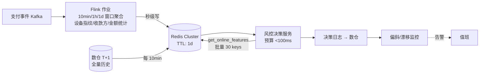

# 8. 企业生产实践：物化、延迟预算与监控闭环

> 一句话理解：生产环境的特征平台成败不在“有没有”，而在**三件工程琐事**——物化调度是否可靠、在线读取是否在延迟预算内、偏斜与漂移监控是否真的能拦住事故。

## 8.1 部署形态选择

| 形态 | 适用 | 代价 |
|---|---|---|
| 云托管全家桶（SageMaker / Vertex / Databricks） | 已深度绑定单一云、团队 30 人以下 | 厂商锁定；跨云复用差 |
| Feast + 自管存储（Redis/数仓） | 多云/混合云、已有数据平台 | 流式计算与监控要自补 |
| Hopsworks（开源自建或商业版） | 想要一体化（含 RonDB） | 平台本身的学习与运维成本 |
| 流式 SQL 自建（Flink/RisingWave 物化视图） | 已有强流式团队、特征量中等 | 特征治理（注册/血缘）要自研 |

决策建议：**特征数量 < 50 且无双云需求时优先云托管；有跨云/合规诉求时 Feast + 自管；实时特征占比高且已有流平台时评估流式 SQL 路线**。

## 8.2 案例：反欺诈的实时特征链路（合成示例）

以在线支付反欺诈（业界最典型的毫秒级特征场景）为例：

要点（与公开实践一致的量级）：

- 端到端决策预算约 100ms，其中特征获取预算 5-15ms → 必须单次批量 fetch、Redis 部署在同机房。
- 流式特征与批式画像混合：行为类特征走 Flink 秒级写 Redis，画像类特征走数仓物化。
- 每次决策的输入特征随日志落离线，支撑次日的偏斜与效果归因。

## 8.3 物化调度的生产细节

1. **增量物化窗口对齐调度周期**：`materialize(now - 2T, now - T)`（T=调度周期），重叠一个周期防边界丢数。
2. **物化幂等**：同一窗口重跑不产生副作用（在线库按 event_timestamp 去重）。
3. **回填与在线更新分离**：回填写离线；在线只接受物化/流式增量，禁止手工改在线库。
4. **首启 full materialize 限流**：新特征上线灌全量实体时按分区限速，避免打爆在线库。

## 8.4 延迟预算分解

以 100ms 端到端推理为例：

| 环节 | 预算 | 手段 |
|---|---|---|
| 请求接入/路由 | 5ms | 同机房、连接池 |
| 特征获取（批量） | 5-15ms | 单次 pipeline 批量 fetch、禁用 N+1 |
| 模型推理 | 50-70ms | 批量、量化、GPU（见 vLLM 主题） |
| 后处理/日志 | 5ms | 异步日志 |

特征获取超预算时的三板斧：本地化缓存（短 TTL 的进程内 LRU）、key 聚批（多特征一次 HMGET）、降级默认值 + STALE 标记。

## 8.5 监控指标体系

| 指标 | 计算 | 告警阈值（示例） |
|---|---|---|
| freshness_lag | now - event_timestamp（在线采样） | 批特征 > 2× 调度周期 |
| online_miss_ratio | null 返回数 / 总请求数 | 突增 > 5% |
| skew_rate | 偏斜检测失配率 | > 0（逐样本比对失败即告警） |
| psi_daily | 在线 vs 训练分布 PSI | > 0.25 |
| materialize_lag | 物化任务延迟 | > 2× 周期 |
| qps / p99 | 在线存储负载 | 容量水位 70% |

监控的闭环动作必须预定义：freshness 告警 → 查调度；PSI 告警 → 触发再训练评估；skew 告警 → 阻断模型上线。

## 8.6 治理与组织实践

- **特征评审制度**：新 FeatureView 合并前评审口径文档、TTL、owner——与代码 review 同级。
- **命名空间与生命周期**：团队前缀（`pay_user_spend_7d`）；下线流程要确认无活跃消费方（registry 查询引用关系）。
- **成本治理**：在线特征全量有内存成本，定期清理无人使用的特征视图；超大特征（embedding）单独评估向量库存储。
- **PII 合规**：SageMaker 官方明确要求 FeatureGroup 的 metadata 不得包含 PII；特征本身按数据分级管控。

## 8.7 血泪教训清单（合成自社区常见问题）

1. **训练用了服务口径的“当前值”做回测**——回测全虚高，上线即崩。PIT join 是唯一正确姿势。
2. **TTL 配错方向**：行为特征 TTL 设成永久，用户三天前的“实时位置”一直被当真。
3. **物化窗口边界丢数**：调度挂了一次，边界记录没同步，在线缺失率缓慢爬升一周才被发现。
4. **entity_id 口径漂移**：数仓侧 user_id 改过映射，特征表没改，join 静默错配。
5. **embedding 特征当普通特征管**：向量更新频率高、体积大，没有独立存储与刷新策略打爆 Redis。

## 8.8 本章小结

- 部署形态四选一：云托管 / Feast 自管 / Hopsworks / 流式 SQL，决策看云绑定与实时占比。
- 生产的三个硬约束：物化幂等 + 限流、特征获取压在 5-15ms、监控阈值必须绑定预定义动作。
- 治理上，特征像 API 一样评审、命名、下线；PII 与成本要有专门流程。

**参考来源**

- [SageMaker Feature Store（多 AZ 韧性、PII 要求）](https://docs.aws.amazon.com/sagemaker/latest/dg/feature-store.html)
- [Databricks Feature Engineering（监控与治理）](https://docs.databricks.com/en/machine-learning/feature-store/index.html)
- [Tecton × LLM 实时上下文实践访谈（Coinbase 风控 <100ms 案例）](https://cerebralvalley.ai/blog/building-context-rich-applications-with-tecton-125ItJUvGdlBoo52YilajW)
- [Feast 生产部署文档](https://docs.feast.dev/)
