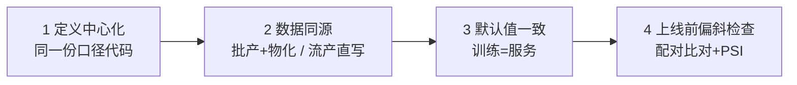

# 9. 最佳实践：口径、时间、TTL 与治理

> 一句话理解：特征平台的最佳实践大多不性感——**命名说清口径、时间字段只用 event_timestamp、TTL 表达业务时效、默认值显式化、上线前必做偏斜检查**——但每一条都对应一类真实线上事故。

## 9.1 特征定义规范

1. **命名即文档**：`entity_agg[_window]`，如 `user_spend_sum_7d`、`item_click_cnt_1h`；禁止 `feat_v2_final` 式命名。
2. **定义即代码**：FeatureView 进 Git，走 code review + CI（`feast plan` 预览变更）。
3. **必填元数据**：owner、口径描述（窗口含不含当天、去重规则、空值语义）、数据源、预期新鲜度。
4. **一个视图一个实体组合**：跨实体拼接留给训练侧，特征视图保持内聚。

## 9.2 时间语义规范（最重要的一节）

| 规则 | 理由 |
|---|---|
| 只用 **event_timestamp**（业务时间）做 PIT 与 TTL | 写入时间会随重跑变化，破坏可复现性 |
| 迟到数据按 event_timestamp 归位 | 保证任意历史时刻可复原 |
| 删除做成“删除事件”写入离线库 | PIT join 能复原删除前的状态 |
| entity_df 必须携带 query_timestamp | 让“按标签时刻取值”成为默认而非选项 |
| 训练集生成冻结 registry 版本与数据快照 ID | 可复现审计 |

反例集锦：用 `NOW()` 回填 event_timestamp（训练集变成“今天看过去”，泄漏）；同一实体不同表的 timestamp 时区不一致（PIT join 错位 8 小时）；批作业按调度日而非业务日分区（重跑产生双份）。

## 9.3 TTL 与默认值策略

TTL 回答“这个特征多旧就不可信”，必须由**业务时效**决定：

| 特征类型 | 建议 TTL | 缺失/过期行为 |
|---|---|---|
| 实时行为（最近点击、位置） | 分钟级 | 默认值 + STALE 标记 |
| 短期画像（7/30 天聚合） | 1-2 倍计算周期 | 0 或全局均值 |
| 长期画像（性别、注册时长） | 无限（无 TTL） | 不可用 → 模型降级 |
| embedding | 与源数据更新频率一致 | 上一版本向量 |

默认值必须显式出现在 FeatureView 定义里，并在训练侧用同样的默认值填充——否则训练学的分布与服务不一致，是偏斜的隐蔽来源。

## 9.4 偏斜防控四道防线

- **首选“单管道”**：能批产+物化就不用批流双实现；必须用流式时，用 Tecton RIFT / Databricks 托管管道这类“一份声明双执行”的引擎。
- **按需特征（on-demand）**：简单变换（如 `a / b`）可在服务时计算，Databricks 支持 on-demand feature，从根上消除该类偏斜。
- **上线门禁**：模型发布流水线里强制跑偏斜检测（同实体抽样 ≥ 1000 对，失配率 0，PSI < 0.25）。

## 9.5 训练集构建清单

1. entity_df 的 query_timestamp = **标签发生时刻**（不是样本构建时刻）。
2. 训练/验证/测试按时间切分，且特征同样 PIT 取值（防止“验证集用了比训练更新的特征分布”这种隐性泄漏）。
3. 记录特征定义版本 + 快照 ID 到实验追踪（MLflow run 的 tag 里）。
4. 抽样 10 条人工 SQL 复核。

## 9.6 规模与性能实践

- **批量取特征**：在线读取永远批量（多实体一次请求），单点查 N+1 是延迟杀手。
- **热点实体**：超活跃实体的特征更新会打偏分区，在线库按 key 打散（一致性哈希）。
- **大特征分流**：embedding/长序列走向量库或对象存储，KV 只放标量与指针。
- **物化错峰**：多个特征的物化任务错峰调度，避免同时冲击离线库。

## 9.7 LLM/Agent 时代的补充实践

1. **把 Agent 上下文当特征管**：用户最近行为、账户状态、会话摘要 → 复用在线特征服务的 TTL 与新鲜度机制，而不是在 Agent 框架里另起炉灶。
2. **embedding 入平台**：向量特征登记进 registry（类型标记为 embedding + 维度），在线侧接向量索引（Hopsworks/Tecton 均支持）。
3. **上下文版本化**：Agent prompt 使用的上下文特征集要版本化，可回放（与 prompt 版本管理同理，见本手册 tool-use/mcp 主题）。

## 9.8 反模式速查表

| 反模式 | 后果 | 替代 |
|---|---|---|
| 手写 SQL join 特征当前值做训练 | 泄漏，指标虚高 | PIT join |
| 批流两套代码算同一特征 | 偏斜 | 单管道/托管管道 |
| TTL 无限 + 无 STALE 标记 | 陈旧值静默污染决策 | TTL + 显式降级 |
| 特征无 owner 无描述 | 没人敢用没人敢删 | 注册即评审 |
| 在线库手工修数据 | 离线/在线不一致 | 修正走离线与重放 |

## 9.9 本章小结

- 五个规范面：定义、时间、TTL/默认值、偏斜防线、训练集构建。
- 时间语义是灵魂：event_timestamp 贯穿一切；默认值一致性是偏斜的隐蔽来源。
- Agent 时代新实践：上下文特征化、embedding 入 registry、上下文版本化。

**参考来源**

- [Feast 最佳实践与文档](https://docs.feast.dev/)
- [Databricks Feature Engineering：on-demand feature 与托管管道](https://docs.databricks.com/en/machine-learning/feature-store/index.html)
- [Tecton：为 LLM 应用供给实时上下文](https://www.tecton.ai/whats-new/introducing-tecton-1-0/)
- [Databricks：什么是 Feature Store（含 PSI 实践口径）](https://www.databricks.com/blog/what-feature-store-complete-guide-ml-feature-engineering)
