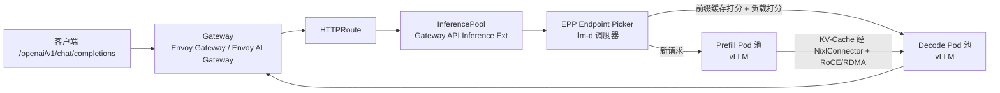

# 2. 核心思想：InferenceService、ServingRuntime 与数据面协议

> 一句话理解：KServe 把"模型服务"拆成三层抽象——**`InferenceService` 描述"要服务什么模型"、`ServingRuntime` 描述"用什么容器跑"、数据面协议描述"客户端怎么调用"**；在这之上再用 `InferenceGraph` 组合多个服务、`Transformer`/`Explainer` 扩展前处理/可解释性；而面向 LLM，`LLMInferenceService` + `LocalModelCache` 把 KV-Cache 路由、PD 分离、冷启动这些专属问题也变成了声明式抽象。

## 2.1 InferenceService：用户的入口

`InferenceService`（IS）是 KServe 最核心的 CRD。用户只需要声明一次，KServe 就负责剩下的所有生命周期。

```yaml
apiVersion: serving.kserve.io/v1beta1
kind: InferenceService
metadata:
  name: sklearn-iris
spec:
  predictor:
    model:
      modelFormat:
        name: sklearn
      storageUri: gs://kfserving-examples/models/sklearn/1.0/model-1
    minReplicas: 1
    maxReplicas: 5
    canaryTrafficPercent: 20
```

**核心字段**：

| 字段 | 含义 |
|---|---|
| `predictor` | **必须**。真正跑模型推理的 Pod。 |
| `transformer` | 可选。请求/响应预处理或后处理（如 tokenization、detokenization）。 |
| `explainer` | 可选。模型可解释性（如 SHAP、LIME、Anchor）。 |
| `minReplicas`/`maxReplicas` | 扩缩边界。 |
| `canaryTrafficPercent` | 金丝雀切流比例。 |
| `serviceAccountName` | 拉模型所需的权限。 |

`predictor` 有三种写法：

1. **老版框架简写**：`predictor.sklearn`、`predictor.tensorflow`、`predictor.pytorch`……（v1beta1 仍兼容，但推荐 runtime 模式）。
2. **新版 runtime 模式**：`predictor.model.modelFormat.name` + 可选 `runtime`。这是推荐方式，更灵活。
3. **自定义容器**：`predictor.containers` 直接写 container spec。

```yaml
# runtime 模式（推荐）
spec:
  predictor:
    model:
      modelFormat:
        name: huggingface
      runtime: kserve-huggingfaceserver   # 显式指定 runtime
      storageUri: s3://models/llama-3/
```

## 2.2 Predictor / Transformer / Explainer：三段式推理链

一个完整的推理请求链路可能包含：

```
客户端请求
   │
   ▼
[Ingress/Gateway]
   │
   ▼
[Transformer]  ← 前处理（tokenize、resize、特征工程）
   │
   ▼
[Predictor]    ← 模型推理
   │
   ▼
[Transformer]  ← 后处理（detokenize、格式化）
   │
   ▼
客户端响应
```

**Predictor**：核心，必须有。它通过 `ServingRuntime` 确定容器镜像、启动命令、资源。

**Transformer**：可选，用于 pre/postprocessing。典型场景：

- LLM 的 tokenize/detokenize。
- 图像分类前的 resize/normalize。
- 推荐模型前的特征拼接。

KServe 支持两种 transformer：

- **v1**：单独的 transformer Pod，KServe 自动把它串到 predictor 前。
- **v2（colocation）**：transformer 与 predictor 同 Pod，通过 localhost 通信，降低延迟。

**Explainer**：可选，用于模型可解释性。输入同样的请求，返回解释（如 SHAP values）。

## 2.3 ServingRuntime / ClusterServingRuntime：runtime 抽象

这是 KServe 架构中非常巧妙的一层——**把"模型格式"和"容器实现"解耦**。

```yaml
apiVersion: serving.kserve.io/v1alpha1
kind: ClusterServingRuntime
metadata:
  name: kserve-huggingfaceserver
spec:
  supportedModelFormats:
    - name: huggingface
      version: "1"
      autoSelect: true
      priority: 1
  protocolVersions:
    - v1
    - v2
  containers:
    - name: kserve-container
      image: kserve/huggingfaceserver:latest
      args:
        - --model_name={{.Name}}
        - --model_dir=/mnt/models
```

**关键机制**：

- 用户写 `modelFormat.name: huggingface`。
- KServe controller 扫描 namespace 的 `ServingRuntime` 或 cluster 的 `ClusterServingRuntime`。
- 找到 `supportedModelFormats` 匹配且 `autoSelect: true` 的 runtime。
- 用该 runtime 的 `containers` 模板渲染 predictor Pod。

模板变量（如 <code v-pre>{{.Name}}</code>、<code v-pre>{{.StorageURI}}</code>、<code v-pre>{{.Labels.modelName}}</code>）在 reconcile 时被替换成实际值。注意：这些 Go template 占位符只在 YAML 字符串里，不是 VitePress 行内代码，不会触发 Vue mustache 问题。

> **为什么需要这一层**：KServe 出厂支持十几种 runtime（sklearn/xgboost/lightgbm/tensorflow/pytorch/onnx/triton/huggingface/paddle），但团队也可以自定义 runtime。新框架出现时，平台工程师只需新增一个 `ClusterServingRuntime`，无需改 KServe controller 代码——这是**开闭原则**。

## 2.4 InferenceGraph：多模型组合与 DAG

当业务需要把多个模型串起来（如 A 模型 embedding → B 模型 rerank → C 模型生成），可以用 `InferenceGraph`：

```yaml
apiVersion: serving.kserve.io/v1alpha1
kind: InferenceGraph
metadata:
  name: llm-rag-pipeline
spec:
  nodes:
    root:
      routerType: Sequence
      steps:
        - serviceName: embedding-model
        - serviceName: retriever
        - serviceName: llm
```

支持的路由类型：

- **Sequence**：顺序执行。
- **Switch**：按条件路由。
- **Ensemble**：并行多模型，聚合结果（投票/平均）。
- **Splitter**：按比例分流（A/B test）。

`InferenceGraph` 让 KServe 从"单模型服务"升级到"推理工作流编排"。

## 2.5 LLM 时代的新抽象：LLMInferenceService 与 LocalModelCache

> 一句话理解：传统 `InferenceService` 是"一个模型一个端点"的通用抽象；而 LLM 需要**KV-Cache 感知路由、prefill/decode 分离、LoRA 热加载、多节点并行**这些专属能力——KServe 从 v0.16 起用 `LLMInferenceService`（llmisvc）承载它们，v0.17 宣布生产可用，并用 `LocalModelCache` 解决大模型冷启动。

### 2.5.1 LLMInferenceService

```yaml
apiVersion: serving.kserve.io/v1alpha1
kind: LLMInferenceService
metadata:
  name: llama-3-1-70b
spec:
  model:
    uri: hf://meta-llama/Llama-3.1-70B-Instruct   # 支持 HuggingFace / S3 / OCI
    name: llama-3-1-70b
  deployments:
    - name: main
      runtime:
        name: vllm                                 # 目前主要面向 vLLM
      replicas: 2
```

它与传统 IS 的本质区别在**数据面调度**：



核心机制：

- **Gateway API Inference Extension（GIE）**：HTTPRoute 的后端不再是普通 Service，而是 `InferencePool` + `InferenceModel`（v0.17 起随 KServe 安装内置；GIE 的 InferencePool 已于 2025-09 随 GIE 1.0 进入 v1 GA，v0.20 升级到 GIE v1.5）。
- **Endpoint Picker Pod（EPP）**：替代 kube-proxy 轮询的智能调度器，来自 [llm-d](https://llm-d.ai/) 生态。vLLM Pod 通过 ZMQ 事件（`BlockStored`/`BlockRemoved`）上报 KV-Cache 块，EPP 维护"前缀哈希 → Pod"索引，用可插拔 scorer 打分：prefix-cache-scorer（权重 2.0）+ load-aware-scorer（权重 1.0）+ 队列 scorer，选最高分 Pod。
- **Prefill/Decode 分离（PD disaggregation）**：新请求先进 decode pool，由路由容器转发给 prefill Pod 做提示词处理，KV-Cache 经 NixlConnector 走 RoCE/RDMA 传给 decode Pod；多轮对话的续写请求若命中 decode Pod 上的缓存则跳过 prefill 直接生成。
- **多节点推理**：v0.17 起用 LeaderWorkerSet 表达 tensor/data/expert 并行；v0.18 增加 `multinode/executor-backend` 注解，可从默认 Ray 模式切到 vLLM 原生 mp（multiprocessing）后端，免装 Ray head 节点，控制器自动建 headless Service 供 worker DNS 发现并注入并行度环境变量。
- **LoRA 适配器热加载**：v0.19 起支持静态 LoRA 适配器协调，v0.20 加入 LoRA affinity scorer（把请求路由到已加载对应 LoRA 的 Pod）。
- **KV-Cache 卸载**：v0.15 集成 LMCache 做跨副本 KV-Cache 卸载降低 TTFT；v0.20 支持把 KV-Cache 卸载到二级文件系统层。

**runtime 现状（2026-10）**：llmisvc 目前主要面向 **vLLM**（v0.20 起 vLLM 成为 KServe 一等支持 runtime）；SGLang 与 trtllm-serve 支持在路线图上（[kserve#5669](https://github.com/kserve/kserve/issues/5669)），但 preset、健康探针、调度指标等仍编码了 vLLM 假设，落地前需核实版本。llmisvc 的扩缩由 llm-d 的 **WVA（Workload Variant Autoscaler）**承载，支持 HPA 或 KEDA 后端；v0.21 起 llmisvc 可直接用 KEDA 扩缩，并支持金丝雀流量切分（`rolloutStrategy`）。

### 2.5.2 LocalModelCache：把"每次从 S3 拉 70GB"变成"节点本地秒开"

大模型冷启动的头号元凶是从对象存储下载权重。`LocalModelCache`（v0.15）把模型预先缓存到 GPU 节点的本地 NVMe 盘：

```yaml
apiVersion: serving.kserve.io/v1alpha1
kind: LocalModelCache
metadata:
  name: llama-3-1-70b
spec:
  model:
    uri: s3://models/llama-3-1-70b/
  nodeGroups:                 # 声明缓存到哪些节点组
    - name: gpu-a100
```

配套 CRD 与组件：

| 资源/组件 | 作用 |
|---|---|
| `LocalModelCache` | 声明要缓存哪个模型（v0.19 起 llmisvc 也可用） |
| `LocalModelNodeGroup` | 声明缓存节点组与本地 PV 规格（`local.path` 必须与 localmodel agent DaemonSet 的 hostPath 一致，否则会出现重复下载 job 和权限错误） |
| `LocalModelNode` | 记录每个节点上各模型的缓存状态 |
| localmodel node agent（DaemonSet） | 在节点上真正执行下载/清理的守护进程 |

效果：官方口径大模型加载时间从 **15-20 分钟降到约 1 分钟**，使"LLM 也敢做激进缩容"成为可能——这是 v0.15 之后生产落地最重要的一个特性，也是 ModelMesh 归档后官方推荐的密度/冷启动方案之一。

## 2.6 数据面协议：V1 / V2 / OpenAI-compatible

KServe 的一个强大之处是**协议统一**。客户端调用模型时，不需要关心 backend 是 TensorFlow 还是 vLLM。

### V1 协议（传统 ML）

```bash
POST /v1/models/sklearn-iris:predict
Content-Type: application/json
{"instances": [[1.0, 2.0, 3.0, 4.0]]}
```

类似 TensorFlow Serving，适合表格/图像等传统 ML。

### V2 协议（Open Inference Protocol）

```bash
POST /v2/models/sklearn-iris/infer
Content-Type: application/json
{
  "inputs": [{"name": "input", "shape": [1,4], "datatype": "FP32", "data": [1.0,2.0,3.0,4.0]}]
}
```

标准化输入/输出张量格式，被 Triton、TorchServe、MLServer 等支持。适合多框架统一。

### OpenAI-compatible 协议（LLM）

```bash
POST /openai/v1/chat/completions
Content-Type: application/json
{"model": "llama-3", "messages": [{"role": "user", "content": "hello"}]}
```

HuggingFace runtime（基于 vLLM）和 Triton 都支持，让 LLM 服务可以直接对接 OpenAI SDK、LangChain、Cursor 等生态。

2026 年的两个扩展：

- **OpenAI Responses API**（v0.18）：HTTPRoute 新增 `/v1/responses` 路由，支持工具调用 + 结构化输出合一的新 API。
- **Anthropic Messages API**（v0.20）：llmisvc 增加 `/v1/messages` 路由，Claude 生态客户端可以直接对接 KServe 端点。

**协议选择建议**：

| 场景 | 推荐协议 |
|---|---|
| 传统 ML / 需要强类型张量 | V2 |
| 已有 TF Serving 客户端 | V1 |
| LLM / Agent / Chat | OpenAI-compatible（chat.completions / responses / messages 按客户端生态选） |
| 多 runtime 混合 | 网关层统一成一种 |

## 2.7 Serverless vs RawDeployment：两种部署模式

KServe 支持两种控制平面部署模式：

### Serverless（Knative）

```yaml
metadata:
  annotations:
    serving.kserve.io/deploymentMode: Serverless
```

- 利用 Knative Serving：每个 IS 是一个 Knative Service。
- **缩到零**：无请求时 Pod 数为 0，请求来时由 Knative Activator 队列缓冲并冷启动。
- 默认 autoscaler 是 Knative Pod Autoscaler（KPA），基于并发请求数。
- 适合：开发测试、CPU 小模型、负载波动大且能接受冷启动的场景。

### RawDeployment（原生 K8s，生产主流）

```yaml
metadata:
  annotations:
    serving.kserve.io/deploymentMode: RawDeployment
    serving.kserve.io/autoscalerClass: hpa
    serving.kserve.io/metric: cpu
    serving.kserve.io/targetUtilizationPercentage: "60"
```

- KServe controller 直接创建 K8s `Deployment` + `Service` + `Ingress`（v0.19 起 Standard 模式支持 REST/gRPC 双协议路由）。
- 用 HPA/KEDA 扩缩，**不支持缩到零**（`minReplicas >= 1`）。
- 无 Knative queue-proxy，延迟更低。
- 适合：生产推理、GPU 模型、latency-sensitive。

**当前趋势**：RawDeployment（在 Red Hat OpenShift AI 等产品 UI 中叫 **Standard 模式**）已是绝对主流——Red Hat 在 RHOAI 3.x 中弃用了 ModelMesh 与 Serverless 两种模式，官方迁移方向就是 RawDeployment + LocalModelCache。对 GPU/LLM，冷启动成本仍然极高（即使上了 LocalModelCache 也要分钟级预热），生产通常保持 `minReplicas >= 1`；CPU 小模型和开发环境可以继续用 Serverless 省资源。

## 2.8 KServe 的"心智模型"

把前几节组合起来，一个完整的 KServe 心智模型：

```
用户写 InferenceService（传统 ML）或 LLMInferenceService（LLM）
        │
        ▼
KServe Controller (kserve-controller-manager)
        │ 1. 选 runtime（modelFormat → ServingRuntime/ClusterServingRuntime）
        │ 2. 按 deploymentMode 创建 Knative Service 或 K8s Deployment+Service+Ingress
        │ 3. 注入 storage initContainer（storageUri → /mnt/models）
        │    或挂载 LocalModelCache 的本地缓存路径
        │ 4. 配置 transformer/explainer sidecar
        │ 5. 设置 HPA/KPA/KEDA/WVA
        │ （llmisvc 路径：创建 Gateway/HTTPRoute/InferencePool + EPP + vLLM Pod 池）
        ▼
运行中的 Predictor (+ Transformer/Explainer) 或 Prefill/Decode Pod 池
        │
        ▼
Ingress/Gateway 暴露 /v1、/v2、/openai/v1 端点
        │
        ▼
客户端调用（无需关心 backend runtime）
```

## 本章小结

- **`InferenceService`** 是用户入口，描述 predictor/transformer/explainer 和扩缩/金丝雀策略。
- **`LLMInferenceService`**（v0.16 引入、v0.17 生产可用）是 LLM 时代的新入口：基于 Gateway API Inference Extension 的 `InferencePool`/`InferenceModel` + EPP KV-Cache 感知路由 + prefill/decode 分离 + LoRA 热加载 + LeaderWorkerSet 多节点推理。
- **`LocalModelCache`**（v0.15）用节点本地缓存把大模型加载从 15-20 分钟降到约 1 分钟，是 LLM 冷启动的标准解法。
- **`ServingRuntime`/`ClusterServingRuntime`** 把模型格式映射到容器实现，支持自定义 runtime；v0.20 起 vLLM 成为一等 runtime。
- **`InferenceGraph`** 把多个模型组合成 Sequence/Switch/Ensemble/Splitter 工作流。
- **三种数据面协议**：V1（传统）、V2（Open Inference Protocol，张量标准化）、OpenAI-compatible（LLM，含 v0.18 Responses API 与 v0.20 Anthropic Messages 路由）。
- **两种部署模式**：Serverless/Knative（缩到零、CPU 小模型）和 RawDeployment（生产 GPU 主流；Red Hat 已弃用 ModelMesh 与 Serverless，方向是 Standard + LocalModelCache）。
- 心智模型：IS/llmisvc → controller 选 runtime → 创建 workload → 接入流量 → 客户端按统一协议调用。

**参考来源**

- [KServe — InferenceService API](https://kserve.github.io/website/docs/get_started/first_isvc/)
- [KServe — LLMInferenceService 架构深入](https://kserve.github.io/website/docs/next/concepts/architecture/control-plane-llmisvc)
- [KServe — LLMInferenceService 概览](https://kserve.github.io/website/docs/model-serving/generative-inference/llmisvc/llmisvc-overview)
- [KServe — LoRA Adapters](https://kserve.github.io/website/docs/model-serving/generative-inference/llmisvc/lora-adapters)
- [KServe — LocalModelCache 文档](https://kserve.github.io/website/docs/0.17/model-serving/generative-inference/modelcache/localmodel)
- [KServe — ServingRuntime](https://kserve.github.io/website/docs/concepts/resources/servingruntime/)
- [KServe — InferenceGraph](https://kserve.github.io/website/docs/concepts/resources/inference_graph/)
- [KServe — Data Plane / V2 Protocol](https://kserve.github.io/website/docs/concepts/data_plane/)
- [Open Inference Protocol](https://github.com/kserve/open-inference-protocol)
- [llm-d ModelService 提案（KServe 0.15+ LLM 特性）](https://llm-d.ai/docs/0.7/proposals/modelservice)
