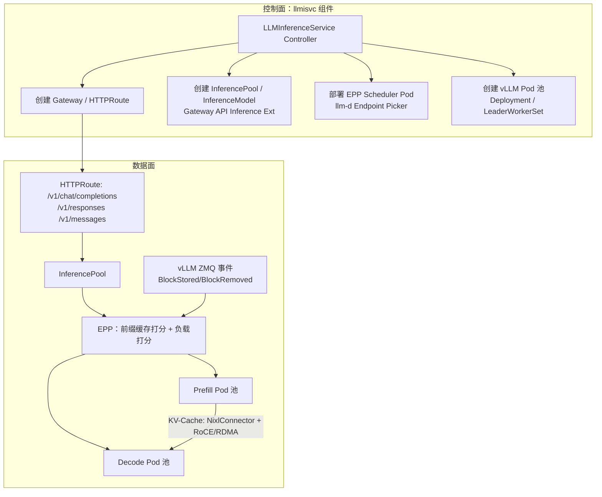

# 3. 架构设计：控制面、数据面与网关层

> 一句话理解：KServe 的架构可以切成三块——**控制面（controller/webhook）负责把 `InferenceService` 渲染成 K8s 资源；数据面（runtime model server + queue-proxy/agent）负责实际推理；网关层（Knative/Raw Ingress）负责把外部请求路由到正确 Pod**。

## 3.1 总体架构图

```
┌──────────────────────────────────────────────────────────────────────┐
│                         外部客户端 / API 网关                          │
└───────────────────────────────┬──────────────────────────────────────┘
                                │
                                ▼
┌──────────────────────────────────────────────────────────────────────┐
│                        Ingress / Gateway                            │
│   /v1/models/... /v2/models/... /openai/v1/chat/completions         │
└───────────────────────────────┬──────────────────────────────────────┘
                                │
            ┌───────────────────┴───────────────────┐
            │                                       │
   Serverless 模式                              RawDeployment 模式
   (Knative Serving)                            (原生 K8s)
            │                                       │
   Knative Activator                        K8s Service
            │                                       │
            └───────────────────┬───────────────────┘
                                │
                                ▼
┌──────────────────────────────────────────────────────────────────────┐
│                         Predictor Pod                               │
│  ┌───────────────────────────────────────────────────────────────┐  │
│  │  Transformer Container (可选)                                   │  │
│  │  Explainer Container (可选)                                     │  │
│  ├───────────────────────────────────────────────────────────────┤  │
│  │  Model Server Runtime Container                                │  │
│  │  (vLLM / Triton / HuggingFace / sklearn / ... )                │  │
│  │  监听 /mnt/models，暴露 8080 推理端口                            │  │
│  ├───────────────────────────────────────────────────────────────┤  │
│  │  queue-proxy (Serverless 模式) / agent (RawDeployment 可选)     │  │
│  └───────────────────────────────────────────────────────────────┘  │
└──────────────────────────────────────────────────────────────────────┘
                                │
                                ▼
┌──────────────────────────────────────────────────────────────────────┐
│                   KServe 控制平面 (kserve-controller-manager)        │
│   - InferenceService Controller                                      │
│   - LLMInferenceService Controller (llmisvc 组件, v0.16+)            │
│   - LocalModelCache Controller (localmodel 组件, v0.15+)             │
│   - ServingRuntime Controller                                        │
│   - InferenceGraph Controller                                        │
│   - Webhook (defaulting / validating / mutating)                     │
│   （ModelMesh Controller 已随项目归档于 2026-04，勿用于新部署）         │
└──────────────────────────────────────────────────────────────────────┘
                                │
                                ▼
┌──────────────────────────────────────────────────────────────────────┐
│                         Kubernetes API Server                        │
│   CRD: InferenceService, ServingRuntime, ClusterServingRuntime, ...  │
└──────────────────────────────────────────────────────────────────────┘
```

## 3.2 控制平面（Control Plane）

### kserve-controller-manager

`kserve-controller-manager` 是一个标准的 K8s Operator，内部有多个 controller：

| Controller | 职责 |
|---|---|
| `InferenceService` Controller | 监听 IS CRD，渲染 Knative Service / K8s Deployment + Service + Ingress + HPA + ConfigMap |
| `LLMInferenceService` Controller（v0.16+，随 `llmisvc` 组件安装） | 把 llmisvc 渲染成 Gateway / HTTPRoute / InferencePool / InferenceModel + EPP Scheduler + vLLM Pod 池（可含 prefill/decode 双池、多节点拓扑） |
| `LocalModelCache` Controller（v0.15+，随 `localmodel` 组件安装） | 管理 `LocalModelCache`/`LocalModelNodeGroup`/`LocalModelNode`，驱动节点 agent 预下载模型 |
| `ServingRuntime` Controller | 处理 runtime 的可用性、协议版本、模型格式注册 |
| `ClusterServingRuntime` Controller | 处理集群级 runtime |
| `InferenceGraph` Controller | 把 Graph 渲染成 Knative Service / K8s Deployment |
| `TrainedModel` Controller | 在单个 IS 内动态挂载/卸载多个子模型（部分场景） |
| Webhook | defaulting、validating、mutating admission |

Controller 的核心逻辑是：

1. **watch** `InferenceService` 的变化（Informer）。
2. **reconcile**：根据 spec 计算 desired state。
3. **apply** 底层资源（Knative Service / Deployment / Service / Ingress / HPA / ServiceAccount）。
4. **update status**：把 `READY`/`PredictorReady`/`IngressReady` 等 condition 写回 IS。

### Webhook

KServe 的 webhook 做三件事：

- **Defaulting**：给未填字段补默认值（如 `modelFormat`、`runtime`、`protocolVersion`）。
- **Validating**：校验 spec 合法性（如 `canaryTrafficPercent` 范围、`storageUri` 格式）。
- **Mutating**：注入 sidecar、init container、环境变量等。

例如，用户写了 `modelFormat.name: sklearn`，但忘写 runtime，webhook 会默认补成 `kserve-sklearnserver`。

## 3.3 数据面（Data Plane）

### Model Server Runtime

数据面的核心是 runtime container。每个 runtime 通常是一个 HTTP/gRPC server，加载模型后监听固定端口（默认 8080）。KServe 维护的 runtime 包括：

| Runtime | 框架/引擎 | 典型模型 |
|---|---|---|
| `kserve-sklearnserver` | scikit-learn | 表格、分类 |
| `kserve-xgbserver` | XGBoost | 梯度提升 |
| `kserve-lgbserver` | LightGBM | 梯度提升 |
| `kserve-tensorflow` | TensorFlow SavedModel | CNN/NLP |
| `kserve-pytorchserver` | PyTorch TorchScript | CV/NLP |
| `kserve-tritonserver` | Triton | 多 backend |
| `kserve-huggingfaceserver` | HuggingFace + vLLM | LLM |
| `kserve-mlserver` | MLServer | sklearn/xgboost/ONNX |
| `kserve-paddleserver` | PaddlePaddle | 百度飞桨 |
| `kserve-custom` | 自定义 | 任意 |

### Storage Init Container

在 runtime 启动前，KServe 通常会注入一个 `storage-initializer` init container：

```yaml
initContainers:
  - name: storage-initializer
    image: kserve/storage-initializer:latest
    args:
      - s3://models/llama-3/
      - /mnt/models
```

它负责从 `storageUri`（S3/GCS/Azure/HTTPS/PVC/OCI，v0.19 起支持多个 `storageUris` 与 OCI 源）下载模型到 `/mnt/models`。runtime 启动后从这个目录加载模型。

> **大模型场景的替代方案**：LocalModelCache（v0.15+）让 agent 提前把模型下载到节点本地盘，storage-initializer 改为从本地缓存挂载/加载，加载时间从 15-20 分钟降到约 1 分钟（详见 5.6）。

### Queue-Proxy / Agent

**Serverless 模式**：Knative 会在 Pod 里注入 `queue-proxy` sidecar，负责：

- 请求队列缓冲（activator 过来的请求）。
- 并发报告给 Knative autoscaler。
- 健康检查/优雅停机。

**RawDeployment 模式**：无 queue-proxy，请求直接打到 model server。可选 `agent` 做一些辅助工作（如 modelmesh 场景）。

## 3.4 网关层（Ingress / Gateway）

KServe 把外部流量路由到模型 Pod，支持两种入口：

### Knative 入口（Serverless）

Knative 自带 Istio/Contour/Kourier/Ambassador 等 net-* 插件。KServe 创建一个 Knative Service 后，Knative 自动：

- 生成一个可路由的 URL（如 `sklearn-iris.default.example.com`）。
- 把请求路由到 revision。
- 处理金丝雀（通过 traffic split）。

### RawDeployment 入口

KServe controller 自己创建：

- K8s `Service`（ClusterIP 或 LoadBalancer）。
- `Ingress` 资源（Istio VirtualService / Kubernetes Ingress / Gateway API）。
- 可选的 SSL、host、path rewrite。

KServe 支持通过 `ingressGateway` 配置使用 Istio 或 Kourier。

### 流量治理特性

| 特性 | 实现 |
|---|---|
| 金丝雀 | Serverless 用 Knative traffic split；RawDeployment 用 Istio/VirtualService weight。 |
| A/B test | `canaryTrafficPercent` 或 `InferenceGraph` Splitter。 |
| 请求路由 | host/path/model name 路由。 |
| 超时/重试 | 网关层配置。 |
| 认证鉴权 | 与 Istio auth policy / OAuth2 proxy 集成。 |

## 3.5 Runtime 注册表与匹配

KServe 在启动时会加载所有 `ServingRuntime` 和 `ClusterServingRuntime`，形成一个内存注册表。匹配算法：

```
1. 取 IS.spec.predictor.model.modelFormat.name
2. 在注册表中过滤 supportedModelFormats[].name == modelFormat.name 的 runtime
3. 如果用户显式指定 runtime，直接用该 runtime
4. 否则，在 autoSelect=true 的 runtime 中按 priority 排序，选最高的
5. 如果多个 runtime 同 priority，按 name 字典序稳定选择
```

这个注册表让平台团队可以：

- 新增自定义 runtime（比如公司自研推理引擎）。
- 覆盖默认 runtime（比如用自编译的 vLLM 镜像替换社区版）。
- 禁用某些 runtime（删除 CR 即可）。

## 3.6 扩缩容组件

### Serverless（Knative Pod Autoscaler）

- 默认基于**并发请求数**缩放。
- `containerConcurrency` 控制每个 Pod 最大并发。
- 可配置 stable/window/target 等参数。
- 无请求时缩到 0，新请求由 Activator 队列缓冲。

### RawDeployment（HPA / KEDA）

- **HPA**：基于 CPU/GPU 利用率或自定义 metrics。
- **KEDA**：基于队列长度、Kafka lag、Prometheus metrics 等事件驱动扩缩；v0.15 起官方支持按 vLLM 请求数等 LLM 指标扩缩；v0.21 起 llmisvc 可直接用 KEDA 扩缩。

### WVA（llmisvc，v0.17+）

`LLMInferenceService` 的扩缩由 llm-d 的 **Workload Variant Autoscaler（WVA）** 承载，可针对 prefill/decode 不同池配置不同 variant，后端可选 HPA 或 KEDA（v0.17 引入，v0.18 升级到 v0.6，此后随 llm-d 持续升级）。

KServe 通过 annotations 暴露配置：

```yaml
metadata:
  annotations:
    serving.kserve.io/autoscalerClass: hpa
    serving.kserve.io/metric: cpu
    serving.kserve.io/targetUtilizationPercentage: "60"
    serving.kserve.io/minReplicas: "1"
    serving.kserve.io/maxReplicas: "5"
```

## 3.7 可观测性组件

KServe 通过标准化接口与 Prometheus/Grafana/ELK 集成：

| 观测点 | 内容 |
|---|---|
| `/metrics` | runtime 暴露请求数、延迟、队列长度、GPU 利用率。 |
| IS `status.conditions` | `PredictorReady`、`TransformerReady`、`ExplainerReady`、`IngressReady`、`Ready`。 |
| Knative metrics | activator queue、concurrency、autoscaler 决策。 |
| Pod logs | runtime、queue-proxy、storage-initializer 日志。 |
| Tracing | 与 Jaeger/Zipkin 集成（视网关配置）。 |

## 3.8 LLM 推理新架构：LLMInferenceService + Gateway API Inference Extension（v0.17+）

从 v0.17 起，KServe 对 LLM 场景提供了一条与传统 IS 并行的全新架构线，控制面由独立的 `llmisvc` 组件承载：



关键设计决策：

- **复用 Kubernetes Gateway API 而不是自造网关**：llmisvc 不自带 ingress，而是创建标准 `Gateway`/`HTTPRoute`（默认 Envoy Gateway，也可引用已有 Gateway，如 GKE Gateway、Envoy AI Gateway），后端指向 `InferencePool`（GIE 自定义资源，v1 已 GA）。这意味着流量层的能力（TLS、限流、故障转移）由成熟网关承担。
- **EPP 是独立 Pod 而不是 sidecar**：调度逻辑（KV-Cache 索引、scorer 管线）从数据面 Pod 中剥离，可独立扩缩和升级（v0.17 起支持 EPP 高可用）。代价是多一跳，换来的是调度的可演进性——这与传统 queue-proxy 内嵌并发上报的模式正好相反。
- **PD 分离是可选拓扑**：只有一个 pool 时退化为普通在线服务；开启分离后 prefill/decode 各自独立扩缩（WVA 可按池配置不同的 variant）。
- **安装解耦**：`kserve`（核心 CRD 与 controller）、`llmisvc`、`localmodel` 三个 Helm 组件可独立安装；v0.17 起 Helm chart 重组为约 10 个子 chart，**v0.16 → v0.17 不能简单 `helm upgrade`**，必须按官方升级指南迁移。

## 3.9 ModelMesh（已归档，勿用于新部署）

KServe 曾有一个子项目 **ModelMesh**，用于**高密度多模型 Serving**：把多个小模型加载到同一个 runtime Pod 池中、按请求动态加载/卸载，自带 etcd 模型索引，适合"模型数量极多、单模型流量低"的场景。

**现状（2026-10）**：`kserve/modelmesh` 与 `kserve/modelmesh-serving` 仓库已于 **2026-04-14 归档**（只读），Red Hat OpenShift AI 3.x 也弃用了 ModelMesh 与 Serverless 模式。新部署不要选 ModelMesh；老用户按官方迁移指南迁到 RawDeployment（Standard 模式）+ LocalModelCache，或用多个轻量 IS 共享 runtime 镜像降低成本。

## 3.10 模块间调用关系

用一个更紧凑的视图表示：

```
用户 apply InferenceService
   │
   ▼
K8s API Server 写入 etcd
   │
   ▼
KServe Controller（Informer）收到事件 → 加入 workqueue
   │
   ▼
Reconciler 读取 IS spec
   │
   ├─ 选 runtime（ServingRuntime 注册表）
   ├─ 生成 Knative Service / Deployment spec
   ├─ 注入 storage-initializer
   ├─ 配置 transformer/explainer
   ├─ 创建 Service / Ingress
   └─ 创建 HPA / KPA
   │
   ▼
底层 workload 运行
   │
   ▼
Gateway 暴露端点
   │
   ▼
客户端调用 → Ingress → Service → Pod → Model Server 返回结果
```

## 本章小结

- **控制面**：`kserve-controller-manager` 包含 IS/llmisvc/LocalModelCache/ServingRuntime/InferenceGraph 等 controller 和 webhook；v0.17 起拆分为 `kserve`/`llmisvc`/`localmodel` 三个可独立安装的组件。
- **数据面**：model server runtime + storage-initializer + queue-proxy/agent；llmisvc 路径下是 vLLM Pod 池（可选 prefill/decode 双池、多节点拓扑）。
- **网关层**：Serverless 用 Knative 自带入口；RawDeployment 用 KServe 创建的 Service/Ingress/Istio；LLM 用 Gateway API（Gateway/HTTPRoute → InferencePool → EPP）。
- **runtime 注册表**：`ServingRuntime`/`ClusterServingRuntime` 让模型格式与容器实现解耦。
- **扩缩容**：Knative KPA（缩到零、按并发） vs HPA/KEDA（生产 GPU、按资源/事件） vs WVA（llmisvc 的 HPA/KEDA 封装，v0.21 起 KEDA 直接扩缩）。
- **可观测性**：`/metrics`、`status.conditions`、Knative metrics、Pod logs；v0.20 起 llmisvc 提供分布式 tracing API。
- **ModelMesh**：已于 2026-04 归档，迁移方向是 RawDeployment + LocalModelCache。

**参考来源**

- [KServe — Architecture](https://kserve.github.io/website/docs/concepts/architecture/)
- [KServe — LLMInferenceService 架构深入](https://kserve.github.io/website/docs/next/concepts/architecture/control-plane-llmisvc)
- [KServe — InferenceService Status](https://kserve.github.io/website/docs/get_started/first_isvc/#3-check-the-inferenceservice-status)
- [Knative Serving docs](https://knative.dev/docs/serving/)
- [KServe — Autoscaling](https://kserve.github.io/website/docs/modelserving/autoscaling/)
- [kserve/modelmesh 仓库（已归档）](https://github.com/kserve/modelmesh)
- [Red Hat — ModelMesh/Serverless 迁移到 RawDeployment](https://access.redhat.com/articles/7134025)
- [KServe v0.17 发布公告](https://kserve.github.io/website/blog/kserve-0.17-release)
