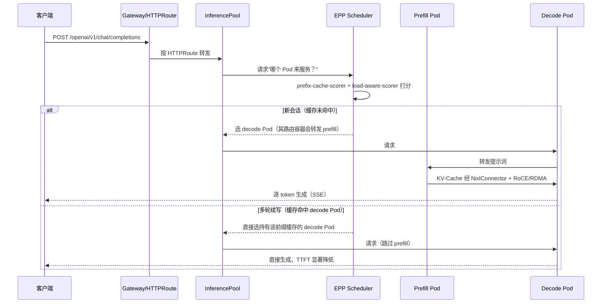

# 4. Runtime 工作流程：从 `kubectl apply` 到请求被路由

> 一句话理解：一次 `kubectl apply -f inference-service.yaml` 会触发 KServe controller 的 reconcile 链——**选 runtime → 渲染 workload → 注入 storage → 创建网关资源 → 更新 status → 等待 Pod ready → 流量接入**。

## 4.1 完整时序图

```
用户          K8s API      KServe         ServingRuntime   Knative/       Pod         Ingress/
            Server      Controller        注册表        K8s API      (runtime)    Gateway
 │             │              │                │              │             │             │
 │ apply IS    │              │                │              │             │             │
 │────────────▶│              │                │              │             │             │
 │             │ write IS     │                │              │             │             │
 │             │─────────────▶│                │              │             │             │
 │             │              │ Informer ADDED │              │             │             │
 │             │              │                │              │             │             │
 │             │              │───────────┐    │              │             │             │
 │             │              │           ▼    │              │             │             │
 │             │              │   workqueue.add(IS)           │             │             │
 │             │              │                │              │             │             │
 │             │              │◀──────────     │              │             │             │
 │             │              │                │              │             │             │
 │             │              │ reconcile(IS)  │              │             │             │
 │             │              │                │              │             │             │
 │             │              │ 1. 读取 spec    │              │             │             │
 │             │              │ 2. 匹配 runtime │              │             │             │
 │             │              │───────────────▶│              │             │             │
 │             │              │◀───────────────│              │             │             │
 │             │              │ 3. 渲染 PodSpec│              │             │             │
 │             │              │    (model      │              │             │             │
 │             │              │     container  │              │             │             │
 │             │              │     + storage  │              │             │             │
 │             │              │     init)      │              │             │             │
 │             │              │                │              │             │             │
 │             │              │ 4. 创建/更新    │              │             │             │
 │             │              │    Knative     │              │             │             │
 │             │              │    Service 或  │              │             │             │
 │             │              │    Deployment  │              │             │             │
 │             │              │──────────────────────────────▶│             │             │
 │             │              │                │              │             │             │
 │             │              │ 5. 创建 Service/│              │             │             │
 │             │              │    Ingress     │              │             │             │
 │             │              │─────────────────────────────────────────────────────────▶│
 │             │              │                │              │             │             │
 │             │              │ 6. 创建 HPA/   │              │             │             │
 │             │              │    KEDA/       │              │             │             │
 │             │              │    Knative PA  │              │             │             │
 │             │              │──────────────────────────────▶│             │             │
 │             │              │                │              │             │             │
 │             │              │ 7. 更新 IS status│             │             │             │
 │             │◀─────────────│                │              │             │             │
 │             │              │                │              │             │             │
 │             │              │                │              │ Pod 创建    │             │
 │             │              │                │              │────────────▶│             │
 │             │              │                │              │             │ storage init│
 │             │              │                │              │             │ 拉模型      │
 │             │              │                │              │             │             │
 │             │              │                │              │             │ runtime 启动│
 │             │              │                │              │             │ 加载模型    │
 │             │              │                │              │             │             │
 │             │              │                │              │ 就绪探针通过 │             │
 │             │              │                │              │◀────────────│             │
 │             │              │                │              │             │             │
 │             │              │                │              │             │             │
 │  HTTP      │              │                │              │             │             │
 │  POST      │              │                │              │             │             │
 │  /v2/...   │              │                │              │             │             │
 │──────────────────────────────────────────────────────────────────────────────────────▶│
 │            │              │                │              │             │             │
 │            │              │                │              │             │◀────────────│
 │            │              │                │              │             │  推理返回   │
 │            │              │                │              │             │────────────▶│
 │  response  │              │                │              │             │             │
 │◀──────────────────────────────────────────────────────────────────────────────────────│
```

## 4.2 阶段详解

### 阶段 1：CRD 写入与事件触发

用户执行：

```bash
kubectl apply -f sklearn-iris.yaml
```

K8s API Server 把 `InferenceService` 对象写入 etcd，resourceVersion 递增。KServe controller 的 Informer 收到 ADDED 事件，加入 workqueue。

### 阶段 2：Runtime 选择

Reconciler 读取 `spec.predictor.model.modelFormat.name`，查询 runtime 注册表。

示例：

```yaml
spec:
  predictor:
    model:
      modelFormat:
        name: sklearn
```

匹配到：

```yaml
# ClusterServingRuntime
metadata:
  name: kserve-sklearnserver
spec:
  supportedModelFormats:
    - name: sklearn
      autoSelect: true
      priority: 1
```

如果用户显式写 `runtime: kserve-sklearnserver`，则跳过 autoSelect 直接命中。

### 阶段 3：渲染 PodSpec

Controller 用 runtime 模板生成容器：

```yaml
containers:
  - name: kserve-container
    image: kserve/sklearnserver:v0.21.0
    args:
      - --model_name=sklearn-iris
      - --model_dir=/mnt/models
    volumeMounts:
      - name: kserve-provision-location
        mountPath: /mnt/models
```

同时注入 storage-initializer init container：

```yaml
initContainers:
  - name: storage-initializer
    image: kserve/storage-initializer:v0.21.0
    args:
      - gs://kfserving-examples/models/sklearn/1.0/model-1
      - /mnt/models
```

如果配置了 `transformer` 或 `explainer`，再渲染对应的 sidecar 或独立 deployment，并设置它们与 predictor 之间的调用关系。

### 阶段 4：创建 Workload

**Serverless 模式**：

```yaml
apiVersion: serving.kserve.io/v1beta1
kind: InferenceService
metadata:
  annotations:
    serving.kserve.io/deploymentMode: Serverless
```

Controller 创建一个 Knative Service：

```yaml
apiVersion: serving.knative.dev/v1
kind: Service
metadata:
  name: sklearn-iris
spec:
  template:
    metadata:
      annotations:
        autoscaling.knative.dev/minScale: "1"
        autoscaling.knative.dev/maxScale: "5"
    spec:
      containers:
        - image: kserve/sklearnserver:v0.13.0
          ...
```

**RawDeployment 模式**：

Controller 直接创建：

- `Deployment`
- `Service`（ClusterIP）
- `Ingress` / `VirtualService`
- `HorizontalPodAutoscaler`（如果配了 HPA）

### 阶段 5：创建网关资源

KServe 根据 `ingressGateway` 配置创建 Istio `VirtualService` 或 K8s `Ingress`。

示例 Istio VirtualService：

```yaml
apiVersion: networking.istio.io/v1beta1
kind: VirtualService
metadata:
  name: sklearn-iris
spec:
  gateways:
    - knative-serving/knative-ingress-gateway
  hosts:
    - sklearn-iris.default.example.com
  http:
    - route:
        - destination:
            host: sklearn-iris-predictor
          weight: 100
```

### 阶段 6：扩缩容配置

Serverless 模式下，KServe 把 `minReplicas`/`maxReplicas` 转成 Knative annotations：

```yaml
metadata:
  annotations:
    autoscaling.knative.dev/minScale: "1"
    autoscaling.knative.dev/maxScale: "5"
```

RawDeployment 模式下，创建 HPA：

```yaml
apiVersion: autoscaling/v2
kind: HorizontalPodAutoscaler
metadata:
  name: sklearn-iris-predictor
spec:
  scaleTargetRef:
    apiVersion: apps/v1
    kind: Deployment
    name: sklearn-iris-predictor
  minReplicas: 1
  maxReplicas: 5
  metrics:
    - type: Resource
      resource:
        name: cpu
        target:
          type: Utilization
          averageUtilization: 60
```

### 阶段 7：更新 Status

Controller 把创建结果写回 IS 的 status subresource：

```yaml
status:
  conditions:
    - type: PredictorReady
      status: "True"
    - type: IngressReady
      status: "True"
    - type: Ready
      status: "True"
  url: http://sklearn-iris.default.example.com
  address:
    url: http://sklearn-iris.default.svc.cluster.local
```

**注意**：status 更新不会增加 `.metadata.generation`（只有 spec 修改才会），这是 K8s `/status` subresource 的标准行为。

### 阶段 8：Pod 启动与模型加载

Pod 启动顺序：

1. storage-initializer 下载模型到 `/mnt/models`。
2. runtime container 启动。
3. runtime 扫描 `/mnt/models` 加载模型。
4. readiness probe 通过（通常检查 8080 `/ready`）。
5. Pod 加入 Service endpoints。

### 阶段 9：请求路由

客户端请求：

```bash
curl http://sklearn-iris.default.example.com/v1/models/sklearn-iris:predict \
  -H "Content-Type: application/json" \
  -d '{"instances": [[1.0,2.0,3.0,4.0]]}'
```

流量路径：

```
客户端
  │
  ▼
Ingres Gateway (Istio / Kourier)
  │
  ▼
Service (sklearn-iris-predictor)
  │
  ▼
Pod
  │
  ▼
queue-proxy (Serverless) 或 直接到 runtime (RawDeployment)
  │
  ▼
model server runtime
  │
  ▼
模型推理 → 返回响应
```

## 4.3 金丝雀升级流程

当用户更新 IS（如换模型版本、换 runtime 镜像）并设置 `canaryTrafficPercent: 20`：

1. Controller 创建新版本 revision/deployment。
2. 配置 traffic split：20% 到新版本，80% 到老版本。
3. 观测 metrics（延迟、错误率）。
4. 逐步调大 canary 比例到 100。
5. 老版本 revision 缩容。

```yaml
spec:
  predictor:
    canaryTrafficPercent: 20
    model:
      modelFormat:
        name: sklearn
      storageUri: gs://models/sklearn/v2
```

## 4.4 失败与重试

Reconcile 过程中任何一步失败（如 runtime 不存在、storage URI 无效、权限不足），Controller 会：

1. 返回 error，workqueue 按指数退避重试。
2. 在 IS status 中写入失败 condition：

```yaml
status:
  conditions:
    - type: PredictorReady
      status: "False"
      reason: RuntimeNotFound
      message: 'No ServingRuntime supports modelFormat "foo"'
```

3. 等待用户修复 spec 或新增 runtime 后重新 reconcile。

## 4.5 缩到零与冷启动

**Serverless 模式**：

- 无流量时 Pod 数为 0。
- 新请求先到 Knative Activator。
- Activator 缓冲请求，触发 Knative autoscaler 扩容。
- storage-initializer + runtime 启动 + 模型加载完成后，请求才放行。

**冷启动成本**：

- 小模型（sklearn/xgboost）：几秒。
- 大模型（LLM 几十 GB）：几十秒到几分钟；未缓存时从对象存储拉权重可达 15-20 分钟。
- 因此 GPU/LLM 生产环境通常用 RawDeployment（minReplicas >= 1）。

**缓解手段（2025 年后）**：`LocalModelCache`（v0.15）把模型预缓存到节点本地 NVMe，加载时间降到约 1 分钟，llmisvc 从 v0.19 起也支持；`LMCache` KV-Cache 卸载（v0.15）降低多轮对话/RAG 的 TTFT；v0.20 进一步支持 KV-Cache 分层卸载到二级文件系统。上了缓存之后，部分对延迟不敏感的 LLM 场景可以重新评估"缩到零 + 快速唤醒"的可行性。

## 4.6 LLMInferenceService 的请求调度链路（v0.17+）

LLM 场景走另一条数据面路径，核心区别是**路由决策点在 EPP，而不是 kube-proxy**：



背后的持续同步：vLLM Pod 通过 ZMQ 事件（`BlockStored`/`BlockRemoved`）把 KV-Cache 块变化推给 EPP，EPP 维护"模型名 + 前缀哈希 → Pod"索引。这带来两个工程要点：

1. **EPP 是新的单点隐患**：v0.17 起支持 EPP 高可用部署；调度器升级时注意观察金丝雀指标。
2. **金丝雀语义不同**：v0.21 起 llmisvc 支持原生金丝雀流量切分和 `rolloutStrategy` 滚动更新，EPP 会按切分比例分流；而传统 IS 的 canary 是网关层 weight。

## 4.7 多节点推理的启动链路（v0.18+）

大模型跨节点时的启动顺序与普通 IS 不同：

1. Controller 解析 `parallelism`（tensor/data/expert）注解，计算节点数与每节点 GPU 数。
2. 创建 headless Service（worker DNS 发现）+ 注入 `PIPELINE_PARALLEL_SIZE`/`TENSOR_PARALLEL_SIZE`/`WORKER_SVC` 环境变量。
3. executor backend 二选一：
   - `ray`（默认）：先起 Ray head 再拉 worker；
   - `mp`（v0.18+）：vLLM 原生 multiprocessing，免 Ray 依赖，运维面更干净。
4. 多副本场景由 LeaderWorkerSet 整体缩扩（v0.18 起作为 autoscaling target）。

## 本章小结

- 完整链路：**apply IS → controller reconcile → 选 runtime → 渲染 workload → 创建网关 → 更新 status → Pod ready → 请求路由**。
- LLM 链路：**apply llmisvc → 创建 Gateway/HTTPRoute/InferencePool → 部署 EPP 与 vLLM 池 → ZMQ 同步 KV-Cache → EPP 打分路由**。
- Reconcile 是幂等的：反复执行结果一致，status 更新不影响 generation。
- 两种模式在 workload 创建上有本质差异：Serverless 用 Knative Service，RawDeployment 用原生 K8s 资源。
- 金丝雀通过 traffic split 实现（llmisvc 由 v0.21 起原生支持比例切分）；失败通过 status conditions + workqueue 退避暴露。
- 冷启动是 Serverless 的核心 trade-off；LocalModelCache + LMCache 是 2025 年后的标准解法。

**参考来源**

- [KServe — First InferenceService](https://kserve.github.io/website/docs/get_started/first_isvc/)
- [KServe — Canary Rollout](https://kserve.github.io/website/docs/modelserving/v1beta1/rollout/canary/)
- [KServe — RawDeployment](https://kserve.github.io/website/docs/modelserving/v1beta1/serving_runtime/)
- [KServe — LLMInferenceService 架构深入](https://kserve.github.io/website/docs/next/concepts/architecture/control-plane-llmisvc)
- [KServe v0.18 发布公告：多节点推理](https://kserve.github.io/website/blog/kserve-0.18-release)
- [Knative — How Knative Services Work](https://knative.dev/docs/serving/)
