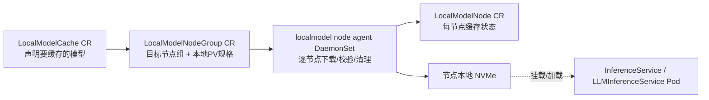

# 5. 核心模块

> 一句话理解：KServe 控制面由**Controller、Webhook、Runtime Manager、Ingress/Gateway Manager、Autoscaler 集成、Metrics/Agent** 六大模块组成；它们各司其职，又通过 K8s API Server 和 CRD 协同。

## 5.1 InferenceService Controller

这是 KServe 的"心脏"。它监听 `InferenceService` CRD，把用户意图翻译成底层资源。

### 主要职责

1. **解析 spec**：提取 predictor/transformer/explainer、modelFormat、storageUri、resources、replicas。
2. **选 runtime**：调用 Runtime Manager 匹配 `ServingRuntime`。
3. **构建 PodSpec**：注入 model server container、storage-initializer、transformer/explainer。
4. **创建/更新底层资源**：
   - Serverless：Knative Service。
   - RawDeployment：Deployment、Service、Ingress、HPA。
5. **处理 finalizer**：清理资源时确保优雅删除。
6. **更新 status**：写回 conditions 和 URL。

### 关键代码路径（概念级）

```
Reconcile(ctx, req)
  │
  ├─ isvc := Get(InferenceService, req.Name, req.Namespace)
  │
  ├─ if isvc.DeletionTimestamp != nil
  │     └─ handle finalizer cleanup
  │
  ├─ if !finalizer exists
  │     └─ add finalizer
  │
  ├─ isvc.InitializeConditions()
  │
  ├─ predictorReconciler.Reconcile(isvc)
  │     ├─ runtime := ResolveRuntime(isvc.spec.predictor.model)
  │     ├─ podSpec := BuildPodSpec(runtime, isvc)
  │     ├─ Deploy(podSpec)  // Knative or RawDeployment
  │     └─ UpdateStatus(isvc, predictorStatus)
  │
  ├─ transformerReconciler.Reconcile(isvc)  // 可选
  ├─ explainerReconciler.Reconcile(isvc)    // 可选
  │
  ├─ ingressReconciler.Reconcile(isvc)
  │     └─ CreateOrUpdate(Ingress/VirtualService)
  │
  ├─ autoscalerReconciler.Reconcile(isvc)
  │     └─ CreateOrUpdate(HPA / Knative PA annotations)
  │
  └─ UpdateStatus(isvc)
```

## 5.2 Webhook（Admission Controller）

KServe 的 webhook 在资源进入 etcd 前拦截并处理。

### Defaulting

- 给未填字段补默认值：
  - `runtime`：根据 `modelFormat` 自动选择。
  - `protocolVersion`：默认 v1 或 v2。
  - `containerConcurrency`（Serverless）。
- 设置默认 resources、security context。

### Validating

- 校验 `storageUri` 是否合法（`gs://`、`s3://`、`pvc://`、`http://`）。
- 校验 `canaryTrafficPercent` 在 0-100。
- 校验 `modelFormat` 与 `runtime` 是否兼容。
- 校验 `minReplicas <= maxReplicas`。

### Mutating

- 注入 sidecar（transformer/explainer）。
- 注入 storage-initializer init container。
- 设置 Pod label/annotation 供网关选择。

## 5.3 Runtime Manager（ServingRuntime Controller）

负责维护 runtime 注册表，并供 IS Controller 查询。

### 注册表结构

```python
# 伪代码
registry = {
    "sklearn": [
        Runtime(name="kserve-sklearnserver", autoSelect=True, priority=1),
    ],
    "huggingface": [
        Runtime(name="kserve-huggingfaceserver", autoSelect=True, priority=1),
        Runtime(name="custom-vllm", autoSelect=True, priority=2),
    ],
}
```

### 匹配逻辑

```python
def resolve_runtime(model_format, requested_runtime=None):
    if requested_runtime:
        return registry.get_by_name(requested_runtime)
    candidates = [r for r in registry[model_format] if r.autoSelect]
    return max(candidates, key=lambda r: (r.priority, r.name))
```

### 职责边界

- Runtime Manager 只负责"有哪些 runtime"和"怎么匹配"。
- 具体 Pod 怎么渲染由 IS Controller 完成。
- 平台团队通过新增/修改 `ClusterServingRuntime` 即可扩展 runtime，无需改代码。

## 5.4 Ingress / Gateway Manager

### Serverless 模式

由 Knative Serving 负责。KServe 只创建 Knative Service，网络栈由 Knative 维护：

- Knative Service → Configuration → Revision。
- Knative Route → traffic split。
- Knative Ingress（net-istio/net-kourier）→ Gateway/VirtualService。

### RawDeployment 模式

KServe controller 直接创建：

- K8s `Service`：ClusterIP，供集群内调用。
- `Ingress` / `VirtualService`：暴露外部域名。
- 可选 `Certificate`：自动 TLS。

### 支持的 Ingress 类

| Ingress 类 | 说明 |
|---|---|
| Istio | 最常用，功能最全。 |
| Kourier | 轻量，Knative 默认之一。 |
| Ambassador | 较少用。 |
| NGINX | K8s 原生 Ingress。 |

## 5.5 Autoscaler 集成

### Knative Pod Autoscaler（KPA）

- 基于**并发请求数**缩放。
- 配置项：
  - `autoscaling.knative.dev/target-utilization-percentage`
  - `autoscaling.knative.dev/stable-window`
  - `autoscaling.knative.dev/metric`
- 支持 scale-to-zero。

### Horizontal Pod Autoscaler（HPA）

- 基于 CPU/GPU 利用率或自定义 metrics。
- 配置项：
  - `serving.kserve.io/metric`: cpu / gpu / memory
  - `serving.kserve.io/targetUtilizationPercentage`
  - `serving.kserve.io/minReplicas` / `maxReplicas`

### KEDA

- 基于事件源（Kafka queue、SQS、Prometheus metrics）扩缩。
- 适合异步推理、批处理队列。
- v0.15 起官方支持按 LLM 指标（如 vLLM 请求数）扩缩；v0.21 起 llmisvc 可直接以 KEDA 作为扩缩后端，无需再经 HPA 中转。

### WVA（Workload Variant Autoscaler，llmisvc 专用）

- 来自 llm-d 生态，v0.17 随 llmisvc 引入，可按 prefill/decode 池配置不同扩缩 variant。
- 后端可选 HPA 或 KEDA；多节点副本组可借助 LeaderWorkerSet 整体缩扩（v0.18）。
- v0.19 起把 HPA/KEDA 的扩缩状态回写到 llmisvc 的 status conditions，SRE 可以统一观测。

### 选型建议

| 场景 | 推荐 |
|---|---|
| CPU 小模型、流量波动大 | KPA（Serverless） |
| GPU/LLM、冷启动不可接受 | HPA（RawDeployment） |
| LLM + PD 分离/多节点 | WVA（llmisvc，HPA/KEDA 后端） |
| 异步队列 | KEDA |
| 高并发低延迟 | 预热 + HPA |

## 5.6 Storage Initializer

一个轻量 init container，负责把模型从远端拉到本地。

### 支持的存储后端

| URI 前缀 | 说明 |
|---|---|
| `gs://` | Google Cloud Storage |
| `s3://` | AWS S3 / MinIO / 兼容 S3 |
| `azure://` / `wasb://` | Azure Blob |
| `hdfs://` | HDFS |
| `pvc://` | 已有 PVC |
| `http(s)://` | HTTP 下载 |

### 工作流程

1. 读取 `spec.predictor.model.storageUri`。
2. 根据前缀选择下载器。
3. 下载到 `/mnt/models`。
4. runtime 从该目录加载模型。

### 安全

- 使用 `serviceAccountName` 绑定云厂商 IAM role（如 IRSA、Workload Identity）。
- 避免把 credential 写进 spec。

## 5.7 Agent / Queue-Proxy

### queue-proxy（Serverless）

Knative 注入的 sidecar，职责：

- 队列缓冲 Activator 发来的请求。
- 统计并发并上报 autoscaler。
- 优雅停机（drain）。
- 返回 queue metrics。

### agent（RawDeployment / ModelMesh）

KServe agent 职责视场景而定：

- RawDeployment：可选，辅助 storage/modelmesh。
- ModelMesh：曾是核心组件，负责模型加载调度；**ModelMesh 项目已于 2026-04 归档，此路径不要用于新部署**。

## 5.8 Metrics 与可观测模块

KServe 通过标准化方式暴露可观测数据：

### Runtime 指标

每个 runtime 在 `/metrics` 暴露 Prometheus 指标：

```
request_count
request_latency_bucket
inference_queue_length
nvidia_gpu_memory_used_bytes  # GPU runtime
```

### Controller 指标

KServe controller 暴露：

- reconcile 次数、延迟、错误数。
- Inferenceservice 数量按状态分布。

### Status Conditions

IS status 中的 condition 是 SRE 最关心的"健康信号"：

```yaml
status:
  conditions:
    - type: PredictorReady
      status: "True"
    - type: TransformerReady
      status: "True"
    - type: ExplainerReady
      status: "True"
    - type: IngressReady
      status: "True"
    - type: Ready
      status: "True"
```

### Logging 与 Tracing

- Pod 日志：runtime、storage-initializer、queue-proxy。
- Tracing：通过 Istio / OpenTelemetry 注入 trace header。
- llmisvc（v0.20+）：提供分布式 tracing API，可在 Gateway→EPP→vLLM 全链路追踪请求。

## 5.9 模块协作图

```
┌─────────────────────────────────────────────────────────────────┐
│                     KServe 控制平面                              │
│  ┌──────────────┐  ┌──────────────┐  ┌──────────────────────┐  │
│  │   Webhook    │  │ IS Controller│  │ Runtime Manager      │  │
│  │ (default/    │──▶│ (reconcile)  │──▶│ (ServingRuntime CRD) │  │
│  │  validate/   │  │              │  │                      │  │
│  │  mutate)     │  │              │◀─│                      │  │
│  └──────────────┘  └──────┬───────┘  └──────────────────────┘  │
│                           │                                     │
│           ┌───────────────┼───────────────┐                    │
│           ▼               ▼               ▼                    │
│    ┌─────────────┐ ┌─────────────┐ ┌─────────────┐             │
│    │   Ingress   │ │  Autoscaler │ │   Storage   │             │
│    │   Manager   │ │   Manager   │ │ Initializer │             │
│    └─────────────┘ └─────────────┘ └─────────────┘             │
│                           │                                     │
│                           ▼                                     │
│                  ┌─────────────────┐                            │
│                  │  K8s API Server │                            │
│                  └─────────────────┘                            │
└─────────────────────────────────────────────────────────────────┘
```

## 5.10 LLMInferenceService Controller 与 EPP（v0.16+）

### LLMInferenceService Controller

随 `llmisvc` 组件安装的独立 controller，reconcile 目标与传统 IS 不同：

1. 解析 `spec.model.uri`（支持 HuggingFace URI、S3、OCI）与 deployments/pools 拓扑。
2. 创建 Gateway API 资源：`Gateway`（managed 或 referenced）、`HTTPRoute`、`InferencePool`、`InferenceModel`。
3. 部署/更新 **EPP Scheduler Pod**（llm-d Endpoint Picker），配置 scorer 管线（v0.17 起插件化：EndpointPickerConfig）。
4. 创建 vLLM Pod 池：单 pool 用 Deployment，多节点用 LeaderWorkerSet + headless Service（注入并行度环境变量）。
5. 把 WVA 扩缩状态、路由拓扑、应用配置回写 status。

### EPP（Endpoint Picker）

- 订阅 vLLM Pod 的 ZMQ KV-Cache 事件，维护前缀缓存索引。
- 请求到来时按 scorer 权重打分（prefix-cache 2.0 + load-aware 1.0 + queue scorer），返回目标 Pod。
- v0.17 起支持高可用；v0.20 加入 LoRA affinity scorer；v0.21 支持金丝雀比例切分下的分流。
- trade-off：多一跳延迟，换来缓存命中率与负载均衡的显著提升——对多轮对话/RAG 类负载 TTFT 收益最大。

## 5.11 LocalModelCache 模块（v0.15+）

随 `localmodel` 组件安装，解决"模型下载慢"：



运维要点：

- `LocalModelNodeGroup.spec.local.path` 必须与 agent DaemonSet 的 hostPath 一致（Helm 默认 `/mnt/models`，Kustomize 默认 `/models`），否则会出现重复下载 job 和权限错误（见 [kserve#5156](https://github.com/kserve/kserve/issues/5156)）。
- 官方口径：加载时间从 15-20 分钟降到约 1 分钟。
- v0.19 起 llmisvc 可引用 LocalModelCache；namespace 级多租户可用 namespace 维度的缓存策略。

## 本章小结

- **IS Controller**：核心控制器，负责把 IS spec 渲染成底层资源。
- **Webhook**：defaulting/validating/mutating，降低用户配置错误。
- **Runtime Manager**：维护 modelFormat → runtime 映射，支持自定义扩展。
- **Ingress/Gateway Manager**：Serverless 靠 Knative，RawDeployment 靠 KServe 自建，LLM 靠 Gateway API + EPP。
- **Autoscaler 集成**：KPA（并发、缩零）、HPA（资源）、KEDA（事件、LLM 指标）、WVA（llmisvc variant 级扩缩）。
- **Storage Initializer**：统一模型下载，支持多协议；LocalModelCache 是 LLM 冷启动的标准搭档。
- **Agent/Queue-Proxy**：Serverless 请求缓冲与扩缩信号；ModelMesh 路径已归档。
- **Metrics**：runtime `/metrics`、controller metrics、status conditions、logs/traces；llmisvc 有全链路 tracing。

**参考来源**

- [KServe — Controller Architecture](https://kserve.github.io/website/docs/concepts/architecture/)
- [KServe — LLMInferenceService 架构深入](https://kserve.github.io/website/docs/next/concepts/architecture/control-plane-llmisvc)
- [KServe — LocalModelCache 文档](https://kserve.github.io/website/docs/0.17/model-serving/generative-inference/modelcache/localmodel)
- [KServe — ServingRuntime](https://kserve.github.io/website/docs/concepts/resources/servingruntime/)
- [KServe — Autoscaling](https://kserve.github.io/website/docs/modelserving/autoscaling/)
- [KServe — Storage URI](https://kserve.github.io/website/docs/modelserving/storage/)
- [llm-d ModelService 提案](https://llm-d.ai/docs/0.7/proposals/modelservice)
