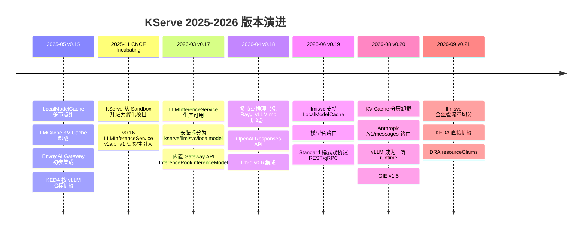

# KServe：云原生模型服务平台

> 一句话理解：**KServe 是把 vLLM/Triton/SGLang/TensorFlow Serving 等单个推理引擎封装成统一、可扩缩、可灰度、可观测的 Kubernetes 服务的控制平面**——用户只写一个 `InferenceService` CR，KServe 自动选好 runtime、拉起 Pod、接入流量、处理扩缩和金丝雀；2025 年起它更进一步，用 `LLMInferenceService` + Gateway API Inference Extension + KV-Cache 感知路由，把自己从"模型服务平台"升级成了"LLM 推理平台"（截至 2026-10 最新版 v0.21，2025-11 进入 CNCF Incubating）。

## 学习目标

读完本主题，你应该能：

1. 解释为什么需要 KServe（裸部署 vLLM/Triton 的痛点）。
2. 说清 KServe 的核心抽象：`InferenceService`、`Predictor`/`Transformer`/`Explainer`、`ServingRuntime`/`ClusterServingRuntime`、`InferenceGraph`。
3. 理解 2025-2026 最重要的新抽象：`LLMInferenceService`（prefill/decode 分离、LoRA 热加载、多节点推理）、Gateway API `InferencePool`/`InferenceModel`、Endpoint Picker（EPP）KV-Cache 感知路由、`LocalModelCache` 本地模型缓存。
4. 理解 Serverless 模式（Knative，缩到零）和 RawDeployment 模式（原生 K8s + HPA/KEDA，当前生产主流）的取舍，以及 ModelMesh 已归档的历史。
5. 理解 V1、V2（Open Inference Protocol）、OpenAI-compatible（含 Responses API、Anthropic Messages 路由）数据面协议。
6. 追踪一个 `InferenceService` 从 `kubectl apply` 到请求被路由的完整链路，以及 LLM 请求经 EPP 智能调度的链路。
7. 了解 KServe 源码主结构和关键控制器调用链。
8. 动手跑一个纯 Python mini-demo，模拟 runtime 选择、Pod 渲染、流量路由、canary。
9. 知道生产落地要点：runtime 选择、协议统一、金丝雀、autoscaling、LocalModelCache 冷启动优化、多租户、可观测、成本。

## 版本动态（截至 2026-10）

## 与相邻主题的关系

| 主题 | 关系 | 链接 |
|---|---|---|
| **Operator 模式** | KServe 本身是一个 Operator（`kserve-controller-manager`），`InferenceService` 就是 CRD | [Operator 模式](../../02-cloud-native/operator/) |
| **vLLM / Triton / SGLang / TensorRT-LLM** | 它们是 KServe 的 runtime 之一，被 `ServingRuntime` 抽象封装 | [LLMOps 篇](../../04-llmops/) |
| **Kubernetes** | KServe 的底座：Deployment/Service/Ingress/CRD/Scheduler/Leader Election | [Kubernetes](../../02-cloud-native/kubernetes/) |
| **Ray** | 分布式训练/推理平台，可与 KServe 互补（Ray Serve 也是替代方案） | [Ray 主题](../ray/) |
| **LLM Gateway** | 统一多供应商/多模型接入，可与 KServe 的模型端点组合 | [LLM Gateway](../../04-llmops/llm-gateway/) |
| **存储系统** | 模型权重通过对象存储/共享 PVC 加载；storage-initializer 是存储系统的上层应用 | [存储系统](../../01-foundation/storage-systems/) |
| **AI SRE** | KServe 的指标、SLO、扩缩告警是 SRE 核心 | [AI SRE](../../07-ai-sre/) |

## 本章结构

| 章节 | 标题 | 内容 |
|---|---|---|
| 1 | [背景](01-background) | 裸推理服务的痛点、KServe 诞生、与裸 vLLM/Triton/自研网关的对比 |
| 2 | [核心思想](02-core-ideas) | InferenceService、Predictor/Transformer/Explainer、ServingRuntime、InferenceGraph、协议面 |
| 3 | [架构设计](03-architecture) | Control Plane vs Data Plane、Serverless vs RawDeployment、runtime 注册表、LLMInferenceService + EPP 新架构 |
| 4 | [Runtime 工作流程](04-runtime-workflow) | 一次 `kubectl apply` 到请求被路由的完整时序（传统 ML + LLM 两条链路） |
| 5 | [核心模块](05-core-modules) | Controller、Webhook、Runtime Manager、Agent/Queue-Proxy、Ingress/Gateway、Autoscaler、LocalModelCache、EPP Scheduler |
| 6 | [源码分析](06-source-analysis) | `kserve` repo 结构、IS controller reconcile 调用链、2025-2026 新增模块、关键代码 |
| 7 | [Mini Demo](07-mini-demo) | 纯 Python 模拟 KServe 控制面：runtime 选择、Pod 渲染、canary、autoscaling |
| 8 | [企业生产实践](08-production-practice) | 多 runtime 管理、协议统一、金丝雀、缩到零、多租户、可观测、成本 |
| 9 | [最佳实践](09-best-practices) | runtime 选型、协议选择、请求/响应大小、超时、错误处理、安全 |
| 10 | [面试题](10-interview-questions) | 初/中/高级 KServe 高频题 |
| 11 | [延伸阅读](11-further-reading) | 官方文档、论文/博客、生态工具、学习路径 |

## 一句话总结

**KServe = Kubernetes 上的"模型服务操作系统"**：Operator 负责生命周期，ServingRuntime 负责模型格式，InferenceGraph 负责组合，网关负责流量，autoscaler 负责弹性；而从 v0.16/0.17 开始，`LLMInferenceService` 把 prefill/decode 分离、KV-Cache 感知路由、LoRA 热加载、多节点推理这些 LLM 专属能力也变成了声明式 CRD——让你用一份声明式 YAML 服务任意模型，包括千卡集群上的大模型。

## 参考来源

- [KServe 官网](https://kserve.github.io/website/)
- [KServe GitHub](https://github.com/kserve/kserve)
- [KServe v0.21 Release](https://github.com/kserve/kserve/releases)
- [KServe 成为 CNCF 孵化项目（2025-11）](https://www.cncf.io/blog/2025/11/11/kserve-becomes-a-cncf-incubating-project/)
- [KServe v0.17 发布公告：LLMInferenceService 生产可用](https://kserve.github.io/website/blog/kserve-0.17-release)
- [KServe v0.18 发布公告：多节点推理、Responses API、llm-d](https://kserve.github.io/website/blog/kserve-0.18-release)
- 本手册 [Operator 模式](../../02-cloud-native/operator/)、[vLLM](../../04-llmops/vllm/)、[Triton](../../04-llmops/triton/)、[Ray](../ray/)
