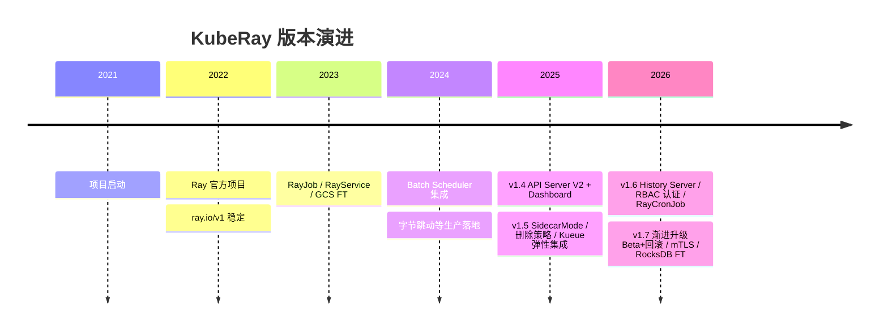

# 1. 背景：为什么 Ray 需要 KubeRay

> 一句话理解：Ray 解决“分布式计算怎么写”，KubeRay 解决“分布式计算集群在 Kubernetes 上怎么管”。

## 1.1 Ray 的强大与部署痛点

Ray 是一个统一的分布式计算框架，提供：

- **Tasks**：无状态分布式函数。
- **Actors**：有状态分布式对象。
- **Objects**：Plasma 对象存储。
- **Train/Serve/Data/Tune/RLlib**：高层库覆盖训练、服务、数据、超参、强化学习。

在单台机器或几台 VM 上启动 Ray 很简单：

```bash
ray start --head
ray start --address="head-ip:6379"
```

但当场景进入生产环境，问题迅速复杂化：

| 痛点 | 手工方案的问题 |
|---|---|
| **Pod 管理** | 需要手动创建/维护 head Pod、worker Pod、Service、Ingress。 |
| **扩缩容** | 需要监听 Ray 资源需求，再手动改 Deployment/StatefulSet 副本数。 |
| **故障恢复** | Head Pod 重启后 GCS 状态丢失，worker 无法重连。 |
| **作业提交** | 用户需要知道 head 地址、Dashboard 端口、认证方式。 |
| **Serve 升级** | 升级 Ray Serve 应用时无法做到零停机。 |
| **GPU/TPU 调度** | 需要把 K8s 资源限制正确映射到 Ray 资源。 |
| **多租户** | Namespace、RBAC、网络隔离、资源配额需要自行拼装。 |

## 1.2 Kubernetes 为什么是 Ray 的最佳底座

Kubernetes 已经解决了大规模集群管理的大部分问题：

- 调度：CPU/内存/GPU/TPU 资源调度、节点亲和、拓扑感知。
- 生命周期：Pod 创建、删除、滚动升级、健康检查。
- 网络：Service、DNS、Ingress、NetworkPolicy。
- 存储：PVC、ConfigMap、Secret。
- 可观测性：Metrics、Logs、Tracing。
- 多租户：Namespace、RBAC、ResourceQuota、LimitRange。

把 Ray 放在 K8s 上，本质上是把 Ray 的“计算语义”嫁接到 K8s 的“基础设施语义”。

## 1.3 KubeRay 的出现

KubeRay 是 Ray 官方维护的 Kubernetes Operator，提供三个核心 CRD：

- **RayCluster**：描述一个 Ray 集群的 desired state。
- **RayJob**：描述一个提交到 Ray 集群的作业。
- **RayService**：描述一个长期运行的 Ray Serve 服务。

用户写 YAML，KubeRay Operator 负责：

1. 创建 Head Pod、Worker Pod、Service、Ingress。
2. 注入 Autoscaler sidecar，根据 Ray 资源需求自动扩缩容。
3. 支持 GCS Fault Tolerance，让 Head 重启后集群状态可恢复。
4. 管理 RayJob 的提交、运行、完成、清理。
5. 为 RayService 实现蓝绿升级与零停机切换。

## 1.4 KubeRay 与相关项目对比

| 项目 | 定位 | 与 KubeRay 的关系 |
|---|---|---|
| Ray | 分布式计算框架 | KubeRay 是 Ray 在 K8s 上的部署形态 |
| KubeRay | K8s Operator for Ray | 官方推荐方式 |
| Volcano / YuniKorn / scheduler-plugins | K8s 批调度器 | KubeRay 可集成以实现 Gang Scheduling |
| Kueue | K8s 作业队列与配额 | 可与 KubeRay 结合实现弹性训练队列 |
| KServe | K8s 模型服务平台 | 可加载 Ray Serve 端点 |
| MLflow | 实验追踪与模型注册 | 训练作业跑在 KubeRay 上，模型注册到 MLflow |

## 1.5 典型使用场景

### 场景 1：分布式训练

```yaml
apiVersion: ray.io/v1
kind: RayJob
metadata:
  name: llm-finetune
spec:
  entrypoint: python train.py --model llama3 --data s3://bucket/dataset
  rayClusterSpec:
    headGroupSpec:
      rayStartParams:
        num-cpus: "0"
    workerGroupSpecs:
      - groupName: gpu-workers
        replicas: 2
        minReplicas: 0
        maxReplicas: 8
        template:
          spec:
            containers:
              - resources:
                  limits:
                    nvidia.com/gpu: "4"
```

### 场景 2：在线推理服务

```yaml
apiVersion: ray.io/v1
kind: RayService
metadata:
  name: llm-serve
spec:
  serveConfigV2: |
    applications:
      - name: llm
        import_path: serve_model:app
  rayClusterConfig:
    gcsFaultToleranceOptions:
      redisAddress: redis:6379
```

### 场景 3：弹性数据处理

```yaml
apiVersion: ray.io/v1
kind: RayCluster
metadata:
  name: etl-cluster
spec:
  enableInTreeAutoscaling: true
  autoscalerOptions:
    idleTimeoutSeconds: 120
  workerGroupSpecs:
    - groupName: cpu-workers
      minReplicas: 0
      maxReplicas: 50
```

## 1.6 发展历程

- **2021**：KubeRay 项目启动，作为社区 Operator。
- **2022**：成为 Ray 官方项目，CRD 稳定到 `ray.io/v1`。
- **2023-2024**：加入 RayJob、RayService、GCS FT、Batch Scheduler 集成；字节跳动等公司开始在生产环境大规模使用（全站 Ray 集群由 KubeRay 管理，覆盖图计算、离线推理、大模型训练）。
- **2025（v1.4 ~ v1.5）**：API Server V2 与 KubeRay Dashboard 发布；推出 Autoscaler V2、SLI 指标；v1.5（2025-12）带来 RayJob `SidecarMode` 提交、基于规则的删除策略（deletion rules）、Token 认证（Ray 2.52+）、RayService 渐进式升级（Alpha），以及 **Kueue + Autoscaler 弹性集成**。
- **2026（v1.6 ~ v1.7）**：v1.6（2026-03）引入 Ray History Server、K8s RBAC 认证（Ray 2.55+）、RayCronJob（Alpha）；v1.7（2026-08）将渐进式升级升级为 Beta 并支持回滚，History Server 转 Beta，新增原生 NetworkPolicy、mTLS（cert-manager 集成）、**GCS FT 内嵌 RocksDB 后端**（免外部 Redis，Ray 2.57+）。最新稳定版为 v1.7.1（2026-09）。



## 本章小结

- Ray 解决分布式计算，KubeRay 解决 Ray 在 K8s 上的生命周期管理。
- KubeRay 让 Ray Cluster、Job、Serve 全部变成声明式 YAML。
- 它与 K8s、Operator、Ray、KServe、MLflow、Kueue 等紧密协作。

**参考来源**

- [KubeRay Docs — Welcome](https://ray-project.github.io/kuberay/)
- [Ray Docs — Ray on Kubernetes](https://docs.ray.io/en/latest/cluster/kubernetes/index.html)
- [Ray Cluster Key Concepts](https://docs.ray.io/en/latest/cluster/key-concepts.html)
- [KubeRay v1.3.0 Blog](https://www.anyscale.com/blog/kuberay-v1-3-0)
- [Introducing KubeRay v1.5](https://www.anyscale.com/blog/kuberay-v1-5)
- [Introducing KubeRay v1.6 and v1.7](https://www.anyscale.com/blog/kuberay-v1-7)
- [KubeRay Releases](https://github.com/ray-project/kuberay/releases)
- [KubeCon：使用 KubeRay 和 Kueue 在 Kubernetes 中托管 Ray 工作负载（字节跳动实践）](https://www.infoq.cn/article/ZRC4RXO1SXy7HfqBzFCg)
