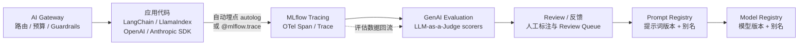

# 2. 核心思想：四大组件与核心概念

> 一句话理解：MLflow 把 ML 生命周期拆成四个可独立使用又可组合的能力——**Tracking 记录实验、Projects 封装代码、Models 打包模型、Model Registry 管理版本**；MLflow 3.x 又在此基础上叠加了 **Tracing（观测）、Prompt Registry（提示词治理）、GenAI Evaluation（评估）与 AI Gateway（模型网关）**，把同一套资产层延伸到 GenAI/Agent 应用。

## 2.1 组件全景图

```
┌──────────────────────────────────────────────────────────────────────┐
│                         MLflow UI / REST API                          │
└───────────────────────────────┬──────────────────────────────────────┘
                                │
        ┌───────────────────────┼───────────────────────┬───────────────────────┐
        │                       │                       │                       │
        ▼                       ▼                       ▼                       ▼
┌───────────────┐      ┌───────────────┐      ┌───────────────┐      ┌───────────────────┐
│    Tracking   │      │     Models    │      │ Model Registry│      │  GenAI 组件（3.x） │
│  - Experiment │      │  - flavor     │      │  - Registered │      │  - Tracing        │
│  - Run        │      │  - signature  │      │     Model     │      │  - Prompt Registry│
│  - metric     │      │  - conda/env  │      │  - Version    │      │  - Evaluation     │
│  - parameter  │      │  - pyfunc     │      │  - Stage      │      │  - AI Gateway     │
│  - artifact   │      │  - deploy     │      │  - Alias      │      │  - MCP Registry   │
│  - tag        │      │               │      │  - Tag        │      │                   │
│  - LoggedModel│      │               │      │               │      │                   │
└───────────────┘      └───────────────┘      └───────────────┘      └───────────────────┘
        │                                               ▲
        │                                               │
        └───────────────────────┬───────────────────────┘
                                │
                                ▼
                    ┌───────────────────────┐
                    │       Projects        │
                    │  - MLproject file     │
                    │  - entry points       │
                    │  - conda/docker env   │
                    └───────────────────────┘
                                │
                                ▼
                    ┌───────────────────────┐
                    │   Backend / Artifact  │
                    │   Store               │
                    └───────────────────────┘
```

## 2.2 MLflow Tracking

Tracking 是 MLflow 最常用的组件。它围绕 **Experiment → Run** 两级结构组织：

```
Experiment: "iris-classification"
    │
    ├─ Run-1
    │   ├─ params:  {lr: 0.01, max_iter: 100}
    │   ├─ metrics: {accuracy: 0.92, loss: 0.15}
    │   ├─ tags:    {model_type: logistic, version: v1}
    │   └─ artifacts: model.pkl, confusion_matrix.png
    │
    ├─ Run-2
    │   ├─ params:  {lr: 0.001, max_iter: 200}
    │   ├─ metrics: {accuracy: 0.95, loss: 0.10}
    │   └─ artifacts: model.pkl
```

### 核心概念

| 概念 | 含义 |
|---|---|
| **Experiment** | 一组相关 Run 的容器，比如“iris 分类实验”。 |
| **Run** | 一次代码执行，记录参数、指标、artifact、tag。 |
| **Metric** | 数值指标，可多次记录（带 step），支持折线图。 |
| **Parameter** | 超参或配置，一次 Run 中通常只记录一次。 |
| **Artifact** | 任意文件：模型、图片、配置、数据。 |
| **Tag** | 键值对，用于标记、过滤。 |
| **LoggedModel（3.x）** | 一等实体模型：拥有独立 `model_id`、参数/指标快照和血缘，可直接被 Registry、Tracing、Evaluation 引用，不再只是 Run 下的一个 artifact 目录。 |

### 代码示例

```python
import mlflow

mlflow.set_experiment("iris-classification")

with mlflow.start_run(run_name="lr-0.01"):
    mlflow.log_params({"lr": 0.01, "max_iter": 100})
    mlflow.log_metric("accuracy", 0.92)
    mlflow.log_artifact("confusion_matrix.png")
```

## 2.3 MLflow Models

Models 组件解决“模型怎么打包”的问题。一个 MLflow Model 是一个目录，包含：

```
mlflow-model/
├── MLmodel              # 元数据：flavor、signature、env
├── model.pkl            # 实际模型（flavor 决定格式）
├── conda.yaml           # conda 依赖
├── python_env.yaml      # pip 依赖
└── input_example.json   # 输入示例
```

### Flavor（风味）

Flavor 是模型框架的适配器。MLflow 支持：

- `sklearn`、`xgboost`、`lightgbm`、`catboost`
- `pytorch`、`tensorflow`、`keras`、`onnx`
- `pyfunc`（通用 Python 函数）
- `langchain`、`openai`、`transformers`（GenAI/LLM）
- `spacy`、`spark`、`paddle` 等

### Signature（签名）

Signature 描述模型的输入/输出模式，是模型服务的契约：

```python
from mlflow.models import infer_signature

signature = infer_signature(X_train, y_pred)
mlflow.sklearn.log_model(model, "model", signature=signature)
```

### PyFunc

`pyfunc` 是最通用的 flavor。只要实现 `predict` 方法，任何模型都可以被 MLflow 封装：

```python
import mlflow

class MyModel(mlflow.pyfunc.PythonModel):
    def load_context(self, context):
        self.model = ...

    def predict(self, context, model_input):
        return self.model.predict(model_input)
```

## 2.4 MLflow Model Registry

Model Registry 是模型的“版本控制系统”。

### 核心概念

| 概念 | 含义 |
|---|---|
| **Registered Model** | 一个逻辑模型名称，比如 `iris-classifier`。 |
| **Model Version** | 该模型的一次迭代，自动递增（1, 2, 3...）。 |
| **Stage** | 生命周期阶段：None / Staging / Production / Archived。 |
| **Alias** | 可变的别名，比如 `champion`、`candidate`，用于解耦部署与版本号。 |
| **Tag** | 模型或版本的键值对元数据。 |

### 代码示例

```python
from mlflow import MlflowClient

client = MlflowClient()
client.create_registered_model("iris-classifier")

mv = client.create_model_version(
    name="iris-classifier",
    source="runs:/<run_id>/model",
    run_id="<run_id>",
)

client.set_registered_model_alias("iris-classifier", "champion", mv.version)
client.transition_model_version_stage("iris-classifier", mv.version, "Production")
```

## 2.5 MLflow Projects

Projects 解决“代码怎么复现”的问题。一个 Project 通过 `MLproject` 文件定义：

```yaml
name: iris-classifier

python_env: python_env.yaml

entry_points:
  main:
    parameters:
      lr: {type: float, default: 0.01}
      max_iter: {type: int, default: 100}
    command: "python train.py --lr={lr} --max_iter={max_iter}"
```

运行：

```bash
mlflow run . -P lr=0.001 -P max_iter=200
```

MLflow 会自动创建 conda/pip 环境并执行入口命令，保证别人能复现。

## 2.6 MLflow 3.x 的 GenAI 组件

传统 ML 的四大组件解决“模型怎么训练、怎么管”；但当应用变成 **LLM 调用 + RAG 检索 + 工具编排的 Agent** 时，需要管理的资产从“模型文件”变成了“一次请求的全链路执行过程”。MLflow 3.0（2025-06）为此新增了一组一等公民组件：



### MLflow Tracing：LLM/Agent 全链路观测

- 基于 **OpenTelemetry**，兼容 GenAI Semantic Conventions，trace 可导出到任意 OTel 后端。
- 对 **LangChain、LlamaIndex、OpenAI、Anthropic、PydanticAI、smolagents、DSPy** 等 20+ 框架支持一行 `mlflow.<lib>.autolog()` 自动追踪；也可手动用 `@mlflow.trace` 装饰任意函数。
- 每个 trace 记录 prompt、response、latency、token 用量与成本，span 支持多模态附件（PDF/图片/音频）与 span links（3.12-3.16）。
- 独立的轻量包 `mlflow-tracing` 可只装追踪能力，不必引入整个 MLflow。

### Prompt Registry：提示词版本管理

提示词和模型一样需要版本化。Prompt Registry 提供：

- **Git 式提交**：每次修改生成新版本，带 commit message 和可视化 diff。
- **别名**：`production` / `staging` 别名指向具体版本，应用代码只引用别名。
- **模板变量**：模板中保留占位符（如 <code v-pre>{{question}}</code>），加载时注入。

```python
import mlflow

# 注册一个新版本
mlflow.genai.register_prompt(
    name="support-bot",
    template="你是客服助手。请回答用户问题：" + "{{question}}",
    commit_message="v1：首版中文提示词",
)

# 运行时按别名加载
prompt = mlflow.genai.load_prompt("support-bot@production")
```

### GenAI Evaluation：LLM-as-a-Judge

- `mlflow.genai.evaluate()` 对评估数据集批量运行应用，并用 **scorer（评审器）** 打分。
- 内置 scorer：相关性（relevance）、忠实度/ groundedness（RAG 防幻觉）、正确性、安全性（safety/toxicity）等；支持自定义 scorer 与多模态 judge（3.15）。
- 评估结果与 trace 关联：可以基于线上真实 trace 构建评估集，形成“线上反馈 → 离线评估 → 改进”的闭环。
- 3.9 引入 **Judge Builder UI** 与 MemAlign 优化器；3.14 引入 `@mlflow.test` pytest 装饰器，把评估用例纳入回归测试。

### AI Gateway 与 MCP Registry

- **AI Gateway**：统一代理多家 LLM API，提供路由、按用户/团队的 token 预算与告警（3.11）、输入输出 Guardrails（3.12），并与 Tracing 天然打通。
- **MCP Registry**（3.15）：集中管理 MCP Server 配置（版本、别名、标签），配合 Agent 的工具发现与治理。

### Databricks 上的 Unity Catalog 集成

在 Databricks 托管环境中，MLflow 3 的默认 Registry 后端是 **Unity Catalog（`databricks-uc`）**：Registered Model 采用 `catalog.schema.model` 三级命名，模型版本的参数、指标与 trace 自动同步到 UC，实现跨 workspace 的统一治理、审计与血缘；旧版 Workspace Model Registry 已标记为弃用。开源自托管版仍使用自带的 Model Registry（SQL backend）。

## 2.7 心智模型：一次完整的 ML 旅程

```
数据科学家在 Notebook 开发
        │
        ▼
mlflow.start_run() 开始一次实验
        │
        ▼
记录 params / metrics / artifacts
        │
        ▼
mlflow.sklearn.log_model() 打包模型
        │
        ▼
创建 Registered Model 并注册版本
        │
        ▼
版本进入 Staging，验证后转到 Production
        │
        ▼
KServe / 自研服务加载 models:/name/alias
        │
        ▼
线上监控，效果回传，触发下一次 Run
```

## 本章小结

- **Tracking**：Experiment → Run → params / metrics / artifacts / tags；3.x 起模型以 LoggedModel 一等实体记录，带独立 ID 与血缘。
- **Models**：目录 + MLmodel + flavor + signature + env，标准化模型打包。
- **Model Registry**：Registered Model / Version / Stage / Alias，管理模型生命周期。
- **Projects**：MLproject 文件 + entry points + env，保证代码可复现。
- **GenAI 组件（3.x）**：Tracing 观测全链路、Prompt Registry 管提示词版本、GenAI Evaluation 用 LLM-as-a-Judge 量化质量、AI Gateway 统一模型接入与预算。
- 四者组合：Tracking 记录过程，Models 封装产物，Registry 管理版本，Projects 保证环境一致；GenAI 组件把同一套资产层延伸到 LLM/Agent 应用。

**参考来源**

- [MLflow — What is MLflow?](https://mlflow.org/docs/latest/what-is-mlflow.html)
- [MLflow Tracking](https://mlflow.org/docs/latest/tracking.html)
- [MLflow Models](https://mlflow.org/docs/latest/models.html)
- [MLflow Model Registry](https://mlflow.org/docs/latest/model-registry.html)
- [MLflow Projects](https://mlflow.org/docs/latest/projects.html)
- [MLflow GenAI 文档](https://mlflow.org/docs/latest/genai/)
- [MLflow 3 Release Notes](https://mlflow.org/releases/3/)
- [Databricks — Model Registry improvements with MLflow 3](https://docs.databricks.com/gcp/en/mlflow/model-registry-3)
