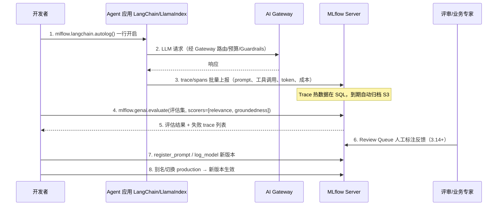

# 4. Runtime 工作流程：从一次实验到线上模型

> 一句话理解：一次典型的 MLflow 旅程是——**数据科学家在代码里 `start_run()`，记录参数、指标、模型 artifact；ML 工程师把模型注册到 Model Registry，经过 Staging 验证后提升到 Production；线上服务通过 `models:/name/alias` 加载模型并对外服务**。

## 4.1 完整旅程时序图

```
数据科学家
   │
   │ 1. 设置 tracking URI 和 experiment
   ▼
mlflow.set_experiment("fraud-detection")
   │
   │ 2. 开始 Run
   ▼
mlflow.start_run(run_name="xgb-v1")
   │
   │ 3. 记录参数
   ▼
mlflow.log_params({max_depth: 6, lr: 0.1})
   │
   │ 4. 训练模型
   ▼
XGBoost.fit(X_train, y_train)
   │
   │ 5. 记录指标
   ▼
mlflow.log_metric("auc", 0.94)
   │
   │ 6. 记录模型 artifact
   ▼
mlflow.xgboost.log_model(model, "model", signature=sig)
   │
   │ 7. 结束 Run
   ▼
mlflow.end_run()
   │
   │ 8. 注册模型
   ▼
MlflowClient.create_registered_model("fraud-detector")
   │
   ▼
MlflowClient.create_model_version(name, source=runs:/.../model)
   │
   │ 9. 设置 alias / stage
   ▼
set_alias("fraud-detector", "candidate", version=1)
   │
   │ 10. 验证（Staging）
   ▼
测试集 AUC >= 0.93 ?
   │
   ├── 否 → 回到 2，重新训练
   │
   └── 是
        │
        ▼
   transition_stage("fraud-detector", 1, "Production")
   set_alias("fraud-detector", "champion", version=1)
        │
        ▼
   11. 线上服务加载模型
        │
        ▼
   mlflow.pyfunc.load_model("models:/fraud-detector@champion")
        │
        ▼
   KServe / 自研服务对外提供 /predict
        │
        ▼
   12. 监控与反馈
        │
        ▼
   漂移 / 效果下降 → 触发新 Run
```

## 4.2 阶段详解

### 阶段 1：实验配置

```python
import mlflow

mlflow.set_tracking_uri("http://mlflow.example.com:5000")
mlflow.set_experiment("fraud-detection")
```

- `set_tracking_uri` 指向 Tracking Server。
- `set_experiment` 创建或切换到某个 experiment。

### 阶段 2：Run 与记录

```python
with mlflow.start_run(run_name="xgb-v1"):
    mlflow.log_params({"max_depth": 6, "learning_rate": 0.1})
    model = xgb.XGBClassifier(**params).fit(X_train, y_train)
    auc = roc_auc_score(y_test, model.predict_proba(X_test)[:, 1])
    mlflow.log_metric("auc", auc)
    mlflow.xgboost.log_model(model, "model")
```

Run 结束后，UI 上可以看到：

- 参数表格
- 指标值
- artifact 列表
- 模型签名

### 阶段 3：模型注册

```python
from mlflow import MlflowClient

client = MlflowClient()
client.create_registered_model("fraud-detector")

mv = client.create_model_version(
    name="fraud-detector",
    source=f"runs:/{run.info.run_id}/model",
    run_id=run.info.run_id,
)
```

`create_model_version` 会把 Run 下的 model artifact 注册到 Model Registry。

### 阶段 4：版本阶段与别名

```python
client.set_registered_model_alias("fraud-detector", "candidate", mv.version)
client.transition_model_version_stage("fraud-detector", mv.version, "Staging")
```

- **Stage**：Staging → Production → Archived。
- **Alias**：`candidate`、`champion`，便于部署脚本不依赖硬编码版本号。

### 阶段 5：模型服务

```python
import mlflow.pyfunc

model = mlflow.pyfunc.load_model("models:/fraud-detector@champion")
predictions = model.predict(df)
```

KServe 也可直接加载：

```yaml
apiVersion: serving.kserve.io/v1beta1
kind: InferenceService
metadata:
  name: fraud-detector
spec:
  predictor:
    model:
      modelFormat:
        name: mlflow
      storageUri: models:/fraud-detector@champion
```

### 阶段 6：监控与迭代

- 线上效果下降 → 触发新 Run。
- 新 Run 产生新版本 → 与当前 champion 做 A/B 对比。
- 验证通过后切换 alias，老版本归档。

## 4.3 URI 约定

MLflow 使用三种 URI 引用模型：

| URI | 含义 | 示例 |
|---|---|---|
| `runs:/run_id/artifact_path` | 引用某次 Run 的 artifact | `runs:/abc123/model` |
| `models:/name/version` | 引用注册模型的某个版本 | `models:/fraud-detector/1` |
| `models:/name/alias` | 引用注册模型的某个别名 | `models:/fraud-detector@champion` |

推荐生产使用 **alias**，因为它把部署与具体版本号解耦。

## 4.4 失败与重试

- **Run 失败**：代码异常时 Run 状态为 `FAILED`，可查看 artifact 和日志。
- **注册失败**：artifact source 不存在或 URI 错误时，`create_model_version` 会报错。
- **部署失败**：模型环境依赖缺失时，`load_model` 或 `predict` 会报错；需要检查 `conda.yaml` / `python_env.yaml`。
- **版本回滚**：把 alias 指回上一个版本即可快速回滚。

## 4.5 GenAI/Agent 场景的运行时旅程（3.x）

当应用从“训练一个模型”变成“编排一个 Agent”，MLflow 的旅程变成以 **Trace** 为中心：



关键差异：

- **没有显式的“训练”步骤**：迭代单元从 Run 变成了 trace（线上真实请求）+ prompt 版本。
- **评估发生在两个阶段**：离线（评估数据集 + scorer）与在线（对流入 trace 持续打分，3.9+ 内置 no-code 监控）。
- **回滚粒度更细**：可以只回滚 prompt 别名（`prompts:/support-bot@production`），也可以回滚模型别名（`models:/support-bot@champion`），二者解耦。
- **编码 Agent 也可接入**：3.13 起 AI Gateway 一键为 Claude Code、Codex、Gemini CLI 等提供带观测与预算的端点；3.14 的 `mlflow agent setup` 则是一条命令完成埋点接入。

## 本章小结

- 完整链路：**实验 → 记录 → 注册 → Staging 验证 → Production → 服务加载 → 监控迭代**。
- GenAI 链路：**autolog 追踪 → 评估（scorer）→ 人工评审 → prompt/模型发版 → 别名灰度与回滚**。
- 推荐用 **alias**（如 `champion`）解耦部署与版本号；prompt 与模型各自独立发版、独立回滚。
- MLflow 提供 `runs:/`、`models:/version`、`models:/alias` 三种模型 URI（3.x 还支持按 LoggedModel 的 `models:/<model_id>` 直接引用）。
- 失败可在 Run/Version/Deployment 三层分别排查。

**参考来源**

- [MLflow Tracking — Quickstart](https://mlflow.org/docs/latest/getting-started/intro-quickstart/index.html)
- [MLflow Model Registry](https://mlflow.org/docs/latest/model-registry.html)
- [MLflow GenAI — Tracing Quickstart](https://mlflow.org/docs/latest/genai/tracing/quickstart/)
- [MLflow 3.14.0 — Review Queues / mlflow agent setup](https://mlflow.org/releases/3.14.0/)
- 本手册 [Kubeflow Runtime](../kubeflow/04-runtime-workflow)、[KServe Runtime](../kserve/04-runtime-workflow)
