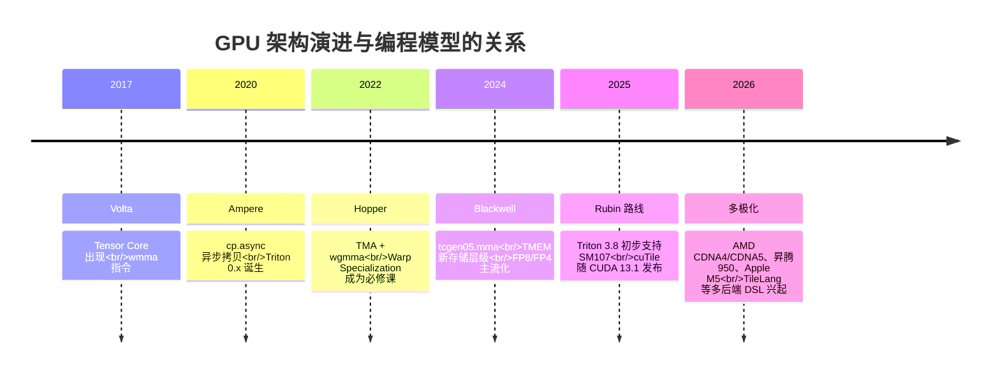

# 1. 背景与动机

## 手写 CUDA 之殇

假设你要在 H100 上写一个大模型推理的核心 kernel——GEMM（矩阵乘）。理论峰值约 989 TFLOPS（BF16），HBM 带宽 3.35 TB/s。一个 naive 的"每个线程算一个输出元素"的 CUDA 写法：

```cuda
// naive：每个线程计算 C 的一个元素，直接读全局内存
__global__ void gemm_naive(const float* A, const float* B, float* C, int M, int N, int K) {
    int row = blockIdx.y * blockDim.y + threadIdx.y;
    int col = blockIdx.x * blockDim.x + threadIdx.x;
    float acc = 0.f;
    for (int k = 0; k < K; ++k)
        acc += A[row * K + k] * B[k * N + col];
    C[row * N + col] = acc;
}
```

实测这种写法通常只能跑到峰值的 **5%-15%**。要让同一个 GEMM 接近 90% 峰值，你需要：

1. **Tiling（分块）**：把 A/B 的子块搬进 shared memory，每个线程块复用数据，把算术强度（FLOPs / 字节）提上去。
2. **寄存器分块（register blocking）**：每个线程算 8x8 或 16x8 的小块，摊薄指令开销。
3. **向量化加载**：128-bit `ld.global.v4`，一次搬 4 个 float。
4. **异步拷贝流水线**：用 `cp.async`（Ampere+）或 TMA（Hopper+）把"搬数据"和"算数据"重叠起来，多级流水（num_stages=3-4）。
5. **Tensor Core 指令**：用 `wgmma`（Hopper）或 `tcgen05.mma`（Blackwell）替代标量 FMA，一条指令算一个 64x256 的 tile。
6. **Warp specialization**：一部分 warp 专职搬数据，一部分专职算，producer-consumer 通过 barrier 同步。
7. **Swizzle / 布局变换**：让 shared memory 的 bank conflict 为零。

这就是 CUTLASS 一个生产级 Hopper GEMM 要 500-1000 行 CUDA 的原因。**更糟的是，上面每一项都硬件相关**：搬到 Blackwell 要换 `tcgen05`、搬到 AMD MI300 要换 MFMA、搬到昇腾要换完全不同的指令集。手写一次的成本是数月，而硬件每 1-2 年迭代一代。

## 算子碎片化：组合爆炸

大模型带来的不只是 GEMM。一个现代推理引擎的 kernel 清单大致是：

| 算子 | 变体数量 | 原因 |
|---|---|---|
| GEMM | M×N×K 形状组合、batch、量化（FP8/FP4/INT8/PTQ/QAT）、sparsity | 每变体一个最优 kernel |
| Attention | decode/prefill、GQA/MQA/MLA、长序列、稀疏、sliding window、FP8 KV cache | 变体两两组合 |
| MoE | grouped GEMM、expert 路由、all-to-all 融合 | 每个模型结构不同 |
| 归一化/激活 | RMSNorm、SwiGLU、RoPE、quant-dequant | 常与前后算子融合，形态不一 |
| 通信 | all-reduce、all-gather、MoE dispatch/combine | 拓扑 + 消息大小 + 精度组合 |

**变体数量是 O(算子 × 硬件 × 数据类型 × 形状)**。靠人肉手写 CUDA，这个组合永远打不完。

## eager 执行的隐形税

PyTorch eager 模式是"Python 调一个算子、GPU 跑一个 kernel"。一个真实测量：一个 LLM 层的 LayerNorm 在 eager 下需要 4-6 次 kernel launch：

```python
# eager：每个操作一次 kernel launch + 一次 HBM 往返
mean = x.mean(-1, keepdim=True)      # kernel 1: reduce
var = x.var(-1, keepdim=True)        # kernel 2: reduce
x = (x - mean) / (var + eps).sqrt()  # kernel 3/4/5: 多个 elementwise
y = x * weight + bias                # kernel 6: elementwise
```

每次 kernel launch 有 3-10 μs 的 CPU 开销（decode 阶段尤其致命，batch 小、计算本来就只有几十微秒），每个中间张量都要从 HBM 读一遍再写一遍。编译器的融合（fusion）把这 6 个 kernel 合成 1 个：中间结果全部留在片上，HBM 流量下降 80% 以上。

## 硬件演进加速了这个需求



两个趋势让"手写 kernel"进一步不可持续：

1. **指令越来越复杂**：Hopper 的 `wgmma` 要从 shared memory 直接读操作数，Blackwell 的 `tcgen05` 更是引入 TMEM（Tensor Memory）这一新层级——手写代码要管理的状态机越来越长。
2. **阵营多极化**：NVIDIA 之外，AMD MI300/MI350、华为昇腾 950、Apple M 系列、Intel Gaudi 都在抢推理市场。每个阵营的最优写法都不同。

**结论：AI 编译器不是"优化选项"，而是 AI 基础设施的必选项。** 它的使命是：让算法工程师写 PyTorch 级别的代码，让编译器生成接近手写专家水平的 kernel，并且一次编写、多硬件可移植。

## 三条技术路线的历史脉络

AI 编译器的发展大致有三条路线，2025-2026 年正在合流：

| 路线 | 代表 | 思路 | 现状 |
|---|---|---|---|
| **图上编译**（graph compiler） | XLA（2017）、TVM（2018）、torch.compile（2022） | 捕获整图，在图上做融合/布局优化，再调 kernel 库或生成 kernel | 已是 PyTorch/JAX 默认能力 |
| **kernel DSL** | Triton（2019）、CUTLASS CuTe DSL（2024）、cuTile（2025）、TileLang（2024） | 给程序员一个"tile 级"的编程抽象，编译器管线程/寄存器/指令 | 推理引擎 kernel 的主要生产方式 |
| **超优化 / 搜索** | AutoTVM/Ansor（2020）、Mirage（OSDI'25）、MPK（OSDI'26） | 用搜索或推理在巨大的程序空间里找更优实现，甚至跨层级重排 | 学术领先，开始进生产 |

本主题后续章节按"核心思想 → 架构 → 流程 → 模块 → 生态"展开，第 7 章的 Mini Demo 会用 400 行 Python 让你亲手摸到这条链路的每一环。

## 本章小结

- 手写 CUDA 要达到峰值性能需要 tiling、寄存器分块、异步流水、Tensor Core 指令、warp specialization 等七八项技术，且全部硬件相关。
- 算子变体数量是 O(算子 × 硬件 × 数据类型 × 形状) 的组合爆炸，人肉写不完。
- eager 执行每次操作都有 launch 开销和 HBM 往返，编译器融合是主要解药。
- 硬件演进（Hopper→Blackwell→Rubin + 多阵营）让编译器从"优化选项"变成"基础设施必选项"。
