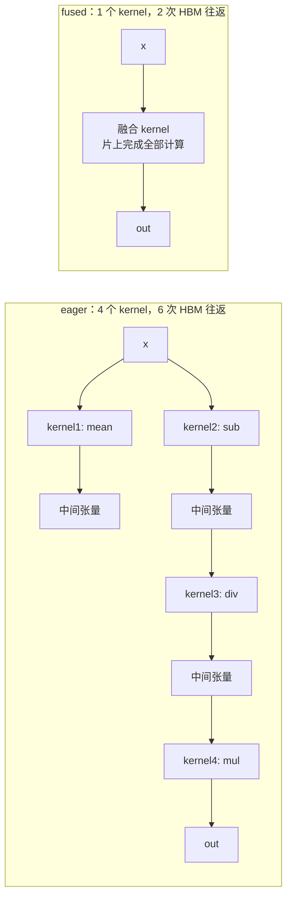
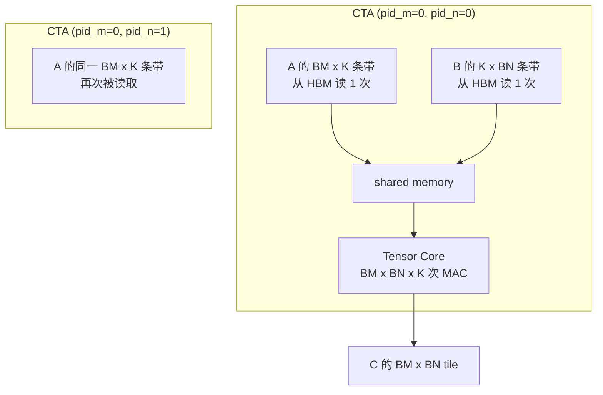
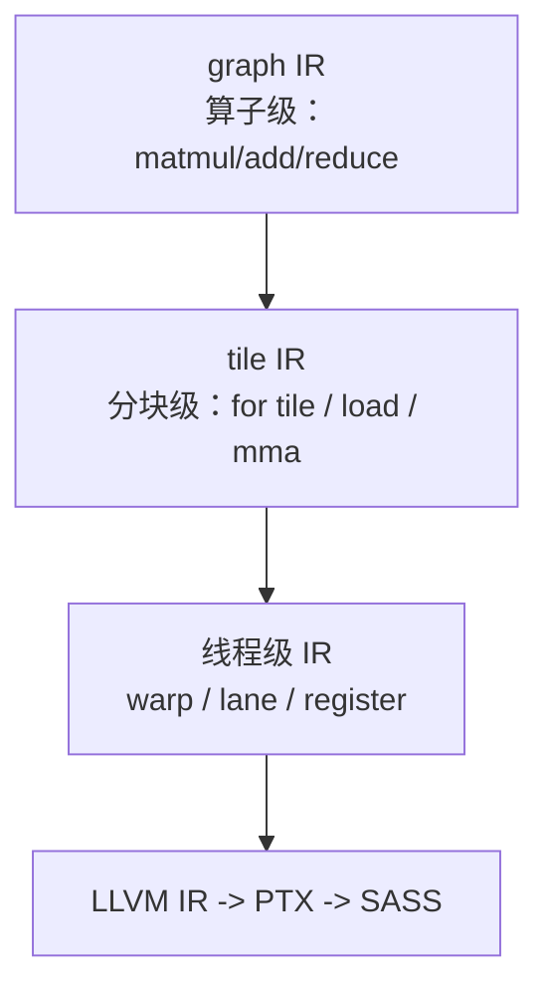

# 2. 核心思想

AI 编译器看上去系统各异（XLA、Inductor、Triton、TVM），但内核是同一组思想。本章把这组思想讲透，后面所有系统都是它们的变体。

## 2.1 Graph Capture：先把动态程序变成静态图

PyTorch eager 是动态的：Python 控制流、动态 shape、随时改图。优化的第一步是**把一段计算捕获成静态计算图 IR**（Intermediate Representation，中间表示）：

```mermaid
flowchart LR
    subgraph 捕获前["eager：每个 op 一次 launch"]
        A1[x.mean] --> A2[x - mean] --> A3[div] --> A4[mul]
    end
    subgraph 捕获后["graph IR：整张图可见"]
        B1["%mean = reduce(x)<br/>%sub = sub(x, mean)<br/>%div = div(sub, std)<br/>%out = mul(div, w)"]
    end
    捕获前 -.torch.compile / jax.jit.-> 捕获后
```

有了图，编译器才能做全局分析："谁是谁的消费者、哪些中间值可以消掉、哪些节点可以合并"。没有图，一切都无从谈起。

实现方式有三种：

| 方式 | 代表 | 机制 | 局限 |
|---|---|---|---|
| **tracing** | torch.fx、torch.jit.trace、JAX | 喂样例输入，记录执行轨迹 | 遇到数据依赖的控制流（if x.shape[0] > 1）会"固化"或断图 |
| **bytecode 解释** | TorchDynamo | 解释 CPython 字节码，遇到不支持的操作就 graph break | 极小部分 Python 语义无法捕获 |
| **源代码/AST 变换** | taichi、早期 Triton | 直接解析 Python AST 生成 IR | 只支持受限制的 Python 子集 |

2026 年的共识是 **Dynamo 式 bytecode 捕获 + guard 机制**：默认把整段函数编成一张图，遇到无法捕获的代码就在那里"断图"（graph break），断点前后各是一张子图。

## 2.2 算子融合（Operator Fusion）：编译器最大的性能来源

融合是"把多个算子的计算合并进一个 kernel"。它带来两个收益：

1. **消除 HBM 往返**：中间结果不落地，留在寄存器 / shared memory。
2. **消除 launch 开销**：6 次 launch 变 1 次。



**融合不是想融就融**，有硬约束（真实编译器的合法性检查，Mini Demo 的 `fusion.py` 会复刻）：

- **单消费者规则**：一个中间值被多个下游使用，融进其中一个会导致另一个被迫重复计算——通常不融（除非它本来就是组输出）。
- **结构规则**：常见可融合模式是 逐元素→逐元素、GEMM→逐元素（epilogue 融合）、逐元素→归约。归约→归约（形状已变）、GEMM→归约（在本 mini 模型中）默认不融。
- **并行结构兼容**：融合组内的所有操作必须能共享同一个并行划分（同一套 tile/grid）。比如行归约 + 列归约无法进同一个 kernel。

一个融合决策本质上是**图划分问题**：把 DAG 划分成若干组，组内并、组间串，目标是最小化总执行时间。XLA、Inductor、TVM 的做法都是带合法性约束的贪心 + 启发式。

## 2.3 Tiling（分块）：一切 GPU 性能优化的根基

GPU 的内存是层级结构，越快的存储越小：

| 层级 | 容量量级 | 带宽量级 | 谁管理 |
|---|---|---|---|
| 寄存器（register） | ~256 KB / SM | ~几十 TB/s | 编译器分配 |
| Shared memory / L1 | ~228 KB / SM | ~20-30 TB/s | 程序员 / DSL 显式 |
| L2 cache | ~50 MB | ~10 TB/s | 硬件 |
| HBM（全局内存） | 80-192 GB | 3-8 TB/s | 硬件 |

算术强度（arithmetic intensity）= FLOPs ÷ 访存字节数，决定 kernel 是"算力受限"还是"带宽受限"。GEMM 的算术强度随 tile 大小增长：tile 越大，每个加载进来的字节被复用越多。



代价：BN 越大，A 的条带被重复读的次数越多（grid 列数越多）。**tiling 的核心矛盾是"片上容量 vs 数据复用"**，这就是为什么要 auto-tune。

## 2.4 Scheduling（调度）：把计算映射到硬件

有了 tile 之后，还要回答：tile 内的计算按什么顺序执行？涉及三个子问题：

1. **循环顺序（loop order）**：K 维在内层还是外层？elementwise 链按什么顺序向量化？
2. **循环变换（loop transformation）**：split / fuse / reorder / vectorize / unroll——传统编译器的循环优化在 tile 级重演。
3. **软件流水线（software pipelining）**：让"载入第 k+1 块"与"计算第 k 块"重叠（对应 Triton 的 `num_stages`，CUTLASS 的 multi-stage pipeline）。

**多面体方法（polyhedral）** 是调度理论里最系统的一支：把循环嵌套看成整数点集上的仿射变换问题，用线性规划求解合法且最优的变换序列。TVM 的 TensorIR、Helion 都吸收了多面体思想。但在 AI 编译器里，实际系统中更常用的是**模板 + 搜索**：人为定义一个高质量的调度模板（模板本身编码了专家知识），auto-tuner 在模板参数里搜索。

## 2.5 Auto-tuning 与 Cost Model：搜索最优配置

同一个 kernel 往往有几十到几百个候选配置（BLOCK_M/BLOCK_N/BLOCK_K × num_warps × num_stages × ...）。2026 年的主流选法有三种：

| 方法 | 做法 | 代表 | 特点 |
|---|---|---|---|
| **实测** | 每个候选真编译真跑，计时 | Triton @autotune、Inductor max-autotune（benchmarking 模式） | 最准，但编译+跑一遍要几十秒到几分钟 |
| **解析 cost model** | 按公式估算访存/计算/占用率 | 早期 AutoTVM、本主题 Mini Demo | 快、可解释、确定性，但精度有限 |
| **学习型 cost model** | 用历史编译数据训练预测模型 | Ansor/TVM MetaSchedule、Meta 的 Helion autotune、Inductor 的局部模型 | 泛化好，冷启动需数据 |

生产实践是**混合制**：先用 cost model 粗筛到前 10-20 个，再实测决出最优（Inductor max-autotune 的 coordinate descent 就是这个思路）。成本管理也是真问题：一个模型全量 max-autotune 可能要数小时编译时间，所以有了 autotune cache（Inductor 的 local/remote cache、SGLang/vLLM 的编译产物缓存）。

## 2.6 布局（Layout）与内存层级抽象

同一个逻辑张量，物理上怎么摆（row-major / column-major / swizzled）对性能影响巨大：

- Tensor Core 指令对操作数布局有硬性要求（比如 `wgmma` 要求 A 在 shared memory 的特定 swizzle 布局）。
- 不同算子偏好不同布局（conv 喜欢 NHWC，attention 的 KV cache 喜欢按 head 分块）。

因此编译器有专门的 **layout 变换 pass** 和**内存层级抽象**。CuTe（CUTLASS 3.x 起）的 `Tensor + Layout` 代数、Triton 的 blocked layout、cuTile 的 Tile IR，本质都是同一思想：**把"逻辑索引 → 物理地址"的映射变成可组合的代数对象**，让布局变换可推导、可验证。

## 2.7 多层级 IR：一次编译，逐级下降

最后把这些串起来：现代 AI 编译器都是**多层级 IR**（MLIR 的 dialect 思想）：



每一层只解决本层的问题：graph 层做融合，tile 层做调度和流水线，线程层做指令选择。**pass（变换）在层内与层间流动**，lower（下降）逐层细化。XLA 的 HLO → LLO、Triton 的 TTIR → TTGIR → LLVM IR、cuTile 的 Tile IR → nv_tileaa / nv_tileas → NVVM，都是这个模式。

## 本章小结

- **Graph capture** 是优化的前提：动态 Python → 静态 IR。
- **融合**是最大性能来源，受单消费者规则与结构规则约束。
- **Tiling** 用片上容量换数据复用，算术强度决定 kernel 的天花板。
- **调度**（循环顺序/变换/流水线）把 tile 映射为高效执行序列，多面体是理论，模板+搜索是实践。
- **Auto-tuning + cost model** 在配置空间里找最优，生产上是"模型粗筛 + 实测决选 + 缓存复用"。
- **多层级 IR + dialect** 让每层只关心本层问题，是现代编译器的通用架构。
