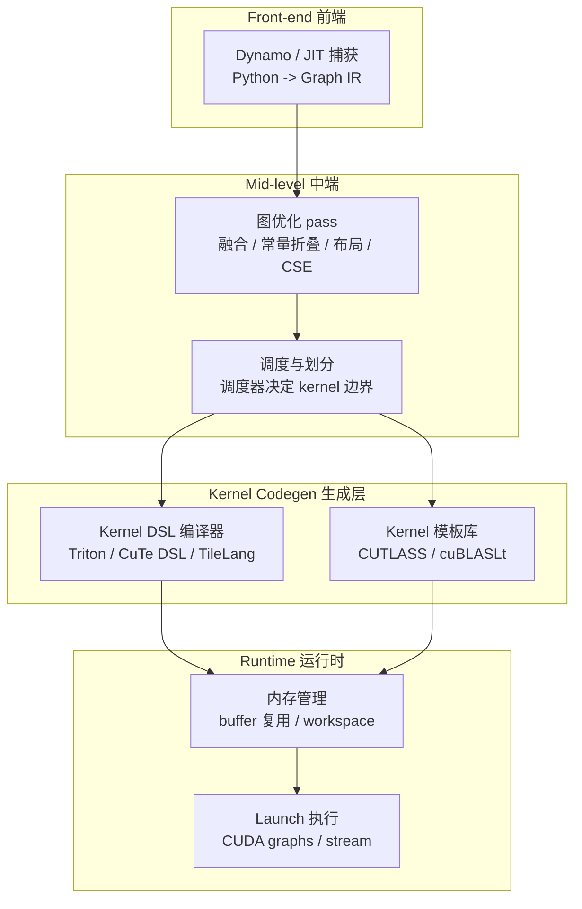
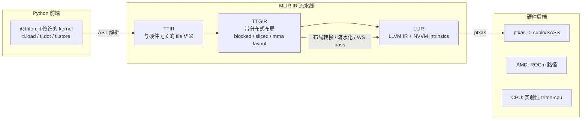
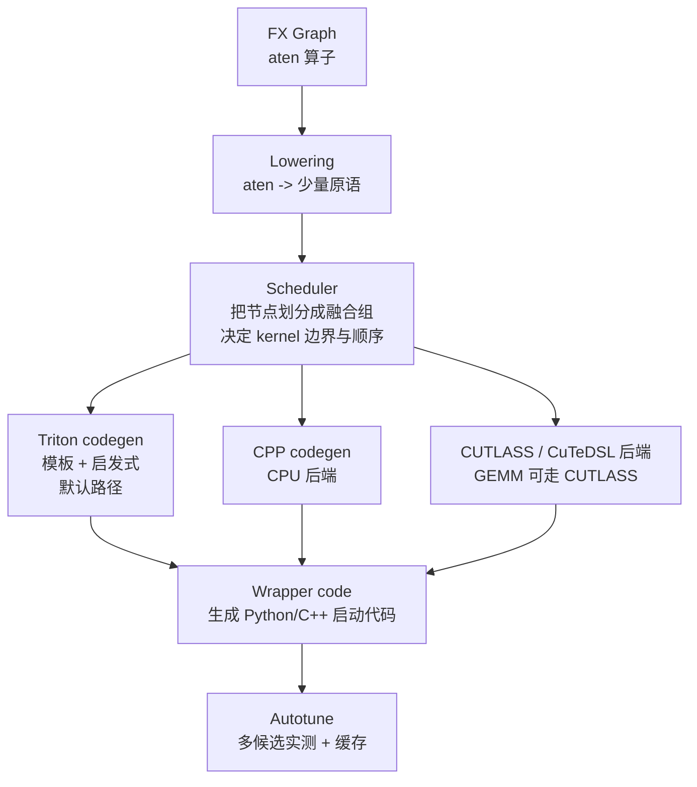
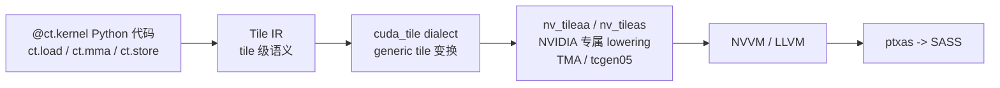

# 3. 架构设计

本章把上一章的思想组装成系统：一个典型 AI 编译器分几层、每层干什么、它们如何用 MLIR 式的 dialect 体系组织起来。

## 3.1 五层参考架构

各层职责与代表实现：

| 层 | 职责 | 关键问题 | 代表 |
|---|---|---|---|
| Front-end | 捕获计算图 | 动态控制流、动态 shape、graph break | TorchDynamo、jax.jit、torch.fx |
| Mid-level | 图级优化 | 融合合法性、buffer 复用、布局选择 | Inductor scheduler、XLA HloPass、TVM FuseOps |
| Kernel codegen | 生成单 kernel | tiling、调度、寄存器分配、指令选择 | Triton 编译器、CuTe DSL、TileLang 编译器 |
| Runtime | 执行与内存 | workspace 分配、kernel launch、CUDA graphs | PyTorch runtime、CUDA driver |

一个系统未必四层全做：**Triton 只 codegen 层**（输入是手写的 kernel 程序）；**XLA 全做但 codegen 层大量依赖外部库**；**torch.compile 的前两层是 Dynamo+Inductor，codegen 层默认调 Triton**。这种"分层 + 可替换"正是生态繁荣的原因——TileLang/Helion 都是把 Triton 或 CUTLASS 当作自己的 codegen 后端。

## 3.2 MLIR 与 dialect：现代 AI 编译器的通用骨架

**MLIR**（Multi-Level Intermediate Representation，LLVM 项目的子项目）不是编译器，而是一套"定义编译器"的基础设施。核心概念是 **dialect（方言）**：

- 每种 dialect 定义一组**算子（operation）和类型**，比如 `arith.addi`、`nv_gpu.warp_group_mma`、`memref.load`。
- 每个 op 声明自己的**约束与语义**，pass 只处理自己认识的 op。
- **lowering（下降）** 把高 dialect 的 op 逐步翻译成低 dialect 的 op 序列，直到 LLVM IR。

为什么 AI 编译器都爱它：

1. **多层级天然契合**：graph 层一个 dialect、tile 层一个 dialect、线程层一个 dialect，层间用 lowering pass 连接——正是 2.7 节的思想有了工程载体。
2. **pass 基础设施免费获得**：pattern rewrite、dialect 转换框架、pass 管理器都是现成的。
3. **生态可复用**：arith/memref/vector/GPU 等通用 dialect 被所有项目共享。

现实中的使用：

| 项目 | MLIR 用法 |
|---|---|
| Triton | TTIR（Triton IR）→ TTGIR（带 GPU 布局）→（NVIDIA 路径）→ LLVM/NVVM；AMD 路径走 ROCm dialect |
| cuTile | Tile IR → cuda_tile / nv_tileaa / nv_tileas dialects → NVVM/LLVM → SASS |
| torch-mlir | 把 torch/aten 算子集定义为 dialect，对接 Inductor/XLA/IREE |
| IREE | 端到端用 MLIR 编译到 CPU/GPU/Vulkan |
| StableHLO | 基于 MLIR 算子集定义的可移植图级 dialect，XLA 与外部工具链的交换格式 |

## 3.3 Triton 编译器架构（kernel DSL 的样板）

以 Triton（截至 2026-10 最新为 3.8.x）为例看一个 kernel DSL 编译器的内部：

几个值得记住的设计：

- **布局（layout）是 TTGIR 的一等公民**：同一张量在不同 op 间可以有不同的分布式布局（blocked、mma、slice），编译器插入 **convert_layout** 节点并在其上跑优化（消除冗余转换）。
- **自动 warp specialization（AWS）**：3.4 版本（2024-07）引入，编译器分析 TTGIR 的依赖图，自动把程序切成 producer/consumer warp 组并插入同步原语——此前这是手写 CUDA 的"绝活"，2025-2026 版本（3.5-3.7）持续加固，AMD gfx1250 路径也支持了 warp specialization。
- **双轨后端**：NVIDIA（走 NVVM/ptxas）与 AMD（走 ROCm）共享 90% 的前中端；CPU 后端（triton-lang 组织下的 `triton-cpu` 分支）处于开发中。
- **Gluon**：在 TTGIR 之上暴露的显式 tile IR DSL（显式 layout、显式 shared memory 管理），2025 年起成熟，FlashAttention 4 用它实现——验证了"同一 IR 上可以长出一层专家 DSL"。

## 3.4 Inductor 架构（全栈编译器的样板）

torch.compile = **Dynamo（前端）+ Inductor（中端+codegen）**，Inductor 的内部：

- **Lowering**：几千个 aten 算子被 lowering 成十几个原语（pointwise/reduction/normalization...），极大缩小优化面。
- **Scheduler** 是灵魂：先在图上做垂直/水平融合（vertical fusion 合并 producer-consumer；horizontal fusion 合并无关的同形计算），再做拓扑排序与 buffer 复用规划。2.10 版本加入的 **combo-kernels（水平融合成 combo kernel）** 专门削减 launch 开销。
- **Wrapper**：默认生成 Python 启动代码，`mode="max-autotune"` 下可切 CPP wrapper（减少 Python 开销）。
- **多后端竞争**（2026 年的重要趋势）：GEMM 候选同时来自 Triton、ATen（cuBLAS）、CuTeDSL/CUTLASS（2.13 引入的 Native DSL 原型，2.14 的 NVGEMM 已支持 epilogue 融合与 NVFP4），由 autotune 实测决选。

## 3.5 cuTile 与 CUTLASS：厂商路线的架构

NVIDIA 在 CUDA 13.1（2025-12）发布 **cuTile**，把"内存层级抽象"推到了新高度：

- 程序员只面对 **tile 与内存层级**（global → shared → register/TMEM），不面对线程、warp、bank conflict。
- `ct.mma` 直接映射 Tensor Core，`ct.load/store` 底层走 TMA；当前要求 Blackwell（compute capability ≥ 10.0），是"Triton 的厂商对标"。
- **CUTLASS 4.x**（2026-09 最新 4.8.0）是同生态的"模板库 + DSL"组合：CuTe DSL 负责 Python 侧表达，**4.7 引入 Primitives API（SIMT 级 Tensor Core 编程）与 Task Scheduling 框架（静态分析 warp-specialized 调度），4.6 引入 Operator API（pip 包 `nvidia-cutlass-operators`）与 `cute.compile_to` 细粒度编译接口**，4.8 加入 Rubin（SM107）dense GEMM 支持与 `cute_ext` 编译管线预览。

## 3.6 与其他主题架构的对照

AI 编译器的分层与推理引擎的分层是同构的，只是优化的对象从"调度"变成了"代码"：

- vLLM/SGLang 的 scheduler 决定**什么时候跑哪个请求**；AI 编译器的 scheduler（如 Inductor）决定**哪些算子进哪个 kernel**。两者都面临"划分"问题。（见 [vLLM 架构](/04-llmops/vllm/03-architecture)、[SGLang 架构](/04-llmops/sglang/03-architecture)）
- TensorRT-LLM 选择了"全编译"路线：离线把模型编译成 engine，与本主题的"运行时编译"形成光谱两端。（见 [TensorRT-LLM](/04-llmops/tensorrt-llm/)）
- 分布式训练中，编译器还要处理通信算子（all-reduce 与 GEMM 重叠）——那是 Megatron/DeepSpeed 与编译器交汇的地带。（见 [分布式系统](/01-foundation/distributed-systems/)）

## 本章小结

- 典型 AI 编译器分五层：front-end 捕获、mid-level 图优化与调度、kernel codegen、runtime 执行；各层均可替换，构成繁荣的生态。
- MLIR dialect 是现代 AI 编译器的通用骨架：多层级 IR + pass + lowering。
- Triton 是 kernel DSL 样板（TTIR→TTGIR→LLIR，3.4 起自动 warp specialization，Gluon 提供专家级下层 DSL）。
- Inductor 是全栈样板（lowering→scheduler→多 codegen 后端→autotune），2026 年已让 Triton/CUTLASS/ATen 候选同场竞技。
- cuTile/CUTLASS 4.x 代表厂商路线：tile 级抽象 + 厂商编译管线，与 Triton 分庭抗礼。
