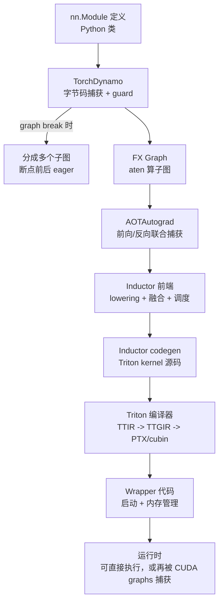

# 4. 编译工作流程

本章以 `torch.compile` 编译一个 MLP 层为例，走一遍 2026 年生产环境的完整编译链路。这是面试中最常考、生产中最常用的一条链路。

## 4.1 全景图



用户视角只有一行代码：

```python
model = torch.compile(model)  # 或 model = torch.compile(model, mode="max-autotune")
out = model(x)                # 第一次调用触发编译（慢），之后走编译产物（快）
```

## 4.2 第一步：Dynamo 捕获与 guard

TorchDynamo 在 CPython 字节码层面解释执行你的 forward，把可捕获部分记录成 FX Graph，不可捕获处 graph break。同时它为这张图生成 **guard（守卫）** 集合：

- 输入 tensor 的 dtype、device、维度数、是否 requires_grad；
- 每个维度的尺寸是"固定值"还是"符号值"（自动动态 shape：首次按静态编译，第二次遇到不同尺寸自动重编译为动态版本）。

guard 的代价是每次调用都要快速校验一遍（纳秒级），不通过就重新捕获/编译。**这是 torch.compile 与 torch.jit.trace 的本质区别**：trace 是把一条执行路径录死，Dynamo 是"带校验的捕获"。

## 4.3 第二步：AOTAutograd 与图优化

训练场景下，AOTAutograd 在前向图之上同步构建反向图，让编译器看到"前向+反向"的全貌（有些融合只有看到反向才划算，比如 recomputation vs checkpointing）。推理场景（inference_mode）这一步基本跳过。

随后 Inductor 前端对 FX 图做标准 pass：

1. **常量折叠 / 死代码消除**（constant folding、DCE）
2. **布局优化**（layout optimization，2.x 中可配置，曾因 regional-inductor 问题在 2.12 回退为默认关闭延迟冻结）
3. **lowering**：aten 算子 → 原语集合（pointwise、reduction、for-loop template 等）

## 4.4 第三步：调度器与融合决策

Inductor scheduler 把 lowered 图划分成融合组。决策依据：

- **垂直融合**：producer-consumer 直连且中间值只被用一次 → 合并（对应 2.2 节规则）。
- **水平融合**：多个互不依赖的同形 pointwise 节点 → 合并为一个 combo kernel（2.10 加入），摊薄 launch 开销。
- **模板融合**：reduction 节点如果匹配某个模板（如 Softmax、LayerNorm、attention），整个模板 + 前后 pointwise 一起生成一个 kernel。

每个融合组生成一段 Triton kernel 源码；大型 reduction/GEMM 还会生成多种 tile 候选交给 autotune。

## 4.5 第四步：Triton 编译

Inductor 生成的 Triton kernel 进入 Triton 编译器（3.3 节架构）：

```python
# Inductor 为 LayerNorm 生成的 Triton kernel 大致长这样（节选概念）
@triton.jit
def layer_norm_kernel(X, W, B, Y, N, eps, BLOCK_N: tl.constexpr):
    row = tl.program_id(0)
    cols = tl.arange(0, BLOCK_N)
    mask = cols < N
    x = tl.load(X + row * N + cols, mask=mask, other=0.0)
    mean = tl.sum(x, axis=0) / N
    xc = tl.where(mask, x - mean, 0.0)
    var = tl.sum(xc * xc, axis=0) / N
    rstd = 1 / tl.sqrt(var + eps)
    w = tl.load(W + cols, mask=mask)
    b = tl.load(B + cols, mask=mask)
    tl.store(Y + row * N + cols, xc * rstd * w + b, mask=mask)
```

编译过程：AST 解析 → TTIR（tile 语义）→ TTGIR（插入布局转换，跑自动 warp specialization、流水化 pass）→ LLVM IR（NVVM）→ ptxas → cubin。产物缓存到 Inductor cache 目录，同一形状/guard 组合再次命中直接加载。

## 4.6 第五步：Wrapper、Autotune 与 CUDA Graphs

- **Wrapper**：把所有 kernel 的启动逻辑拼成一个可调用对象。默认生成 Python wrapper；`max-autotune` 下可生成 CPP wrapper（降低 Python launch 开销，对 decode 小 batch 场景收益明显）。
- **Autotune**：每个有多个候选的 kernel（GEMM/reduction 模板）编译全部候选并实测计时（coordinate descent tuning），结果写入本地或远程 cache。这就是为什么第一次 `torch.compile` 可能要几分钟到几十分钟，而缓存命中时只需几秒。
- **CUDA graphs**（见 [GPU 与 CUDA](/01-foundation/gpu-cuda/)）：编译产物之上，Inductor 2.8 起支持图划分（graph partitioning）——把整个执行序列捕获为 CUDA graph，消除全部 launch 开销。推理引擎（vLLM/SGLang）几乎总是把 torch.compile 与 CUDA graphs 搭配使用。

## 4.7 时间线：一次编译花多久

以 7B 模型的 decoder layer 为例（H100，2026 年环境）：

| 阶段 | 耗时量级 | 说明 |
|---|---|---|
| Dynamo 捕获 | 10-100 ms | 含 guard 求值 |
| Inductor 图优化 + 调度 | 100 ms - 数 s | 图越大越慢 |
| Triton kernel 编译 | 每 kernel 1-10 s | 与 kernel 数量线性 |
| max-autotune 实测 | 数分钟 - 数十分钟 | 候选数 × benchmark 时间 |
| 缓存命中后的加载 | < 5 s | 生产部署的正常路径 |

工程含义：**编译时间是生产成本**。这是所有推理引擎都做"编译缓存 + 预编译发布"的根本原因（详见第 8 章）。

## 4.8 另一条链路：JAX/XLA 对照

JAX 的链路是 `jax.jit` → XLA → StableHLO → 优化（与 Inductor 同构的 fusion pass）→ 后端（GPU 走 XLA GPU / 也可走 IREE）。概念上第 2 章的所有思想一一对应，区别在于：

- XLA 更早地把一切规范化到 StableHLO（跨框架可移植的 MLIR dialect）；
- XLA 的 kernel 来源更依赖外部库（cuBLAS/cuDNN）+ 少量自生成，而 Inductor 默认全自生成 Triton；
- 2026 年起两者都在向"多候选 autotune 竞速"收敛。

## 本章小结

- torch.compile 链路：Dynamo 捕获（guard 校验）→ AOTAutograd → Inductor lowering/调度/融合 → Triton 源码 → Triton 编译器 → wrapper →（可选）CUDA graphs。
- graph break 把函数切成多个子图；guard 决定何时复用编译产物。
- 编译时间是分钟到几十分钟量级，缓存是生产必需品。
- JAX/XLA 是同构的另一条链路，差异在 IR 规范与 kernel 来源。
