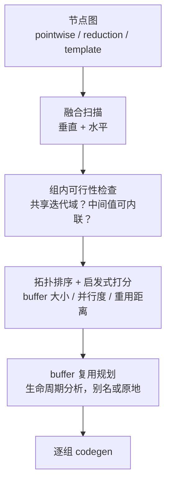
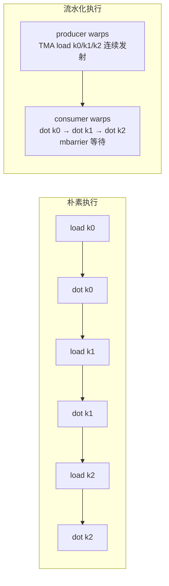

# 5. 核心模块

本章解剖四个核心模块：Triton 编译 pipeline、Inductor 调度器、自动 warp specialization、cuTile 的内存层级抽象。它们是"编译器如何把高层代码变成快 kernel"的关键所在。

## 5.1 Triton 编译 Pipeline：从 Python 到 cubin

以一个 matmul kernel 为例走 pipeline（概念视角）：

```python
@triton.jit
def matmul_kernel(a_ptr, b_ptr, c_ptr, M, N, K,
                  stride_am, stride_bk, stride_cm,
                  BLOCK_M: tl.constexpr, BLOCK_N: tl.constexpr, BLOCK_K: tl.constexpr):
    pid_m = tl.program_id(0)
    pid_n = tl.program_id(1)
    offs_m = pid_m * BLOCK_M + tl.arange(0, BLOCK_M)
    offs_n = pid_n * BLOCK_N + tl.arange(0, BLOCK_N)
    acc = tl.zeros((BLOCK_M, BLOCK_N), dtype=tl.float32)
    for k in range(0, K, BLOCK_K):
        a = tl.load(a_ptr + offs_m[:, None] * stride_am + k + tl.arange(0, BLOCK_K)[None, :])
        b = tl.load(b_ptr + k * stride_bk + offs_n[None, :])
        acc = tl.dot(a, b, acc)
    tl.store(c_ptr + offs_m[:, None] * stride_cm + offs_n[None, :], acc)
```

Pipeline 各阶段做的事：

| 阶段 | IR | 关键变换 |
|---|---|---|
| 1. 前端 | Python AST | 解析 JIT 函数，`tl.constexpr` 作为编译期常量特化 |
| 2. 语义层 | TTIR | 类型/形状检查，循环与 tl.dot 保持 tile 语义 |
| 3. GPU 层 | TTGIR | **布局分配**（每个 tensor 一个分布式 layout）、插入 convert_layout、**流水化**（按 num_stages 展开 K 循环成多级 buffer）、**自动 warp specialization**（3.4+）、选择 mma 指令版本 |
| 4. 底层 | LLIR | 映射到 NVVM intrinsic（cp.async、TMA、wgmma/tcgen05）、shared memory 分配、barrier 插入 |
| 5. 汇编 | PTX → cubin | ptxas 完成寄存器分配与指令调度（Triton 3.8 起提供寄存器溢出诊断等改进） |

两个容易踩坑的点：

- **特化（specialization）**：`BLOCK_M=128` 不同、`K % 16 == 0` 与否，都会产生不同的编译产物（不同的 tl.constexpr 与 div-isibility hint）。这解释了 Triton cache 为什么按"参数属性"组织。
- **convert_layout 的成本**：布局转换要走 shared memory，TTGIR 上的优化 pass 会尽量消除冗余转换；写 Gluon（显式 layout）时这个成本完全由你控制。

## 5.2 Inductor 调度器：融合与 buffer 复用

Inductor scheduler 的输入是 lowered 后的节点图，输出是**有序 kernel 序列 + 每个 kernel 的 codegen 计划**。核心机制：



- **迭代域（iteration domain）兼容**是融合的第一道检查：两个节点要被垂直融合，消费节点必须能在生产节点的循环结构内计算（比如 pointwise 接 pointwise 永远兼容；reduction 接 pointwise 要看归约轴方向）。
- **buffer 复用**：调度器做生命周期分析（liveness），让死掉的 buffer 被后续节点原地复用——这正是"为什么 torch.compile 后显存峰值常常下降"的原因之一。
- **模板调度**：对 GEMM/attention 这类"计算骨架固定、epilogue 可变"的节点，调度器把匹配到的模板（Triton template 或 CUTLASS template）与周边 pointwise 拼合，模板参数进入 autotune 空间。

## 5.3 自动 Warp Specialization：把流水线的手艺自动化

**问题背景**：Hopper 的 GEMM/attention 最优写法是"生产者-消费者"分工：一部分 warp 专职用 TMA 搬数据（producer），一部分 warp 专职喂 Tensor Core（consumer），靠 mbarrier 同步。手写 CUDA 里这是一套容易写错的状态机。

**Triton 的做法（3.4 引入，3.5-3.7 加固）**：编译器在 TTGIR 上分析数据依赖，自动识别可重叠的 load 与 compute，把 warpgroup 划分为 partition，自动插入 barrier 与多缓冲。程序员零改动获得流水线：



**局限**：自动 WS 依赖静态可分析的依赖图；动态控制流或复杂指针算术会退化为普通模式。这时可以下沉到 **Gluon**（显式 layout/同步的 DSL，FlashAttention 4 的选择），或改用 CUTLASS 4.7 的 Task Scheduling 框架做静态调度分析。

## 5.4 cuTile 的内存层级抽象

cuTile 把"内存层级"变成类型系统的一部分。一个 cuTile GEMM（概念代码）：

```python
import cuda.tile as ct

@ct.kernel
def gemm_kernel(a: ct.Tensor, b: ct.Tensor, c: ct.Tensor):
    # tile 类型自带内存层级信息
    ta = ct.load(a.tile)          # global -> 片上（TMA 语义）
    tb = ct.load(b.tile)
    acc = ct.mma(ta, tb)          # Tensor Core，操作数自动降到所需层级
    ct.store(c.tile, acc)         # 片上 -> global
```

关键设计：

- **tile 是一等类型**：编译器从 tile 形状/布局推导出 shared memory 容量检查、swizzle 模式与 TMA descriptor——这正是 2.6 节"布局代数"的厂商化。
- **显式的层级下降**：global → shared → register/TMEM 的每一步都由类型驱动，编译管线（Tile IR → cuda_tile → nv_tileaa/nv_tileas → NVVM）逐级落实。
- **代价**：Blackwell 限定（compute capability ≥ 10.0），跨硬件可移植性不如 Triton（NVIDIA+AMD+CPU 实验性）。

对比 CUTLASS CuTe DSL：CuTe 更底层（`cute.Tensor + Layout` 代数、手动 pipeline），cuTile 更声明式；4.6 的 `cute.compile_to` 与 Operator API 正在把两者缝合成"库 + DSL"的组合。

## 5.5 TileLang 与 Helion：多后端与高层抽象的两极

**TileLang**（v0.1.13，2026-08）代表了"一个 DSL 编译到多个硬件"的路线：

- 语法接近 Triton（`T.gemm` / `T.copy` / `T.Pipelined`），但底层是 Apache TVM 的 TIRX 与 pass 基础设施。
- **TileLang-X 多后端**：NVIDIA SM70-SM120、AMD ROCm、华为昇腾 950（2026-09 官方支持）、Apple Metal（M5 cooperative tensor）、实验性 LLVM CPU / WebGPU / CuTe DSL。
- 配套工具链完整：LSP、pass visualizer、layout 可视化、并行 autotuner——对"研究新硬件的 AI 芯片公司"极具吸引力。

**Helion**（Meta，PyTorch Conference 2025 public beta）代表了"更高层抽象"的路线：

- 用 Python 嵌套循环写 kernel（`helion.kernel` + `hl.tile` 循环），**编译目标是 Triton**（以及 TPU 后端的 Pallas）。
- 内建激进 autotune：tile 形状、循环策略（pipeline vs unroll）全自动搜索；官方口径是 attention kernel 约 30 行 Helion 对应约 120 行 Triton；TPU v7 上 FlashAttention 达约 838 TFLOPs（约 79% MFU）。
- 意义在于：把"写 kernel"进一步变成"写数学"，编译器承担更多搜索。

## 5.6 Mirage/MPK：超优化的极端

Mirage（OSDI'25，多级超优化器）与 MPK（OSDI'26）代表第三极——不做"模板内的搜索"，而是**跨层级推理**：

- Mirage 把"张量程序的最优实现"建模为搜索问题，在"kernel 结构"层面同时改写并行化、布局、算子组合（其分支归约、注意力变体的发现是手工想不到的），报告 LLM 推理端到端 1.2-6.7 倍延迟下降。
- MPK 更进一步：把整个 LLM 推理编译成**单个 persistent megakernel**——所有层、所有通信（NVSHMEM）都在一个 kernel 内完成，用 task graph + local/remote scheduler 在 GPU 上直接调度，消灭跨 kernel 的 launch 与同步开销。

对基础设施工程师的启示：**编译与调度的边界正在溶解**。当 megakernel 成为主流，"推理引擎"可能变成"编译器 + 轻量 runtime"（参见 [SGLang](/04-llmops/sglang/) 与本主题第 8 章）。

## 本章小结

- Triton pipeline：AST → TTIR（语义）→ TTGIR（布局/流水/自动 WS）→ LLIR（指令映射）→ cubin；constexpr 特化导致多份产物。
- Inductor 调度器：融合扫描 + 迭代域兼容检查 + buffer 生命周期复用，是"编译后显存下降"的来源之一。
- 自动 warp specialization（3.4+）把 Hopper/Blackwell 的生产者-消费者流水线自动化；搞不定时下沉 Gluon 或 CUTLASS。
- cuTile 把内存层级做成类型系统（Blackwell 限定）；TileLang 走多后端；Helion 走高层抽象+编译到 Triton；Mirage/MPK 走超优化与 megakernel。
