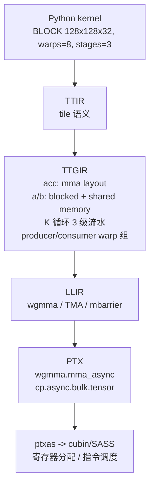

# 6. 生态与实现分析

本章做两件事：给出现状对比表（Triton / Inductor 生成 kernel / CUTLASS / cuTile / TileLang / Helion），并概念性地解读"一个 Triton matmul kernel 如何一步步变成 PTX 级产物"。

## 6.1 生态对比总表

| 维度 | Triton | Inductor（生成 Triton） | CUTLASS / CuTe DSL | cuTile | TileLang | Helion |
|---|---|---|---|---|---|---|
| 抽象层级 | tile 级 kernel DSL | 算子图（全自动） | 线程/warp 级模板+DSL | tile 级（类型化内存层级） | tile 级 DSL | 数学循环级 DSL |
| 使用者 | kernel 工程师 | 所有 PyTorch 用户 | 厂商/引擎团队 | kernel 工程师 | 芯片厂商/引擎团队 | kernel 工程师 |
| 控制粒度 | tile/布局（Gluon 更细） | 几乎无（config 开关） | 极细（指令级） | tile/层级 | tile/pipeline 原语 | 循环结构 |
| 后端覆盖 | NVIDIA/AMD/CPU 实验中 | 跟随 PyTorch 后端 | NVIDIA 全家族 | Blackwell 限定 | NVIDIA/AMD/昇腾/Metal/CPU 实验 | Triton 能到的地方 + TPU |
| 典型产出 | 单个 kernel cubin | 整模型 wrapper + kernel 集合 | 单 kernel / 模板实例 | 单 kernel cubin | 多后端 kernel | Triton 源码 |
| 学习曲线 | 中 | 零（对用户透明） | 陡 | 中 | 中 | 平缓 |
| 2026 年现状 | 3.8.x，自动 WS 成熟 | PyTorch 2.14，多后端竞速 | 4.8.x，Rubin 支持 | CUDA 13.1+，随 Blackwell 放量 | v0.1.13，多后端扩张 | public beta，TPU 后端落地 |

补充说明几组关系：

- **Inductor 生成 Triton ≠ Triton**：前者是"编译器自动写 Triton"，产物风格固定（模板化）；后者是"人写 Triton"，可以表达任意结构。Inductor 搞不定的 kernel（新 attention 变体、MoE 路由融合）往往需要人写 Triton 补上。
- **CUTLASS 与 cuTile 是互补**：CuTe DSL 管"专家级表达 + 模板"，cuTile 管"声明式快速开发"，4.6 起通过 Operator API 互相调用。
- **TileLang 与 TVM**：TileLang 构建在 Apache TVM 的 IR 与 pass 设施上（TIRX），可视为"TVM 思想在 kernel DSL 时代的复兴"。
- **Helion 依赖 Triton**：Helion 是 Triton 的上游（生成 Triton 源码），不是替代者。

## 6.2 源码级解读：一个 Triton matmul 的编译旅程

以 5.1 节的 `matmul_kernel`（BLOCK_M=BLOCK_N=128, BLOCK_K=32, num_warps=8, num_stages=3）为例，跟踪它的编译产物（概念层面，非逐字引用）。

**第 1 站：TTIR（语义不变，硬件无关）**

kernel 体被解析成 tile 级操作序列：program_id 计算、arange 生成坐标、循环内的 load/dot/store。此时还看不到任何线程、寄存器、shared memory——这正是 Triton 抽象的核心：**IR 停留在"每个 program 处理一块 tile"的语义层**。

**第 2 站：TTGIR（布局与并行策略落地）**

这是最有料的一层。编译器为每个 tensor 选定**分布式布局**：

- `acc`（128x128 fp32 累加器）→ `mma` layout：由 8 个 warpgroup 的 Tensor Core 指令分布持有；Hopper 上映射到 `wgmma`，Blackwell 上映射到 `tcgen05.mma` 并把累加器放进 TMEM。
- `a`/`b` 的 load → `blocked` layout，同时插入 `local_alloc`（shared memory 分配）与 `async_copy`（TMA 或 cp.async）。
- K 循环按 `num_stages=3` **流水展开**：三段 shared memory buffer 轮转，load(k+2) 与 dot(k) 重叠——这就是 5.3 节自动 warp specialization 的产物（3.4+ 版本会把 producer/consumer 拆到不同 warp 组）。
- 插入 `convert_layout`：load 的 blocked 布局 → mma 需要的操作数布局，经 shared memory 完成（swizzle 模式在此确定，目标是零 bank conflict）。

**第 3 站：LLIR（指令映射）**

每个 TTGIR op 落到 NVVM intrinsic：`tt.dot` → `wgmma.mma_async` 序列；`local_load/local_store` → shared memory 的 `ldmatrix`/`stmatrix` 或 Blackwell 的 `tcgen05.cp`；同步 → `mbarrier.arrive/wait`。寄存器分配此时仍未定（留给 ptxas）。

**第 4 站：PTX 与 SASS（硬件后端的最后两公里）**

- PTX：接近汇编的文本形式，还能看到 `wgmma`、`cp.async.bulk.tensor`（TMA）这些指令级语义。
- ptxas：做寄存器分配、指令重排、双发射调度。Triton 3.7/3.8 改进了溢出诊断（带源码行号的 spill report）——**生产上调 Triton kernel 的第一手资料就是 ptxas 的 spill 警告**。

一张总览图：



**为什么这一步值得读懂**：性能问题的归因都在这一链路上——spill 多（第 4 站）、bank conflict（第 2 站 swizzle）、流水线断流（第 2 站 stages/WS）、布局转换频繁（第 2 站 convert_layout）。本主题 Mini Demo 的 `triton_like.py` 模拟的就是第 1-2 站的 program/tile 语义。

## 6.3 Inductor 生成 kernel vs 手写 Triton：实例对照

同一个 RMSNorm，两条路线：

```text
路线 A（Inductor）：torch.compile(model) 自动生成，zero 开发成本，
                   质量稳定在中上水平，通用 shape 都覆盖。
路线 B（手写 Triton）：vLLM 的 fused_add_rms_norm 这类 kernel，为特定
                   shape 分布（decode 小 batch / prefill 大 batch）分别调优，
                   上限更高，但每变体要人维护。
```

2026 年的工程现实是**混合体**：LayerNorm/RoPE/elementwise 全交给 Inductor；attention、MoE grouped GEMM、量化 GEMM 由引擎团队手写（Triton 或 CUTLASS）。分界线是"该算子的性能方差是否值得人肉投入"（详见第 9 章）。

## 6.4 版本速查（截至 2026-10）

| 系统 | 最新版本 | 节点 |
|---|---|---|
| Triton | 3.8.0（2026-08） | Rubin SM107 初步支持；FpSan/GSan sanitizer；Gluon aggregate 类型公有化 |
| PyTorch / Inductor | 2.14.x | NVGEMM（CuTeDSL/CUTLASS 进 autotune 竞速）；Inductor 支持 sm_107 |
| CUTLASS | 4.8.0（2026-09） | Rubin dense GEMM；TMEM 576 列；cute_ext 预览 |
| cuTile | CUDA 13.1+（2025-12 起） | Blackwell 限定；Tile IR → MLIR 管线 |
| TileLang | v0.1.13（2026-08） | 多后端 dialect；昇腾 950 支持（2026-09） |
| Helion | public beta（2025 PyTorch Conf） | TPU 后端（Pallas），约 79% MFU FlashAttention |
| Mirage / MPK | OSDI'25 / OSDI'26 | megakernel 编译 + persistent runtime |

## 本章小结

- 生态呈"塔形"：Helion/TileLang（高层或多后端 DSL）→ Triton/cuTile（tile 级主力）→ Gluon/CuTe（专家级）→ PTX/SASS；Inductor 在塔外自动生成整条链。
- 读 Triton 编译产物要会定位四层：TTIR（语义）→ TTGIR（布局/流水/WS）→ LLIR（指令）→ SASS（寄存器/调度）。
- 生产是混合体：通用算子交给编译器，性能敏感算子手写，分界线是性能方差是否值回人力。
