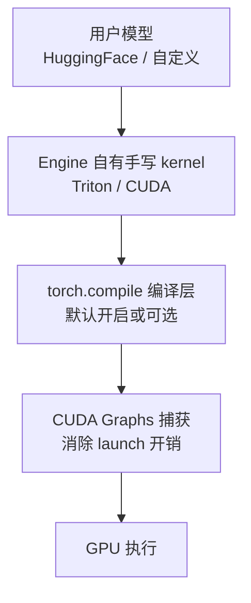

# 8. 企业生产实践

编译器不是孤立存在的——它嵌在推理引擎、训练框架、芯片厂商的工具链里。本章看 2026 年真实生产环境中 AI 编译器的用法、坑与演化方向。

## 8.1 推理引擎如何使用编译器

vLLM 与 SGLang 这两大业界主流引擎的 kernel 策略高度同构，可以分为四层：

| 层 | vLLM | SGLang |
|---|---|---|
| 手写 kernel | PagedAttention、量化 GEMM、MoE（Triton 为主） | RadixAttention、融合算子（Triton 为主） |
| torch.compile | 支持对 model forward 做整图编译（compilation level 可配） | `enable_torch_compile` 开关，对 forward 编译 |
| CUDA graphs | 默认开启，按 batch size 桶捕获 | 默认开启，decode/prefill 分别捕获 |
| 自定义扩展点 | custom op 注册 + piecewise 编译 | 同左 |

两个值得记住的工程细节：

1. **piecewise compilation**：整图编译遇到动态控制流（如 vLLM 里采样逻辑、variable-length 的 attention metadata 处理）会频繁断图，因此生产上更常用"分段编译"——把计算密集的 Transformer 层编成图，把 host 侧逻辑留在图外，配合 CUDA graphs 分段捕获。
2. **编译与调度的耦合**：torch.compile 的 guard 校验与 CUDA graph 的固定 shape 要求，把"batch size 分桶"（padding 到固定桶）变成行业标准做法——见 [vLLM 主题](/04-llmops/vllm/05-core-modules) 的 continuous batching 与 [GPU 与 CUDA](/01-foundation/gpu-cuda/) 的 CUDA graphs 章节。

## 8.2 torch.compile 在生产中的坑

以下是从业者最常遇到的五类问题（2026 年视角）：

| 坑 | 表现 | 缓解 |
|---|---|---|
| **首次编译延迟** | 服务启动要几分钟到几十分钟 | 预编译 + Inductor cache 持久化（本地 FX graph cache / remote cache）；镜像内置编译产物 |
| **动态 shape 重编译** | 新 shape 触发重编译，延迟毛刺 | 开启 `dynamic=True` 自动符号化；或统一分桶让 shape 集合有限 |
| **graph break 碎片化** | 断点过多导致编译收益被 Python 开销吃掉 | 用 `torch._dynamo.explain` 定位断点；无法消除的 host 逻辑移到图外集中处理 |
| **精度回退/数值差异** | 编译后 loss/输出与 eager 有微小差异 | 定位融合 kernel（尤其 reduction 的重排序）；必要时对敏感算子回退 eager |
| **调试栈断裂** | 报错堆栈指向生成的 Triton 代码 | `TORCH_LOGS=output_code` 导出生成代码；配合 `TORCH_COMPILE_DEBUG` 保留中间产物 |

经验法则：**编译问题排查的第一步永远是拿到 Inductor 生成的 wrapper 与 kernel 源码**，而不是在 Python 层猜。

## 8.3 CUDA Graphs 与编译器的共生

CUDA graphs（见 [GPU 与 CUDA](/01-foundation/gpu-cuda/)）解决 launch 开销，编译器解决 kernel 质量，两者是乘法关系：

- decode 阶段 batch 小、kernel 多，launch 开销可占 20-40% 时间——CUDA graphs 几乎免费获得这部分收益；
- 但 CUDA graphs 要求**固定的内存地址与形状**，这反向塑造了推理引擎的设计：KV cache 池化、paged 布局、batch 分桶、静态 shape 编译（dynamic=False 的 piece 模式）。
- PyTorch 2.8 起 Inductor 支持 graph partitioning：一张 FX 图内部被切成"可捕获段"与"不可捕获段"，自动围绕不可捕获算子拆分 CUDA graph——这大幅降低了引擎自己管理捕获边界的成本。

## 8.4 训练侧的编译器实践

推理之外，编译器在训练侧的渗透更渐进：

- **单卡训练**：`torch.compile` 对中小型模型普遍有 1.1-1.5 倍吞吐收益（主要来自融合），大模型受通信主导收益收窄；megatron 类框架通常只对局部模块开编译。
- **编译与分布式协同**：ZeRO/FSDP 的 all-gather/reduce-scatter 与计算重叠（overlap）是分布式训练的核心优化，编译器正在把"通信算子"也纳入图内（Inductor 的 DDP 优化、XLA 的 SPMD 分区）——但 2026 年这仍是半手工状态。
- **FlexAttention**：PyTorch 2.5 引入的 `flex_attention` 把"自定义注意力掩码/分数变换"变成可编译对象，2.11 在 Hopper/Blackwell 上接 FlashAttention-4 后端——这标志着"注意力变体"从手写 kernel 竞赛转向编译器扩展点。

## 8.5 芯片厂商的编译器栈

多极化硬件时代，每家有编译器栈：

- **NVIDIA**：Triton 的事实标准后端 + CUTLASS/cuTile 官方栈 + TensorRT/TensorRT-LLM 全编译引擎（见 [TensorRT-LLM](/04-llmops/tensorrt-llm/)）。2.13/2.14 的 Inductor CuTeDSL 后端意味着"PyTorch 官方编译器"与"厂商模板库"正式合流。
- **AMD**：Triton 的 ROCm 后端是 MI300/MI350 上 kernel 生产的主力（3.5-3.7 版本持续增强，gfx1250 支持 warp specialization）；MIGraphX 提供全编译路线。
- **华为昇腾**：CANN 工具链 + MindSpore/torch_npu；TileLang 对昇腾 950 的官方支持（2026-09）提供了 DSL 级新选择。
- **Apple**：MLX 生态 + Inductor MPS 后端；2.13 的 FlexAttention on MPS 报告了相对 SDPA 约 12 倍的稀疏模式加速。
- **Intel**：XPU 后端进 PyTorch 主线；Triton 的 Intel 分支（triton-cpu / xpu）活跃。

对基础设施团队的含义：**跨硬件可移植性越来越依赖"上层图 IR（StableHLO/TorchInductor）+ 下层多后端 DSL（Triton/TileLang）"的组合**，而不是单一编译器通吃。

## 8.6 演进方向：megakernel 与编译-调度融合

OSDI'26 的 MPK（Mirage 后继）展示了激进方向：把整个 LLM 推理编译成单个 persistent megakernel，层间调度、通信（NVSHMEM）全部在 kernel 内完成，报告 1.2-6.7 倍端到端延迟下降。与今天"引擎调度 + 编译 kernel + CUDA graphs"的三层结构相比，它把调度器也编译了进去。

2026 年这还不是主流（生态与调试工具都未就绪），但它指出了一个趋势：**随着编译器能看到的程序越来越大，运行时能做的优化越来越少**。对做推理引擎的人，这意味着"引擎的核心竞争力"正在从调度算法部分地向"编译产物质量"迁移。

## 本章小结

- vLLM/SGLang 的典型架构：手写 Triton kernel（attention/量化/MoE）+ torch.compile（forward）+ CUDA graphs（launch 消除）+ 分桶静态 shape。
- torch.compile 生产五坑：首次编译延迟、动态 shape 重编译、graph break、精度差异、调试断裂；排查第一步是导出 Inductor 生成代码。
- CUDA graphs 与编译器互相塑造：固定地址/形状要求催生了 KV cache 池化与 batch 分桶。
- 厂商栈多极化，跨硬件可移植性依赖"上层图 IR + 下层多后端 DSL"组合。
- megakernel 范式预示"调度也被编译掉"的未来，引擎竞争力向编译产物迁移。
