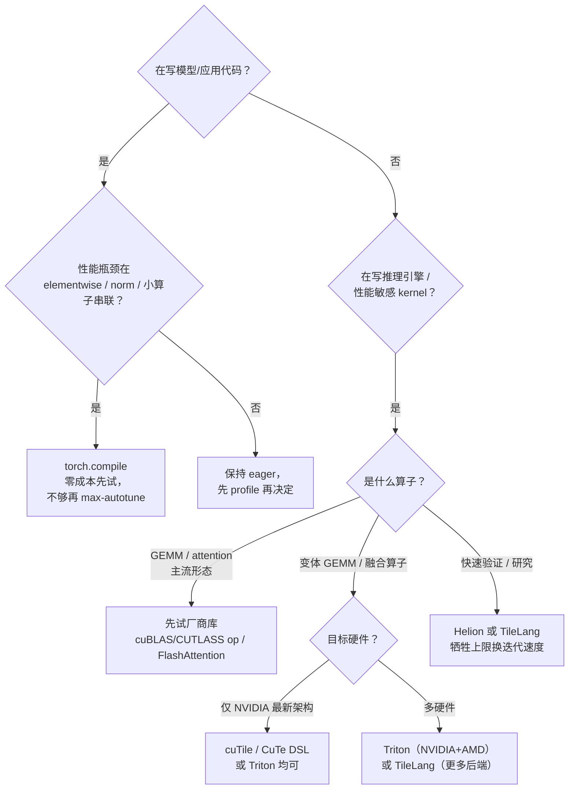

# 9. 最佳实践

## 9.1 决策树：什么时候用什么

核心原则一句话：**先用零成本的（torch.compile），再用可移植的（Triton/TileLang），最后才用极致的（CUTLASS/cuTile/Gluon）**。每一层的迁移成本都是上一层的数倍。

## 9.2 torch.compile 使用清单

1. **从默认模式开始**：`torch.compile(fn)`。收益不够再上 `mode="reduce-overhead"`（自动配 CUDA graphs）或 `mode="max-autotune"`（GEMM 走 autotune + CPP wrapper）。
2. **动态 shape 显式声明**：服务有多变 batch 时用 `dynamic=True` 或 PyTorch 2.14 的 `@dynamic_spec` 声明性动态形状，避免每个新 shape 重编译。
3. **断点要治理**：`torch._dynamo.explain(fn)(args)` 输出断点位置；把 host 逻辑（打印、断言、Python 数据结构操作）移出热点函数。
4. **精度敏感区回退**：对数值敏感的 reduction/softmax 可用 `torch._dynamo.config` 或 custom op 边界保护。
5. **缓存即资产**：生产环境持久化 Inductor cache（`TORCHINDUCTOR_CACHE_DIR` 挂卷 / remote cache），把编译时间从启动路径上移除。
6. **测量再保留**：编译前后各跑一轮端到端 benchmark；个别模型编译反而变慢（图太小、断点太多），不要默认开。

## 9.3 手写 Triton 的使用清单

1. **先确认 Inductor 搞不定**：用 `TORCH_LOGS=output_code` 看 Inductor 为该算子生成的 kernel，确认它是"模板不匹配"还是"配置没调优"——后者调 autotune 配置即可，不必手写。
2. **从教程骨架开始**：Triton 官方 matmul / fused-softmax 教程覆盖了 90% 的模式；在小 shape 上验证正确性（`tl.testing` 或 numpy 对拍），再上真实 shape。
3. **BLOCK 尺寸与硬件对齐**：BLOCK_M/N 取 16 的倍数（Tensor Core 对齐），BLOCK_K 覆盖 K 的主要公约数；num_warps=4/8，num_stages=2-4 起步，交给 `@triton.autotune` 搜索。
4. **用 Triton 自带工具看中间产物**：`TRITON_ALWAYS_COMPILE=1 TRITON_DUMP_DIR=...` 可 dump TTGIR/PTX；学会读 TTGIR 的 layout 与 convert_layout 数量（6.2 节）。
5. **关注 ptxas 警告**：spill（寄存器溢出）是性能第一杀手；3.7+ 的 spill report 带源码行号，直接定位。
6. **Gluon 是逃生舱**：当自动 WS 失效、需要显式 TMEM 管理或极致布局控制时，再下沉到 Gluon——代价是失去硬件无关性。

## 9.4 跨硬件与厂商栈选择

| 场景 | 推荐 |
|---|---|
| 只在 Blackwell 上榨性能 | cuTile（声明式）或 CuTe DSL / CUTLASS（模板库，4.8 已支持 Rubin） |
| NVIDIA + AMD 双栈 | Triton（ROCm 后端是 AMD 官方投入方向） |
| 还要覆盖昇腾 / Apple / CPU 实验 | TileLang（TileLang-X 多后端） |
| 想要最少代码量 + 内建 autotune | Helion（编译到 Triton，beta 阶段需评估稳定性） |
| JAX/TF 体系 | XLA + StableHLO；需要自定义 kernel 时走 Pallas（TPU）或 Triton（GPU） |

## 9.5 调试工具箱

按排查问题的层次排列：

| 层次 | 工具 | 看什么 |
|---|---|---|
| 图捕获 | `torch._dynamo.explain`、`TORCH_LOGS=graph_breaks` | 断在哪里、为什么 |
| 生成代码 | `TORCH_LOGS=output_code` | Inductor 生成的 wrapper + Triton 源码 |
| kernel 编译 | `TRITON_DUMP_DIR`、`MLIR_ENABLE_DUMP` | TTIR/TTGIR/LLIR 逐级产物 |
| 运行时 profile | Nsight Compute、torch profiler | 每 kernel 耗时、HBM 流量、occupancy、spill |
| 数值对拍 | eager vs compiled 双跑 + allclose | 定位数值回退的具体算子 |

典型排查路径：**profile 发现某 kernel 慢 → output_code 找到它 → 看生成代码结构是否合理 → 不合理则调 Inductor config 或手写 Triton 替换；手写后仍慢 → NCU 看流量/占用率 → 调 tile/调 stages**。

## 9.6 团队协作与工程化

- **编译产物纳入 CI**：对关键模型跑编译回归（编译时间、数值一致性、性能基线），防止框架升级引入静默回退。
- **kernel 评审看产物**：Triton code review 时要求附 TTGIR 或 NCU 截图，避免"看起来对但没验证布局"的合并。
- **维护内部 autotune cache 服务**：多机共享编译缓存，避免每台机器重复付编译成本。
- **写清"为什么不手写"**：为每个手写 kernel 留一段注释说明 Inductor 替代方案的测量数据——半年后没人记得当时的决策依据。

## 本章小结

- 决策顺序：torch.compile → Triton/TileLang → CUTLASS/cuTile/Gluon；每层迁移成本递增。
- torch.compile 的关键治理点：动态 shape、graph break、缓存持久化、编译前后实测。
- 手写 Triton 前先确认 Inductor 真搞不定；BLOCK 对齐、autotune、读 TTGIR、盯 spill。
- 调试按层推进：断点 → 生成代码 → IR 产物 → NCU → 数值对拍。
