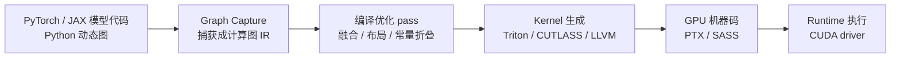

# AI 编译器与 Kernel 生成

> 一句话理解：**AI 编译器是把 PyTorch/TensorFlow 写的高层级模型，自动翻译成 GPU 上跑得最快的机器码（kernel）的系统**。它决定了同一张 H100 上你的模型能跑出 30% 还是 80% 的理论算力。

::: warning 此 Triton 非彼 Triton
本手册 [04-llmops/triton](/04-llmops/triton/) 讲的是 **NVIDIA Triton Inference Server**（推理服务框架）。本主题讲的是 **OpenAI Triton 语言与编译器**（GPU kernel 编程语言），两者只是撞名。本主题中出现的 "Triton" 如无特殊说明，均指 OpenAI Triton。
:::

## 什么是 AI 编译器

传统编译器（GCC/Clang）翻译的是 CPU 程序；**AI 编译器**翻译的是**张量计算程序**：

代表系统按"抽象层级从高到低"排列：

| 系统 | 出品方 | 定位 |
|---|---|---|
| **torch.compile / Inductor** | PyTorch | PyTorch 官方编译栈，默认后端生成 Triton kernel |
| **XLA / StableHLO** | Google / OpenXLA | JAX 与 TensorFlow 的编译器，多硬件可移植 |
| **Triton** | OpenAI | GPU kernel 编程语言 + 编译器， tile 级抽象 |
| **CUTLASS / CuTe DSL / cuTile** | NVIDIA | 官方 kernel 模板库与 Python DSL，直接喂 Tensor Core |
| **TileLang** | 清华大学 / Tile-AI（基于 Apache TVM） | 声明式 tile DSL，多后端（NVIDIA/AMD/昇腾/Metal） |
| **Helion** | Meta | 高层 kernel DSL，编译到 Triton，autotune 内建 |
| **Mirage / MPK** | CMU 等（OSDI'25/'26） | 多级超优化器，把整层甚至整网编译成 megakernel |
| **TVM (Relax/TensorIR)** | Apache | 老牌深度学习编译器框架，IR 基础设施被大量复用 |
| **MLIR** | LLVM 项目 | 编译器基础设施（dialect 体系），不是编译器本身 |

## 为什么 AI 编译器是"基础设施"问题

LLM 推理引擎（vLLM/SGLang/TensorRT-LLM）的火热掩盖了一个事实：**它们的性能上限大多由编译层决定**——

- **kernel 质量决定 MFU**：同一个 GEMM，cuBLAS 能到 85% 峰值， naive PyTorch eager 可能只有 40%。推理引擎里的 FlashAttention、MoE grouped GEMM、quantized GEMM，几乎都是"编译生成或手写调优"的产物。
- **算子碎片化没有尽头**：每来一个新硬件（H100 → B200 → Rubin → MI300 → 昇腾）、新数据类型（FP8/FP4/NVFP4）、新算子（Muon 优化器、稀疏注意力），都需要新 kernel。靠手写 CUDA 永远追不上。
- **eager 执行的税太重**：PyTorch eager 模式下，一个 `LayerNorm` 要 launch 4-6 个小 kernel，每个 kernel 都有一次 launch 开销和一次 HBM 往返。编译器通过融合把 6 个 kernel 变 1 个。

## 2024-2026 年为什么爆发

- **2024-07：Triton 3.4 引入 Automatic Warp Specialization**——编译器自动把 producer/consumer warp 分组重叠执行， Hopper/Blackwell 上 attention/GEMM 类 kernel 不再需要手写复杂流水线。
- **2025：Gluon 成熟**——Triton 团队开放的"Triton 之下、CUDA 之上"的 tile IR 级 DSL，FlashAttention 4 用它重写，性能超过手写 CUDA。
- **2025-12：NVIDIA 发布 cuTile**——CUDA 13.1 内置的 Python tile 编程模型（`@ct.kernel` / `ct.mma` / TMA 语义），编译管线 Python AST → Tile IR → MLIR → SASS；Blackwell 上 60 行 Python 写出 2.5 倍 FlashAttention-2 的 fused attention。
- **2025-2026：编译器进入推理引擎主链路**：PyTorch 2.14 的 Inductor 已能把 CuTeDSL 生成的 CUTLASS kernel（NVGEMM）与 Triton、ATen 放在一起 autotune；vLLM/SGLang 全面拥抱 `torch.compile` + CUDA graphs。
- **2026：megakernel 范式兴起**：OSDI'26 的 MPK（Mirage 后继）把 LLM 推理编译成单个大 kernel，端到端延迟下降 1.2-6.7 倍，"编译器消灭调度器"成为新叙事。

## 本主题结构

1. [背景与动机](01-background)：手写 CUDA 之殇、算子碎片化、硬件演进
2. [核心思想](02-core-ideas)：graph capture、融合、tiling、调度、auto-tuning、cost model
3. [架构设计](03-architecture)：AI 编译器的分层与 MLIR dialect 思想
4. [编译工作流程](04-compilation-workflow)：torch.compile → Inductor → Triton kernel 全链路
5. [核心模块](05-core-modules)：Triton 编译 pipeline、Inductor 调度器、warp specialization、cuTile 内存层级
6. [生态与实现分析](06-ecosystem-analysis)：Triton vs CUTLASS vs TileLang vs Inductor 对比，matmul kernel 编译产物解读
7. [工程实践：Mini Demo](07-mini-demo)：纯 Python 实现 graph IR + 融合 + 调优 + tile 模拟
8. [企业生产实践](08-production-practice)：vLLM/SGLang 的编译器使用、torch.compile 的坑、CUDA graphs
9. [最佳实践](09-best-practices)：什么时候 compile、什么时候手写 Triton、调试技巧
10. [面试题](10-interview-questions)
11. [延伸阅读](11-further-reading)

## 学习目标

读完本主题后，你应该能够：

- 解释 AI 编译器与传统编译器的差异，以及它为什么性能攸关
- 画出 torch.compile 的完整链路，说明 Dynamo/Inductor/Triton 各自职责
- 说明算子融合、tiling、auto-tuning、cost model 的核心思想
- 比较 Triton、CUTLASS/CuTe DSL、cuTile、TileLang、Helion 的抽象层级与适用场景
- 在生产环境中决定"什么时候开 torch.compile、什么时候手写 Triton"
- 读懂一个 Triton matmul kernel 从 Python 到 PTX 的编译旅程（概念层面）

## 相关主题

- [Triton Inference Server](/04-llmops/triton/)：撞名提醒——那是推理服务框架，不是 OpenAI Triton
- [GPU 与 CUDA](/01-foundation/gpu-cuda/)：kernel 最终运行的硬件与编程模型
- [vLLM](/04-llmops/vllm/)：torch.compile + CUDA graphs 的最大用户之一
- [SGLang](/04-llmops/sglang/)：RadixAttention 之外，同样重度依赖 Inductor/Triton
- [TensorRT-LLM](/04-llmops/tensorrt-llm/)：另一条"全编译"路线（TensorRT 引擎）
- [分布式系统](/01-foundation/distributed-systems/)：编译器生成的 kernel 如何与通信算子协同
