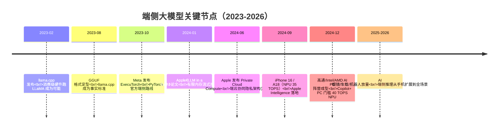

# 1. 背景：端侧 AI 的爆发与四面墙

> 一句话理解：2024-2026 年，大模型从「云端 API」走进「每台设备」——驱动它的是延迟、隐私、成本与离线四股力量；拦住它的是功耗、内存、带宽与散热四面墙。端侧推理基础设施的全部工作，就是在墙的夹缝里把模型跑起来。

## 1.1 四股推动力：为什么模型必须上设备

### 延迟：交互体验的最后一公里

云端推理的时延底线是网络：4G/5G 环境下一次 RTT 往往 100-300 ms，加上排队与首 token，总时延常以秒计。语音助手、实时翻译、AR 标注这类交互场景要求端到端时延压在 300 ms 以内——这不是优化能解决的，而是物理距离决定的。**把模型放到设备上，是延迟问题的结构性解法**。

### 隐私：数据不出设备是最强合规

健康记录、相册、聊天记录、车内影像——最有价值的个人数据恰恰是最敏感的数据。端侧推理让原始数据永远不离开设备，从架构上消除了「服务商是否偷看」的信任问题。Apple Intelligence 的「端侧优先」策略、欧盟 GDPR 与企业数据主权要求，都把隐私从「加分项」变成了「入场券」。

### 成本：推理经济学的规模翻转

云端 API 按 token 计费，用户量越大账单越高；端侧推理的边际成本是电。对月活上亿的 App，把高频、短输出请求下沉到端侧，云端成本可下降一个数量级。反过来，端侧设备为模型付了「固定成本」（NPU 硅片面积），不跑模型就是浪费——硬件厂商有强烈动机把生态做起来。

### 离线：连接不是理所当然

飞机上、隧道里、地下车库、灾害应急——弱网与断网场景真实存在。对工业巡检、车载、户外机器人，**离线可用不是体验问题而是功能正确性问题**。

## 1.2 端侧 AI 爆发时间线

几个标志性事实（均为一手来源口径，截至 2026-10）：

- **llama.cpp** 持续高频迭代，2026-10-15 发布 v0.7.0（ggml v0.27.0），新增 LiliCorr 投机解码、GLM5-Next MTP 支持，服务器默认端口改为 9931（[GitHub Releases](https://github.com/ggml-org/llama.cpp/releases)）。
- **ExecuTorch** 2026-09-23 发布 v1.5.1，Qualcomm QNN、Apple Core ML、XNNPACK 三条 delegate 线并行推进（[GitHub Releases](https://github.com/pytorch/executorch/releases)）。
- **Apple** M4 代际 Neural Engine 标称 38 TOPS（Apple 官方口径），A18 为 35 TOPS；Private Cloud Compute 于 2024-06-10 随 Apple Intelligence 发布，安全白皮书公开于 [Apple Security Blog](https://security.apple.com/blog/private-cloud-compute/)。
- **AI PC**：微软 Copilot+ PC 认证要求 NPU 算力 ≥ 40 TOPS，高通 Snapdragon X Elite（Hexagon NPU 45 TOPS）、Intel Lunar Lake（48 TOPS）、AMD Strix Point 达标。
- **边缘节点**：NVIDIA JetPack 7.2.1（L4T 39.2.1）已支持 Jetson AGX Thor 与 Orin 全系，JetPack 6.2.3（L4T 36.5.2）为 Orin 的 6.x 最新版（[JetPack 归档](https://developer.nvidia.com/embedded/jetpack-archive)）。

## 1.3 四面墙：端侧设备的硬约束

### 功耗墙：一切优化的母约束

数据中心单卡功耗 700 W 起步，手机整机持续功耗预算只有 **3-5 W**（SoC 分到 NPU 的往往不足 2 W）。NPU 的 TOPS 数字大多是「峰值」——只在极短时间、满电压频率下可达。持续推理几分钟后，温度上升触发 DVFS 降频，性能可能只剩峰值的 60-70%。**端侧系统设计的是持续性能，不是峰值性能**。

### 内存墙：容量与带宽的双重短缺

| 设备形态 | 统一内存容量 | 内存带宽（约） | 整机持续功耗 | 典型 NPU（标称峰值） |
|---|---|---|---|---|
| 旗舰手机 | 8-16 GB | 60-80 GB/s（LPDDR5X） | 3-5 W | 35-45 TOPS |
| AI PC | 16-64 GB | 100-200 GB/s（LPDDR5X/DDR5） | 15-28 W | 40-50 TOPS |
| AR 眼镜 | 4-8 GB | 30-70 GB/s | 1-3 W | 10-30 TOPS |
| 车载座舱 | 8-32 GB | 60-200 GB/s | 5-15 W | 30-100+ TOPS |
| 边缘盒子（Jetson Orin） | 8-64 GB | 102-204 GB/s | 10-60 W | 67-275 TOPS |
| 数据中心 GPU（对照） | 80-192 GB HBM | 3.4-8 TB/s | 700-1200 W | 数百到上千 TOPS |

两个尖锐对比：手机内存带宽仅为 H100 的约 1/50，而 8B 模型 FP16 权重 16 GB——**连装都装不下，更别说跑**。这就是为什么端侧推理的第一工具是量化（把 16 GB 压到 5 GB 以内），第一指标是「每 token 搬多少字节」而不是 TOPS。

### 散热墙：持续性能的隐形天花板

手机没有风扇，热量只能经机身传导到空气。SoC 温度超过阈值后触发热节流（thermal throttling）：先降 GPU/NPU 频率，再降大核。后果是：**跑分性能 ≠ 连续对话 10 分钟的性能**。端侧 benchmark 必须报「30 秒稳态」数字，这也是第 2 章持续性能思想的由来。

### 软件墙：生态碎片化

云端 CUDA 一家独大；端侧是六国混战：Apple 的 Core ML/MLX、高通的 QNN、联发科的 NeuroPilot、ARM 的 CMSIS-NN、各家 NPU 私有 SDK……同一个模型要适配 5+ 套工具链，且各家的算子支持度、量化格式、内存模型都不兼容。**格式与运行时的碎片化本身就是端侧最大的工程成本**。

## 1.4 端侧 vs 云端：同一问题的两个极端

| 维度 | 云端 serving（vLLM 等） | 端侧推理（本主题） |
|---|---|---|
| 优化目标 | 吞吐（tokens/s/卡）、利用率 | 单请求时延、持续性能、功耗 |
| batch 策略 | 越大越好（continuous batching） | 通常 batch=1，投机解码制造「小 batch」 |
| 内存模型 | 显存充足，KV 可分层/驱逐 | 统一内存，容量硬顶，KV 量化是刚需 |
| 硬件 | 同构 GPU 集群 | NPU/GPU/CPU 异构，算子要回退 |
| 失效成本 | 请求排队、降级 | OOM 即崩溃，热节流即降速，不可「扩容」 |
| 更新方式 | 热部署、蓝绿发布 | 应用商店审核周期，灰度慢、回滚难 |

## 1.5 本章小结

端侧 AI 的爆发是真实且不可逆的，但它不是云端能力的简单平移：四股力量（延迟、隐私、成本、离线）决定了「必须做」，四面墙（功耗、内存、带宽、散热）决定了「难做」。接下来的核心思想章节，就是把这四面墙翻译成可计算的工程约束。
