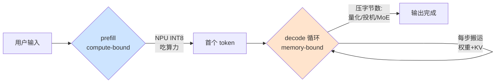
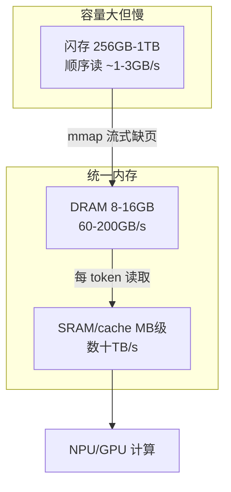

# 2. 核心思想：带宽账、异构账与隐私账

> 一句话理解：端侧推理的全部设计可以归结为三本账——**带宽账**（每生成一个 token 要搬多少字节）、**异构账**（每个算子该在哪颗芯片上跑、回退要花多少钱）、**隐私账**（这份数据允许离开设备吗）；格式、运行时与路由分别是三本账的记账工具。

## 2.1 带宽账：decode 是被带宽决定的

### 一行公式

LLM decode 每生成 1 个 token，都要把这一步参与计算的所有权重（以及增长的 KV cache）从内存完整读一遍。算术强度极低，因此：

```text
decode 吞吐上限（tok/s） = 内存带宽（GB/s）× 带宽兑现率 / 每 token 字节数
每 token 字节数 ≈ 量化权重大小 + KV每token × 当前上下文长度
```

一个旗舰手机画像的实算（与 Mini Demo 场景 1 一致）：LPDDR5X 带宽 68 GB/s、兑现率 0.85、8B 模型 Q4_K_M 权重 5.18 GB/s 级字节 → 上限 **11.15 tok/s**；同带宽下 FP16 权重 16 GB → **3.61 tok/s**。注意两件事：比值 3.09 倍来自位宽 4 倍打折扣（量化元数据开销约 8%）；**NPU 标称的 45 TOPS 在这个公式里根本没出现**——decode 是访存受限，算力再强也无处施展。这就是端侧与云端最根本的差异：云端 H100 的 3.35 TB/s 带宽对 70B 模型才构成束缚，端侧 68 GB/s 对 8B 模型就构成了。

### prefill 与 decode 的分裂

| 阶段 | 瓶颈 | 每步工作量 | 决定因素 | 端侧典型数字 |
|---|---|---|---|---|
| prefill（读入 prompt） | 算力（compute-bound） | 一次处理全部输入 token（大矩阵乘） | NPU/GPU 算力 | 8B INT8 约 150-250 tok/s |
| decode（逐字生成） | 带宽（memory-bound） | 每步只算 1 个 token（矩阵-向量） | 内存带宽 ÷ 权重字节 | 8B Q4 约 8-15 tok/s |

这个分裂直接导出端侧优化的两条主路线：prefill 要快 → 用 NPU 吃算力；decode 要快 → 压每 token 字节数（量化、投机解码、MoE 稀疏化）。



## 2.2 异构账：NPU 是主攻，GPU/CPU 是替补

端侧 SoC 通常有三类算力：**NPU**（低精度矩阵乘最强、功耗最低，但算子支持最窄）、**GPU**（通用性最好、功耗高）、**CPU**（什么都能跑、最慢但常有 NEON/AMX 加速）。没有一个算子图能 100% 跑在 NPU 上——softmax、norm、rope、动态 shape 的算子几乎必然要回退。

回退不是免费的：输出张量要在设备间搬运一次（统一内存也要走片内 fabric），还要等慢设备算完。Mini Demo 场景 3 的实算：seq=512 的一层 prefill，NPU 优先放置下 softmax 和两个 norm 回退 GPU，**回退传输税占单层时延的 16.8%**。工程含义：

1. **算子覆盖度决定 NPU 的实际收益**：宣传 TOPS 要打「算子覆盖率」折扣；
2. **回退要批量做**：与其每个 norm 单独回退，不如把相邻 unsupported 算子融合后一次搬运；
3. **编译期尽量消除回退**：ExecuTorch/MLC 的思路就是在 AOT 编译时把整图 lower 到 delegate 支持的子集，把运行时回退变成编译期报错或图切分。

## 2.3 内存层级账：flash → DRAM → SRAM 的接力

端侧设备没有「显存」概念，统一内存之上还有一个云端不存在的层级——**闪存**（手机 256 GB-1 TB，但读取延迟高、随机访问贵）。它改变了模型加载的经济学：



三个工程结论：

- **mmap 流式加载是默认姿势**：llama.cpp 默认把权重 mmap 进地址空间而非一次性读入——进程启动毫秒级，首次访问才缺页换入（细节见第 4 章与 Mini Demo 场景 4：5.18 GB 模型全量预载 0.076 s，纯按需缺页却高达 7.986 s，预取窗口 32 页把它压回 0.323 s）。
- **工作集小于全量时，懒加载完胜**：若一次会话只触达 30% 权重页，加载成本同比例下降（0.097 s）——这是 Apple《LLM in a flash》一文的洞见：激活是稀疏的，冷权重页可以一直留在闪存。
- **mlock 是双刃剑**：锁定内存换取确定性时延，但挤占 KV 预算，间接缩短上下文。

## 2.4 隐私账：分级决定架构

端云协同的前提是承认一个事实：**有些请求必须留在端侧，有些天然属于云端**。把请求按隐私分级，路由就从「性能优化」变成「硬约束下的优化」：

| 隐私级别 | 示例 | 允许的去处 | 架构含义 |
|---|---|---|---|
| 机密 | 病历、相册、聊天记录 | 仅端侧 | 模型再慢也得跑完；不能因超时偷偷上云 |
| 内部 | 企业文档、工作纪要 | 端侧或企业/私有云（如 PCC） | 需要一条「可审计的私有通道」 |
| 公开 | 百科问答、创作续写 | 端侧或公有云 | 纯性能/成本问题，自由路由 |

Mini Demo 场景 6 把这变成决策表：机密病历摘要无论多慢都被钉在端侧（25.38 s 也认）；公开闲聊因 SLO 3 秒不满足而走公有云（1.54 s）；内部纪要因企业云可用且更快（4.74 s vs 31.07 s）走私有云。**隐私约束必须先于性能约束求值**——顺序颠倒就是数据泄露事故。

## 2.5 持续性能：给峰值数字打七折

端侧性能必须区分三个数字：

```text
峰值性能   = datasheet TOPS/tok/s（几秒真男人）
爆发性能   = 冷机前 30-60 秒的实际表现
持续性能   = 热平衡后的稳态表现（通常 = 峰值 × 0.6-0.7）
```

热节流不是故障而是设计特性：设备优先保证触屏温度与电池安全，NPU 频率是可牺牲的。工程后果：

1. 容量规划必须用持续性能数字，否则长对话后半段必然超时（Demo 场景 6 中「长文续写」就因热节流把端侧估时从约 79 s 放大到 112.88 s）；
2. 交互设计要主动配合热模型——长时间生成任务应分片、可暂停，而不是一个请求跑到底；
3. benchmark 协议要规定「预热 + 稳态测量」，冷启动数字会系统性偏乐观。

## 2.6 投机解码：用算力换带宽的对冲交易

decode 被带宽卡死，而 NPU 算力大量闲置——投机解码（speculative decoding）与 MTP（multi-token prediction）正是利用这个错配：用小 draft 模型（或 MTP 头）猜后面 γ 个 token，target 模型一次并行验证。验证 γ+1 个 token 的带宽成本与验证 1 个几乎相同，只要接受率 α 不太低，单位带宽产出的 token 数就接近翻倍。Mini Demo 用标准几何模型给出：α=0.75、γ=4、draft 成本比 0.15 时加速比 **1.91x**（11.15 → 21.26 tok/s）。第 5 章会展开它的端侧适配细节。

## 2.7 本章小结

三本账各有一个主导公式：

| 账 | 核心公式 | 工程杠杆 |
|---|---|---|
| 带宽账 | tok/s ≈ 带宽 × 兑现率 ÷ 每 token 字节 | 量化位宽、GQA、投机解码、MoE |
| 异构账 | 层时延 = Σ max(算子计算, 访存) + 回退传输 | 算子覆盖度、图融合、编译期 lower |
| 隐私账 | 路由 = 硬约束过滤 → SLO 可行性 → 成本 | 分级标准、私有云通道、降级策略 |

第 3 章把这些账房组织成一套完整的系统架构。
