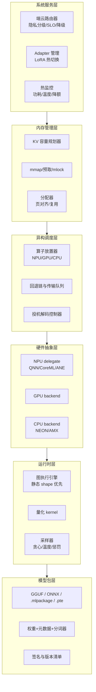
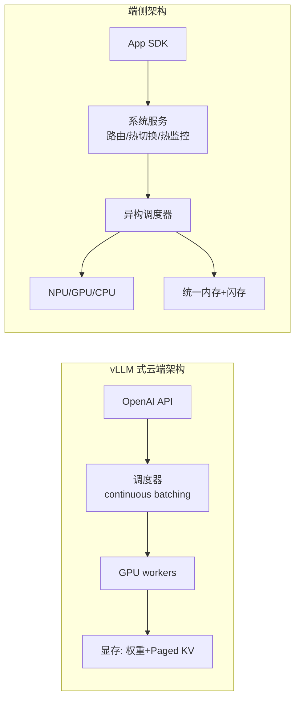

# 3. 架构设计：端侧推理系统的六层架构

> 一句话理解：把端侧推理系统纵向切成六层——**模型包、运行时、硬件抽象、异构调度、内存管理、系统服务**——每一层都对应云端 serving 的一个变体：同源的算法，完全不同的约束与失效模式。

## 3.1 总体分层

数据流是自下而上加载、自上而下执行：模型包被验证后映射进地址空间，运行时把计算图 lower 到硬件后端，调度器在三种芯片间分配算子，内存管理器守着容量红线，系统服务层对应用暴露「一个会路由、会降级的推理 API」。

## 3.2 各层职责与关键决策

### L1 模型包层：格式就是生态位

模型包要同时回答四个问题：权重怎么存（量化格式）、图怎么描述（算子集）、元数据带什么（分词器、特殊 token、 rope 参数）、如何证明可信（签名）。主流格式各有生态位（细节见第 5、6 章）：

| 格式 | 代表工具链 | 典型载体 | 端侧定位 |
|---|---|---|---|
| GGUF | llama.cpp | 手机/PC 原生 App | 社区事实标准，K-quant 丰富 |
| ONNX | ONNX Runtime + QNN/NNAPI/CoreML EP | 跨平台 SDK | 图交换中立格式 |
| .mlpackage | Core ML / coremltools（9.x） | 全部 Apple 平台 | ANE 优先的 Apple 原生 |
| .pte | ExecuTorch（v1.5.x） | Meta 系 App、Android/iOS | PyTorch 生态的 AOT 出口 |
| MLC/TVM 编译产物 | MLC LLM | 浏览器/WebGPU、移动端 | 编译器极致优化路线 |

关键决策是**格式收敛**：一个团队维护两套以上格式打包管线，成本翻倍；实践中常见「GGUF 服务社区/开发者，ONNX/CoreML 服务正式产品」的双轨制。

### L2 运行时层：静态 shape 的纪律

与云端引擎以「可变 batch、动态 KV」为中心不同，端侧运行时普遍倾向**静态 shape 与静态内存规划**：

- 推理前确定最大上下文，KV 池一次性分配（MLC 的 static memory planning 是典范）；
- 图 shape 在编译期固化，避免运行时构图开销与碎片；
- 采样循环手写为紧循环，去掉一切动态分配。

这是「失效成本不对称」逼出来的：云端 OOM 可以排队重试，端侧 OOM 是应用崩溃。

### L3 硬件抽象层：delegate 与 backend 的组合

运行时通过 delegate（ExecuTorch 术语）/ ExecutionProvider（ORT 术语）/ backend（ggml 术语）对接芯片。三种成熟模式的取舍：

| 模式 | 例子 | 优点 | 代价 |
|---|---|---|---|
| 整图 delegate | QNN、Core ML | 零回退、可整图优化 | 图必须可被 delegate 完整吃下 |
| 算子级分派 | ORT EP、ggml backend | 灵活、渐进适配 | 每步一次分派开销，回退税 |
| 编译进 kernel | MLC/TVM、ExecuTorch AOT | 极致性能、shape 特化 | 编译慢、调试难、机型碎片化 |

### L4 异构调度层：放置、回退与投机

调度器维护设备能力表（算子集合、峰值、带宽），对每个算子求值「计算时间 vs 访存时间」的 roofline 下界，再按 2.2 节的回退规则放置。投机解码控制器是这一层的特殊成员：它在 decode 循环里插入 draft-验证子循环，调度 target（NPU）与 draft（可放 GPU/CPU 的小模型）两类工作。

### L5 内存管理层：守红线的人

三条红线：**总容量**（权重 + KV + 激活 < 可用内存，留 OS 余量）、**上下文上限**（KV 预算 ÷ 每 token 字节）、**页效率**（mmap 页对齐、避免碎片）。这一层的产出是两张表——容量规划表（Demo 场景 2 的 19k/39k/78k token 三档）与加载策略表（预载/懒加载/预取窗口，Demo 场景 4）。

### L6 系统服务层：对应用暴露「聪明」的 API

上层应用不想理解量化与拓扑，它要的是 `chat(messages)`。系统服务层在此之上提供三个增值能力：端云路由器（2.4 节）、Adapter 热切换管理（多 LoRA 的注册、驻留与 LRU）、热监控（温度/功耗采样、降额系数反馈给路由器和调度器——超过热预算时主动限长输出、降并发、切云端）。

## 3.3 与云端 serving 架构的对照

| 关注点 | 云端 | 端侧 |
|---|---|---|
| 调度单位 | 请求（batch 内交错） | 算子（图内放置）+ 单请求 |
| 内存主权 | 引擎全权管理 | 与 OS/图形栈共享，需协商 |
| 扩容手段 | 加卡、加实例 | 无。降级、路由、分片是唯一出路 |
| 观测性 |  Prometheus 全家桶 | 严格采样（功耗敏感），以聚合指标为主 |

## 3.4 失效模式清单

端侧架构设计的一半工作量在回答「坏了怎么办」：

| 失效 | 触发 | 缓解 |
|---|---|---|
| OOM | 上下文超预算、内存碎片 | 容量规划 + 预分配 + 超限时主动截断上下文 |
| 热节流 | 长生成、高温环境 | 稳态数字规划 + 输出分片 + 降额反馈路由 |
| 算子回退雪崩 | NPU 覆盖率不足 | 编译期 lower 验证 + 回退税预算（如 ≤15%） |
| 模型包损坏 | 下载中断、存储位翻转 | 签名校验 + 哈希清单 + 原子替换 |
| 路由误判 | 隐私分级错误 | 分级默认从严 + 审计日志 + 用户可改 |

## 3.5 本章小结

六层架构中，L1/L2 决定「能跑什么」，L3/L4 决定「跑得多快」，L5 决定「能撑多久」，L6 决定「用起来多聪明」。下一章沿时间轴走完一个请求，看这些层如何接力。
