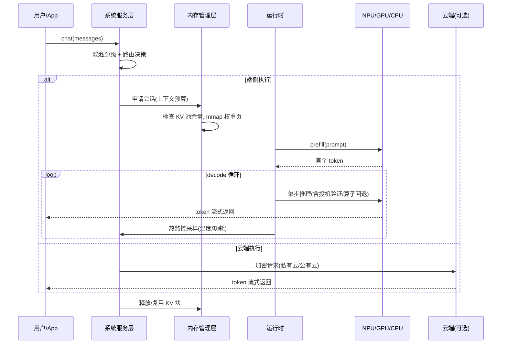
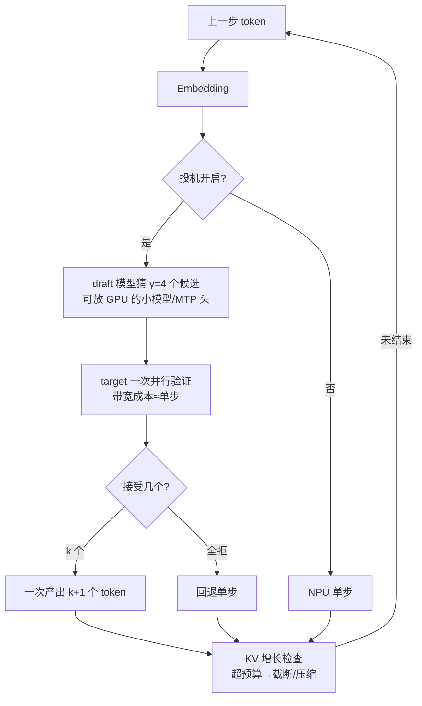

# 4. 工作流程：一次端侧推理请求的完整生命周期

> 一句话理解：从用户按下回车到第一个字出现，端侧请求要穿过**获取 → 验证 → 映射 → 预热 → prefill → decode → 收尾**七个阶段；每个阶段都有自己的预算、坑与降级手段。

## 4.1 生命周期全景

## 4.2 阶段拆解与预算

以旗舰手机跑 8B Q4 模型为例，各阶段量级（经验估计值，用于建立直觉）：

| 阶段 | 内容 | 预算量级 | 常见坑 |
|---|---|---|---|
| 1. 模型获取 | 首次下载/更新模型包 | 百 MB 级，Wi-Fi 后台 | 增量更新（分片下载、断点续传） |
| 2. 验证 | 签名 + 哈希清单校验 | 百 ms 级 | 校验跳过 = 供应链敞口 |
| 3. 映射加载 | mmap 权重页入地址空间 | 冷启动秒级 → 热启动百 ms（见场景 4） | 无预取时缺页风暴 8 s |
| 4. 预热 | 小 prompt 跑通全图、触发缺页与编译 | 1-2 s | 跳过预热 = 首 token 惩罚 |
| 5. prefill | prompt 一次过图 | 8B INT8 约 150-250 tok/s | 超长 prompt 挤占 KV 预算 |
| 6. decode | 逐 token 生成 | Q4 约 8-15 tok/s，叠加 MTP ×1.5-2 | 热节流后半程降速 30% |
| 7. 收尾 | KV 复用/释放、会话状态落盘 | 十 ms 级 | 泄漏 → 下次启动 OOM |

### 阶段 3 的流式加载细节

这是端侧独有的一章。llama.cpp 的做法是默认 mmap：权重文件映射进虚拟地址空间，页表按需建立，首次访问触发缺页，内核按 readahead 窗口预读。三个运营策略：

- **冷启动（首次）**：接受秒级加载，或后台预热（App 启动即映射常用模型）；
- **热启动（常驻）**：mlock 权重防换出，首 token 稳定在百 ms 级；
- **懒加载（多模型）**：按路由结果现映射对应模型，配合 32 页级预取窗口把缺页税压一个数量级（Demo 场景 4：按需 7.986 s → 预取 0.323 s）。

### 阶段 6 的 decode 循环内部

循环里每一圈都要过三道闸：**算子回退**（softmax/norm 不在 NPU 就换 GPU，付 16.8% 量级的传输税——Demo 场景 3）、**KV 红线**（剩余容量不够下一圈就触发截断、压缩或会话迁移）、**热红线**（温度超阈值时降频，吞吐乘 0.6-0.7 系数并上报路由器）。

## 4.3 路由决策穿插点

路由不只在请求入口做一次。至少四个决策点：

1. **入口路由**（主决策）：隐私硬约束 + SLO 可行性 + 成本（Demo 场景 6 的完整逻辑）；
2. **中途升级**：端侧生成中触碰热红线或 KV 红线，且隐私允许 → 把已生成的 prefix 与 KV 摘要移交云端续写（工程上难，多数产品选择「暂停+建议缩短」）；
3. **能力路由**：请求用到端侧模型没有的能力（如联网搜索、大上下文）→ 工具调用而非模型调用；
4. **降级路由**：两端都不满足 SLO → 明确降级（缩短输出、模板回复），而不是静默超时。

## 4.4 会话管理与 KV 复用

端侧同样受益于 KV 复用（见 KV Cache 主题），形态更朴素：系统提示词与 RAG 前缀的 KV 常驻缓存（预热时预计算），多轮对话复用前缀 KV 只增量算新 token。约束是内存——常驻缓存吃 KV 预算，要按会话价值 LRU 淘汰。

## 4.5 异常路径

| 异常 | 检测 | 处置 |
|---|---|---|
| OOM | 分配失败/水位预警 | 截断上下文 → 量化 KV → 重启会话（保应用不崩） |
| 热节流 | 温度传感器 + 吞吐监测 | 限长、降频声明、建议稍后继续 |
| 模型包损坏 | 校验和失败 | 拒绝加载，回退旧版或云端 |
| NPU 驱动异常 | delegate 报错 | 整图回退 GPU/CPU 模式（慢但可用） |
| 路由全失败 | 离线 + 端侧超时 | 显式告知 + 本地降级回复 |

## 4.6 本章小结

一次端侧请求的预算大致是：路由（ms 级）→ 加载（热启动百 ms）→ prefill（prompt 长度 ÷ 200 tok/s）→ decode（输出长度 ÷ 稳态 tok/s）。每个阶段都有明确的降级手段，而所有降级的排序依据来自第 2 章的三本账。第 5 章深入每个核心模块的实现要点。
