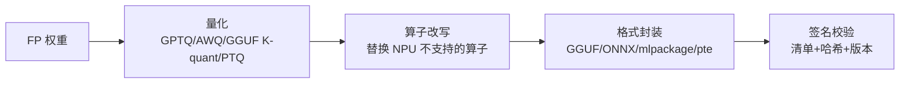

# 5. 核心模块：格式、运行时、调度、内存与路由

> 一句话理解：端侧推理系统由五个核心模块拼成——**模型打包器**决定模型长什么样，**运行时**决定模型怎么跑，**异构调度器**决定算子去哪跑，**内存管理器**决定能跑多久，**端云路由器**决定要不要本地跑。

## 5.1 模型打包器：从训练产物到设备可装的包

打包管线的输入是训练/蒸馏出的稠密权重，输出是签名过的模型包，中间四个动作：



每个动作的端侧特有考量：

- **量化**：端侧 NPU 的甜点区是 INT8/INT4 权重量化 + INT8/FP16 激活。与数据中心不同，端侧几乎不接受 W4A16 之外的「激活也 4bit」激进方案（NPU 支持矩阵窄），也不追求 FP8/FP4（端侧 NPU 普遍没有 FP8 矩阵单元）。格式细节与误差分析见模型量化主题，本章只关心「格式 + kernel 契约」。
- **算子改写**：pre-norm 化、算子融合（QKV 合并、gate-up 合并）、rope 表预生成、 attention mask 静态化——一切为了在目标 delegate 的算子覆盖集内闭合。
- **封装**：元数据必须自带分词器、特殊 token、rope base、GQA 形状等——端侧没有「服务端配置」可以补。
- **签名**：应用商店与供应链要求可验证来源；llama.cpp 社区靠哈希清单，商业产品走代码签名。

## 5.2 运行时：六大玩家的能力矩阵

| 运行时 | 维护方 | 原生格式 | 硬件后端 | 量化侧重 | 端侧典型场景 |
|---|---|---|---|---|---|
| llama.cpp | 社区（Georgi Gerganov） | GGUF | CPU SIMD / Metal / CUDA / Vulkan / QNN 等 | K-quant（Q4_K_M 等） | 跨平台 App、边缘盒子、快速集成 |
| MLX | Apple（ml-explore） | safetensors / 自研 | Apple Silicon GPU/CPU（统一内存） | 4/8bit 权重量化，懒加载 | Mac/iPad 原生、研究原型 |
| ExecuTorch | Meta / PyTorch | .pte | XNNPACK、QNN、Core ML、Vulkan、CMSIS-NN | QAT 导出、8bit | Meta 系 App、Android/iOS 正式产品 |
| ONNX Runtime | Microsoft | ONNX | QNN / NNAPI / CoreML / XNNPACK EP | ONNX 量化工具链 | 跨平台 SDK、已有 ONNX 资产复用 |
| Core ML | Apple | .mlpackage | ANE / GPU / CPU | palettization（查找表）、8bit | 全 Apple 平台系统级集成 |
| MLC LLM | 社区（Apache TVM） | TVM 编译产物 | Metal / Vulkan / WebGPU / CUDA | 编译期量化编排 | 浏览器 WebGPU、极限性能移动端 |

版本锚点（截至 2026-10，一手来源）：llama.cpp **v0.7.0**（2026-10-15）；ExecuTorch **v1.5.1**（2026-09-23，QNN 线新增 Gemma 4 支持，CMSIS-NN 升至 v8.0.0）；ONNX Runtime **v1.31.0**（2026-10-09）；MLX **v0.32.4**（2026-10-14）；coremltools 最新稳定 **9.x**（Apple 官方 GitHub）。MLC LLM 基于 Apache TVM 编译栈，近年版本节奏放缓，生产选型需评估维护风险。

### 运行时的三个内部共性

1. **静态 shape 纪律**（见 3.2 节）：KV 池预分配、shape 编译期固化；
2. **紧 decode 循环**：单函数无分配热循环，采样（温度/top-p）内联；
3. **后端抽象**：统一 tensor 描述 + backend vtable，与 ggml 的 `ggml_backend`、ExecuTorch 的 delegate API 同构。

## 5.3 异构调度器：能力表驱动的放置算法

调度器的最小实现（与 Mini Demo 场景 3 同构）：

```text
输入: 计算图 G = [op_1..op_n]，设备表 D = {NPU, GPU, CPU}
for op in G:
    t(op, d) = max(op.flops / d.rate, op.bytes / d.bw)   # roofline 下界
    d* = argmin_{d: op.kind ∈ d.supported} t(op, d)       # 可用设备中最快
    if preferred 支持且 t(op, preferred) ≤ 1.5 × t(op, d*):
        放 preferred                                   # 容忍 1.5x 避免乒乓
    else:
        放 d*，记录回退，计传输税 = op.bytes / fabric_bw
约束检查: Σ 传输税 / 总时延 ≤ 预算（如 15%），超预算报警
```

工程上的三个增强：**算子融合**（把回退算子打包成一次搬运）、**并发重叠**（GPU 算 norm 时 NPU 预取下一 gemm 权重）、**缓存放置决策**（同 shape 的层只算一次）。

## 5.4 内存管理器：KV 预算与加载策略

### KV 容量规划（Demo 场景 2 的公式化）

```text
KV 每 token = 2 × 层数 × KV头数 × head_dim × 每值字节
最大上下文 = (总内存 - OS保留 - 权重占用) ÷ KV 每 token
```

8 GiB 手机、8B 模型 Q4_K_M（4.83 GiB）、保留 0.8 GiB：KV 预算 2.37 GiB。GQA（8 KV 头）下三档：FP16 KV 131072 B/token → **19,431 token**；INT8 KV → **38,863**；INT4 KV → **77,726**。可见「端侧长上下文」本质是内存会计问题——把 KV 头数砍到 8（GQA）比把模型砍半更有效。

### 加载策略三选（Demo 场景 4）

| 策略 | 首访时延 | 内存占用 | 适用 |
|---|---|---|---|
| 全量预载（mlock） | 0.076 s（5.18 GB @ 68 GB/s） | 全量常驻 | 单一模型、热路径 |
| mmap + 预取窗口 | 0.323 s | 按需增长 | 多模型、内存紧张 |
| mmap + 热子集（30% 页） | 0.097 s | 工作集级 | 稀疏激活大模型 |

## 5.5 端云路由器：决策表与灰度

路由器的生产实现 = Demo 场景 6 的决策函数 + 三个补丁：

1. **指纹缓存**：按（模型能力、隐私级、输入长度桶、网络状态）缓存决策，避免每次请求都跑完整估时；
2. **灰度旋钮**：按用户/请求比例在端云间双跑，对比质量与延迟，逐步调大端侧流量；
3. **反馈闭环**：实测端侧 tok/s 与温度回流，修正估时模型里的兑现率与降额系数——路由器的精度取决于遥测质量。

## 5.6 投机解码控制器

端侧投机与云端的两点差异：draft 模型可以用 GPU/CPU 跑（错开 NPU 的带宽竞争），以及接受率受领域影响大（闲聊 α 可到 0.8+，代码/数学骤降到 0.5 以下）。控制器按会话滑动窗口估计 α，动态开关投机与选择 γ（Demo 的 `best_gamma`：draft 便宜时 γ 取大，贵时取小）。llama.cpp v0.7.0 已内置 LiliCorr 与 GLM5-Next MTP 支持，说明「投机解码标配化」在端侧已是事实。

## 5.7 模块间接口契约

| 生产者 → 消费者 | 契约 | 违约后果 |
|---|---|---|
| 打包器 → 运行时 | 算子覆盖清单 + 量化格式说明 | 运行时回退或拒载 |
| 运行时 → 调度器 | 图 shape 与算子类型标注 | 放置错误、传输税超支 |
| 调度器 → 内存管理器 | 每步峰值内存曲线 | OOM |
| 内存管理器 → 路由器 | 容量水位与 KV 余量 | 误判可行性、会话中断 |
| 热监控 → 全部 | 降额系数 | 估时失真、SLO 违约 |

## 5.8 本章小结

五个模块一句话：打包器把模型压进格式，运行时用静态纪律执行它，调度器在三种芯片间分配它，内存管理器守住容量红线，路由器决定它该不该在本地跑。第 6 章落到具体生态与源码视角。
