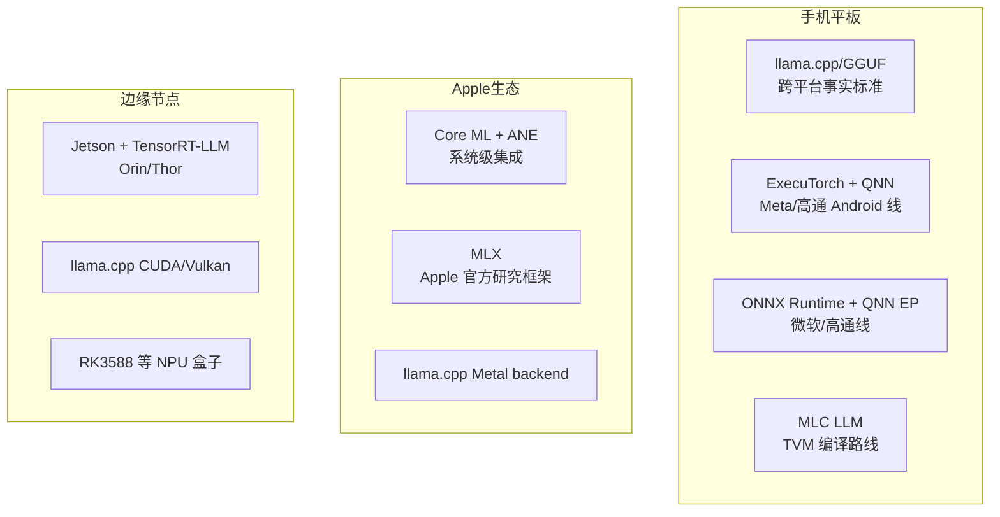
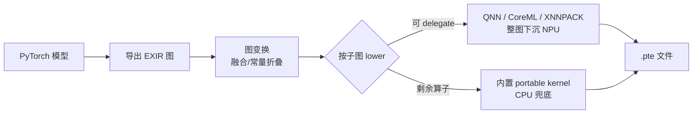
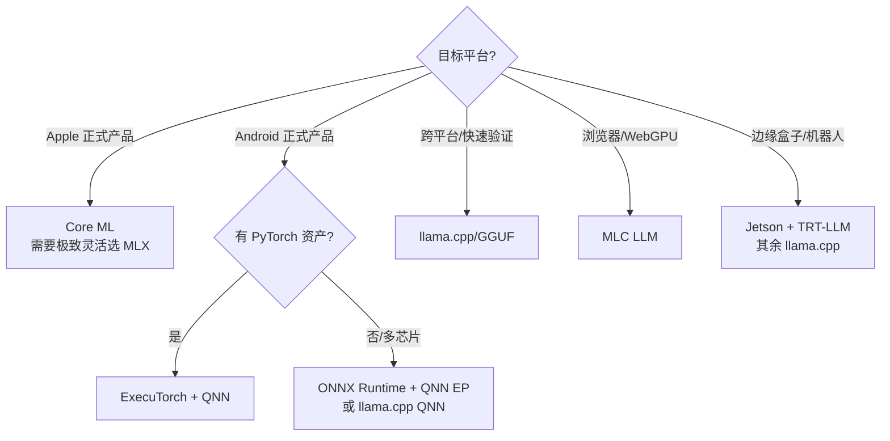

# 6. 生态与源码分析：六大运行时与边缘节点

> 一句话理解：端侧运行时生态呈「一超多强」格局——llama.cpp 以 GGUF 成为社区事实标准，MLX/Core ML 锁死 Apple 最优解，ExecuTorch 与 ONNX Runtime + QNN 分食 Android 正式产品，MLC 守住编译器极客路线；边缘节点则由 Jetson 一极独大。

## 6.1 格局总览

## 6.2 llama.cpp / GGUF：社区事实标准

**源码视角的三个支柱**：

1. **ggml 张量库 + backend 抽象**：计算图以 `ggml_tensor`/`ggml_cgraph` 描述，后端通过 `ggml_backend` 接口注册（CPU SIMD、Metal、CUDA、Vulkan、SYCL、QNN 等 10+ 个）。同一份图在编译期选 backend，运行时按 buffer 类型分派——这是「算子级分派」模式的范本。
2. **GGUF 加载器**：单文件内嵌权重 + 元数据（分词器、rope 参数、GQA 形状），mmap 直接映射，`no_alloc` 模式下权重页零拷贝驻留闪存/页缓存——第 2 章流式加载思想的原生实现。
3. **紧 decode 循环 + 投机**：`llama_decode` 单步热循环无动态分配；`--model-draft` 投机解码与 v0.7.0 新增的 LiliCorr、GLM5-Next MTP 支持，让「小模型猜 + 大模型验」成为一键能力。

**适配哲学**：追求「能在任何硬件跑起来」的通用性，用后端插件吸收碎片化。代价是极致性能要靠各后端自己卷。

## 6.3 MLX 与 Core ML：Apple 生态的双子星

**MLX**（v0.32.4，2026-10-14）是 Apple 官方的研究/部署框架，核心设计是把「统一内存」用到极致：GPU/CPU 共享同一物理内存，张量 `lazy evaluation` + 按需物化，数组操作 NumPy 风格。对端侧 LLM 的意义：Mac/iPad 上 8B 模型可以「内存映射 + GPU 直接读」零拷贝推理，KV cache 增长不触发复制。

**Core ML**（coremltools 9.x）是正式产品路线：模型编译为 .mlpackage，由系统自动在 ANE/GPU/CPU 间选择（或按算子拆分）。ANE 的约束塑造了它的风格——偏好静态 shape、查表式 palettization 量化、整图 lower；Transformer 架构从 iOS 17 起有原生 `scaled_dot_product_attention` 算子。ExecuTorch v1.5.1 的 Core ML delegate 也把这条线作为 Apple 平台的落地通道。

两者分工：**MLX 适合研究与快速产品验证，Core ML 适合上架的正式 App**。

## 6.4 ExecuTorch：PyTorch 的官方端侧出口

架构是「导出 → 变换 → lower → delegate」的编译器管线：

v1.5.1（2026-09-23）的三个信号值得注意：QNN 线支持了 Gemma 4 与量化感知蒸馏（QNN 已能承载正式 LLM 产品）；Core ML 线补齐了 ETDump 性能分析与 SwiftPM 集成（Apple 工具链对接成熟）；XNNPACK 线加 BF16 全连接（低端 Android 芯片的 CPU 兜底在增强）。**ExecuTorch 是「Android 正式产品 + PyTorch 资产复用」的最短路径**。

## 6.5 ONNX Runtime + QNN EP：中立格式的企业路线

ORT 的 ExecutionProvider 插件机制让它天然适合「一套代码、多芯片分派」：移动端常见组合是 **QNN EP**（高通 NPU）+ **CoreML EP**（Apple）+ **XNNPACK EP**（通用 CPU）。v1.31.0（2026-10-09）维持季度节奏。适合已有 ONNX 资产（传统 CV/语音模型）的团队做统一推理层；纯 LLM 场景下它更像「兼容层」而非最优解。

## 6.6 MLC LLM / Apache TVM：编译器极客路线

MLC LLM 用 TVM 的 Unity 编译栈做整模型 AOT：算子调度、量化编排、内存规划全部编译期完成，产出物可直接跑在 Metal/Vulkan/WebGPU 上——**唯一一条「浏览器里跑 7B」的严肃路线**（WebGPU 后端）。代价是编译时间长、调试链路深、对新型号支持滞后。近年社区节奏放缓，新项目多转向 ExecuTorch 或 llama.cpp；但其在编译期内存规划上的思想（static memory planning）已被全行业吸收。

## 6.7 边缘节点：Jetson 一极与长尾硬件

| 平台 | 算力量级（官方标称） | 内存 | 典型场景 | 软件栈 |
|---|---|---|---|---|
| Jetson Orin Nano（Super 模式） | 67 TOPS | 8 GB | 入门机器人、视觉边缘 | JetPack 6.2.3 |
| Jetson AGX Orin | 275 TOPS | 64 GB | AMR、多路视频分析 | JetPack 6.2.3 / 7.2.1 |
| Jetson AGX Thor | PFLOPS 级（FP4 稀疏口径，随 SKU 而异） | 128 GB | 人形机器人 | JetPack 7.2.1 |
| 手机/平板 | 35-45 TOPS | 8-16 GB | 个人助理 | 见上文各运行时 |
| 廉价 NPU 盒子（RK3588 等） | 6-16 TOPS | 4-16 GB | 门禁、 cameras | 厂商 SDK / llama.cpp CPU |

边缘节点与手机的关键差异：**有风扇或较大散热体，功耗预算高一个数量级**——可以按峰值性能的 70-80% 规划，KV 预算也宽松（Orin 64 GB 可跑 70B Q4 + 32k 上下文）。Jetson + TensorRT-LLM 的组合在机器人圈接近事实标准；纯 CPU 长尾盒子则由 llama.cpp 的 SIMD 后端通吃。

## 6.8 选型决策树

## 6.9 本章小结

生态选型的本质是**约束匹配**：Apple 平台吃系统红利（Core ML/MLX），高通 Android 吃 NPU 红利（QNN 双通道），跨平台吃社区红利（llama.cpp），浏览器吃编译红利（MLC）。没有全优解，只有与你的产品形态、团队资产、目标芯片最匹配的那条路径。
