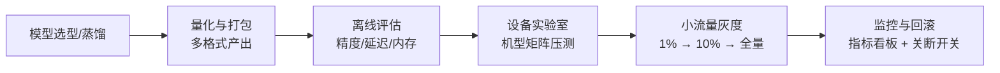

# 8. 企业生产实践：从能跑到敢上线

> 一句话理解：端侧模型上线的门槛不在「跑通」，而在「敢放量」——准入门槛、热节流压测、端云灰度、OOM 治理与观测体系，五道关每一道都有各自的通过标准。

## 8.1 生产流水线总览

## 8.2 模型准入门槛

上线前为每个目标机型设定硬门槛（示例值，按产品形态调整）：

| 指标 | 门槛示例 | 测量条件 |
|---|---|---|
| 稳态 decode 吞吐 | ≥ 8 tok/s（手机）/ ≥ 25 tok/s（AI PC） | 预热后连续 60 s，45°C 环境箱 |
| 首 token 时延 | ≤ 800 ms（prompt ≤ 1k） | 热启动、前台进程 |
| 峰值内存 | 权重 + KV 上限 + 20% 余量 ≤ 可用内存 | 最长上下文 + 最长输出 |
| 精度 | 相对云端基线，任务指标掉点 ≤ 2% | 业务评测集 + LLM-judge |
| 功耗 | 连续推理平均 ≤ 2.5 W（手机 SoC 口径） | 稳态功率计 |

两个常见误区：用冷启动数字报首 token（用户实际遇到的是热启动）；用 25°C 实验室数字外推夏天车内（热节流的输入是环境温度，不只是芯片温度）。

## 8.3 机型矩阵与热节流压测

Android 碎片化是端侧特有的测试矩阵地狱。实践做法：

1. **分层抽样**：芯片平台（骁龙 8 系/7 系、天玑 9/8 系、Exynos、Tensor）× 内存档位（8/12/16 GB）× 系统版本，选出 20-50 台代表机；
2. **热箱测试**：35°C/45°C 环境箱 + 太阳灯直射场景，跑 30 分钟连续对话脚本，记录 tok/s 随时间衰减曲线——准入看「60 秒稳态」和「30 分钟准稳态」两个点；
3. **降级预案**：每台机型预注册降档配置（更低位宽、更短默认上下文、关投机解码），运行时按机型 ID 选择。

## 8.4 端云灰度策略

端云灰度比云端灰度慢一个数量级（应用商店审核 + 用户更新滞后），因此策略要更保守：

| 阶段 | 流量 | 通过标准 | 回滚手段 |
|---|---|---|---|
| 实验室 | 内部设备 | 准入门槛全过 | 无需 |
| 种子 | 1% 用户，可回退版本 | 崩溃率 < 0.1%，端侧成功率 > 95% | 远程配置切回云端 |
| 扩量 | 10% → 50% | 负面反馈率不高于云端组，会话完成率不降 | 远程配置 |
| 全量 | 100% | 云端成本下降达预期 | 按机型粒度回滚 |

**关键设计：一切端侧决策都要可远程覆写**。路由比例、端侧开关、降级配置全部走远程配置中心，且默认值要求「云端可用」——端侧挂了用户无感知。

## 8.5 OOM 与内存治理

端侧 OOM 不可恢复（进程被杀），治理思路从「避免」升级为「结构上不可能」：

- **预算前置**：KV 池与激活缓冲在会话建立时一次分配，推理循环零分配；
- **水位线**：可用内存低于阈值（如 500 MB）时拒新会话、提示清理后台，而不是硬撑到 OOM；
- **上下文护栏**：按剩余 KV 预算动态收紧 max_context，优先级：系统提示词 > 历史摘要 > 远史原文；
- **换出策略**：mmap 权重页天然可被内核回收（对比 mlock 的取舍，见 5.4 节）；KV 页在非活跃会话间 swap 到闪存的方案存在但延迟抖动大，慎用。

## 8.6 观测体系

端侧遥测要在「看得清」与「省得动」之间取平衡——采样上报 + 端上聚合：

| 指标 | 粒度 | 用途 |
|---|---|---|
| 首 token / 稳态 tok/s | 按机型 × 场景分桶 | 准入回归、灰度通过标准 |
| 端侧成功率 / 回退率 / 崩溃率 | 按版本 × 机型 | 放量决策、回滚触发 |
| 热节流发生时长占比 | 按机型 × 环境温度 | 降级配置选择 |
| 路由决策分布 | 按隐私级 × 输入长度桶 | 隐私合规审计、成本核算 |
| 端云质量对比（双跑样本） | 抽样 | 量化掉点是否可感知 |

隐私红线：遥测本身也要过隐私账——指标聚合在端上完成，上传禁止携带 prompt 内容；路由日志只记决策与原因码。

## 8.7 三个真实形态的案例要点

**手机助手（类 Apple Intelligence）**：双模型策略（小模型常驻端侧处理高频短请求，大请求上私有云）；mmap 常驻 + mlock 小模型；热监控直接驱动 UI（降额时主动提示「正在省电模式」）。

**车载座舱**：散热好、供电足，按持续性能 80% 规划；多路并发（导航 + 语音 + 娱乐）要求推理可中断、优先级可抢占；离线是硬需求（隧道/地库）。

**AR 眼镜**：1-3 W 功耗预算是最紧约束，被迫「眼镜端听写+手机端推理+眼镜端显示」的分布式架构；眼镜端只跑 tiny 模型（ASR 唤醒、VAD），大模型放手机或云——这是端侧推理的「联邦形态」，对蓝牙/Wi-Fi 链路的时延预算提出第 2 章之外的新账。

## 8.8 本章小结

上线五道关：准入门槛（数字说话）、机型矩阵（热箱压测）、灰度放量（远程可回滚）、内存治理（结构上防 OOM）、观测体系（聚合遥测）。端侧系统的生产成熟度，最终体现在「任何一个环节出问题，用户都无感知」。
