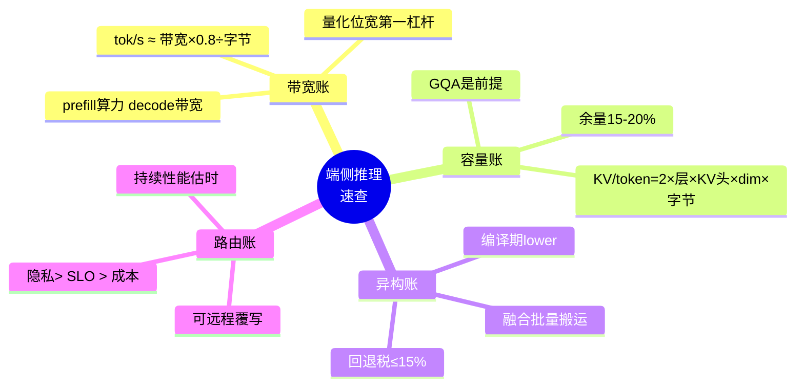

# 9. 最佳实践：清单与反模式

> 一句话理解：端侧推理的最佳实践大多是一条公式的变形——「每 token 字节数 × 搬运次数 ≤ 带宽 × 时延预算」；本章把它展开成可勾选的清单与要避开的反模式。

## 9.1 容量规划清单

```text
□ 1. 选目标模型时先算带宽账：tok/s 上限 = 带宽 × 0.8 ÷ 权重量化字节
□ 2. 选权重量化位宽：端侧甜点区 Q4_K_M 类混合量化（等效 4.5-4.8 bit），
     低于 Q3 需逐任务验证精度，W4A16 优先于 W4A4（激活位宽保 16）
□ 3. 确认 GQA：KV 头数 ≤ 8 是端侧长上下文前提，新选型避免 MHA 老模型
□ 4. 算 KV 预算：最大上下文 = (内存 - OS保留 - 权重) ÷ KV每token，
     按业务 95 分位上下文长度倒推所需 KV 量化档（FP16/INT8/INT4）
□ 5. 留 15-20% 内存余量给激活、页缓存与系统抖动
```

## 9.2 运行时与格式清单

| 决策点 | 推荐 | 理由 |
|---|---|---|
| 跨平台快速验证 | llama.cpp + GGUF | 生态最大、后端最全、迭代最快 |
| Apple 正式上架 | Core ML（.mlpackage） | ANE 红利 + 系统级集成 |
| Mac/iPad 研究原型 | MLX | 统一内存原生设计 |
| Android 正式产品 | ExecuTorch + QNN 或 ORT + QNN EP | NPU 覆盖率与官方支持 |
| 已有 ONNX 资产 | ORT 多 EP 组合 | 一套代码多芯片 |
| 浏览器场景 | MLC/WebGPU | 唯一严肃路线 |

```text
□ 6. 格式双轨收敛：社区/开发者走 GGUF，正式产品走平台原生格式，
     避免维护三条以上打包管线
□ 7. 打包时内嵌完整元数据（分词器、rope 参数、GQA 形状、算子覆盖清单）
□ 8. 模型包必须签名 + 哈希清单，加载失败拒绝运行而非降级
```

## 9.3 性能优化清单

```text
□ 9. 默认 mmap 懒加载 + 合理预取窗口；热路径小模型 mlock
□ 10. prefill 与 decode 分开优化：prefill 吃 NPU INT8 算力，
     decode 压每 token 字节（量化 > 投机解码 > MoE 稀疏）
□ 11. 投机解码按会话实测接受率动态开关；α < 0.6 的领域直接关掉
□ 12. 算子回退税设预算（≤15%），超预算回编译期解决（图融合/改写算子），
      不在运行时硬扛
□ 13. 系统提示词/RAG 前缀 KV 预热缓存，多轮对话只增量 prefill
□ 14. 采样循环零分配；会话级内存一次分配、复用到底
```

## 9.4 端云协同清单

```text
□ 15. 隐私分级先于性能求值：默认从严，用户可显式放宽
□ 16. 路由决策可远程覆写，且默认配置必须云端可用（端侧挂=无感知降级）
□ 17. 估时模型用持续性能数字（峰值 × 0.6-0.7），并按遥测回流修正
□ 18. 两端都不满足 SLO 时显式降级（缩短输出/模板回复），禁止静默超时
□ 19. 端云双跑抽样对比质量，量化掉点 > 2% 的领域回退云端
```

## 9.5 反模式清单

| 反模式 | 后果 | 正确姿势 |
|---|---|---|
| 用 datasheet TOPS 做容量规划 | 上线即热节流，长对话后半段超时 | 用稳态数字，热箱验证 |
| FP16 权重直端侧 | 装不下或 tok/s 个位数 | 至少 Q4 起步 |
| 冷启动数字报首 token | 预期管理崩坏 | 报热启动 + p95 |
| 每个回退算子单独搬运 | 传输税失控 | 融合 + 批量搬运 |
| mlock 一切 | KV 预算被挤占 | 只锁热路径小模型 |
| 隐私让位于延迟悄悄上云 | 合规事故 | 硬约束 + 审计日志 |
| 端侧失败静默重试 | 用户面对无限转圈 | 显式降级 + 可解释提示 |
| 单一机型通过即全量 | 低端机集中崩溃 | 机型矩阵 + 分级降档 |

## 9.6 一页纸速查



## 9.7 本章小结

清单的本质是把前三章的公式变成肌肉记忆：先带宽账选位宽，再容量账定上下文，异构账管回退，路由账守隐私；所有数字用稳态、所有决策可回滚。
