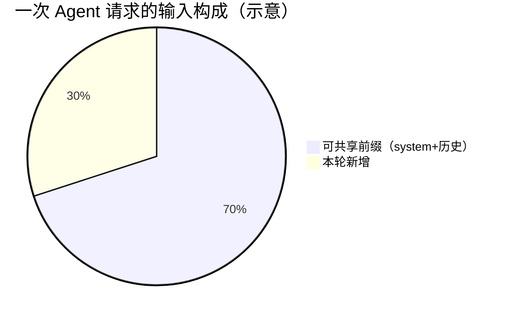
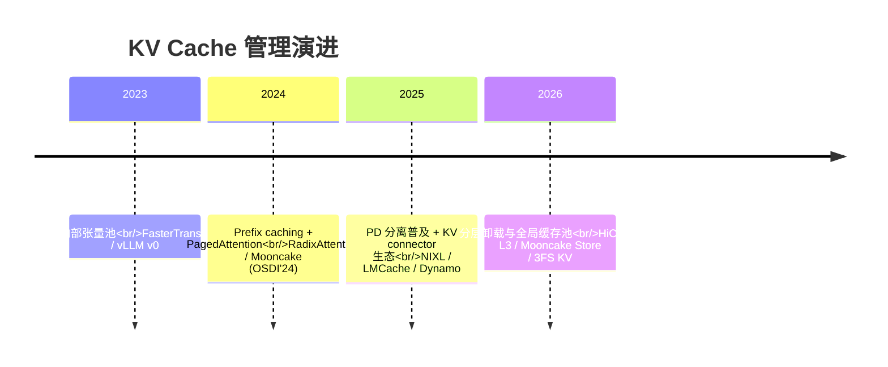

# 1. 背景：KV 为什么成为一种新的存储对象

> 一句话理解：Transformer 每生成一个 token 都要「回看」之前所有 token 的 Key/Value，这份历史状态（KV Cache）既**大**（动辄几十 GB）、又**贵**（算一遍要真金白银的 FLOPs）、还**可复用**（同样的前缀算一遍就够）——三个属性叠加，让 KV 从引擎内部状态升级为基础设施层的一等存储对象。

## 1.1 KV Cache 是什么

自回归生成的每一步，注意力层需要所有历史 token 的 K、V 向量。为了避免每步都重新计算历史，推理引擎把历史 token 的 K/V 张量缓存在显存里，这就是 KV Cache。

```text
第 t 步生成：
  query_t · K_1..t^T → attention → 预测 token t+1
                ↑
        K/V 来自 KV Cache（历史 token 的注意力状态）
```

没有 KV Cache，生成长度 N 的序列要做 O(N²) 的注意力计算；有了 KV Cache，每步只需 O(N) 的读取。KV Cache 是用显存换计算的标准时空权衡。

## 1.2 KV 有多大：一个公式算清楚

单个 token 在一层上的 KV 占用 = 2（K 和 V）× KV 头数 × 头维度 × 每元素字节数。整模型的每 token 占用：

```text
bytes_per_token = 2 × num_layers × num_kv_heads × head_dim × dtype_bytes
```

| 模型（示例配置） | 层数 | KV heads × head_dim | FP16 | FP8 | 128K 上下文（FP16） |
|---|---|---|---|---|---|
| Llama-3.1-70B 类（GQA） | 80 | 8 × 128 | 320 KiB/token | 160 KiB/token | 40 GiB |
| Qwen-32B 类（GQA） | 64 | 8 × 128 | 256 KiB/token | 128 KiB/token | 32 GiB |
| DeepSeek-V3 类（MLA，等效） | 61 | 低秩压缩 ≈ 576 dim | ~70 KiB/token | ~35 KiB/token | ~9 GiB |

几个直观结论：

- **KV 比权重更吃显存**：70B 模型权重 FP16 约 140 GB，但单条 128K 请求的 KV 就要 40 GB；batch 一放大，KV 池很快成为显存第一大户。
- **KV 随上下文线性膨胀**：这决定了「缓存容量规划」必须按 token 粒度做，而不是按请求条数。
- **架构演进的主线之一就是砍 KV**：MQA/GQA 把 KV heads 从 64 压到 8；DeepSeek 的 MLA 把 KV 压成低秩隐向量，等效每 token 只有几十 KB——**架构层压缩与基础设施层管理是同一问题的两面**。

## 1.3 KV 为什么「贵」：重复 prefill 的浪费

KV 的「贵」体现在 prefill 阶段。一次请求的 prefill 成本约正比于上下文长度，而生产负载中有大量**重复前缀**：

- **System prompt**：所有请求共享同一段指令（几十到几万 token）；
- **Agent 工作流**：规划-执行-反思多轮循环，每轮都带着完整历史；
- **RAG / few-shot**：检索结果、示例拼接进 prompt，多次查询共享底座；
- **多副本部署**：同一请求可能被路由到没有这份 KV 的实例，重算一遍。

典型互联网 agentic 负载中，可共享前缀占总输入 token 的比例可以达到 50%-90%。**前缀每复用一次，就省下一次对应长度的 prefill 计算**——这就是 KV Cache 管理的经济学基础。



## 1.4 从「引擎私有」到「基础设施对象」

2023 年以前，KV Cache 是推理引擎内部的一个张量池，生命周期绑定在进程内的一条请求上。2024 年起三个变化把它推到了引擎之外：

1. **Prefix caching 普及**（vLLM、SGLang RadixAttention）：KV 开始跨请求复用，需要管理「哪段 token 的 KV 还在、在哪」；
2. **PD 分离**（Mooncake、Dynamo）：prefill 与 decode 拆到不同 GPU 池，KV 必须在节点间搬运，催生了专门的传输层（Transfer Engine / NIXL）；
3. **分层卸载**（LMCache、HiCache、KV Block Manager）：GPU 放不下的 KV 下沉到 CPU、SSD 甚至对象存储，KV 具备了存储系统的全部属性——容量、带宽、逐出策略、持久化。



## 1.5 新问题域

KV 成为基础设施对象后，带来一组经典系统问题的新变体：

| 经典问题 | KV 版本 |
|---|---|
| 缓存替换策略 | block 粒度 LRU / LFU，prefix tree 逐出 |
| 缓存一致性 | 分布式 Store 中多副本 KV 的失效与逐出 |
| 负载均衡 | cache-aware 路由：命中率 vs 负载均衡的权衡 |
| 存储分层 | GPU→CPU→SSD→对象存储的降级与提升 |
| 数据传输 | RDMA 直传、多流聚合、流水线重叠 |
| 容量规划 | 每 token 字节数 × 并发 × 上下文的显存预算 |

这些正是本主题后续章节逐一展开的内容。

## 小结

- KV Cache = 2 × 层数 × KV heads × head_dim × 字节数/token，128K 上下文单条可达 40 GiB 级。
- 生产负载存在大量可共享前缀，复用一次省一次 prefill——这是 KV 经济学的全部来源。
- Prefix caching、PD 分离、分层卸载三件事，把 KV 从引擎私有状态变成了跨进程、跨节点、跨介质的基础设施对象。
