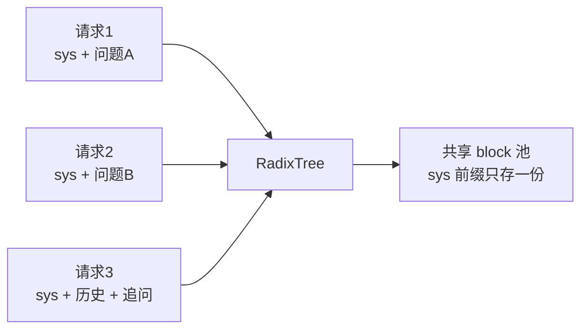
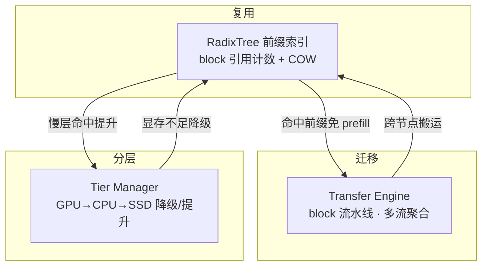

# 2. 核心思想：复用、迁移、分层

> 一句话理解：KV Cache 管理的全部技巧可以归纳为三个动词——**能复用的不重复算（复用），能搬走的不占显存（迁移），能下沉的不挤 GPU（分层）**；每个动词背后都是一个明确的成本权衡。

## 2.1 复用（Sharing）：一次 prefill，多次收益

复用回答的问题：**这段 token 的 KV 已经算过了吗？**

实现复用需要三件套：

1. **块化（Paging）**：把 KV 切成固定大小的 block（如 vLLM 的 16 token/block），block 成为复用与调度的最小单元；
2. **内容寻址**：按 token 内容哈希 block，相同前缀必然得到相同哈希，命中即复用；
3. **前缀索引**：用 radix tree（Patricia trie）维护「token 序列 → block 链」的映射，支持任意两条请求的公共前缀匹配。



复用率的两个放大器：

- **请求内**：多轮对话把历史轮次留在缓存里，第 N 轮只 prefill 新增的追问；
- **请求间**：Gateway 做 cache-aware 路由，把请求尽量发到「已经持有其前缀 KV」的实例上——复用率从单机问题变成集群调度问题。

## 2.2 迁移（Migration）：让 KV 去找算力

迁移回答的问题：**这段 KV 应该放在哪个算力单元旁边？**

两个典型场景：

**场景一：PD 分离。** Prefill 是计算密集（compute-bound），Decode 是显存带宽密集（memory-bandwidth-bound），两者混布互相干扰。拆开后 KV 必须从 prefill 节点搬到 decode 节点：

```text
prefill 节点算完前缀 KV ──按 block 流水线──▶ decode 节点消费产出首 token
     （计算密集）          RDMA / NVLink        （带宽密集）
```

关键洞察：**decode 不需要等全部 KV 到齐**。block 按 token 顺序消费，只要第一个 block 到了就能开始出 token——传输与 decode 可以流水线重叠，把 TTFT 从「全量传输时间」压到「单 block 传输时间 + 首 block 解码时间」。Mooncake 的 Transfer Engine、NVIDIA 的 NIXL 就是为这条链路生的。

**场景二：弹性与亲和。** 请求扩容、实例故障恢复、副本迁移时，已缓存的 KV 比权重更有搬迁价值——40 GB 的 KV 重算要分钟级，搬运只要秒级。

## 2.3 分层（Tiering）：用容量换显存

分层回答的问题：**GPU 放不下的 KV，往哪里沉？**

```text
        越往上：越快、越贵、越小
  GPU HBM   ████   纳秒级，TB/s 级带宽
  CPU DRAM  ████████  百纳秒级，~数百 GB/s
  本地 SSD  ██████████████  微秒级，~数 GB/s（每盘）
  远端存储  ██████████████████████  毫秒级，取决于网络
        越往下：越慢、越便宜、越大
```

分层的经济学是一个不等式：

```text
慢层命中收益 = prefill_cost_per_block（省下的计算）
慢层命中成本 = read_cost(慢层) + write_cost(快层)（搬上来）

当且仅当 收益 > 成本，分层缓存才是赚的。
```

由于 prefill 一个 block 的成本通常在毫秒~数十毫秒级，而 CPU/SSD 的读取在微秒~毫秒级，**命中几乎总是赚的**——前提是命中。所以分层策略的重心不在「搬不搬」，而在「什么数据值得留在哪一层」（替换策略）与「如何提升慢层命中率」（路由亲和 + 全局索引）。

## 2.4 三个思想如何组合



三者是递归关系：复用产生「哪些 KV 值得保留」的需求，分层回答「保留在哪里」，迁移回答「怎么把它送到用的地方」。所有生产系统（Mooncake、Dynamo、HiCache、LMCache）都是这个三角的具体实现。

## 2.5 成本模型的统一视角

把三个思想放进同一个账本，一次请求的耗时可以写成：

```text
TTFT = 路由与排队
     + max(未命中前缀的 prefill 时间, 该等来的 KV 传输时间)
     + 首 block 解码时间
```

- 复用 ↑ 减少「未命中前缀长度」；
- 迁移调度 ↑ 减少「等 KV 的时间」；
- 分层 ↑ 提高「前缀在慢层也能命中」的概率，但以传输时间换 prefill 时间。

工程上的一切优化——更聪明的路由、更细粒度的流水线、更激进的量化——都是在挪这三项的相对大小。Mini Demo 的第 3、4 个场景会把这个模型跑成具体数字。

## 小结

- **复用**：块化 + 内容哈希 + radix tree，一次 prefill 多次收益，复用率靠路由亲和放大。
- **迁移**：PD 分离下按 block 流水线传输，TTFT 从「全量传输」压到「首 block 到达」。
- **分层**：收益（省 prefill）大于成本（搬运）就下沉；策略重心是替换与索引，而不是搬运本身。
